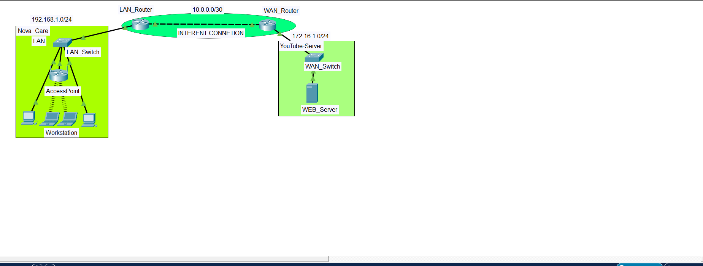

# Nova Care Packet Tracer Assignment

This folder contains the interpreted problem, the complete step-by-step solution, the original Packet Tracer file, and the physical topology image for the Nova Care network activity.

## Files

| File | Purpose |
|---|---|
| `Nova.pkt` | Original Cisco Packet Tracer activity file |
| `Nova_Physical_Topology.png` | Physical topology image used to interpret the task |
| `Nova_Network_Problem.md` | Problem interpretation and required outcomes |
| `Nova_Network_Solution.md` | Detailed step-by-step configuration and verification guide |

## Physical Topology

## Activity Summary

Nova Care has an internal LAN in `192.168.1.0/24`, a router-to-router WAN link in `10.0.0.0/30`, and a server-side network in `172.16.1.0/24`. The goal is to configure the routers, workstations, access point, and web server so LAN users can reach the remote web server.

The solution uses static routing and gives copy-friendly Cisco IOS commands. If the router interface names in Packet Tracer are different from the sample commands, run `show ip interface brief` and replace the interface names with the correct ones.
