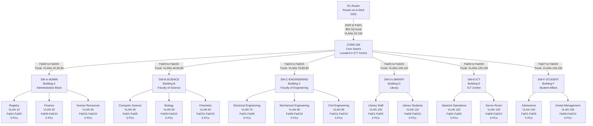

# Villa University Physical Topology

## Physical Design Overview

This physical topology shows how the Villa University campus network should be arranged in Cisco Packet Tracer.

The ICT Centre contains the central core switch. The router connects to the core switch using one trunk link for Router-on-a-Stick inter-VLAN routing. Each building has one access switch, and each access switch connects back to the core switch through a trunk link.

## Physical Topology Diagram

## Packet Tracer Placement Guide

Place the devices in this order:

1. Put `CORE-SW` in the center of the workspace.
2. Put `R1` above `CORE-SW`.
3. Put `SW-E-ICT` close to the core switch because the core switch is located inside the ICT Centre.
4. Put the other five building switches around the core switch.
5. Place each department's five PCs below its building switch.
6. Use clear labels for building names, department names, VLAN IDs, and network addresses.

## Physical Link Table

| Link | From Device | From Port | To Device | To Port | Link Type |
|---|---|---|---|---|---|
| Router trunk | R1 | G0/0 | CORE-SW | Fa0/1 | Trunk |
| Building A uplink | CORE-SW | Fa0/2 | SW-A-ADMIN | Fa0/24 | Trunk |
| Building B uplink | CORE-SW | Fa0/3 | SW-B-SCIENCE | Fa0/24 | Trunk |
| Building C uplink | CORE-SW | Fa0/4 | SW-C-ENGINEERING | Fa0/24 | Trunk |
| Building D uplink | CORE-SW | Fa0/5 | SW-D-LIBRARY | Fa0/24 | Trunk |
| Building E uplink | CORE-SW | Fa0/6 | SW-E-ICT | Fa0/24 | Trunk |
| Building F uplink | CORE-SW | Fa0/7 | SW-F-STUDENT | Fa0/24 | Trunk |

## Access Port Summary

| Building Switch | Department | VLAN | Access Ports |
|---|---|---:|---|
| SW-A-ADMIN | Registry | 10 | Fa0/1-Fa0/5 |
| SW-A-ADMIN | Finance | 20 | Fa0/6-Fa0/10 |
| SW-A-ADMIN | Human Resources | 30 | Fa0/11-Fa0/15 |
| SW-B-SCIENCE | Computer Science | 40 | Fa0/1-Fa0/5 |
| SW-B-SCIENCE | Biology | 50 | Fa0/6-Fa0/10 |
| SW-B-SCIENCE | Chemistry | 60 | Fa0/11-Fa0/15 |
| SW-C-ENGINEERING | Electrical Engineering | 70 | Fa0/1-Fa0/5 |
| SW-C-ENGINEERING | Mechanical Engineering | 80 | Fa0/6-Fa0/10 |
| SW-C-ENGINEERING | Civil Engineering | 90 | Fa0/11-Fa0/15 |
| SW-D-LIBRARY | Library Staff | 100 | Fa0/1-Fa0/5 |
| SW-D-LIBRARY | Library Students | 110 | Fa0/6-Fa0/10 |
| SW-E-ICT | Network Operations | 120 | Fa0/1-Fa0/5 |
| SW-E-ICT | Server Room | 130 | Fa0/6-Fa0/10 |
| SW-F-STUDENT | Admissions | 140 | Fa0/1-Fa0/5 |
| SW-F-STUDENT | Hostel Management | 150 | Fa0/6-Fa0/10 |

## What This Topology Proves

This topology proves that Villa University is using a campus design where all buildings connect to a central core switch. The access switches provide local building connectivity, the trunk links carry VLAN traffic across the campus, and the router provides inter-VLAN routing for communication between departments.

