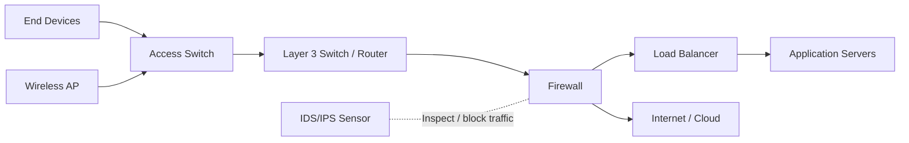

# LESSON 2: NETWORK DEVICES AND APPLIANCES

## TRAINING FOCUS

This lesson is part of the FEMTECT Network Engineering Foundation course. It is written to help students build strong networking fundamentals through clear explanations, real enterprise context, practical troubleshooting logic, and certification-aware technical depth.

## VISUAL DIAGRAM: DEVICE ROLES IN AN ENTERPRISE PATH



The diagram separates endpoint devices from infrastructure devices and shows where appliances normally appear in a real traffic path.


## DEFINITION AND TECHNICAL IN-DEPTH KNOWLEDGE

### 2.1 Network Devices and Appliances

Network devices and appliances are the physical, virtual, or cloud-based systems that allow a network to connect users, move data, enforce security, provide services, and maintain reliable communication. In Lesson 1, a network was defined as a controlled communication system made of devices, media, protocols, addressing, services, and security rules. Lesson 2 focuses on the devices and appliances that make that system work.

A network device is any hardware or virtual component that participates in network communication. Some devices are used by people directly, such as laptops, desktops, smartphones, printers, and IP phones. These are commonly called end devices or hosts. Other devices exist mainly to move or control traffic, such as switches, routers, wireless access points, firewalls, load balancers, proxy servers, and IDS/IPS systems. These are infrastructure devices or network appliances.

The difference between a general network device and a network appliance is mostly based on purpose. A network device may be any system connected to the network, while a network appliance is usually a specialized system designed to perform a specific network function. For example, a firewall appliance is built to inspect and filter traffic. A load balancer appliance is built to distribute client requests across multiple servers. A wireless LAN controller is built to manage many access points.

Network devices may be physical hardware, virtual machines, containers, or cloud-managed services. In older networks, most network functions were provided by dedicated physical devices. In modern enterprise and cloud environments, many functions can also be virtualized. A firewall may be a physical appliance in a server room, a virtual firewall in VMware, or a cloud firewall inside AWS, Azure, or Google Cloud. The function remains similar even when the form changes.

For CCNA and CompTIA Network+, students must understand what each device does, where it is normally placed, which OSI layer it mainly works at, how it affects traffic flow, and how it can fail. In real IT support and network engineering, knowing device roles helps technicians troubleshoot faster. If one user cannot connect, the issue may be an end device, NIC, cable, switch port, or IP configuration. If many users cannot reach the Internet, the issue may be a router, firewall, ISP link, DNS service, or upstream provider. If one web application is unavailable, the issue may be a server, load balancer, proxy, firewall rule, or DNS record.

### 2.2 Technical Importance: Network Devices Matter

Network devices matter because every packet must pass through a chain of hardware, software, and services before it reaches its destination. A user may think they are simply opening a website, but the traffic may pass through a laptop NIC, Wi-Fi access point, access switch, distribution switch, router, firewall, ISP modem, provider network, DNS resolver, load balancer, web server, and security inspection systems.

If any device in that path fails or is misconfigured, communication may break. A disabled laptop wireless adapter can stop one user. A failed access switch can stop one office area. A wrong router route can stop traffic between networks. A firewall rule can block an application. A failed load balancer can make multiple web servers appear unavailable. A bad transceiver can bring down a fiber uplink. This is why network engineers must understand device roles deeply, not just memorize names.

Network devices also matter because they define network performance and security. A low-quality switch may not handle business traffic properly. A firewall that is too small for the traffic volume can become a bottleneck. A wireless access point placed poorly can create weak signal and roaming problems. A router without redundancy can become a single point of failure. A server without monitoring can fail silently. A network without proper security appliances can expose the business to attacks.

In enterprise networking, device selection, placement, configuration, monitoring, and documentation are professional responsibilities. A good network is not only built from powerful equipment; it is built from the right equipment in the right place, configured for the right purpose, and monitored continuously.

## 2.3 END DEVICES

An end device is a device that users or applications use to send, receive, create, store, or consume data on a network. End devices are also called hosts when they have network addresses and participate in communication. Examples include desktop computers, laptops, smartphones, tablets, servers, printers, IP phones, CCTV cameras, barcode scanners, biometric devices, point-of-sale terminals, smart TVs, IoT sensors, and industrial controllers.

End devices are important because they are usually the source or destination of network traffic. When a user sends an email, the laptop is the source device. When a web server responds to a browser request, the server is the source of the response. When a printer receives a print job, the printer is the destination. Network infrastructure exists mainly to allow these end devices to communicate.

Technically, an end device needs a network interface, an IP address, a subnet mask or prefix length, a default gateway, DNS information, and working physical or wireless connectivity. If any of these are missing or incorrect, the device may not communicate properly. For example, a laptop with a wrong default gateway may reach local devices but fail to reach the Internet. A printer with a wrong IP address may disappear from users' computers. A phone connected to the wrong Wi-Fi SSID may be placed in the wrong network segment.

End devices may connect through wired Ethernet, Wi-Fi, cellular, Bluetooth, USB tethering, or specialized industrial media. In enterprise networks, most fixed devices such as desktops, printers, IP phones, and access points use wired Ethernet because it is stable and easier to control. Mobile devices such as laptops, tablets, and smartphones often use Wi-Fi because they require mobility.

Common End Device Examples

- Desktop computers.
- Laptops.
- Smartphones and tablets.
- Network printers.
- IP phones.
- CCTV cameras.
- Servers.
- Point-of-sale terminals.
- Barcode scanners.
- Biometric attendance devices.
- Industrial control systems.
- IoT sensors.

End Device Characteristics

- Usually the source or destination of network traffic.
- Requires a wired, wireless, or virtual network interface.
- Usually needs IP configuration.
- Often depends on DHCP, DNS, and default gateway settings.
- Can be affected by malware, user error, driver issues, and adapter problems.
- Common starting point for troubleshooting.

End Device Troubleshooting Clues

- If only one user is affected, start with the end device.
- Check whether the network adapter is enabled.
- Check whether the Ethernet cable or Wi-Fi connection is active.
- Run `ipconfig /all` on Windows to inspect IP settings.
- Test the default gateway with `ping`.
- Confirm whether the device is in the correct VLAN or SSID.
- Check whether security software or firewall settings are blocking traffic.

## 2.4 SERVERS

A server is a system that provides services, resources, or applications to other devices called clients. A server may be physical hardware, a virtual machine, a containerized workload, or a cloud service. Servers are central to client-server architecture, which was introduced in Lesson 1. In enterprise networks, servers provide authentication, file storage, databases, websites, email, DNS, DHCP, application hosting, monitoring, backup, directory services, security logging, and many other functions.

A server is not defined only by its hardware. It is defined by the service it provides. A powerful rack-mounted machine in a data center may be a server, but a small virtual machine running DNS can also be a server. A cloud-hosted database can also be a server from the client's perspective. The key idea is that clients request services and the server responds.

Technically, servers usually need stable IP addressing, strong hardware resources, reliable storage, backups, monitoring, security controls, and high availability. Many servers use static IP addresses or DHCP reservations because clients and network services must find them consistently. Critical servers may use redundant power supplies, RAID storage, multiple NICs, virtualization clusters, load balancing, and backup systems to reduce downtime.

Servers are often placed in data centers, server rooms, cloud environments, or protected network segments. They should not be treated like ordinary user computers. A compromised server can expose sensitive data or disrupt business operations. For example, if a domain controller fails, users may not be able to log in. If a DNS server fails, users may be unable to access websites by name. If a database server fails, business applications may stop working.

Common Server Types

- File server: stores and shares files.
- Web server: hosts websites and web applications.
- Database server: stores structured application data.
- Mail server: handles email sending and receiving.
- DNS server: translates names into IP addresses.
- DHCP server: assigns IP addresses and network settings.
- Authentication server: verifies user identity.
- Application server: runs business applications.
- Backup server: stores backup copies of data.
- Monitoring server: collects alerts, logs, and performance data.

Server Characteristics

- Provides services to clients.
- Usually requires reliable hardware or cloud infrastructure.
- Often uses static IP addressing or DHCP reservations.
- Must be secured, monitored, patched, and backed up.
- May be physical, virtual, containerized, or cloud-hosted.
- Can become a critical point of failure if not designed with redundancy.

Server Troubleshooting Clues

- If many users cannot access the same application, check the server or service.
- If users can ping a server but the application fails, check the application service or port.
- If users can access by IP but not by name, check DNS.
- If authentication fails for many users, check domain controllers or identity services.
- If performance is slow, check CPU, memory, disk, network utilization, and logs.

## 2.5 SWITCHES

A switch is a network device that connects devices within a local area network and forwards traffic intelligently. In Ethernet networks, switches receive Ethernet frames, learn MAC addresses, build a MAC address table, and forward frames out the correct port. Switches are the foundation of modern LANs because they allow many devices to communicate efficiently within the same local network or VLAN.

In Lesson 1, star topology was introduced as the most common LAN topology. The central device in a modern star topology is usually a switch. Each PC, printer, IP phone, access point, or server connects to a switch port. The switch then forwards traffic based on destination MAC addresses.

Technically, a switch mainly operates at Layer 2 of the OSI model, the Data Link layer. A Layer 2 switch understands MAC addresses and Ethernet frames. It does not normally route traffic between different IP networks. When traffic must move from one VLAN or subnet to another, a router or Layer 3 switch is required.

Switches improve performance compared to older shared media networks because each switch port is its own collision domain. Modern switches support full-duplex communication, meaning devices can send and receive at the same time. Switches may also support VLANs, trunking, Spanning Tree Protocol, EtherChannel, port security, Power over Ethernet, quality of service, and network monitoring features.

### Layer 2 Switch

A Layer 2 switch forwards Ethernet frames based on MAC addresses. It is used to connect devices within the same LAN or VLAN. Layer 2 switches are common at the access layer, where end devices connect to the network.

For example, if PC1 sends traffic to PC2 in the same VLAN, the switch checks its MAC address table and forwards the frame to the port where PC2 is connected. If the switch does not know the destination MAC address, it floods the frame out other ports in the same VLAN. Lesson 8 and Lesson 9 will explain Ethernet and switching in more detail.

Layer 2 Switch Characteristics

- Forwards frames using MAC addresses.
- Operates mainly at OSI Layer 2.
- Connects devices in the same LAN or VLAN.
- Builds and uses a MAC address table.
- Supports VLANs and trunk ports.
- Common at the access layer.

### Layer 3 Switch

A Layer 3 switch can perform switching and routing. It can forward frames within a VLAN like a Layer 2 switch, but it can also route traffic between VLANs or IP networks using Layer 3 interfaces or switch virtual interfaces. Layer 3 switches are common in enterprise distribution layers and collapsed core designs.

For example, a company may have separate VLANs for staff, voice, servers, and guest Wi-Fi. A Layer 3 switch can route traffic between the staff VLAN and server VLAN while blocking or controlling traffic from the guest VLAN based on policy.

Layer 3 switches are usually faster than traditional routers for internal campus routing because they are optimized for high-speed forwarding. However, routers are still widely used for WAN, internet edge, VPN, and advanced routing functions.

Layer 3 Switch Characteristics

- Performs Layer 2 switching and Layer 3 routing.
- Routes between VLANs using SVIs or routed ports.
- Common in distribution and collapsed core designs.
- Supports high-speed internal network routing.
- May support routing protocols such as OSPF.
- Often used for inter-VLAN routing in enterprise LANs.

Switch Troubleshooting Clues

- If one user is down, check the switch port, cable, VLAN, and port status.
- If many users on one switch are down, check switch power, uplink, and configuration.
- If users are in the wrong network, check VLAN assignment.
- If IP phones or APs do not power on, check PoE.
- If loops cause instability, check Spanning Tree and redundant links.
- If a fiber uplink is down, check transceivers and fiber patch cables.

## 2.6 ROUTERS

A router is a network device that connects different networks and forwards packets based on IP addresses. Routers operate mainly at Layer 3 of the OSI model, the Network layer. Their job is to decide where packets should go next so traffic can move from one network to another.

In a simple home network, the router connects the home LAN to the Internet. In an enterprise network, routers may connect branch offices, WAN links, internet circuits, cloud networks, data centers, and service provider networks. Routers use routing tables to make forwarding decisions. A routing table contains known networks, next-hop addresses, outgoing interfaces, and route preferences.

Technically, when a device wants to send traffic to another device outside its local network, it sends the traffic to its default gateway. The default gateway is usually a router or Layer 3 switch. The router then examines the destination IP address, checks the routing table, and forwards the packet toward the destination.

Routers may use static routes or dynamic routing protocols. Static routes are manually configured. Dynamic routing protocols allow routers to learn routes automatically from each other. Common routing protocols include OSPF, BGP, RIP, EIGRP, and IS-IS. Later lessons will explain static routing, default routes, OSPF, BGP overview, and route selection.

Routers also commonly perform NAT, VPN termination, WAN connectivity, quality of service, access control, and traffic path selection. At the internet edge, a router may connect the organization to an ISP. In some designs, the firewall may perform routing functions too, especially in smaller networks.

Router Characteristics

- Connects different IP networks.
- Operates mainly at OSI Layer 3.
- Forwards packets using destination IP addresses.
- Uses a routing table.
- Acts as a default gateway for end devices.
- Connects LANs, WANs, cloud networks, and the Internet.
- May support NAT, VPN, QoS, ACLs, and dynamic routing.

Router Troubleshooting Clues

- If local communication works but remote networks fail, check the gateway or router.
- If one network cannot reach another, check routes.
- If Internet access fails for everyone, check the edge router, firewall, ISP link, or default route.
- If a branch office cannot reach headquarters, check WAN interface status, routing, VPN, and provider circuit.
- If traffic takes the wrong path, check route preference, administrative distance, and longest-prefix match in later routing lessons.

Cisco IOS Basic Router Commands

```text
show ip interface brief
show ip route
show running-config
show interfaces
ping <destination>
traceroute <destination>
```

These commands help engineers verify interface status, IP addressing, routing table entries, configuration, and reachability.

## 2.7 WIRELESS ACCESS POINTS AND WLAN CONTROLLERS

A wireless access point, or AP, is a network device that allows wireless clients to connect to a wired network using Wi-Fi. The AP bridges wireless traffic from devices such as laptops, phones, tablets, scanners, and IoT devices into the wired LAN. Without an AP, wireless clients would not have a controlled entry point into the enterprise network.

An AP is not the same thing as Wi-Fi itself. Wi-Fi is the wireless technology based on IEEE 802.11 standards. The access point is the device that provides Wi-Fi access. In homes, the wireless router often combines a router, switch, firewall, DHCP server, and access point in one box. In enterprises, these functions are usually separated for better control, performance, and security.

Technically, access points transmit and receive radio frequency signals. They use frequency bands such as 2.4 GHz, 5 GHz, and 6 GHz. They advertise wireless networks using SSIDs. They apply security settings such as WPA2, WPA3, and enterprise authentication. They connect back to the wired network through Ethernet, often using Power over Ethernet so one cable provides both data and electrical power.

Wireless design is more complex than simply placing APs around a building. Engineers must consider signal strength, channel overlap, interference, client density, roaming, authentication, guest access, building materials, and bandwidth requirements. A poorly placed AP can cause weak coverage, slow speeds, or unstable connections.

### Autonomous Access Points

An autonomous access point is configured and managed individually. Each AP has its own configuration for SSIDs, security settings, channels, and management. This can work in small environments, but it becomes difficult when an organization has many APs.

### Lightweight Access Points and WLAN Controllers

A lightweight access point depends on a wireless LAN controller, or WLC, for centralized management. The WLC manages SSIDs, security policies, roaming behavior, radio settings, firmware, and monitoring across many APs. This is common in enterprise wireless networks because it provides consistency and easier administration.

Some modern wireless systems use cloud-managed controllers instead of an on-premises controller. The principle is similar: centralized control, monitoring, and configuration.

Access Point Characteristics

- Provides Wi-Fi access to wireless clients.
- Bridges wireless clients into the wired LAN.
- Uses 2.4 GHz, 5 GHz, and 6 GHz frequency bands.
- Advertises SSIDs.
- Supports encryption and authentication.
- Often uses PoE.
- Requires proper placement and channel planning.

WLAN Controller Characteristics

- Centrally manages multiple APs.
- Controls SSIDs, security, roaming, and radio settings.
- Simplifies enterprise wireless administration.
- Provides monitoring and troubleshooting information.
- May be physical, virtual, or cloud-managed.

Wireless Troubleshooting Clues

- If one device cannot connect, check credentials, adapter, signal, and client settings.
- If many users in one area have weak service, check AP placement, power, and interference.
- If users connect but cannot get IP addresses, check DHCP and VLAN mapping.
- If users connect to Wi-Fi but cannot reach internal systems, check SSID policy, firewall rules, and VLANs.
- If roaming is poor, check controller settings, AP overlap, and client behavior.

## 2.8 FIREWALLS

A firewall is a security device or software system that monitors, permits, denies, and sometimes modifies network traffic based on security rules. Firewalls are used to protect networks from unauthorized access, malicious traffic, policy violations, and uncontrolled communication. They are one of the most important security appliances in enterprise networks.

Firewalls may be placed at the internet edge, between internal network segments, between users and servers, between branch offices and headquarters, or inside cloud environments. A firewall can be physical hardware, a virtual appliance, a host-based firewall, or a cloud firewall service.

Technically, a firewall makes decisions based on traffic characteristics such as source IP address, destination IP address, protocol, source port, destination port, application, user identity, URL category, security zone, and threat signature. Older firewalls mainly filtered traffic using Layer 3 and Layer 4 information. Modern next-generation firewalls can inspect applications, users, content, malware, encrypted traffic metadata, and intrusion attempts.

Firewalls are essential, but they can also cause network problems if rules are wrong. If a firewall blocks DNS, users may not browse websites. If a firewall blocks TCP port 443, HTTPS sites may fail. If a firewall blocks traffic between VLANs, users may not reach servers. If NAT is misconfigured, internal users may fail to access the Internet. Good troubleshooting must include firewall policy review when basic connectivity works but applications fail.

Firewall Characteristics

- Filters traffic based on security rules.
- Can operate across multiple OSI layers.
- Protects networks from unauthorized access.
- Often sits at the internet edge or between security zones.
- May perform NAT, VPN, logging, and threat inspection.
- Can be physical, virtual, host-based, or cloud-based.

Firewall Examples

- Internet edge firewall.
- Data center firewall.
- Internal segmentation firewall.
- Windows Defender Firewall.
- Linux `iptables` or `nftables`.
- Cloud security groups and network firewalls.
- Next-generation firewall appliance.

Firewall Troubleshooting Clues

- If ping works but an application fails, check firewall ports and policies.
- If users cannot access the Internet, check NAT, security policies, and default route.
- If one VLAN cannot reach another, check inter-zone firewall rules.
- If VPN users cannot access internal resources, check VPN policies and routes.
- If logs show deny entries, match them to the user's traffic.

Cybersecurity Reminder

Firewalls reduce risk, but they do not make a network automatically secure. They must be combined with strong passwords, patching, endpoint protection, monitoring, segmentation, secure configuration, user training, and incident response.

## 2.9 IDS AND IPS

An Intrusion Detection System, or IDS, monitors network or host activity for suspicious behavior and alerts administrators when it detects possible attacks. An Intrusion Prevention System, or IPS, can detect suspicious traffic and actively block or prevent it. The main difference is that IDS detects and alerts, while IPS detects and takes action.

IDS and IPS technologies are important because firewalls alone may not identify all attack patterns. A firewall may allow traffic on TCP port 443 because HTTPS is required for business, but malicious activity can still travel inside allowed traffic. IDS/IPS systems inspect traffic patterns, signatures, anomalies, protocol behavior, and known attack indicators.

Technically, an IDS is often placed out-of-band, meaning it receives a copy of traffic through a SPAN port, TAP, or sensor feed. Because it sees a copy, it can alert but usually does not directly block the original traffic. An IPS is often placed inline, meaning traffic passes through it. Because it is in the traffic path, it can block malicious traffic before it reaches the target. However, an inline IPS must be carefully tuned because false positives can block legitimate business traffic.

IDS/IPS systems may be network-based or host-based. A network-based IDS/IPS monitors traffic crossing network links. A host-based IDS/IPS monitors activity on a specific server or endpoint.

IDS Characteristics

- Detects suspicious activity.
- Sends alerts to administrators or security systems.
- Usually does not block traffic directly.
- Often receives copied traffic.
- Useful for visibility and investigation.

IPS Characteristics

- Detects suspicious activity.
- Can block or drop malicious traffic.
- Often placed inline.
- Requires careful tuning.
- Can prevent attacks before they reach targets.

IDS/IPS Troubleshooting Clues

- If legitimate traffic suddenly fails, check IPS block logs.
- If alerts appear repeatedly, investigate source, destination, and signature.
- If performance drops, check inline inspection load.
- If no alerts appear, verify sensor placement and traffic visibility.
- If false positives occur, tune signatures carefully rather than disabling protection completely.

Exam Reminder

For Network+ and CCNA security topics, remember: IDS detects and alerts; IPS detects and prevents.

## 2.10 LOAD BALANCERS

A load balancer is a network appliance or service that distributes client requests across multiple servers. The purpose of load balancing is to improve availability, performance, scalability, and reliability. Instead of sending all users to one server, a load balancer spreads traffic across a group of servers called a server pool, backend pool, or farm.

For example, an organization may host an online portal on three web servers. Users do not connect directly to each individual server. They connect to one virtual IP address on the load balancer. The load balancer then forwards each request to one of the healthy backend servers. If one server fails, the load balancer can stop sending traffic to it and continue using the remaining servers.

Technically, load balancers can operate at different layers. A Layer 4 load balancer uses IP addresses and ports, such as TCP port 443 for HTTPS. A Layer 7 load balancer understands application-layer information, such as HTTP headers, URLs, cookies, and hostnames. Layer 7 load balancing allows more advanced decisions, such as sending `/api` requests to one server pool and `/images` requests to another.

Load balancers use health checks to determine whether backend servers are working. A health check may test whether a server responds to ping, TCP connection, HTTP request, or a specific application URL. Without health checks, a load balancer might continue sending users to a failed server.

Load Balancer Characteristics

- Distributes traffic across multiple servers.
- Improves availability and scalability.
- Uses a virtual IP address or frontend listener.
- Checks server health.
- Can operate at Layer 4 or Layer 7.
- May support SSL/TLS offloading.
- Common in data centers and cloud environments.

Load Balancer Troubleshooting Clues

- If all users cannot access an application, check the virtual IP and listener.
- If some users get errors, check backend server health.
- If HTTPS fails, check certificates and SSL/TLS settings.
- If one server is overloaded, check balancing method and persistence.
- If an application works directly on a server but not through the load balancer, check pool membership, NAT, and health checks.

Cloud Networking Reminder

Cloud platforms provide managed load balancers. AWS, Azure, and Google Cloud all offer load balancing services. Even though these are cloud services, the networking principles remain the same: frontend address, backend pool, health check, rules, and traffic distribution.

## 2.11 PROXY SERVERS AND CONTENT FILTERS

A proxy server is a system that acts as an intermediary between clients and external services. Instead of a client connecting directly to a destination, the client sends the request to the proxy, and the proxy forwards the request on behalf of the client. Proxies can provide filtering, logging, caching, access control, anonymity, malware scanning, and policy enforcement.

In enterprise networks, proxies are often used to control web access. For example, a company may block access to known malicious websites, gambling sites, adult content, unauthorized file-sharing sites, or high-risk categories. A school may use a content filter to protect students from inappropriate websites. A bank may use proxy logging to investigate which internal device accessed a suspicious domain.

Technically, proxies can operate explicitly or transparently. An explicit proxy requires the client or browser to be configured to use the proxy. A transparent proxy intercepts traffic without requiring manual client configuration. Some modern secure web gateways combine proxy, content filtering, malware scanning, data loss prevention, SSL inspection, and cloud access security features.

Content filters classify and control access based on URL, domain, category, reputation, keywords, file type, user identity, or policy. They are important for cybersecurity because many attacks begin when users click malicious links or visit compromised websites.

Proxy Characteristics

- Acts as an intermediary between client and destination.
- Can filter, log, cache, or inspect traffic.
- Often used for web access control.
- May be explicit or transparent.
- Can improve visibility and policy enforcement.
- May be physical, virtual, or cloud-based.

Content Filter Characteristics

- Blocks or allows content based on policy.
- Uses categories, reputation, keywords, or user identity.
- Helps reduce access to malicious or inappropriate sites.
- Common in schools, businesses, and regulated environments.
- May be part of a firewall, proxy, or secure web gateway.

Proxy and Content Filter Troubleshooting Clues

- If only websites fail but other services work, check proxy settings.
- If one category of websites is blocked, check content filter policy.
- If users get certificate warnings, check SSL inspection settings.
- If a browser works on one network but not another, check proxy auto-configuration.
- If cloud apps fail, check whether the proxy supports required URLs and ports.

## 2.12 NETWORK INTERFACE CARDS

A Network Interface Card, or NIC, is the hardware or virtual interface that allows a device to connect to a network. A NIC may be wired Ethernet, wireless Wi-Fi, fiber Ethernet, cellular, virtual, or specialized industrial networking hardware. Without a NIC, a device cannot send or receive network traffic.

Every NIC has a MAC address for Layer 2 communication. A wired Ethernet NIC connects through an RJ45 copper port or fiber interface. A wireless NIC connects through radio signals to an access point. A virtual NIC connects a virtual machine to a virtual switch inside a hypervisor or cloud environment.

Technically, the NIC handles the physical and data-link connection between the device and the network. It sends and receives frames, works with device drivers, negotiates speed and duplex on Ethernet links, and passes data between the operating system and the network medium.

NIC problems can cause serious connectivity issues. A bad driver can cause intermittent disconnections. A disabled NIC stops communication. A NIC forced to the wrong speed or duplex can cause poor performance. A damaged Ethernet port may show no link. A wireless NIC with old drivers may fail to connect to newer security standards.

NIC Characteristics

- Connects a device to the network.
- Has a MAC address.
- May be wired, wireless, fiber, cellular, or virtual.
- Depends on drivers and operating system support.
- Negotiates speed and duplex on Ethernet.
- Can be built-in, add-on, USB-based, or virtual.

NIC Troubleshooting Clues

- Check whether the adapter is enabled.
- Check link lights for wired connections.
- Check Wi-Fi signal and driver version for wireless connections.
- Check speed and duplex settings.
- Check Device Manager in Windows for driver errors.
- Use `ipconfig /all` to view adapter details.
- Replace cable or test another port before assuming the NIC is bad.

## 2.13 TRANSCEIVERS

A transceiver is a module that transmits and receives network signals. The word comes from transmitter and receiver. In networking, transceivers are commonly used in switches, routers, firewalls, and servers to connect fiber optic or copper links. Common pluggable transceiver types include SFP, SFP+, QSFP, QSFP+, QSFP28, and other form factors.

Transceivers are important because they allow network devices to support different media types, speeds, and distances. A switch may have empty SFP ports, and the engineer inserts the correct transceiver depending on the link requirement. For example, one transceiver may support 1 Gbps multimode fiber over a short distance, while another may support 10 Gbps single-mode fiber over a longer distance.

Technically, transceivers must match the required speed, fiber type, wavelength, connector type, and distance. A 1 Gbps SFP is different from a 10 Gbps SFP+. Multimode and single-mode optics are not interchangeable without proper design. Short-range optics are not used for long-distance links. Some vendors also restrict or warn against unsupported third-party transceivers.

Transceiver problems are common in enterprise troubleshooting. A fiber uplink may fail because of a wrong optic type, dirty connector, damaged fiber patch cord, mismatched speed, unsupported module, reversed transmit/receive strands, or power level problem. Engineers must learn to check both the module and the physical fiber path.

Common Transceiver Types

- SFP: commonly used for 1 Gbps links.
- SFP+: commonly used for 10 Gbps links.
- QSFP/QSFP+: commonly used for higher-speed links such as 40 Gbps.
- QSFP28: commonly used for 100 Gbps links.
- Copper SFP: supports Ethernet over copper in some cases.
- Fiber optic SFP: supports multimode or single-mode fiber.

Transceiver Characteristics

- Transmits and receives network signals.
- Commonly used for fiber uplinks.
- Must match speed, media, distance, and wavelength.
- Can be hot-swappable on many devices.
- Used in switches, routers, firewalls, and servers.
- Critical for uplinks, backbone links, and data center connections.

Transceiver Troubleshooting Clues

- Check whether both ends use compatible optics.
- Confirm single-mode vs. multimode fiber.
- Confirm supported speed.
- Check whether transmit and receive strands are reversed correctly.
- Inspect and clean fiber connectors.
- Check device logs for unsupported transceiver messages.
- Use interface commands to check link status and optical power if supported.

## 2.14 DEVICE PLACEMENT IN AN ENTERPRISE NETWORK

Network devices must be placed according to their function. Poor placement can create security gaps, performance problems, and troubleshooting confusion.

End devices usually connect at the access layer. Access switches connect user devices, printers, IP phones, cameras, and APs. Distribution switches aggregate access switches and may route between VLANs. Core switches provide high-speed backbone connectivity in larger networks. Routers connect different networks, WAN links, ISP circuits, cloud networks, or branch offices. Firewalls sit between security zones, especially between the internal network and the Internet. Wireless controllers manage APs. Load balancers sit in front of server farms or applications. Proxies and content filters sit in the path of web traffic or integrate with firewall and endpoint policies. IDS/IPS sensors are placed where they can inspect important traffic.

In a small business, many functions may be combined into fewer devices. A single appliance may act as router, firewall, VPN gateway, DHCP server, and wireless controller. In a large enterprise, those roles are separated for performance, redundancy, security, and manageability.

The professional skill is not only knowing the device name. The professional skill is knowing what the device is responsible for and what type of failure it can create.

## 2.15 REAL-WORLD TROUBLESHOOTING EXAMPLE

Scenario:

A department says, "The Internet is down."

A technician must not assume the whole Internet is down. The technician should identify which device or appliance in the path is failing.

If only one laptop is affected, the likely issue may be the end device, Wi-Fi adapter, Ethernet cable, NIC driver, IP settings, or local firewall. If everyone connected to one switch is affected, the likely issue may be the access switch, uplink, VLAN, power, or PoE. If all wired users work but wireless users fail, the likely issue may be the AP, WLC, SSID, wireless authentication, or DHCP mapping. If users can reach internal servers but not the Internet, the likely issue may be the default gateway, router, firewall, NAT, DNS, or ISP link. If one web application fails while other websites work, the issue may be the application server, load balancer, proxy, firewall rule, or DNS record.

This is why network device knowledge matters. Each device has a role, and each role creates specific troubleshooting questions.

## 3. KEY TERMS / GLOSSARY

| Term | Definition |
|---|---|
| End Device | A user or application device that sends or receives network traffic. |
| Host | An endpoint with a network address that participates in communication. |
| Server | A system that provides services or resources to clients. |
| Client | A device or application that requests services from a server. |
| Switch | A LAN device that forwards Ethernet frames using MAC addresses. |
| Layer 2 Switch | A switch that forwards frames based on MAC addresses. |
| Layer 3 Switch | A switch that can also route traffic between IP networks or VLANs. |
| Router | A device that connects different networks and forwards packets using IP addresses. |
| Access Point | A device that provides Wi-Fi access to wireless clients. |
| WLAN Controller | A system that centrally manages multiple wireless access points. |
| Firewall | A device or software system that filters traffic based on security rules. |
| IDS | Intrusion Detection System; detects suspicious activity and alerts. |
| IPS | Intrusion Prevention System; detects and blocks suspicious activity. |
| Load Balancer | A system that distributes client traffic across multiple servers. |
| Proxy Server | A system that acts as an intermediary between clients and destinations. |
| Content Filter | A system that permits or blocks content based on policy. |
| NIC | Network Interface Card; an interface that connects a device to a network. |
| Transceiver | A module that transmits and receives network signals. |
| SFP | Small Form-factor Pluggable transceiver, commonly used for 1 Gbps links. |
| SFP+ | Enhanced SFP commonly used for 10 Gbps links. |
| QSFP | Quad Small Form-factor Pluggable transceiver for higher-speed links. |
| MAC Address | A Layer 2 hardware address used for local network communication. |
| IP Address | A Layer 3 logical address used for routing between networks. |
| Default Gateway | The router or Layer 3 device used to reach other networks. |
| PoE | Power over Ethernet; sends power and data over Ethernet cabling. |
| Virtual IP | A load balancer address that clients use to reach a server pool. |
| Health Check | A test used by a load balancer to verify server availability. |

## 4. COMPARISON TABLES

### 4.1 Common Network Devices

| Device | Main Function | Main OSI Layer | Common Placement |
|---|---|---|---|
| End Device | Sends or receives user/application traffic | Layers 1-7 | Access layer |
| Server | Provides services to clients | Layers 3-7 | Server room, data center, cloud |
| Layer 2 Switch | Forwards frames using MAC addresses | Layer 2 | Access layer |
| Layer 3 Switch | Switches and routes traffic | Layers 2-3 | Distribution/collapsed core |
| Router | Connects different networks | Layer 3 | WAN edge, internet edge, branches |
| Access Point | Provides Wi-Fi access | Layers 1-2 | Ceiling/walls, access layer |
| Firewall | Filters and inspects traffic | Layers 3-7 | Internet edge, between zones |
| Load Balancer | Distributes traffic to servers | Layers 4-7 | In front of applications |
| Proxy | Intermediary for client requests | Layer 7 | Web/security path |
| IDS/IPS | Detects or blocks suspicious traffic | Layers 3-7 | Security inspection points |

### 4.2 Layer 2 Switch vs Layer 3 Switch vs Router

| Feature | Layer 2 Switch | Layer 3 Switch | Router |
|---|---|---|---|
| Main Address Used | MAC address | MAC and IP address | IP address |
| Main Function | LAN switching | Switching and routing | Network-to-network routing |
| Common Use | Access layer | Distribution and inter-VLAN routing | WAN, Internet, branch, cloud |
| VLAN Support | Yes | Yes | Sometimes, depending on design |
| Routing Support | No traditional routing | Yes | Yes |
| Best For | Connecting local devices | High-speed internal routing | Connecting separate networks and WANs |

### 4.3 Firewall vs IDS vs IPS

| Feature | Firewall | IDS | IPS |
|---|---|---|---|
| Main Purpose | Permit or deny traffic by policy | Detect suspicious activity | Detect and block suspicious activity |
| Traffic Position | Usually inline | Often out-of-band | Usually inline |
| Action | Allows, denies, logs, inspects | Alerts | Blocks, drops, alerts |
| Risk If Misconfigured | Blocks needed traffic or allows unsafe traffic | Misses attacks or creates alert noise | Can block legitimate traffic |
| Exam Tip | Policy enforcement | Detection | Prevention |

### 4.4 Physical, Virtual, and Cloud Appliances

| Form | Description | Example | Strength | Limitation |
|---|---|---|---|---|
| Physical | Dedicated hardware appliance | Rack firewall | High performance and direct control | Hardware cost and maintenance |
| Virtual | Software appliance running on virtualization | Virtual firewall | Flexible and scalable | Depends on host infrastructure |
| Cloud | Provider-managed or cloud-native service | Cloud load balancer | Fast deployment and cloud integration | Provider dependency and configuration risk |

### 4.5 Device Failure Scope

| Failed Component | Likely Impact |
|---|---|
| One NIC | One device affected |
| One cable | Usually one device affected |
| One access switch | One area, room, or rack affected |
| Distribution switch | Multiple access switches may be affected |
| Core switch | Large network areas may be affected |
| Router/default gateway | Remote network or Internet access may fail |
| Firewall | Security-zone or Internet traffic may fail |
| DNS server | Name-based access may fail |
| DHCP server | New or renewing clients may fail to get addresses |
| Load balancer | Application access may fail or become unstable |

## 5. REAL-WORLD EXAMPLE / ANALOGY

Think of a medium-sized hospital network.

Doctors and nurses use laptops, tablets, IP phones, and medical workstations. These are end devices. The hospital has servers for patient records, imaging, authentication, DNS, DHCP, email, backups, and monitoring. Access switches connect user devices in wards, laboratories, reception areas, and offices. Layer 3 distribution switches route between VLANs such as staff, medical devices, voice, servers, and guest Wi-Fi. Routers connect the hospital to branches, cloud services, and service providers. Firewalls protect the hospital from the Internet and separate sensitive systems from less trusted networks.

Wireless access points provide Wi-Fi coverage for mobile clinical devices. A WLAN controller manages SSIDs, roaming, and wireless security. IDS/IPS systems monitor for attacks. A proxy or content filter controls web access. Load balancers distribute traffic across web servers for the patient portal. NICs connect servers and workstations to the network. Fiber transceivers connect switches across buildings.

If the patient portal is slow, the issue may be the server, load balancer, firewall, DNS, database, or network path. If one ward has no network, the issue may be an access switch, uplink, power, VLAN, or fiber transceiver. If only one doctor's laptop has a problem, the issue may be the laptop NIC, Wi-Fi adapter, IP settings, or security software. Understanding devices helps engineers narrow the problem quickly.

## 7. WINDOWS, LINUX, AND CISCO IOS PRACTICAL COMMANDS

### Windows Commands

```powershell
ipconfig
ipconfig /all
ping <destination>
tracert <destination>
getmac
arp -a
```

Windows commands are useful for checking end-device addressing, reachability, MAC information, ARP cache entries, and path testing.

### Linux Commands

```bash
ip addr
ip route
ping <destination>
traceroute <destination>
ss -tulnp
arp -n
```

Linux commands are useful for checking IP addresses, routing tables, listening services, reachability, and neighbor information.

### Cisco IOS Commands

```text
show ip interface brief
show interfaces status
show mac address-table
show vlan brief
show ip route
show running-config
ping <destination>
traceroute <destination>
```

Cisco IOS commands help engineers verify interface status, switching behavior, VLAN assignment, routing entries, and reachability.

## 8. QUICK-RECAP CHEAT SHEET

- End devices are user or application devices that send and receive data.
- Servers provide services such as DNS, DHCP, files, web applications, authentication, and databases.
- Layer 2 switches forward frames using MAC addresses.
- Layer 3 switches can switch and route, commonly between VLANs.
- Routers connect different IP networks and forward packets using routing tables.
- Wireless access points provide Wi-Fi connectivity.
- WLAN controllers centrally manage multiple APs.
- Firewalls filter traffic based on security policy.
- IDS detects suspicious activity and alerts.
- IPS detects suspicious activity and can block it.
- Load balancers distribute traffic across multiple servers.
- Proxies act as intermediaries between clients and destinations.
- Content filters block or allow web content based on policy.
- NICs connect devices to networks and have MAC addresses.
- Transceivers transmit and receive signals, often for fiber uplinks.
- One failed end device usually affects one user.
- One failed access switch can affect a room, office, or floor.
- One failed router or firewall can affect access to remote networks or the Internet.
- Device role knowledge makes troubleshooting faster and more accurate.

## 7. LESSON ASSESSMENT

This assessment is intentionally focused. Students should answer clearly, use correct networking terminology, and show practical troubleshooting thinking.

### 7.1 Theory Questions

1. Explain the main networking concept covered in this lesson and describe its role in a real enterprise network.
2. Describe two technical problems that can occur when this lesson's concept is poorly designed or incorrectly configured.
3. Explain how a network technician or junior network engineer would verify that this part of the network is working correctly.
4. Describe one security, reliability, or performance concern related to this topic.
5. Explain how this topic connects to CCNA, Network+, IT support, or junior network engineering work.

### 7.2 Multiple-Choice Questions

1. What is the best reason for studying this lesson's topic?
   A. It helps students understand and support real network operation.
   B. It replaces the need for troubleshooting.
   C. It removes the need for IP addressing.
   D. It is only useful for memorizing definitions.

2. When troubleshooting a problem related to this lesson, what should be done first?
   A. Gather evidence and identify the exact scope of the problem.
   B. Replace every network device immediately.
   C. Delete the running configuration without backup.
   D. Assume the Internet service provider is always responsible.

3. Which habit best reflects professional network engineering practice?
   A. Verify changes with commands, tests, and documented results.
   B. Make random changes until something works.
   C. Ignore diagrams and rely only on memory.
   D. Avoid documenting successful fixes.

4. Which item is most useful when proving that a network feature is working?
   A. A successful test result compared with the expected result.
   B. A guess from another user.
   C. A device name with no configuration evidence.
   D. A screenshot unrelated to the problem.

5. What should students connect this lesson to during hands-on practice?
   A. Addressing, device roles, commands, verification, and troubleshooting.
   B. Only typing speed.
   C. Only cable color.
   D. Only memorizing vendor logos.

6. In an enterprise environment, why is documentation important for this topic?
   A. It helps future troubleshooting, audits, handover, and change control.
   B. It makes testing unnecessary.
   C. It disables security risks automatically.
   D. It replaces the need for correct configuration.

7. Which approach gives the strongest learning outcome?
   A. Combining technical explanation with lab practice and verification.
   B. Reading commands without understanding them.
   C. Skipping troubleshooting steps.
   D. Memorizing answers without using the network.

8. If a configuration change causes a new outage, what should the technician use?
   A. A rollback plan and saved baseline information.
   B. A random new subnet.
   C. A different monitor.
   D. A guess without evidence.

9. Which result shows that a student understands the lesson at a practical level?
   A. The student can explain the concept, configure or identify it, test it, and troubleshoot failure.
   B. The student can only repeat the title.
   C. The student avoids using commands.
   D. The student ignores enterprise examples.

10. Why are scenario questions included in this course?
   A. They train students to apply concepts to real network problems.
   B. They remove the need for labs.
   C. They focus only on spelling.
   D. They are unrelated to IT jobs.

### 7.3 Scenario-Based Questions

1. A user or department reports a connectivity problem related to this lesson's topic. Write the first five checks you would perform, the commands or tools you would use, and the evidence you expect to collect.
2. You are asked to explain this topic to a new IT support intern before a hands-on lab. Write a short technical explanation that connects the concept to real devices, real traffic flow, and troubleshooting.

### 7.4 Answer Guide

Theory answers should be marked for technical accuracy, clear explanation, correct terminology, and practical relevance to enterprise networking. Scenario answers should show a logical troubleshooting sequence, evidence gathering, likely causes, verification steps, and a professional final recommendation.

Multiple-choice answers: 1. A; 2. A; 3. A; 4. A; 5. A; 6. A; 7. A; 8. A; 9. A; 10. A
