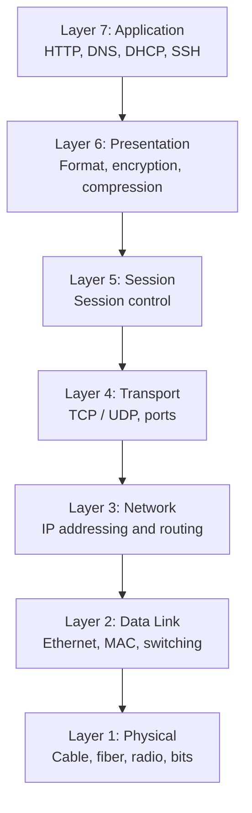

# LESSON 3: OSI MODEL DEEP DIVE

## TRAINING FOCUS

This lesson is part of the FEMTECT Network Engineering Foundation course. It is written to help students build strong networking fundamentals through clear explanations, real enterprise context, practical troubleshooting logic, and certification-aware technical depth.

## VISUAL DIAGRAM: OSI MODEL LAYERS



This vertical view helps students remember that troubleshooting can move from physical signals upward to applications, or from applications downward to the network path.


## DEFINITION AND TECHNICAL IN-DEPTH KNOWLEDGE

### 3.1 The OSI Model

The OSI model, or Open Systems Interconnection model, is a seven-layer reference model used to explain how network communication works. It divides the communication process into smaller functional layers so students, technicians, engineers, vendors, and exam candidates can understand what happens when data moves from one device to another.

The OSI model is not a single protocol and it is not a device. It is a conceptual framework. It helps people describe network functions clearly. Instead of saying "the network is not working," an engineer can ask whether the failure is at the physical layer, data link layer, network layer, transport layer, session layer, presentation layer, or application layer.

This lesson introduces the OSI model as a structured way to understand network communication. The next lesson will use this layer knowledge to follow data as it moves from a source device to a destination device.

The OSI model is important because networking is complex. A user may complain that "the internet is down," but the real issue could be a disconnected cable, wrong VLAN, missing IP route, blocked firewall port, failed DNS server, expired certificate, or application server outage. The OSI model gives a structured way to locate the problem instead of guessing.

For CCNA and CompTIA Network+, students must know the OSI layers, the function of each layer, the PDU names, the common devices and protocols associated with each layer, and how to use the model during troubleshooting.

### 3.2 Technical Importance: the OSI Model Exists

The OSI model exists because network communication requires many different tasks to happen in the correct order. A device must convert user data into a network-ready format, identify the correct application, create a communication session, choose transport behavior, apply logical addressing, deliver frames locally, and transmit signals across physical media. If all these tasks were explained as one large process, networking would be difficult to learn and difficult to troubleshoot.

The OSI model separates these tasks into layers. Each layer has a specific responsibility. The lower layers focus more on moving bits, frames, and packets through the network. The upper layers focus more on applications, sessions, formatting, encryption, and user-facing services.

This layered design also helps vendors build interoperable systems. A laptop from one manufacturer can connect to a switch from another manufacturer and access a server running a different operating system because common standards exist at different layers. Ethernet defines local network frame behavior. IP defines logical addressing and routing. TCP and UDP define transport behavior. HTTP, DNS, SMTP, and other protocols define application services.

In real troubleshooting, the OSI model helps technicians test from simple to complex. If a PC has no link light, there is no reason to begin by troubleshooting DNS. If the PC has a valid IP address and can ping the gateway but cannot browse websites by name, the issue may be higher than Layer 3 and may involve DNS or application-layer services. The OSI model prevents confusion by helping engineers ask better questions.

### 3.3 The Seven Layers of the OSI Model

The OSI model has seven layers:

1. Layer 7 - Application
2. Layer 6 - Presentation
3. Layer 5 - Session
4. Layer 4 - Transport
5. Layer 3 - Network
6. Layer 2 - Data Link
7. Layer 1 - Physical

The model is often discussed from Layer 7 down to Layer 1 when explaining how data is prepared for transmission, and from Layer 1 up to Layer 7 when explaining how received data is processed. During encapsulation, data moves down the layers on the sending device. During decapsulation, data moves up the layers on the receiving device.

The lower layers are often easier to see physically. Cables, Wi-Fi signals, switches, MAC addresses, routers, and IP addresses are visible in tools and configurations. The upper layers are closer to user experience. Web browsers, DNS names, encryption, sessions, authentication, and application errors live closer to the top of the model.

OSI Layer Quick View

| Layer | Name | Main Question |
|---|---|---|
| 7 | Application | What network service is the user or application trying to use? |
| 6 | Presentation | Is the data formatted, encrypted, compressed, or translated correctly? |
| 5 | Session | Is the communication session established and maintained? |
| 4 | Transport | Are ports, reliability, and end-to-end transport working? |
| 3 | Network | Can packets route between IP networks? |
| 2 | Data Link | Can frames move across the local network segment? |
| 1 | Physical | Can signals move across the cable, fiber, or wireless medium? |

## 3.4 LAYER 7 - APPLICATION LAYER

The Application layer is Layer 7 of the OSI model. It is the closest layer to the user and provides network services to applications. It includes protocols and services that users and software interact with directly or indirectly.

The Application layer does not mean the application itself in every case. It means the network services and protocols that support application communication. For example, HTTP and HTTPS support web browsing, DNS supports name resolution, SMTP supports email sending, IMAP and POP3 support email retrieval, SMB supports file sharing, SSH supports secure remote administration, and DHCP supports automatic IP configuration.

Layer 7 exists because users and applications need meaningful services, not just packets. A user wants to open a web page, send email, resolve a name, access a file share, or log into a system. The Application layer defines how these services communicate over the network.

Common Application Layer Examples

- HTTP.
- HTTPS.
- DNS.
- DHCP.
- SMTP.
- IMAP.
- POP3.
- FTP.
- SSH.
- SMB.
- SNMP.
- NTP.
- LDAP.
- RDP.

Application Layer Failure Symptoms

- Website returns HTTP error.
- DNS name does not resolve.
- Email cannot send or receive.
- File share access denied.
- DHCP server does not assign an address.
- Authentication service fails.
- Application server returns error even though ping works.
- Wrong URL, wrong hostname, or wrong application configuration.

Application Layer Troubleshooting

- Test DNS resolution.
- Check service status.
- Check application logs.
- Verify URL, hostname, and application port.
- Check user credentials and permissions.
- Test from another client.
- Confirm server process is running.
- Check application-specific error messages.

Windows and Linux Application Layer Checks

```powershell
nslookup <name>
Resolve-DnsName <name>
curl https://example.com
```

```bash
dig <name>
curl -I https://example.com
systemctl status <service>
```

Enterprise Example

If a user can ping a server and connect to TCP port 443 but the website shows an application error, the lower layers may be working. The issue may be at Layer 7: web service configuration, database dependency, authentication failure, application code, or server-side error.

## 3.5 LAYER 6 - PRESENTATION LAYER

The Presentation layer is Layer 6 of the OSI model. It is responsible for data format, translation, encryption, decryption, compression, and encoding. It makes sure data is presented in a format that the receiving system can understand.

The Presentation layer exists because different systems may represent data differently. Text, images, video, audio, documents, encrypted traffic, and compressed data must be formatted correctly. If the format is wrong, the receiving application may receive data but fail to interpret it properly.

In modern networking, Presentation layer functions are often handled by applications, libraries, operating systems, and security protocols. TLS encryption for HTTPS is one of the most common real-world examples associated with this layer. File formats, character encoding, image formats, compression formats, and certificate handling also relate to presentation concerns.

Common Presentation Layer Examples

- TLS/SSL encryption and decryption.
- Character encoding such as UTF-8.
- Data compression.
- JPEG, PNG, MP4, PDF, and other formats.
- Certificate validation.
- Data serialization formats such as JSON and XML.

Presentation Layer Failure Symptoms

- HTTPS certificate warning.
- Encrypted website fails while plain HTTP works.
- Unsupported file format.
- Corrupted or unreadable downloaded file.
- Application cannot parse JSON or XML response.
- Compression or encoding mismatch.
- TLS version mismatch.

Presentation Layer Troubleshooting

- Check certificates and expiration dates.
- Check TLS versions and cipher support.
- Verify system date and time.
- Confirm file format support.
- Check browser security errors.
- Review application logs for encoding or parsing errors.

Enterprise Example

If users can reach a secure website but receive certificate errors, the issue is not usually Layer 1, Layer 2, or Layer 3. The network path may be working, but the Presentation layer may be failing because of an expired certificate, untrusted certificate authority, wrong hostname, or incorrect system time.

## 3.6 LAYER 5 - SESSION LAYER

The Session layer is Layer 5 of the OSI model. It is responsible for establishing, managing, and terminating communication sessions between systems. A session is a logical conversation or relationship between two applications or devices.

The Session layer exists because some communication requires more than individual packets. Applications often need to maintain state. A user logs into a system, opens a connection, continues working, and later disconnects. The systems involved must track that conversation so the communication remains organized.

In modern TCP/IP networks, Session layer functions are often handled by applications, operating systems, authentication systems, or protocols that span multiple layers. This is why the upper OSI layers may feel less visible than the lower layers. Even so, the concept is important because many real problems are session-related rather than cable-related or routing-related.

Common Session Layer Examples

- Login sessions.
- Remote desktop sessions.
- SMB file-sharing sessions.
- Database sessions.
- VPN sessions.
- API sessions.
- Web application sessions.
- Session tokens and cookies in web systems.

Session Layer Failure Symptoms

- User logs in but session expires quickly.
- Remote desktop connects and then disconnects.
- VPN connects but drops repeatedly.
- File share opens but disconnects during use.
- Application requires repeated logins.
- Session timeout too short.
- Load balancer persistence problem.

Session Layer Troubleshooting

- Check authentication and session timeout settings.
- Review application session logs.
- Check load balancer persistence or sticky session settings.
- Verify VPN session stability.
- Check whether firewalls are timing out idle sessions.
- Confirm time synchronization when authentication is involved.

Enterprise Example

If a user can open a web application but is logged out every few minutes, the cable, IP address, routing, and port may all be working. The issue may be a session timeout, cookie problem, load balancer persistence setting, or authentication token issue.

## 3.7 LAYER 4 - TRANSPORT LAYER

The Transport layer is Layer 4 of the OSI model. It is responsible for end-to-end communication between applications on different devices. It uses port numbers to identify services and can provide reliability, sequencing, flow control, and connection management depending on the protocol used.

The two most common Transport layer protocols are TCP and UDP. TCP is connection-oriented and provides reliability features such as acknowledgments, retransmissions, sequencing, and flow control. UDP is connectionless and has lower overhead, making it useful for services where speed or simplicity matters more than built-in reliability.

Layer 4 exists because one device may run many network applications at the same time. A server may provide HTTPS, DNS, SSH, email, and database services. IP addressing gets traffic to the correct device, but port numbers help deliver traffic to the correct application or service on that device.

Lesson 5 will explain TCP, UDP, ICMP, ARP, and the TCP three-way handshake in greater depth. In this lesson, the important point is that Layer 4 identifies applications and controls transport behavior.

Common Transport Layer Examples

- TCP.
- UDP.
- Port numbers.
- TCP port 443 for HTTPS.
- TCP port 22 for SSH.
- UDP port 53 for DNS queries in many cases.
- TCP connection establishment.
- Flow control.
- Retransmission.

Transport Layer Failure Symptoms

- Ping works but application connection fails.
- Server is reachable by IP but port is closed.
- Firewall blocks a TCP or UDP port.
- Application listens on the wrong port.
- TCP session fails to establish.
- UDP application has no response.
- Intermittent connection resets.

Transport Layer Troubleshooting

- Confirm the correct port number.
- Check whether the server is listening on the port.
- Test the port with tools such as `Test-NetConnection`, `telnet`, `nc`, or `ss`.
- Check host firewall and network firewall rules.
- Verify whether TCP or UDP is required.
- Review application logs.

Windows and Linux Transport Layer Checks

```powershell
Test-NetConnection <server> -Port 443
netstat -ano
```

```bash
ss -tulnp
nc -vz <server> 443
```

Enterprise Example

If a user can ping a web server but cannot open the website, Layer 3 reachability may be working while Layer 4 or above is failing. The server may not be listening on TCP port 443, a firewall may be blocking the port, or the application may be down.

## 3.8 LAYER 3 - NETWORK LAYER

The Network layer is Layer 3 of the OSI model. It is responsible for logical addressing and routing between networks. The most important Layer 3 protocol in modern networks is IP, including IPv4 and IPv6.

The Network layer exists because local delivery is not enough. A laptop in one VLAN may need to reach a server in another VLAN, a branch office, a cloud service, or a public website. Layer 3 makes this possible by using IP addresses and routing decisions.

Routers and Layer 3 switches operate heavily at this layer. They examine destination IP addresses, check routing tables, and forward packets toward the correct next hop. Layer 3 also includes concepts such as subnets, default gateways, static routes, dynamic routing protocols, longest-prefix match, TTL, and ICMP.

Students should remember that a packet is the Layer 3 PDU. The packet contains source and destination IP addresses. When packets cross routed hops, the Layer 2 frame changes at each hop, but the Layer 3 destination normally remains focused on the final destination unless NAT is involved.

Common Network Layer Examples

- IPv4.
- IPv6.
- IP addresses.
- Subnet masks and prefix lengths.
- Default gateways.
- Routers.
- Layer 3 switches.
- Routing tables.
- Static routes.
- Dynamic routing protocols.
- ICMP.
- TTL.

Network Layer Failure Symptoms

- Device can reach local devices but not remote networks.
- Missing or wrong default gateway.
- Wrong IP address or subnet mask.
- Routing table missing a route.
- Duplicate IP address.
- Incorrect static route.
- Dynamic routing failure.
- Ping to gateway works but remote ping fails.
- Traceroute stops at a router.

Network Layer Troubleshooting

- Check IP address, subnet mask, gateway, and DNS.
- Ping the default gateway.
- Ping a remote IP address.
- Check routing table.
- Use traceroute or tracert.
- Check router interfaces.
- Verify static or dynamic routes.
- Check ACLs if routing exists but traffic is denied.

Windows and Linux Layer 3 Checks

```powershell
ipconfig /all
ping <gateway>
tracert <destination>
```

```bash
ip addr
ip route
ping <gateway>
traceroute <destination>
```

Cisco IOS Network Layer Checks

```text
show ip interface brief
show ip route
ping <destination>
traceroute <destination>
```

Enterprise Example

If a PC can ping devices in its own VLAN but cannot reach a server in another VLAN, Layer 3 must be checked. The default gateway may be missing, the gateway interface may be down, or routing between VLANs may not be configured.

## 3.9 LAYER 2 - DATA LINK LAYER

The Data Link layer is Layer 2 of the OSI model. It is responsible for local network delivery. It organizes bits into frames, uses MAC addresses, detects some frame errors, and controls how devices access the local network medium. Ethernet and Wi-Fi are major Layer 2 technologies.

The Data Link layer exists because devices need a way to communicate across the same local network segment. IP addresses help with logical delivery across networks, but a device still needs local delivery information to send traffic to the next device on the same link. That local delivery information is handled at Layer 2.

In Ethernet networks, Layer 2 uses MAC addresses. A switch learns source MAC addresses, builds a MAC address table, and forwards frames toward destination MAC addresses. In Wi-Fi networks, Layer 2 also includes wireless association, SSIDs, and frame delivery between wireless clients and access points.

Layer 2 is also where VLANs operate. A VLAN creates a separate logical Layer 2 broadcast domain on a switch. VLANs help separate departments, control broadcast traffic, improve security, and support enterprise segmentation.

Common Data Link Layer Examples

- Ethernet frames.
- MAC addresses.
- Switches.
- VLANs.
- Trunking.
- 802.1Q tags.
- Wireless association.
- ARP-related local delivery.
- Spanning Tree Protocol.
- Frame check sequence.

Data Link Layer Failure Symptoms

- Wrong VLAN assignment.
- Switch port disabled or err-disabled.
- MAC address not learned.
- VLAN missing on a trunk.
- Native VLAN mismatch.
- Spanning Tree blocking an expected port.
- Duplicate MAC address behavior.
- Excessive broadcasts.
- Wireless client associated but placed in wrong VLAN.

Data Link Layer Troubleshooting

- Check switch port status.
- Verify VLAN assignment.
- Check the MAC address table.
- Check trunk configuration.
- Verify whether the correct VLAN is allowed on trunks.
- Check for Layer 2 loops.
- Check STP state.
- Confirm wireless SSID-to-VLAN mapping.

Cisco IOS Data Link Layer Checks

```text
show interfaces status
show mac address-table
show vlan brief
show interfaces trunk
show spanning-tree
```

Enterprise Example

If a user has a working cable and link light but receives an IP address from the wrong subnet, the issue may be a Layer 2 VLAN assignment problem. The physical connection works, but the device is logically placed in the wrong Layer 2 network.

## 3.10 LAYER 1 - PHYSICAL LAYER

The Physical layer is Layer 1 of the OSI model. It is responsible for transmitting raw bits across a physical or wireless medium. This layer deals with electrical signals, light pulses, radio waves, connectors, cables, pinouts, transceivers, wireless frequencies, link speed, signal strength, and physical interfaces.

The Physical layer exists because data must eventually become a signal. A file, web request, voice call, or video stream cannot move across a cable as an idea. It must be represented as bits, and those bits must be transmitted using a physical method. Copper cables use electrical signals. Fiber optic cables use light. Wi-Fi uses radio waves.

In enterprise networks, Physical layer components include UTP cables, STP cables, fiber optic cables, RJ45 connectors, patch panels, wall jacks, SFP transceivers, switch ports, router interfaces, wireless radios, antennas, and network interface cards. If the Physical layer fails, higher-layer protocols cannot function properly because the basic signal path is broken or unstable.

Common Physical Layer Examples

- Ethernet cables.
- Fiber optic cables.
- RJ45 connectors.
- Patch panels.
- Wall sockets.
- Switch ports.
- NIC ports.
- SFP and SFP+ transceivers.
- Wi-Fi radio signals.
- Antennas.
- Link lights.
- Cable testers.

Physical Layer Failure Symptoms

- No link light on a switch or NIC.
- Cable unplugged or damaged.
- Wrong cable type or bad termination.
- Fiber strand reversed incorrectly.
- Dirty fiber connector.
- Weak Wi-Fi signal.
- High wireless interference.
- Interface down/down on Cisco IOS.
- Speed or duplex mismatch in older environments.

Physical Layer Troubleshooting

- Check whether the cable is connected.
- Check link lights.
- Try a known-good cable.
- Test the wall port or patch panel.
- Check the switch port status.
- Check SFP compatibility and fiber type.
- Check Wi-Fi signal strength and interference.
- Use a cable tester for copper cabling.

Cisco IOS Physical Layer Checks

```text
show ip interface brief
show interfaces status
show interfaces
```

In practical troubleshooting, Physical layer problems are often the first thing to check. If there is no link, do not begin troubleshooting DNS, routing, or applications until the basic signal path has been confirmed.

## 3.11 PDU NAMES PER LAYER

A Protocol Data Unit, or PDU, is the name given to data at a specific OSI layer. PDU names are essential for understanding the OSI model and real network troubleshooting.

PDU Names Table

| OSI Layer | Layer Name | PDU Name |
|---|---|---|
| Layer 7 | Application | Data |
| Layer 6 | Presentation | Data |
| Layer 5 | Session | Data |
| Layer 4 | Transport | Segment / Datagram |
| Layer 3 | Network | Packet |
| Layer 2 | Data Link | Frame |
| Layer 1 | Physical | Bits |

Important Exam Notes

- TCP at Layer 4 uses segments.
- UDP at Layer 4 uses datagrams.
- IP at Layer 3 uses packets.
- Ethernet and Wi-Fi at Layer 2 use frames.
- Layer 1 transmits bits as signals.

## 3.12 OSI MODEL AND ENCAPSULATION

During encapsulation, data moves from the upper layers down to the lower layers on the sending device. The Application, Presentation, and Session layers prepare user or application data. The Transport layer adds port and transport information. The Network layer adds IP addressing. The Data Link layer adds local delivery information such as MAC addresses. The Physical layer transmits the bits.

During decapsulation, the process is reversed on the receiving device. Bits are received, frames are processed, packets are examined, transport information is checked, and the data is delivered to the correct application.

The OSI model helps explain this process cleanly, but real protocols do not always fit perfectly into one layer. For example, TLS is often associated with the Presentation layer, but it interacts closely with applications and transport. DNS is usually considered Application layer, but it depends on UDP or TCP at Layer 4, IP at Layer 3, and Ethernet/Wi-Fi at Layer 2. The model is a teaching and troubleshooting framework, not a rigid cage.

## 3.13 OSI MODEL AS A TROUBLESHOOTING METHOD

The OSI model is one of the most useful troubleshooting tools in networking. It helps technicians isolate faults by layer.

There are two common troubleshooting approaches:

1. Bottom-up troubleshooting starts at Layer 1 and moves upward.
2. Top-down troubleshooting starts at Layer 7 and moves downward.

Bottom-up troubleshooting is useful when there may be a physical or connectivity problem. For example, if a user has no network connection, start with cable, Wi-Fi, link light, switch port, VLAN, IP address, gateway, and then services.

Top-down troubleshooting is useful when the physical and network path seem healthy but the application fails. For example, if a user can ping the server and connect to the port but the application returns an error, begin closer to the application layer.

OSI Troubleshooting by Symptom

| Symptom | Likely Layer to Check First |
|---|---|
| No link light | Layer 1 |
| Cable unplugged | Layer 1 |
| Wrong VLAN | Layer 2 |
| MAC address not learned | Layer 2 |
| Wrong IP address | Layer 3 |
| Missing default gateway | Layer 3 |
| Ping to gateway works but remote network fails | Layer 3 |
| Ping works but TCP port fails | Layer 4 |
| VPN connects then drops | Layer 5 |
| Certificate warning | Layer 6 |
| DNS name fails | Layer 7 |
| Website returns application error | Layer 7 |

Practical Enterprise Troubleshooting Example

A user says, "I cannot access the payroll website."

Layer 1: Check whether the device is connected by Ethernet or Wi-Fi.

Layer 2: Check whether the device is in the correct VLAN or SSID.

Layer 3: Check IP address, subnet mask, default gateway, and route to the server.

Layer 4: Check whether TCP port 443 is reachable.

Layer 5: Check whether the session stays active after login.

Layer 6: Check whether there is a TLS certificate warning.

Layer 7: Check DNS, URL, application service, authentication, and server logs.

This method makes troubleshooting organized and professional.

## 3.14 REAL-WORLD EXAMPLES MAPPED TO EACH LAYER

The OSI model becomes easier when students can connect each layer to real network behavior.

| OSI Layer | Real-World Example | Explanation |
|---|---|---|
| Layer 7 Application | DNS lookup for `portal.company.local` | The client asks a DNS service to resolve a name. |
| Layer 6 Presentation | HTTPS certificate validation | The browser checks encryption and certificate trust. |
| Layer 5 Session | User login session to a web portal | The application tracks the user's session after authentication. |
| Layer 4 Transport | TCP port 443 connection | The client connects to the web service using a transport port. |
| Layer 3 Network | Router forwards packet to server VLAN | IP addressing and routing move traffic between networks. |
| Layer 2 Data Link | Switch forwards Ethernet frame | MAC addresses and VLANs support local delivery. |
| Layer 1 Physical | Copper cable carries electrical signal | Bits move across physical media. |

Hospital Example

In a hospital, a nurse opens a patient records system from a workstation.

At Layer 1, the workstation connects through Ethernet or Wi-Fi. At Layer 2, the switch or AP places the device in the correct VLAN. At Layer 3, the workstation uses IP addressing and the default gateway to reach the server network. At Layer 4, the workstation connects to the application using TCP port 443. At Layer 5, the system maintains the nurse's login session. At Layer 6, TLS encrypts the connection and validates certificates. At Layer 7, the patient records application processes the request.

If the nurse cannot access the system, the OSI model helps the technician avoid guessing. Each layer gives a clear area to test.

## 3.15 OSI MODEL, TCP/IP MODEL, AND REAL NETWORKS

The OSI model has seven layers, while the TCP/IP model is usually shown with four or five layers depending on the source. Real networks use TCP/IP protocols more directly, but the OSI model remains popular because it is excellent for teaching and troubleshooting.

The OSI model separates Session and Presentation functions into their own layers. The TCP/IP model often groups those functions into the Application layer. The OSI model separates Data Link and Physical layers clearly, while some TCP/IP model versions combine them as the Network Access or Link layer.

OSI vs TCP/IP Mapping

| OSI Model | TCP/IP Model | Example |
|---|---|---|
| Application | Application | HTTP, DNS, SMTP, SSH |
| Presentation | Application | TLS, encoding, compression |
| Session | Application | Login sessions, session control |
| Transport | Transport | TCP, UDP |
| Network | Internet | IP, ICMP |
| Data Link | Network Access / Link | Ethernet, Wi-Fi |
| Physical | Network Access / Link | Copper, fiber, radio |

Important Note

Students should not argue with real networks because a protocol does not fit perfectly into one OSI layer. The model is a tool for understanding. The goal is practical clarity, not forcing every technology into a perfect box.

## 3.16 CYBERSECURITY RELEVANCE

Security controls and attacks exist across multiple OSI layers. Understanding the OSI model helps security teams identify where to apply defense and where to investigate threats.

At Layer 1, attackers or accidents can cause cable cuts, device theft, rogue hardware, or wireless jamming. At Layer 2, attacks may include MAC flooding, VLAN hopping, ARP spoofing, and rogue DHCP servers. At Layer 3, attackers may perform IP spoofing, route manipulation, scanning, or denial-of-service attacks. At Layer 4, attackers may scan ports, abuse TCP sessions, or flood services. At Layer 5, attackers may hijack or abuse sessions. At Layer 6, weak encryption, expired certificates, and downgrade attacks may create risk. At Layer 7, attacks include phishing, malicious web requests, SQL injection, credential attacks, and application-layer DDoS.

Security devices also map to layers. Firewalls often enforce Layer 3 and Layer 4 policy, and next-generation firewalls inspect Layer 7 applications. IDS/IPS systems inspect traffic patterns across layers. Web application firewalls focus on Layer 7 web traffic. NAC and switch security can enforce Layer 2 access controls. VPNs protect communication using encryption and tunneling.

Cybersecurity Reminder

A secure network requires defense-in-depth. No single OSI layer can protect everything. Professional security combines physical controls, switch security, routing controls, firewalls, encryption, authentication, monitoring, and application security.

## 3.17 CLOUD NETWORKING RELEVANCE

Cloud networking still uses OSI concepts, even when devices are virtual or provider-managed. A cloud virtual network still has IP addressing and routing. A cloud load balancer still listens on ports and forwards traffic to backend services. A security group or cloud firewall still permits and denies traffic based on rules. A cloud application still depends on DNS, TLS, sessions, and application-layer behavior.

For example, if a web application in Azure, AWS, or Google Cloud is unavailable, an engineer may troubleshoot across layers. At Layer 7, the application service may be down. At Layer 6, the certificate may be expired. At Layer 4, the load balancer listener may not allow TCP port 443. At Layer 3, the route table may be wrong. At Layer 2 and Layer 1, the cloud provider abstracts most physical infrastructure, but virtual networking still depends on lower-layer services underneath.

Cloud does not remove the OSI model. It changes which parts the customer controls directly. In cloud environments, the provider manages more of the lower physical infrastructure, while the customer still manages addressing, routing, firewall rules, identity, certificates, applications, and data security depending on the service model.

## 5. KEY TERMS / GLOSSARY

| Term | Definition |
|---|---|
| OSI Model | A seven-layer reference model for understanding network communication. |
| Layer | A functional section of the OSI model with specific responsibilities. |
| Application Layer | Layer 7; provides network services to applications. |
| Presentation Layer | Layer 6; handles formatting, encryption, compression, and translation. |
| Session Layer | Layer 5; establishes, manages, and terminates sessions. |
| Transport Layer | Layer 4; handles end-to-end transport, ports, reliability, and flow control. |
| Network Layer | Layer 3; handles logical addressing and routing. |
| Data Link Layer | Layer 2; handles local frame delivery, MAC addresses, and VLANs. |
| Physical Layer | Layer 1; transmits bits as physical or wireless signals. |
| PDU | Protocol Data Unit; the name for data at a specific OSI layer. |
| Segment | TCP Transport layer PDU. |
| Datagram | UDP Transport layer PDU. |
| Packet | Network layer PDU. |
| Frame | Data Link layer PDU. |
| Bits | Physical layer representation of data. |
| Encapsulation | Adding headers and trailers as data moves down the layers. |
| Decapsulation | Removing headers and trailers as data moves up the layers. |
| MAC Address | Layer 2 address used for local delivery. |
| IP Address | Layer 3 address used for logical addressing and routing. |
| Port Number | Layer 4 identifier for an application or service. |
| VLAN | Logical Layer 2 segmentation within a switched network. |
| Default Gateway | Layer 3 device used to reach remote networks. |
| TLS | Encryption technology commonly used to secure HTTPS traffic. |
| DNS | Application layer service that translates names into IP addresses. |

## 6. COMPARISON TABLES

### 6.1 OSI Layers Summary

| Layer | Name | Function | PDU | Examples |
|---|---|---|---|---|
| 7 | Application | Network services for applications | Data | HTTP, DNS, DHCP, SMTP, SSH |
| 6 | Presentation | Format, encryption, compression | Data | TLS, encoding, JPEG, JSON |
| 5 | Session | Establish/manage/end sessions | Data | Login sessions, VPN sessions |
| 4 | Transport | Ports and transport behavior | Segment/Datagram | TCP, UDP |
| 3 | Network | Logical addressing and routing | Packet | IP, ICMP, routers |
| 2 | Data Link | Local delivery and framing | Frame | Ethernet, Wi-Fi, switches, VLANs |
| 1 | Physical | Signals and media | Bits | Copper, fiber, radio |

### 6.2 OSI Troubleshooting Table

| Layer | Common Problem | Example Test |
|---|---|---|
| 1 Physical | No signal or link | Check cable, link light, interface status |
| 2 Data Link | Wrong VLAN or local frame issue | Check MAC table, VLAN, trunk |
| 3 Network | Wrong IP or routing issue | Check IP config, ping gateway, route table |
| 4 Transport | Port blocked or service not listening | Test TCP/UDP port |
| 5 Session | Session timeout or drop | Check session logs and timeout settings |
| 6 Presentation | Certificate or encryption issue | Check TLS certificate and system time |
| 7 Application | Service, DNS, or application error | Check DNS, URL, service status, logs |

### 6.3 OSI vs TCP/IP

| OSI Layer | TCP/IP Equivalent | Main Idea |
|---|---|---|
| Application | Application | User-facing network services |
| Presentation | Application | Formatting and encryption |
| Session | Application | Session handling |
| Transport | Transport | TCP/UDP and ports |
| Network | Internet | IP addressing and routing |
| Data Link | Link / Network Access | Frames and local delivery |
| Physical | Link / Network Access | Media and signals |

### 6.4 Common Devices by OSI Layer

| Device or Component | Common OSI Layer Association |
|---|---|
| Cable, connector, transceiver | Layer 1 |
| Switch | Layer 2 |
| Wireless access point | Layers 1-2 |
| Router | Layer 3 |
| Layer 3 switch | Layers 2-3 |
| Firewall | Layers 3-7 depending on type |
| Load balancer | Layers 4-7 |
| Proxy server | Layer 7 |
| Web server | Layer 7 |

## 7. REAL-WORLD EXAMPLE / ANALOGY

Think of the OSI model like a professional courier system.

At Layer 7, the business decides what service is needed: send a document, request a file, or receive a message. At Layer 6, the document is formatted, translated, compressed, or encrypted so the recipient can read it securely. At Layer 5, the courier office manages the ongoing relationship between sender and receiver. At Layer 4, the package is assigned a service type and tracking behavior. At Layer 3, the destination city and building address are selected. At Layer 2, the package is handed to the correct local delivery vehicle for the next part of the route. At Layer 1, the vehicle physically moves on roads, rails, air, or sea.

If the road is blocked, that is like a Physical layer problem. If the local delivery label is wrong, that is like a Data Link layer problem. If the building address is wrong, that is like a Network layer problem. If the wrong department code is used, that is like a Transport layer problem. If the receiver's account session has expired, that is like a Session layer problem. If the document is encrypted with the wrong key, that is like a Presentation layer problem. If the business application rejects the request, that is like an Application layer problem.

## 9. WINDOWS, LINUX, AND CISCO IOS PRACTICAL COMMANDS

### Windows Commands

```powershell
ipconfig /all
ping <destination>
tracert <destination>
nslookup <name>
Test-NetConnection <server> -Port 443
netstat -ano
```

### Linux Commands

```bash
ip addr
ip route
ping <destination>
traceroute <destination>
dig <name>
ss -tulnp
curl -I https://example.com
```

### Cisco IOS Commands

```text
show interfaces status
show mac address-table
show vlan brief
show interfaces trunk
show ip interface brief
show ip route
ping <destination>
traceroute <destination>
```

## 10. QUICK-RECAP CHEAT SHEET

- The OSI model is a seven-layer reference model for network communication.
- Layer 7 Application provides network services such as HTTP, DNS, DHCP, SMTP, and SSH.
- Layer 6 Presentation handles formatting, encryption, compression, and translation.
- Layer 5 Session manages communication sessions.
- Layer 4 Transport uses TCP/UDP and port numbers.
- Layer 3 Network handles IP addressing and routing.
- Layer 2 Data Link handles frames, MAC addresses, switches, and VLANs.
- Layer 1 Physical handles cables, fiber, radio, connectors, and signals.
- Upper-layer PDUs are called data.
- TCP uses segments.
- UDP uses datagrams.
- IP uses packets.
- Ethernet and Wi-Fi use frames.
- The Physical layer sends bits.
- Bottom-up troubleshooting starts at Layer 1.
- Top-down troubleshooting starts at Layer 7.
- Ping mostly tests Layer 3 reachability, though it depends on lower layers.
- A successful ping does not prove the application works.
- If ping works but a port fails, check Layer 4 or firewall policy.
- If a certificate fails, think Layer 6.
- If DNS or application service fails, think Layer 7.

## 7. LESSON ASSESSMENT

This assessment is intentionally focused. Students should answer clearly, use correct networking terminology, and show practical troubleshooting thinking.

### 7.1 Theory Questions

1. Explain the main networking concept covered in this lesson and describe its role in a real enterprise network.
2. Describe two technical problems that can occur when this lesson's concept is poorly designed or incorrectly configured.
3. Explain how a network technician or junior network engineer would verify that this part of the network is working correctly.
4. Describe one security, reliability, or performance concern related to this topic.
5. Explain how this topic connects to CCNA, Network+, IT support, or junior network engineering work.

### 7.2 Multiple-Choice Questions

1. What is the best reason for studying this lesson's topic?
   A. It helps students understand and support real network operation.
   B. It replaces the need for troubleshooting.
   C. It removes the need for IP addressing.
   D. It is only useful for memorizing definitions.

2. When troubleshooting a problem related to this lesson, what should be done first?
   A. Gather evidence and identify the exact scope of the problem.
   B. Replace every network device immediately.
   C. Delete the running configuration without backup.
   D. Assume the Internet service provider is always responsible.

3. Which habit best reflects professional network engineering practice?
   A. Verify changes with commands, tests, and documented results.
   B. Make random changes until something works.
   C. Ignore diagrams and rely only on memory.
   D. Avoid documenting successful fixes.

4. Which item is most useful when proving that a network feature is working?
   A. A successful test result compared with the expected result.
   B. A guess from another user.
   C. A device name with no configuration evidence.
   D. A screenshot unrelated to the problem.

5. What should students connect this lesson to during hands-on practice?
   A. Addressing, device roles, commands, verification, and troubleshooting.
   B. Only typing speed.
   C. Only cable color.
   D. Only memorizing vendor logos.

6. In an enterprise environment, why is documentation important for this topic?
   A. It helps future troubleshooting, audits, handover, and change control.
   B. It makes testing unnecessary.
   C. It disables security risks automatically.
   D. It replaces the need for correct configuration.

7. Which approach gives the strongest learning outcome?
   A. Combining technical explanation with lab practice and verification.
   B. Reading commands without understanding them.
   C. Skipping troubleshooting steps.
   D. Memorizing answers without using the network.

8. If a configuration change causes a new outage, what should the technician use?
   A. A rollback plan and saved baseline information.
   B. A random new subnet.
   C. A different monitor.
   D. A guess without evidence.

9. Which result shows that a student understands the lesson at a practical level?
   A. The student can explain the concept, configure or identify it, test it, and troubleshoot failure.
   B. The student can only repeat the title.
   C. The student avoids using commands.
   D. The student ignores enterprise examples.

10. Why are scenario questions included in this course?
   A. They train students to apply concepts to real network problems.
   B. They remove the need for labs.
   C. They focus only on spelling.
   D. They are unrelated to IT jobs.

### 7.3 Scenario-Based Questions

1. A user or department reports a connectivity problem related to this lesson's topic. Write the first five checks you would perform, the commands or tools you would use, and the evidence you expect to collect.
2. You are asked to explain this topic to a new IT support intern before a hands-on lab. Write a short technical explanation that connects the concept to real devices, real traffic flow, and troubleshooting.

### 7.4 Answer Guide

Theory answers should be marked for technical accuracy, clear explanation, correct terminology, and practical relevance to enterprise networking. Scenario answers should show a logical troubleshooting sequence, evidence gathering, likely causes, verification steps, and a professional final recommendation.

Multiple-choice answers: 1. A; 2. A; 3. A; 4. A; 5. A; 6. A; 7. A; 8. A; 9. A; 10. A

