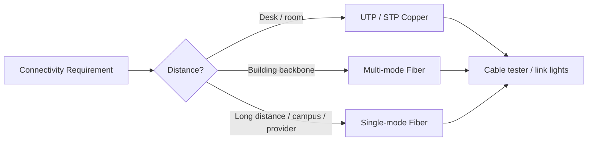

# LESSON 7: CABLING AND PHYSICAL MEDIA

## TRAINING FOCUS

This lesson is part of the FEMTECT Network Engineering Foundation course. It is written to help students build strong networking fundamentals through clear explanations, real enterprise context, practical troubleshooting logic, and certification-aware technical depth.

## VISUAL DIAGRAM: CHOOSING PHYSICAL MEDIA



The diagram connects media choice to distance, environment, and testing, which is the main Layer 1 decision students must learn.


## DEFINITION AND TECHNICAL IN-DEPTH KNOWLEDGE

### 7.1 Cabling and Physical Media

Cabling and physical media are the physical pathways used to carry network signals between devices. They operate at Layer 1, the Physical layer, which was introduced in Lesson 3. Every network communication eventually becomes a signal, and that signal must travel across some type of medium. The medium may be copper cable, fiber optic cable, wireless radio, or another physical transmission system.

In enterprise networks, cabling is not just an installation detail. It is part of the network design. A good switch, router, firewall, server, or access point cannot perform properly if the physical cabling is poor. Many network faults that appear to be "IP problems" or "application problems" are actually caused by weak physical media, bad terminations, damaged patch cords, poor cable routing, low-quality connectors, electromagnetic interference, or incorrect fiber selection.

Cabling exists because devices need a dependable way to transmit bits. Copper cables transmit electrical signals. Fiber optic cables transmit light signals. Wireless networks transmit radio signals. This lesson focuses mainly on wired physical media: UTP, STP, copper cable categories, RJ45 wiring standards, cable testing tools, single-mode fiber, multi-mode fiber, and how to choose the right media for real environments.

For CCNA and CompTIA Network+, students must understand cable types, Ethernet copper categories, RJ45 wiring standards, fiber types, distance limitations, testing tools, and common Layer 1 troubleshooting symptoms. For IT support and network engineering jobs, cabling knowledge is practical survival knowledge. A technician who cannot identify a bad cable, wrong termination, or fiber mismatch will waste time troubleshooting higher layers unnecessarily.

### 7.2 Technical and Business Importance of Physical Media

Physical media matters because every higher-layer function depends on it. TCP, UDP, IP, DNS, DHCP, VLANs, routing, firewalls, and cloud applications all require the basic signal path to work. If the cable is damaged, if the connector is badly crimped, if the fiber strand is dirty, or if the wireless signal is weak, the network may fail before any protocol troubleshooting becomes useful.

In real organizations, cabling problems can create many symptoms. A user may experience intermittent disconnections. An IP phone may reboot because PoE is unstable. A switch port may flap up and down. A server uplink may negotiate at a lower speed than expected. A CCTV camera may lose video. A wireless access point may not power on. A whole floor may be offline because an uplink fiber was cut or bent too sharply.

Physical media also affects performance and future growth. A poorly planned cabling installation may work today at 100 Mbps but fail when the organization upgrades to 1 Gbps or 10 Gbps. A cheap cable may save money during installation but create years of instability. A copper run that exceeds distance limits may work sometimes and fail under load. A fiber link may be more expensive initially but more reliable for long distances, outdoor runs, or building-to-building connections.

Good physical media design considers distance, speed, electromagnetic interference, building structure, cable pathways, future expansion, power needs, budget, security, documentation, and maintenance.

## 7.3 UTP - UNSHIELDED TWISTED PAIR

UTP, or Unshielded Twisted Pair, is the most common copper cable used in Ethernet LANs. It contains pairs of copper wires twisted together inside an outer jacket. The twisting helps reduce electromagnetic interference and crosstalk between pairs.

UTP is popular because it is affordable, flexible, easy to install, widely available, and supported by standard Ethernet ports. It is commonly used to connect PCs, printers, IP phones, wireless access points, CCTV cameras, and other end devices to access switches. Most office network cabling uses UTP or a similar twisted-pair copper cable.

Technically, twisted-pair Ethernet uses balanced electrical signaling. The twist rate of each pair helps cancel noise and reduce interference. The cable is terminated into RJ45 connectors, keystone jacks, patch panels, or wall outlets. Ethernet over UTP commonly supports distances up to 100 meters for many copper Ethernet standards, including the horizontal cable run and patch cords.

UTP is not ideal for every environment. Because it has no extra shielding, it is more vulnerable to electromagnetic interference than shielded cable. It should not be run close to high-voltage electrical cables, heavy motors, elevators, fluorescent ballasts, industrial machinery, welding equipment, or other strong interference sources. Good installation practice matters.

UTP Characteristics

- Most common Ethernet copper cabling.
- Contains twisted pairs of copper wires.
- No additional shielding around pairs or cable.
- Affordable and easy to install.
- Commonly terminated with RJ45 connectors or keystone jacks.
- Typical Ethernet copper distance limit is 100 meters.
- Suitable for most office LAN environments.

UTP Common Uses

- Desktop computer connections.
- Printer connections.
- IP phones.
- Wireless access points.
- CCTV cameras.
- Patch panel to switch connections.
- Wall outlet to end-device patch cords.

UTP Troubleshooting Clues

- No link light may indicate bad cable, bad termination, or disabled port.
- Link speed lower than expected may indicate poor cable quality or wrong category.
- Intermittent disconnection may indicate damaged cable or loose connector.
- PoE device not powering may indicate cable pair fault or distance issue.
- High error counters on a switch port may indicate Layer 1 media problems.

## 7.4 STP - SHIELDED TWISTED PAIR

STP, or Shielded Twisted Pair, is twisted-pair copper cabling that includes shielding to reduce electromagnetic interference. The shielding may cover individual wire pairs, the entire cable, or both, depending on the cable design. Related terms include FTP, S/FTP, F/UTP, and other shielded cable constructions.

STP exists because some environments have more electrical noise than ordinary office spaces. Industrial floors, factories, power rooms, elevators, generator areas, radio equipment rooms, and locations with heavy machinery may create interference that affects unshielded cable. Shielding helps protect the signal from external noise and can reduce emissions from the cable itself.

Technically, shielded cable must be installed correctly to be effective. The shield must be properly bonded and grounded according to standards and local electrical practice. Poor grounding can reduce the benefit of shielding or even create new problems. STP also tends to be more expensive, less flexible, and harder to terminate than UTP.

STP should not be selected only because it sounds stronger. In a normal office, high-quality UTP installed correctly is often sufficient. STP is best used when the environment justifies it.

STP Characteristics

- Twisted-pair copper cable with shielding.
- Better protection against electromagnetic interference.
- More expensive than UTP.
- Less flexible and harder to install.
- Requires correct grounding and bonding.
- Useful in industrial or high-interference environments.

STP Common Uses

- Factory floors.
- Industrial control networks.
- Areas near heavy electrical equipment.
- Generator or inverter rooms when cabling must pass nearby.
- Environments with strong EMI.
- Special security or high-performance cabling requirements.

STP Troubleshooting Clues

- Poor grounding can cause unexpected noise issues.
- Wrong termination may break shield continuity.
- Using shielded cable without proper installation may not solve interference.
- If errors occur near machinery or power equipment, EMI should be investigated.

## 7.5 COPPER CABLE CATEGORIES: CAT5E AND CAT6

Ethernet copper cables are categorized by performance standards. Categories define the cable's ability to support certain frequencies, speeds, and distances. The most common categories students encounter early are CAT5e and CAT6.

### CAT5e

CAT5e means Category 5 enhanced. It improved older CAT5 cabling and is widely used for Gigabit Ethernet. CAT5e commonly supports speeds up to 1 Gbps over distances up to 100 meters when properly installed. In some conditions, it may support higher speeds over shorter distances, but it is not the preferred choice for new high-performance installations.

CAT5e exists because organizations needed affordable cabling that could support 1000BASE-T Gigabit Ethernet. Many offices, schools, small businesses, and older enterprise buildings still use CAT5e successfully.

CAT5e Characteristics

- Commonly supports 1 Gbps up to 100 meters.
- Affordable and widely available.
- Suitable for many office access-layer connections.
- Less capable than CAT6 for higher-frequency performance.
- Common in existing buildings.

### CAT6

CAT6 means Category 6. It provides better performance than CAT5e, better crosstalk control, and higher frequency support. CAT6 commonly supports 1 Gbps up to 100 meters and can support 10 Gbps over shorter distances, commonly up to about 55 meters depending on installation quality and environment.

CAT6 exists because networks need better performance, better noise resistance, and more future-ready cabling. For new installations, CAT6 is often preferred over CAT5e because the cost difference may be reasonable compared with the cost of replacing cabling later.

CAT6 Characteristics

- Better performance than CAT5e.
- Commonly supports 1 Gbps up to 100 meters.
- Can support 10 Gbps over shorter distances under proper conditions.
- Better crosstalk control.
- Common choice for new office cabling.
- Usually thicker and less flexible than CAT5e.

CAT5e vs CAT6

| Feature | CAT5e | CAT6 |
|---|---|---|
| Common Use | Existing office LANs | Newer office and enterprise LANs |
| Typical 1 Gbps Support | Up to 100 meters | Up to 100 meters |
| 10 Gbps Support | Limited and not preferred | Supported over shorter distances |
| Crosstalk Control | Good | Better |
| Cost | Lower | Higher |
| Future Readiness | Moderate | Better |

Important Installation Note

A cable category rating is only valid if the entire channel is installed correctly. A CAT6 cable badly terminated with poor connectors and poor patch panels may perform worse than a properly installed CAT5e channel. The cable, connector, patch panel, keystone jack, patch cord, termination quality, and test result all matter.

## 7.6 RJ45 CONNECTORS AND ETHERNET TERMINATION

RJ45 is the common connector style used for Ethernet twisted-pair copper cabling. Technically, Ethernet uses an 8-position 8-contact modular connector, often called RJ45 in everyday networking language. It has eight pins that connect to the eight copper conductors inside a four-pair Ethernet cable.

RJ45 termination matters because Ethernet depends on correct wire order, pair integrity, and good contact. If wires are placed in the wrong order, if a pair is split, if the connector is poorly crimped, or if too much untwisted wire is exposed, the cable may fail or perform poorly.

Ethernet copper cabling uses two common wiring standards: T568A and T568B. Both define the order of the colored wires in the connector. The most important rule is consistency. A straight-through Ethernet cable has the same wiring standard on both ends. A crossover cable uses T568A on one end and T568B on the other end.

### T568A Wiring Standard

T568A pinout:

| Pin | Wire Color |
|---:|---|
| 1 | White/Green |
| 2 | Green |
| 3 | White/Orange |
| 4 | Blue |
| 5 | White/Blue |
| 6 | Orange |
| 7 | White/Brown |
| 8 | Brown |

### T568B Wiring Standard

T568B pinout:

| Pin | Wire Color |
|---:|---|
| 1 | White/Orange |
| 2 | Orange |
| 3 | White/Green |
| 4 | Blue |
| 5 | White/Blue |
| 6 | Green |
| 7 | White/Brown |
| 8 | Brown |

### Straight-Through Cable

A straight-through cable uses the same wiring standard on both ends. It may be T568A on both ends or T568B on both ends. Straight-through cables are used for most modern Ethernet connections, such as PC to switch, printer to switch, IP phone to switch, access point to switch, and patch panel to switch.

Straight-through examples:

- T568A to T568A.
- T568B to T568B.

### Crossover Cable

A crossover cable uses T568A on one end and T568B on the other end. Historically, crossover cables were used to connect similar devices directly, such as switch-to-switch, PC-to-PC, or router-to-router Ethernet connections. Modern devices often support Auto-MDIX, which automatically adjusts transmit and receive pairs, so crossover cables are less commonly required today.

Crossover example:

- T568A to T568B.

Exam Reminder

For CCNA and Network+, know the difference between T568A and T568B, know that straight-through uses the same standard on both ends, and know that crossover uses different standards on each end.

## 7.7 CABLE TESTING TOOLS

Cable testing tools are used to verify whether a cable is correctly wired, physically usable, and capable of supporting the required network performance. A cable that looks fine visually may still have broken conductors, reversed pairs, split pairs, shorts, opens, excessive length, or poor signal quality.

Testing matters because cable faults waste troubleshooting time. A technician may spend hours checking IP settings, VLANs, firewalls, and servers when the real issue is a badly terminated cable. Professional network work requires testing and documenting cable results, especially for structured cabling installations.

### Basic Cable Tester

A basic cable tester checks wire continuity and pin mapping. It can show whether pins are connected end-to-end and whether wires are open, shorted, crossed, or reversed. Basic testers are affordable and useful for quick field checks.

Basic Cable Tester Detects

- Open wire.
- Short circuit.
- Reversed pair.
- Crossed wires.
- Missing conductor.
- Incorrect pinout.

Limitation

A basic cable tester may not certify that a cable can support a specific speed such as 1 Gbps or 10 Gbps. It may show that wires are connected but not detect performance problems such as excessive crosstalk or poor signal quality.

### Cable Certifier

A cable certifier is a professional tool that tests whether a cabling channel meets standards for a category such as CAT5e or CAT6. It can test parameters such as length, attenuation, near-end crosstalk, return loss, propagation delay, and other performance measurements.

Cable certifiers are used by professional cabling installers to prove that structured cabling meets required standards. They are more expensive than basic testers but are important for enterprise installations.

### Tone Generator and Probe

A tone generator and probe are used to trace cables. The tone generator sends a signal into a cable, and the probe helps locate the other end. This is useful when cables are not labeled or documentation is poor.

### Loopback Plug

A loopback plug can be used to test a network interface by looping transmit and receive pairs. It is useful in some hardware diagnostics, although it does not replace full cable testing.

### Optical Power Meter and Light Source

For fiber optic links, an optical power meter and light source can measure signal loss. This helps determine whether a fiber link has excessive attenuation, dirty connectors, bad splices, or damaged cable.

Cable Testing Tool Summary

| Tool | Main Use | Best For |
|---|---|---|
| Basic cable tester | Wire map and continuity | Quick copper cable checks |
| Cable certifier | Standards-based performance testing | Professional structured cabling |
| Tone generator/probe | Cable tracing | Finding unlabeled cable ends |
| Loopback plug | Interface testing | Basic NIC or port diagnostics |
| Optical power meter/light source | Fiber signal testing | Fiber loss and link validation |

## 7.8 SINGLE-MODE FIBER

Single-mode fiber is a type of fiber optic cable designed to carry light through a very small core. It is used for long-distance, high-speed communication. Single-mode fiber commonly uses laser-based optics and can support distances far beyond copper and multi-mode fiber, depending on the optics used.

Single-mode fiber exists because copper has distance and interference limitations. Building-to-building links, campus backbones, ISP connections, long-distance WAN links, and data center interconnects often need a medium that can carry signals over long distances with low loss. Single-mode fiber is excellent for this.

Technically, single-mode fiber has a smaller core than multi-mode fiber, commonly around 9 microns. Because the core is small, light travels in a more direct path with less modal dispersion. This allows longer distance and higher bandwidth potential. Single-mode optics are often more expensive than multi-mode optics, but the fiber itself is very future-ready.

Single-Mode Fiber Characteristics

- Small core, commonly 9 microns.
- Designed for long-distance transmission.
- Uses laser-based optics.
- Supports high bandwidth.
- Lower modal dispersion than multi-mode.
- Common for campus, metro, ISP, and long backbone links.
- Optics may be more expensive than multi-mode.

Single-Mode Fiber Common Uses

- Building-to-building links.
- ISP handoff connections.
- Campus backbone.
- Long-distance WAN circuits.
- Data center interconnects.
- High-speed uplinks requiring distance.

Single-Mode Fiber Troubleshooting Clues

- Check optic type and wavelength.
- Confirm single-mode patch cable is used.
- Clean fiber connectors.
- Check transmit and receive strand orientation.
- Measure optical power if tools are available.
- Avoid sharp bends that exceed bend radius.

## 7.9 MULTI-MODE FIBER

Multi-mode fiber is a type of fiber optic cable with a larger core that allows multiple light paths, or modes, to travel through the fiber. It is commonly used for shorter-distance high-speed links inside buildings, data centers, and campus environments.

Multi-mode fiber exists because organizations need high-speed fiber connections over moderate distances at a lower optic cost than many single-mode solutions. It is common for switch uplinks, server connections, storage networks, and data center cabling.

Technically, multi-mode fiber commonly has a 50-micron or 62.5-micron core. Because multiple light paths travel through the fiber, modal dispersion limits the distance compared to single-mode fiber. Multi-mode fiber is usually paired with shorter-range optics such as SX or SR optics, depending on speed and standard.

Multi-mode fiber categories include OM1, OM2, OM3, OM4, and OM5. OM3 and OM4 are common for higher-speed data center and enterprise links. Older OM1 and OM2 may exist in older buildings but may not support newer high-speed requirements over the desired distances.

Multi-Mode Fiber Characteristics

- Larger core than single-mode.
- Commonly 50 or 62.5 microns.
- Used for shorter-distance fiber links.
- Optics are often cheaper than single-mode optics.
- Common inside buildings and data centers.
- Distance depends on fiber grade and speed.

Multi-Mode Fiber Common Uses

- Data center switch uplinks.
- Server-to-switch fiber links.
- Building internal backbone links.
- Storage networks.
- Short campus connections.
- High-speed connections over moderate distances.

Multi-Mode Fiber Troubleshooting Clues

- Confirm OM rating matches required speed and distance.
- Do not mix incompatible fiber types.
- Check optic type, such as SX or SR.
- Clean connectors.
- Avoid tight bends.
- Verify patch panel and fiber strand mapping.

## 7.10 SINGLE-MODE VS MULTI-MODE FIBER

Single-mode and multi-mode fiber both transmit data using light, but they are designed for different distance, cost, and performance needs.

Single-mode is best for long distances and future-proof backbone design. Multi-mode is common for shorter distances, especially inside buildings and data centers. Choosing the wrong fiber type can cause link failure or unnecessary cost.

Single-Mode vs Multi-Mode Fiber

| Feature | Single-Mode Fiber | Multi-Mode Fiber |
|---|---|---|
| Core Size | Smaller, commonly 9 microns | Larger, commonly 50 or 62.5 microns |
| Distance | Longer | Shorter |
| Light Source | Laser | LED or VCSEL/laser depending on optics |
| Optic Cost | Often higher | Often lower |
| Common Use | Campus, ISP, long backbone | Data center, building backbone, short uplinks |
| Bandwidth Potential | Very high | High but more distance-limited |
| Cable Jacket Color Commonly Seen | Yellow | Aqua, orange, violet, or lime depending on type |

Important Note

Do not choose fiber only by color. Jacket colors are helpful clues, but the correct decision should be based on labeling, documentation, optic specifications, fiber grade, connector type, wavelength, and required distance.

## 7.11 CHOOSING MEDIA FOR COST, DISTANCE, AND LOCAL REALITIES

Choosing network media is a design decision. The best cable is not always the most expensive cable. The best cable is the one that meets speed, distance, reliability, security, budget, installation, and maintenance requirements.

### Cost

Copper is usually cheaper for short access-layer connections. It is easy to terminate, widely available, and supports PoE for devices such as IP phones, access points, and cameras. Fiber is usually more expensive at first because it requires optics, fiber patch panels, careful handling, and sometimes specialist tools. However, fiber may be cheaper long-term for backbone links because it supports longer distances and higher speeds with better interference resistance.

### Distance

Copper Ethernet is commonly limited to 100 meters for many twisted-pair Ethernet standards. If the distance is longer, fiber is usually the better choice. Building-to-building links should generally use fiber, not copper, because fiber handles distance better and avoids electrical grounding risks between buildings.

### Electromagnetic Interference

If cables must pass near heavy electrical systems, machinery, generators, inverters, elevators, or radio equipment, UTP may suffer interference. STP may help if properly grounded, but fiber is often the cleanest solution because it is immune to electromagnetic interference.

### Power over Ethernet

Copper supports Power over Ethernet, which allows switches to power IP phones, wireless access points, and cameras. Fiber does not carry electrical power for PoE. If a device needs power and data over one cable, copper is often required up to the supported distance. For long runs, designers may use local power near the device or fiber plus a media converter or switch.

### Outdoor and Building-to-Building Runs

Outdoor cabling must consider weather, UV exposure, lightning, water ingress, rodents, grounding, conduit, and physical damage. Copper between buildings can create grounding and lightning risks. Fiber is usually preferred for building-to-building links because it does not conduct electricity.

### Local Realities

In many real environments, including small businesses, schools, hospitals, factories, and local offices, network cabling must deal with budget constraints, unstable power, poor documentation, untrained installers, counterfeit cable, mixed cable categories, crowded conduits, and improvised repairs. A professional technician must inspect the actual installation, not only trust labels.

Common local problems include cheap copper-clad aluminum cable sold as copper, patch cords crimped with wrong pin order, cables run beside electrical mains, outdoor cable used without conduit, ceiling rodents damaging cable, water entering conduits, overloaded UPS systems affecting switches, and undocumented patch panels.

Media Selection Guide

| Requirement | Recommended Media |
|---|---|
| Short office desk connection | CAT5e or CAT6 UTP |
| New office installation | CAT6 UTP or better based on budget |
| High EMI industrial area | Properly grounded STP or fiber |
| Building-to-building link | Single-mode fiber preferred |
| Data center short high-speed link | Multi-mode fiber or DAC depending on design |
| Long campus backbone | Single-mode fiber |
| IP phone/AP/camera needing PoE | Copper Ethernet |
| Outdoor link with lightning risk | Fiber preferred |
| Low budget small office | Good-quality CAT5e/CAT6 with proper testing |

## 7.12 COMMON CABLING FAILURES AND SYMPTOMS

Cabling failures can be obvious or subtle. A completely broken cable may show no link. A poorly terminated cable may work at 100 Mbps but fail at 1 Gbps. A cable near interference may work during quiet periods and fail when machinery starts. A fiber connector with dust may work intermittently or show high error rates.

Common Cabling Failures

| Failure | Common Symptom |
|---|---|
| Open wire | No link or limited pair function |
| Short circuit | No link or unstable link |
| Reversed pair | Link failure or negotiation issue |
| Split pair | Link may appear but performance is poor |
| Cable too long | Intermittent errors or no reliable link |
| Bad crimp | Link flaps or no link |
| Damaged patch cord | One user or device affected |
| Wrong cable category | Lower speed or errors |
| Dirty fiber connector | High loss or link failure |
| Bent fiber | Signal loss or intermittent link |
| Wrong optic type | Fiber link does not come up |
| EMI near cable | Errors, retransmissions, unstable link |

Troubleshooting Rule

If a problem affects one device, swap the patch cable early. If a problem affects many devices behind one uplink, check the uplink cable, fiber, transceiver, patch panel, and switch port.

## 7.13 WINDOWS, LINUX, AND CISCO IOS PHYSICAL MEDIA CHECKS

Physical media troubleshooting starts with observation, then testing. Check link lights, cable seating, port status, and whether the problem follows the cable or remains with the device.

Windows Checks

```powershell
Get-NetAdapter
ipconfig /all
ping <gateway>
```

Linux Checks

```bash
ip link
ethtool <interface>
ping <gateway>
```

Cisco IOS Checks

```text
show interfaces status
show interfaces
show ip interface brief
show controllers ethernet-controller
```

Important Cisco Output Clues

- `connected` means physical link is up.
- `notconnect` may mean no cable, bad cable, or powered-off device.
- `err-disabled` may indicate port security, BPDU Guard, link-flap, or other protection.
- High CRC errors can indicate cabling, duplex, or physical-layer problems.
- Interface flapping can indicate bad cable, bad transceiver, power issue, or physical instability.

## 7.14 CYBERSECURITY RELEVANCE

Physical media has cybersecurity relevance because network access often begins with physical access. An exposed Ethernet port can allow an unauthorized device to connect. An unlocked network cabinet can allow someone to unplug equipment, insert rogue devices, mirror traffic, or tamper with cabling. A poorly secured outdoor cable can be cut or tapped. A rogue access point can be connected to an unused wall jack.

Physical security and Layer 1 design support cybersecurity. Network rooms should be locked. Patch panels should be documented. Unused switch ports should be disabled or placed in an unused VLAN. Important uplinks should be protected from easy access. Cabling routes should avoid public exposure where possible.

Fiber is harder to tap casually than copper, but it is not magically immune to attack. Sensitive networks still require encryption, access control, monitoring, and physical protection.

Security Reminder

A secure network is not only firewall rules and passwords. It also includes locked cabinets, controlled ports, documented cabling, disabled unused interfaces, and protected physical pathways.

## 7.15 CLOUD NETWORKING RELEVANCE

Cloud users do not usually manage the provider's physical cabling, but physical media still exists underneath cloud services. Cloud data centers depend on high-speed fiber, structured cabling, transceivers, power, cooling, and physical security. The customer may not see these layers, but the cloud provider operates them at massive scale.

Hybrid networks also depend on physical media. A company connecting its office to a cloud provider through VPN still depends on the local LAN, ISP handoff, fiber link, router, firewall, and power. A company using a private circuit to cloud, such as Direct Connect, ExpressRoute, or similar services, depends heavily on physical carrier links and data center cross-connects.

Cloud Reminder

Cloud networking abstracts physical cabling from the customer, but it does not eliminate the Physical layer. For hybrid and branch networks, local physical media still determines reliability.

## 8. KEY TERMS / GLOSSARY

| Term | Definition |
|---|---|
| Physical Media | The physical pathway used to carry network signals. |
| UTP | Unshielded Twisted Pair; common Ethernet copper cable without shielding. |
| STP | Shielded Twisted Pair; twisted-pair cable with shielding against interference. |
| EMI | Electromagnetic interference that can disrupt electrical signals. |
| Crosstalk | Interference between wire pairs inside a cable. |
| CAT5e | Category 5 enhanced copper cable, commonly used for Gigabit Ethernet. |
| CAT6 | Category 6 copper cable with better performance than CAT5e. |
| RJ45 | Common modular connector style used for Ethernet twisted-pair cabling. |
| T568A | RJ45 wiring standard with green pair on pins 1 and 2. |
| T568B | RJ45 wiring standard with orange pair on pins 1 and 2. |
| Straight-Through Cable | Cable with the same wiring standard on both ends. |
| Crossover Cable | Cable with T568A on one end and T568B on the other. |
| Auto-MDIX | Feature that automatically adjusts transmit and receive pairs. |
| Cable Tester | Tool used to test copper cable continuity and wire mapping. |
| Cable Certifier | Professional tool used to certify cable performance against standards. |
| Tone Generator and Probe | Tool set used to trace unlabeled cables. |
| Single-Mode Fiber | Fiber type with small core used for long-distance links. |
| Multi-Mode Fiber | Fiber type with larger core used for shorter-distance high-speed links. |
| SFP | Pluggable transceiver module commonly used for fiber links. |
| PoE | Power over Ethernet, sending power and data over copper Ethernet. |
| Bend Radius | Minimum safe bend for cable or fiber without damaging performance. |

## 9. COMPARISON TABLES

### 9.1 UTP vs STP

| Feature | UTP | STP |
|---|---|---|
| Shielding | None | Has shielding |
| Cost | Lower | Higher |
| Flexibility | Easier to install | Less flexible |
| EMI Protection | Lower | Higher if installed correctly |
| Grounding Requirement | Normal installation | Requires correct grounding/bonding |
| Common Use | Offices and general LANs | Industrial or high-interference areas |

### 9.2 CAT5e vs CAT6

| Feature | CAT5e | CAT6 |
|---|---|---|
| Common Speed | 1 Gbps | 1 Gbps, with better support for higher speeds over shorter distance |
| Typical Distance for 1 Gbps | 100 meters | 100 meters |
| Crosstalk Control | Good | Better |
| Cost | Lower | Higher |
| New Installation Preference | Acceptable on budget | Often preferred |

### 9.3 T568A vs T568B

| Pin | T568A | T568B |
|---:|---|---|
| 1 | White/Green | White/Orange |
| 2 | Green | Orange |
| 3 | White/Orange | White/Green |
| 4 | Blue | Blue |
| 5 | White/Blue | White/Blue |
| 6 | Orange | Green |
| 7 | White/Brown | White/Brown |
| 8 | Brown | Brown |

### 9.4 Single-Mode vs Multi-Mode Fiber

| Feature | Single-Mode | Multi-Mode |
|---|---|---|
| Core | Smaller | Larger |
| Distance | Longer | Shorter |
| Optics | Often more expensive | Often cheaper |
| Common Use | Campus, ISP, long backbone | Data center, short building links |
| EMI Resistance | Immune | Immune |
| Best Use | Long-distance and future-ready links | Shorter high-speed links |

### 9.5 Cable Testing Tools

| Tool | Use |
|---|---|
| Basic cable tester | Checks continuity and wire map |
| Cable certifier | Certifies performance against category standards |
| Tone generator/probe | Traces cable paths |
| Loopback plug | Tests interface behavior |
| Optical power meter/light source | Measures fiber signal loss |

## 10. REAL-WORLD EXAMPLE / ANALOGY

Think of network cabling like roads in a city.

Applications, servers, and protocols are like businesses and vehicles using the road system. If the road is broken, flooded, too narrow, badly marked, or blocked by construction, the best vehicle in the world will still struggle. In the same way, a powerful switch, fast router, and well-configured server cannot overcome bad physical media.

UTP is like a normal city road: affordable and good for most daily movement. STP is like a road with extra protection in a noisy industrial zone. Fiber is like a high-speed rail line: excellent for long distance and high capacity, but it needs the correct equipment and careful handling. Cable testers are like road inspectors. They prove whether the path is actually usable, not merely visible.

## 11. PRACTICAL LAB

### Lab: Build and Test Ethernet Cabling Concepts

Required materials if available:

- CAT5e or CAT6 cable.
- RJ45 connectors.
- Crimping tool.
- Cable tester.
- Switch.
- Laptop or desktop.
- Patch cords.

Student tasks:

1. Identify a factory-made Ethernet patch cord.
2. Inspect the RJ45 connector and wire order.
3. Identify whether it follows T568A or T568B.
4. Use a cable tester to test continuity.
5. Connect the cable between a PC and switch.
6. Observe link light and negotiated speed.
7. Replace the cable with a known-bad or incorrectly wired cable if available.
8. Record the difference in symptoms.

Expected learning outcome:

Students should understand that physical media must be verified, not assumed. A cable can look correct but fail electrically. A network can have correct IP settings but still fail because Layer 1 is broken.

## 12. QUICK-RECAP CHEAT SHEET

- Cabling and physical media operate at OSI Layer 1.
- UTP is common, affordable, and suitable for most office LANs.
- STP has shielding and is useful in high-interference environments.
- STP must be grounded properly.
- CAT5e commonly supports 1 Gbps up to 100 meters.
- CAT6 has better performance and is often preferred for new installations.
- RJ45 connectors have 8 pins.
- T568A and T568B are Ethernet wiring standards.
- Straight-through cable uses the same standard on both ends.
- Crossover cable uses T568A on one end and T568B on the other.
- Auto-MDIX reduces the need for crossover cables on modern devices.
- Basic cable testers check wire mapping and continuity.
- Cable certifiers test whether cabling meets category performance standards.
- Tone generator and probe help trace cables.
- Single-mode fiber is best for long-distance links.
- Multi-mode fiber is common for shorter high-speed fiber links.
- Fiber is immune to electromagnetic interference.
- Copper supports PoE; fiber does not carry PoE.
- Building-to-building links should generally use fiber.
- Bad cabling can cause no link, low speed, errors, or intermittent failures.

## 7. LESSON ASSESSMENT

This assessment is intentionally focused. Students should answer clearly, use correct networking terminology, and show practical troubleshooting thinking.

### 7.1 Theory Questions

1. Explain the main networking concept covered in this lesson and describe its role in a real enterprise network.
2. Describe two technical problems that can occur when this lesson's concept is poorly designed or incorrectly configured.
3. Explain how a network technician or junior network engineer would verify that this part of the network is working correctly.
4. Describe one security, reliability, or performance concern related to this topic.
5. Explain how this topic connects to CCNA, Network+, IT support, or junior network engineering work.

### 7.2 Multiple-Choice Questions

1. What is the best reason for studying this lesson's topic?
   A. It helps students understand and support real network operation.
   B. It replaces the need for troubleshooting.
   C. It removes the need for IP addressing.
   D. It is only useful for memorizing definitions.

2. When troubleshooting a problem related to this lesson, what should be done first?
   A. Gather evidence and identify the exact scope of the problem.
   B. Replace every network device immediately.
   C. Delete the running configuration without backup.
   D. Assume the Internet service provider is always responsible.

3. Which habit best reflects professional network engineering practice?
   A. Verify changes with commands, tests, and documented results.
   B. Make random changes until something works.
   C. Ignore diagrams and rely only on memory.
   D. Avoid documenting successful fixes.

4. Which item is most useful when proving that a network feature is working?
   A. A successful test result compared with the expected result.
   B. A guess from another user.
   C. A device name with no configuration evidence.
   D. A screenshot unrelated to the problem.

5. What should students connect this lesson to during hands-on practice?
   A. Addressing, device roles, commands, verification, and troubleshooting.
   B. Only typing speed.
   C. Only cable color.
   D. Only memorizing vendor logos.

6. In an enterprise environment, why is documentation important for this topic?
   A. It helps future troubleshooting, audits, handover, and change control.
   B. It makes testing unnecessary.
   C. It disables security risks automatically.
   D. It replaces the need for correct configuration.

7. Which approach gives the strongest learning outcome?
   A. Combining technical explanation with lab practice and verification.
   B. Reading commands without understanding them.
   C. Skipping troubleshooting steps.
   D. Memorizing answers without using the network.

8. If a configuration change causes a new outage, what should the technician use?
   A. A rollback plan and saved baseline information.
   B. A random new subnet.
   C. A different monitor.
   D. A guess without evidence.

9. Which result shows that a student understands the lesson at a practical level?
   A. The student can explain the concept, configure or identify it, test it, and troubleshoot failure.
   B. The student can only repeat the title.
   C. The student avoids using commands.
   D. The student ignores enterprise examples.

10. Why are scenario questions included in this course?
   A. They train students to apply concepts to real network problems.
   B. They remove the need for labs.
   C. They focus only on spelling.
   D. They are unrelated to IT jobs.

### 7.3 Scenario-Based Questions

1. A user or department reports a connectivity problem related to this lesson's topic. Write the first five checks you would perform, the commands or tools you would use, and the evidence you expect to collect.
2. You are asked to explain this topic to a new IT support intern before a hands-on lab. Write a short technical explanation that connects the concept to real devices, real traffic flow, and troubleshooting.

### 7.4 Answer Guide

Theory answers should be marked for technical accuracy, clear explanation, correct terminology, and practical relevance to enterprise networking. Scenario answers should show a logical troubleshooting sequence, evidence gathering, likely causes, verification steps, and a professional final recommendation.

Multiple-choice answers: 1. A; 2. A; 3. A; 4. A; 5. A; 6. A; 7. A; 8. A; 9. A; 10. A
