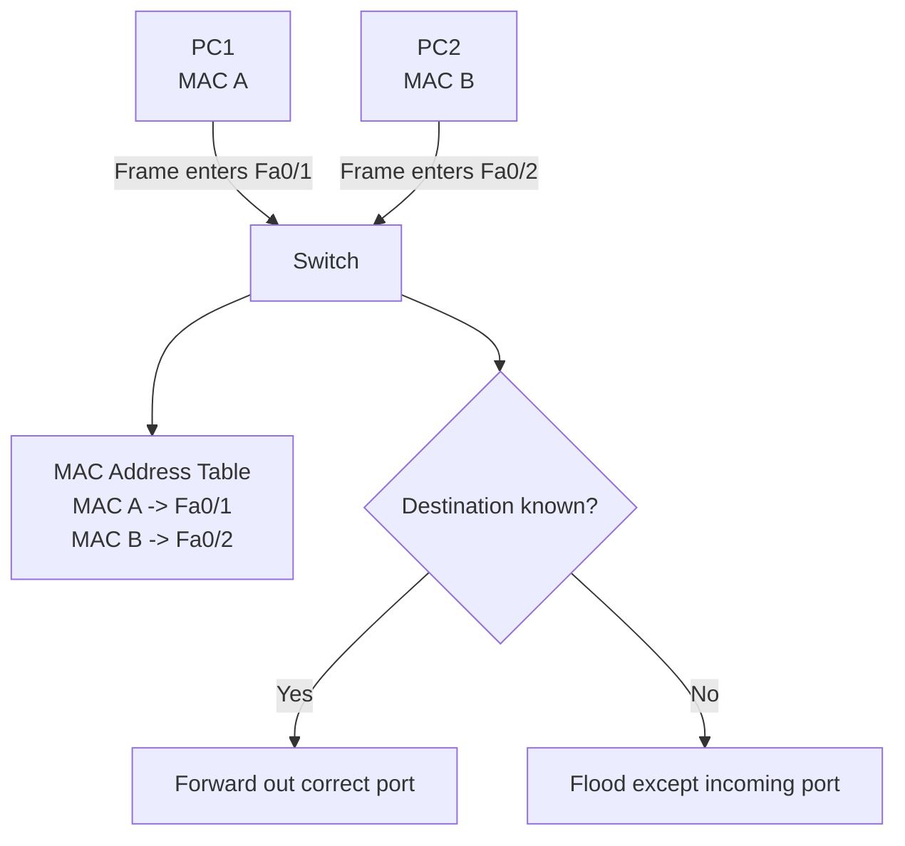

# LESSON 9: ENTERPRISE SWITCHING FUNDAMENTALS

## TRAINING FOCUS

This lesson is part of the FEMTECT Network Engineering Foundation course. It is written to help students build strong networking fundamentals through clear explanations, real enterprise context, practical troubleshooting logic, and certification-aware technical depth.

## VISUAL DIAGRAM: SWITCH MAC LEARNING



Students should understand that a switch learns from source MAC addresses and forwards based on destination MAC addresses.


## DEFINITION AND TECHNICAL IN-DEPTH KNOWLEDGE

### 9.1 Enterprise Switching

Enterprise switching is the use of network switches to connect devices inside a local area network and move Ethernet frames efficiently between them. A switch operates mainly at Layer 2 of the OSI model. It reads the source and destination MAC addresses inside Ethernet frames and uses that information to decide where to send traffic.

In Lesson 8, Ethernet was explained as the wired LAN technology that uses frames and MAC addresses for local delivery. Lesson 9 builds directly on that foundation. Ethernet defines the frame. Switching defines how that frame is handled inside the LAN.

A switch exists because a modern LAN may contain many end devices, servers, printers, wireless access points, IP phones, cameras, and uplinks. If all devices shared one old hub-based segment, traffic would be inefficient, collisions would be common, and security would be weak. A switch improves the LAN by giving each connected device a dedicated port, learning where MAC addresses are located, and forwarding frames only where they need to go when possible.

In real enterprise networks, switches form the access layer where users connect, the distribution layer where VLANs and routing may be aggregated, and sometimes the collapsed core in smaller organizations. A school, bank branch, hospital, factory, hotel, or office may have many switches across floors and buildings. These switches must forward traffic quickly, keep broadcast behavior controlled, support VLAN segmentation, provide Power over Ethernet for phones and access points, and help administrators troubleshoot user connectivity.

For CCNA and CompTIA Network+, students must understand MAC address tables, frame forwarding, flooding, filtering, port behavior, port security, and basic verification commands. These topics prepare students for VLANs, trunking, Spanning Tree Protocol, inter-VLAN routing, and enterprise troubleshooting.

### 9.2 Technical and Business Importance of Switching

Switching matters because most enterprise network problems first appear at the access switch. A user may say, "The internet is not working," but the real issue may be that the switch port is shut down, the cable is connected to the wrong VLAN, the switch has not learned the correct MAC address, port security has disabled the port, or the uplink is down.

A switch is not only a device with many ports. It is an intelligent forwarding device. It builds a database of MAC addresses, associates those MAC addresses with switch ports, and makes forwarding decisions in hardware. This allows LAN traffic to move quickly and reduces unnecessary traffic compared with hubs.

Switching also matters for security and design. If every device were placed in one flat network, broadcasts would reach too many devices, failures could spread more easily, and attackers would have a larger local attack surface. Enterprise switching supports segmentation through VLANs, controlled access through port settings, and basic access protection through features such as port security.

Where switching is used, technicians must know how to verify it. A network engineer should be able to look at a switch and answer practical questions: Is the port up? What MAC address is learned on this port? Is the port assigned to the correct VLAN? Is the port an access port or trunk port? Has port security blocked the device? Is the switch flooding because it does not know the destination MAC address?

## 9.3 SWITCHES IN THE ENTERPRISE LAN

A switch connects devices inside the same local network or VLAN. It does not normally make routing decisions unless it is a Layer 3 switch. A Layer 2 switch focuses on Ethernet frames and MAC addresses. A Layer 3 switch can also route between VLANs using Switch Virtual Interfaces, but inter-VLAN routing will be covered later in Lesson 16.

In the access layer, switches connect end devices such as laptops, desktops, printers, IP phones, wireless access points, and CCTV cameras. In the distribution layer, switches aggregate access switches and may enforce VLAN, routing, redundancy, and policy decisions. In a collapsed core design, one pair of powerful switches may perform both distribution and core roles for a smaller organization.

Enterprise switches commonly support features beyond basic forwarding. They may support VLANs, trunks, Spanning Tree Protocol, EtherChannel, Power over Ethernet, port security, DHCP snooping, Dynamic ARP Inspection, access control lists, Quality of Service, SNMP monitoring, Syslog logging, and centralized management. This lesson focuses on the switching fundamentals that come before those advanced features.

Enterprise Switching Roles

| Switch Location | Main Purpose | Common Connected Devices |
|---|---|---|
| Access Layer | Connect end devices to the network | PCs, phones, printers, APs, cameras |
| Distribution Layer | Aggregate access switches and apply policy | Access switch uplinks, routers, firewalls |
| Core Layer | Provide high-speed backbone connectivity | Distribution switches, data center, WAN edge |
| Collapsed Core | Combine distribution and core in smaller networks | Access switches, firewalls, servers |

## 9.4 MAC ADDRESS TABLE / CAM TABLE

The MAC address table is the switch database that maps MAC addresses to switch ports. Cisco often refers to this as the MAC address table, while the hardware memory used for fast lookup is commonly called CAM, which means Content Addressable Memory.

The MAC address table exists because the switch needs to know where devices are located. If PC1 is connected to FastEthernet0/1 and PC2 is connected to FastEthernet0/2, the switch should send PC1's frames for PC2 only out the port leading to PC2. Without a MAC address table, the switch would have to flood frames much more often, which would waste bandwidth and reduce efficiency.

The switch learns MAC addresses dynamically by reading the source MAC address of incoming frames. When a frame enters a switch port, the switch looks at the source MAC address and records that the source MAC can be reached through that port. This learning process is automatic.

For example, if a frame arrives on interface GigabitEthernet1/0/5 with source MAC address `00D0.BA11.2233`, the switch adds an entry saying that `00D0.BA11.2233` is reachable through `Gi1/0/5`. If that MAC address later sends traffic from a different port, the switch updates the table.

MAC Address Table Example

| MAC Address | VLAN | Port | Type |
|---|---:|---|---|
| 00D0.BA11.2233 | 10 | Gi1/0/5 | Dynamic |
| 00E0.FA22.3344 | 10 | Gi1/0/6 | Dynamic |
| 001B.0C55.8899 | 20 | Gi1/0/12 | Dynamic |
| 0050.56AA.1001 | 30 | Gi1/0/24 | Static |

The VLAN column matters because the same switch may support multiple VLANs. A MAC address entry is associated with both a VLAN and a port. Switching decisions are made inside the relevant VLAN. A device in VLAN 10 is not treated as if it belongs to VLAN 20 simply because it is on the same physical switch.

### Dynamic MAC Address Learning

Dynamic MAC address learning is the normal automatic process used by switches. The switch learns a MAC address when it receives a frame from that MAC address. The administrator does not need to manually add every device.

This is important in enterprise networks because users move, devices are replaced, laptops connect and disconnect, and IP phones or access points may reboot. Dynamic learning allows the switch to adapt.

Dynamic entries do not stay forever. Switches age out inactive MAC address entries after a period of time. Cisco switches commonly use a default MAC aging time of 300 seconds, although this can vary by platform and configuration. Aging prevents the table from keeping stale information about devices that moved or disconnected.

### Static MAC Address Entries

A static MAC address entry is manually configured by an administrator. Static entries are less common in normal access networks because they increase administrative work. They may be used in special environments where a device should always be tied to a specific port or where strict control is required.

Static entries should be documented carefully. If a device is moved to another port and the static entry is not updated, communication may fail or traffic may be forwarded incorrectly.

### MAC Address Table Verification

On Cisco IOS, a common verification command is:

```text
show mac address-table
```

To check entries for a specific interface:

```text
show mac address-table interface gigabitEthernet 0/1
```

To check entries for a specific VLAN:

```text
show mac address-table vlan 10
```

These commands are important in troubleshooting. If a PC is connected to a switch port but the switch does not learn the PC's MAC address, the technician should check the cable, NIC, port status, VLAN assignment, port security, and whether the PC is actually sending traffic.

## 9.5 THE FRAME SWITCHING PROCESS

The frame switching process is the logic a switch uses when it receives an Ethernet frame. The switch does not simply send every frame everywhere. It examines the frame, learns from it, checks its MAC address table, and then decides whether to forward, flood, or filter the frame.

The basic process is:

1. The switch receives an Ethernet frame on a port.
2. The switch reads the source MAC address and learns or updates the MAC address table.
3. The switch reads the destination MAC address.
4. The switch checks the MAC address table inside the same VLAN.
5. The switch forwards, floods, or filters the frame based on the result.

This process is extremely fast in modern switches because forwarding decisions are performed in specialized hardware.

### Source MAC Learning

When a frame enters a switch, the first useful thing the switch learns is the source MAC address. The source MAC tells the switch where the sender is located.

For example, PC1 sends a frame into switch port `Fa0/1`. The switch reads PC1's source MAC address and records that PC1 is reachable through `Fa0/1`. This learning happens before the switch makes the forwarding decision for the destination.

Source MAC learning is the reason a switch becomes more efficient over time. At first, the switch may not know where all devices are located. As devices communicate, the table fills with useful entries.

### Destination MAC Lookup

After learning the source MAC address, the switch checks the destination MAC address. The destination MAC tells the switch where the frame is trying to go.

If the destination MAC address exists in the MAC address table for the same VLAN, the switch knows the correct outgoing port. If the destination MAC address is unknown, the switch must flood the frame inside that VLAN. If the destination MAC address is on the same port where the frame arrived, the switch filters the frame because sending it back out the same port is unnecessary.

## 9.6 FLOOD, FORWARD, AND FILTER

Flood, forward, and filter are three core switching behaviors. Students must understand these terms because they explain what a switch does with frames in real networks.

### Forward

Forwarding happens when the switch knows the destination MAC address and sends the frame only out the correct port.

For example, PC1 on `Fa0/1` sends a frame to PC2. The switch checks its MAC address table and sees that PC2's MAC address is on `Fa0/2`. The switch forwards the frame only out `Fa0/2`.

Forwarding is efficient because unnecessary ports do not receive the frame. This reduces traffic exposure and improves LAN performance.

### Flood

Flooding happens when the switch sends a frame out multiple ports because the destination must be delivered broadly or is unknown.

There are two common flooding situations. The first is broadcast traffic. A frame with destination MAC address `FF:FF:FF:FF:FF:FF` must be flooded to all ports in the same VLAN, except the port where it was received. ARP Requests and DHCP Discover messages are common examples.

The second is unknown unicast traffic. If the switch receives a unicast frame but does not know the destination MAC address, it floods the frame out all ports in the same VLAN except the incoming port. The destination device should receive the frame if it is somewhere in that VLAN. When the destination replies, the switch learns the destination's source MAC address.

Flooding is normal, but excessive flooding can indicate a problem. Unknown unicast flooding may happen when the MAC address table has aged out, when devices are silent, when a topology problem exists, or when the switch table is overloaded. Broadcast storms can happen during Layer 2 loops, which will be covered in Lesson 15 on Spanning Tree Protocol.

### Filter

Filtering happens when the switch decides not to forward a frame out a port. The most basic filtering example occurs when the destination MAC address is learned on the same port where the frame arrived.

For example, imagine a small hub is connected to a switch port with two legacy devices behind it. If Device A sends a frame to Device B and both are behind the same switch port, the switch may already know that the destination MAC address is reachable through the same incoming port. It filters the frame and does not send it back out that port.

Filtering can also describe policy-based behavior, such as a port security violation or an access control rule on more advanced switches. In this lesson, the main focus is basic Layer 2 filtering.

Flood, Forward, and Filter Summary

| Switch Decision | When It Happens | What the Switch Does |
|---|---|---|
| Forward | Destination MAC is known on another port in the same VLAN | Sends frame only out the correct port |
| Flood | Destination is broadcast, multicast, or unknown unicast | Sends frame out all appropriate VLAN ports except incoming port |
| Filter | Destination is on the same incoming port or policy blocks it | Does not forward the frame out that port |

## 9.7 STEP-BY-STEP PACKET JOURNEY THROUGH A SWITCH

Consider a simple office LAN with one switch, two PCs, and one printer. PC1 is connected to `Fa0/1`, PC2 is connected to `Fa0/2`, and the printer is connected to `Fa0/3`. All devices are in VLAN 10.

At the start, the switch MAC address table is empty.

PC1 sends an ARP Request to find PC2's MAC address. The destination MAC is broadcast, so the switch learns PC1's MAC address on `Fa0/1` and floods the ARP Request out `Fa0/2` and `Fa0/3`.

PC2 replies with an ARP Reply. The switch learns PC2's MAC address on `Fa0/2`. The destination MAC is PC1's MAC address, which the switch already knows is on `Fa0/1`, so the switch forwards the reply only out `Fa0/1`.

Now PC1 sends normal unicast traffic to PC2. The switch already knows PC2's MAC address, so it forwards the frame only out `Fa0/2`. The printer on `Fa0/3` does not receive the frame.

This process explains why switches are more efficient than hubs. A hub repeats traffic to all ports. A switch learns addresses and forwards traffic intelligently.

Switch Learning Sequence

| Step | Event | Switch Action |
|---:|---|---|
| 1 | PC1 sends ARP Request | Learns PC1 on `Fa0/1` and floods broadcast |
| 2 | PC2 sends ARP Reply | Learns PC2 on `Fa0/2` and forwards to PC1 |
| 3 | PC1 sends data to PC2 | Forwards only to `Fa0/2` |
| 4 | Printer remains uninvolved | Does not receive PC1-to-PC2 unicast frame |

## 9.8 SWITCH PORT MODES

A switch port mode defines how a switch port handles VLAN traffic. The two most important modes are access mode and trunk mode. VLANs and trunking will be taught in greater depth in Lessons 13 and 14, but students need the basic port-mode idea now because port mode affects whether a device can communicate correctly.

An access port belongs to one VLAN and is normally used for end devices. A trunk port carries traffic for multiple VLANs and is normally used between switches, between a switch and a router, between a switch and a firewall, or between a switch and a virtualization host.

### Access Ports

An access port carries traffic for one VLAN. It is usually configured for an end device such as a PC, printer, IP phone, access point in local mode, or CCTV camera.

For example, a staff PC may be connected to an access port in VLAN 10. A printer may be connected to an access port in VLAN 20. A guest access point may connect to a port that maps guest traffic to a separate VLAN depending on design.

Access ports matter because a device in the wrong VLAN may have the wrong subnet, wrong DHCP scope, wrong gateway, and wrong security policy. A user may connect physically to the network, but if the port is assigned to the wrong VLAN, the user may not reach the correct resources.

Basic Cisco IOS access-port example:

```text
interface fastEthernet 0/10
 switchport mode access
 switchport access vlan 10
```

### Trunk Ports

A trunk port carries traffic for multiple VLANs across one physical link. Trunks are commonly used between switches and between a switch and a router or firewall when multiple VLANs must cross the same connection.

Trunking is important because enterprises rarely use only one VLAN. A single uplink may need to carry staff, voice, guest, CCTV, server, and management VLANs. Instead of running a separate cable for every VLAN, trunking allows multiple VLANs to share one link using VLAN tagging.

IEEE 802.1Q tagging will be covered more deeply in Lesson 14. For now, remember that trunk ports are not normally used for ordinary user PCs unless there is a special reason such as virtualization, IP phone pass-through, or lab testing.

Basic Cisco IOS trunk-port example:

```text
interface gigabitEthernet 0/1
 switchport mode trunk
```

### Dynamic Port Behavior

Some Cisco switches support Dynamic Trunking Protocol, or DTP. DTP can negotiate whether a port becomes a trunk. In production networks, many engineers prefer to manually configure ports as access or trunk ports to avoid unexpected trunk formation.

For security and predictability, unused access ports should be shut down or placed in an unused VLAN. User-facing ports should normally be forced to access mode unless trunking is required.

Switch Port Mode Comparison

| Port Mode | Carries | Common Use | Risk If Misconfigured |
|---|---|---|---|
| Access | One VLAN | End devices | User placed in wrong VLAN |
| Trunk | Multiple VLANs | Switch uplinks, router/firewall links | VLAN leakage or missing VLANs |
| Dynamic | Negotiated behavior | Some Cisco environments | Unexpected trunking |

## 9.9 BASIC PORT SECURITY CONCEPTS

Port security is a switch feature that controls which MAC addresses are allowed on a switch port. It helps limit unauthorized device access at the access layer.

Port security exists because a physical Ethernet port can be misused. Someone may unplug an office PC and connect an unauthorized laptop. A user may connect a small unmanaged switch under a desk. A visitor may try to plug into a wall jack. Without controls, the switch may learn the new MAC address and allow traffic according to the VLAN configuration.

Port security is not a complete security solution, but it is an important access-layer hardening feature. It should be combined with good physical security, 802.1X where available, DHCP snooping, Dynamic ARP Inspection, VLAN segmentation, monitoring, and proper documentation.

### How Port Security Works

Port security allows the administrator to define how many MAC addresses may be learned on a port and, optionally, which MAC addresses are allowed. If the port learns more MAC addresses than permitted or learns an unauthorized MAC address, a violation occurs.

For example, a staff PC port may be configured to allow only one MAC address. If a user connects an unmanaged switch and then connects multiple devices, the port may detect more MAC addresses than allowed and trigger a violation.

Basic Cisco IOS port security example:

```text
interface fastEthernet 0/10
 switchport mode access
 switchport access vlan 10
 switchport port-security
 switchport port-security maximum 1
 switchport port-security mac-address sticky
 switchport port-security violation shutdown
```

Sticky MAC learning allows the switch to dynamically learn a MAC address and treat it like a secure address. This is useful when administrators do not want to manually type every MAC address.

### Port Security Violation Modes

Cisco port security commonly uses three violation modes: protect, restrict, and shutdown.

Protect mode drops unauthorized traffic but does not generate as much visibility. Restrict mode drops unauthorized traffic and can increment violation counters or generate logs depending on configuration. Shutdown mode places the port into an error-disabled state, which usually requires administrator action or automatic recovery configuration.

Port Security Violation Modes

| Mode | What Happens | Visibility | Common Use |
|---|---|---|---|
| Protect | Drops unauthorized frames | Low | Limited-control environments |
| Restrict | Drops unauthorized frames and records violations | Medium | Monitoring-focused environments |
| Shutdown | Error-disables the port | High | Strict access-layer control |

Shutdown mode is strict and visible, but it can also create helpdesk tickets if legitimate devices are replaced without updating the port security state. A technician must understand the business impact before applying strict port security widely.

### Port Security Troubleshooting

When port security blocks a port, users may report that the network cable is connected but there is no network access. The interface may appear error-disabled.

Useful Cisco IOS commands include:

```text
show port-security
show port-security interface fastEthernet 0/10
show interfaces status
show interfaces fastEthernet 0/10
show errdisable recovery
```

To recover an error-disabled port manually, an administrator commonly enters interface configuration mode and shuts/no shuts the port after fixing the cause:

```text
interface fastEthernet 0/10
 shutdown
 no shutdown
```

This should not be done blindly. If the violation was caused by an unauthorized device, the device should be removed or the security policy should be reviewed before re-enabling the port.

## 9.10 ENTERPRISE SWITCHING TROUBLESHOOTING

Switching troubleshooting begins with the physical link but does not stop there. A switch port can show link up while the device still fails because of VLAN mismatch, port security, MAC learning problems, trunk problems, DHCP scope issues, or upstream connectivity problems.

A practical troubleshooting sequence is:

1. Check whether the cable is connected and the link light is active.
2. Verify the switch port status.
3. Confirm speed and duplex.
4. Check the VLAN assigned to the port.
5. Check whether the switch learned the device MAC address.
6. Check whether port security is active or violated.
7. Check uplink status.
8. Test gateway reachability from the host.
9. Review logs and interface counters.

Cisco IOS commands:

```text
show interfaces status
show interfaces fastEthernet 0/10
show mac address-table interface fastEthernet 0/10
show vlan brief
show running-config interface fastEthernet 0/10
show port-security interface fastEthernet 0/10
show logging
```

Windows checks:

```text
ipconfig /all
ping <default-gateway>
arp -a
getmac /v
```

Linux checks:

```text
ip addr
ip link
ip neigh
ping <default-gateway>
```

Enterprise Troubleshooting Examples

| Symptom | Possible Switching Cause | What to Check |
|---|---|---|
| PC has no network access | Port is down or administratively shut | `show interfaces status` |
| PC gets wrong IP subnet | Port is in wrong VLAN | `show vlan brief` |
| PC link is up but no traffic passes | Port security violation | `show port-security interface` |
| Traffic reaches some devices but not others | MAC table or VLAN issue | `show mac address-table`, VLAN assignment |
| Many devices lose connectivity after adding a switch | Loop or trunk problem | STP status, uplinks, trunk configuration |
| Intermittent slowness | Duplex/speed issue or errors | Interface counters, CRC, duplex |

## 9.11 CYBERSECURITY RELEVANCE

Switching is a security topic because attackers often begin from the access layer. If an attacker can connect a device to an active wall port, they may attempt reconnaissance, spoofing, man-in-the-middle attacks, DHCP attacks, ARP attacks, or unauthorized access to internal systems.

Basic switching security reduces unnecessary exposure. Administrators should disable unused ports, place unused ports in an unused VLAN, use port security where appropriate, document port ownership, monitor MAC address changes, and avoid unnecessary trunking on user-facing ports.

Port security can help limit casual unauthorized access, but it should not be treated as the final defense. MAC addresses can be spoofed. Stronger enterprise environments may use 802.1X authentication, Network Access Control, endpoint compliance checks, and centralized identity systems.

From a cybersecurity point of view, the switch is both a forwarding device and a control point. Good switching hygiene makes attacks harder, improves investigation, and reduces the blast radius of a compromised endpoint.

## 9.12 CLOUD NETWORKING RELEVANCE

Cloud networking still uses switching concepts, even when the student does not see a physical switch. In a cloud platform, virtual networks, subnets, virtual NICs, security groups, load balancers, and hypervisor virtual switches all rely on similar ideas: interfaces, forwarding, segmentation, and policy.

A virtual machine has a virtual NIC. That virtual NIC has a MAC address. Traffic is forwarded through virtual switching components inside the cloud provider's infrastructure. The administrator may not manage the underlying switch CLI, but the concepts of Layer 2 adjacency, segmentation, and interface attachment still matter.

In enterprise hybrid networks, physical switches connect users, servers, wireless access points, firewalls, WAN routers, SD-WAN appliances, and cloud connectivity devices. A cloud application may fail for users because of a local switch port, VLAN, trunk, or uplink issue before traffic ever reaches the internet or cloud provider.

## 10. KEY TERMS / GLOSSARY

| Term | Meaning |
|---|---|
| Switch | A network device that forwards Ethernet frames based on MAC addresses. |
| Enterprise Switching | Use of switches to connect, segment, and manage traffic in an organization LAN. |
| MAC Address Table | Switch database mapping MAC addresses to ports and VLANs. |
| CAM Table | Hardware-based table used for fast MAC address lookup. |
| Dynamic MAC Entry | MAC address table entry learned automatically from incoming frames. |
| Static MAC Entry | Manually configured MAC address table entry. |
| MAC Aging | Process of removing inactive dynamic MAC entries after a period of time. |
| Forward | To send a frame out the known correct port. |
| Flood | To send a frame out all appropriate ports except the incoming port. |
| Filter | To avoid forwarding a frame out a port when forwarding is unnecessary or blocked. |
| Unknown Unicast | A unicast frame whose destination MAC address is not yet in the switch MAC table. |
| Access Port | A switch port assigned to one VLAN, normally used for end devices. |
| Trunk Port | A switch port that carries traffic for multiple VLANs. |
| DTP | Dynamic Trunking Protocol, used by some Cisco switches to negotiate trunking. |
| Port Security | Switch feature that limits allowed MAC addresses on a port. |
| Sticky MAC | Dynamically learned MAC address stored as a secure address for port security. |
| Violation Mode | Port security action taken when a security rule is broken. |
| Error-Disabled | A switch port state where the port is disabled because of a detected problem. |

## 11. COMPARISON TABLES

### 11.1 Hub vs Switch

| Feature | Hub | Switch |
|---|---|---|
| OSI Layer | Layer 1 | Mainly Layer 2 |
| Forwarding Logic | Repeats bits to all ports | Uses MAC address table |
| Collision Domains | One shared collision domain | Each port is separate collision domain |
| Efficiency | Low | High |
| Security Exposure | Higher, because traffic is repeated broadly | Lower, because known unicast is forwarded selectively |
| Modern Enterprise Use | Rare/legacy | Standard |

### 11.2 Dynamic vs Static MAC Entries

| Feature | Dynamic MAC Entry | Static MAC Entry |
|---|---|---|
| How Created | Learned automatically | Manually configured |
| Maintenance | Low | Higher |
| Aging | Ages out when inactive | Usually remains until removed |
| Common Use | Normal enterprise switching | Special control requirements |
| Risk | Can be affected by movement or spoofing | Can break communication if not updated |

### 11.3 Flood vs Forward vs Filter

| Action | Trigger | Result |
|---|---|---|
| Forward | Known destination MAC on another port | Frame sent only to correct port |
| Flood | Broadcast, multicast, or unknown unicast | Frame sent to all appropriate VLAN ports except incoming port |
| Filter | Destination learned on incoming port or blocked by policy | Frame is not sent out that port |

### 11.4 Access Port vs Trunk Port

| Feature | Access Port | Trunk Port |
|---|---|---|
| VLAN Handling | One VLAN | Multiple VLANs |
| Common Connection | PC, printer, phone, camera | Switch, router, firewall, virtualization host |
| Tagging | Usually sends untagged frames to endpoint | Uses VLAN tagging such as 802.1Q |
| Main Risk | Wrong VLAN assignment | Missing or unauthorized VLANs |
| Lesson Depth | Basic here, more in Lessons 13 and 14 | Basic here, more in Lesson 14 |

### 11.5 Port Security Violation Modes

| Mode | Unauthorized Traffic | Logging/Counter Visibility | Port State |
|---|---|---|---|
| Protect | Dropped | Low | Stays up |
| Restrict | Dropped | Medium | Stays up |
| Shutdown | Dropped | High | Error-disabled |

## 12. REAL-WORLD EXAMPLE / ANALOGY

Think of a switch like a professional office receptionist who learns where everyone sits. At first, if the receptionist does not know where a person is located, they may announce the message broadly in the correct department. After people respond, the receptionist learns their desk locations and can deliver future messages directly.

The MAC address table is the receptionist's desk directory. Forwarding is direct delivery to the right desk. Flooding is announcing inside the department when the exact desk is unknown. Filtering is refusing to send a message back to the same place it came from.

This analogy is useful, but the real technical point is that switches learn from source MAC addresses and make forwarding decisions using destination MAC addresses.

## 14. WINDOWS, LINUX, AND CISCO IOS PRACTICAL COMMANDS

### Windows Commands

```text
ipconfig /all
getmac /v
arp -a
ping <default-gateway>
```

Windows is useful for identifying the host MAC address, IP configuration, default gateway, and ARP table. If the Windows MAC address does not appear on the expected switch port, the technician should verify cable path, dock connection, adapter status, and switch port configuration.

### Linux Commands

```text
ip addr
ip link
ip neigh
ping <default-gateway>
```

Linux is useful for checking interface state, MAC address, IPv4/IPv6 addressing, neighbor information, and gateway reachability. If `ip link` shows the interface down, the problem may be local adapter state, cable, switch port, or physical media.

### Cisco IOS Commands

```text
show interfaces status
show interfaces switchport
show mac address-table
show mac address-table interface fastEthernet 0/10
show vlan brief
show running-config interface fastEthernet 0/10
show port-security
show port-security interface fastEthernet 0/10
show logging
```

Cisco IOS commands allow the technician to verify the switch side of the connection. The host may believe it is connected, but the switch reveals whether the port is up, assigned to the correct VLAN, learning the expected MAC address, or blocked by a security feature.

## 15. QUICK-RECAP CHEAT SHEET

- A switch forwards Ethernet frames using MAC addresses.
- Switches learn source MAC addresses.
- Switches look up destination MAC addresses.
- The MAC address table maps MAC addresses to ports and VLANs.
- CAM refers to hardware memory used for fast MAC lookup.
- A known unicast frame is forwarded only to the correct port.
- A broadcast frame is flooded within the VLAN.
- An unknown unicast frame is flooded within the VLAN.
- A frame may be filtered if the destination is on the incoming port.
- Access ports carry one VLAN and usually connect end devices.
- Trunk ports carry multiple VLANs and usually connect network devices.
- Dynamic trunk negotiation should be controlled in production networks.
- Port security limits allowed MAC addresses on a port.
- Sticky MAC allows dynamic learning of secure MAC addresses.
- Port security violation modes include protect, restrict, and shutdown.
- Shutdown mode can place a port into error-disabled state.
- Wrong VLAN assignment can make a correctly cabled device fail.
- `show mac address-table` is a key switching troubleshooting command.
- `show interfaces status` quickly checks port state.
- `show port-security interface` helps investigate port security issues.

## 7. LESSON ASSESSMENT

This assessment is intentionally focused. Students should answer clearly, use correct networking terminology, and show practical troubleshooting thinking.

### 7.1 Theory Questions

1. Explain the main networking concept covered in this lesson and describe its role in a real enterprise network.
2. Describe two technical problems that can occur when this lesson's concept is poorly designed or incorrectly configured.
3. Explain how a network technician or junior network engineer would verify that this part of the network is working correctly.
4. Describe one security, reliability, or performance concern related to this topic.
5. Explain how this topic connects to CCNA, Network+, IT support, or junior network engineering work.

### 7.2 Multiple-Choice Questions

1. What is the best reason for studying this lesson's topic?
   A. It helps students understand and support real network operation.
   B. It replaces the need for troubleshooting.
   C. It removes the need for IP addressing.
   D. It is only useful for memorizing definitions.

2. When troubleshooting a problem related to this lesson, what should be done first?
   A. Gather evidence and identify the exact scope of the problem.
   B. Replace every network device immediately.
   C. Delete the running configuration without backup.
   D. Assume the Internet service provider is always responsible.

3. Which habit best reflects professional network engineering practice?
   A. Verify changes with commands, tests, and documented results.
   B. Make random changes until something works.
   C. Ignore diagrams and rely only on memory.
   D. Avoid documenting successful fixes.

4. Which item is most useful when proving that a network feature is working?
   A. A successful test result compared with the expected result.
   B. A guess from another user.
   C. A device name with no configuration evidence.
   D. A screenshot unrelated to the problem.

5. What should students connect this lesson to during hands-on practice?
   A. Addressing, device roles, commands, verification, and troubleshooting.
   B. Only typing speed.
   C. Only cable color.
   D. Only memorizing vendor logos.

6. In an enterprise environment, why is documentation important for this topic?
   A. It helps future troubleshooting, audits, handover, and change control.
   B. It makes testing unnecessary.
   C. It disables security risks automatically.
   D. It replaces the need for correct configuration.

7. Which approach gives the strongest learning outcome?
   A. Combining technical explanation with lab practice and verification.
   B. Reading commands without understanding them.
   C. Skipping troubleshooting steps.
   D. Memorizing answers without using the network.

8. If a configuration change causes a new outage, what should the technician use?
   A. A rollback plan and saved baseline information.
   B. A random new subnet.
   C. A different monitor.
   D. A guess without evidence.

9. Which result shows that a student understands the lesson at a practical level?
   A. The student can explain the concept, configure or identify it, test it, and troubleshoot failure.
   B. The student can only repeat the title.
   C. The student avoids using commands.
   D. The student ignores enterprise examples.

10. Why are scenario questions included in this course?
   A. They train students to apply concepts to real network problems.
   B. They remove the need for labs.
   C. They focus only on spelling.
   D. They are unrelated to IT jobs.

### 7.3 Scenario-Based Questions

1. A user or department reports a connectivity problem related to this lesson's topic. Write the first five checks you would perform, the commands or tools you would use, and the evidence you expect to collect.
2. You are asked to explain this topic to a new IT support intern before a hands-on lab. Write a short technical explanation that connects the concept to real devices, real traffic flow, and troubleshooting.

### 7.4 Answer Guide

Theory answers should be marked for technical accuracy, clear explanation, correct terminology, and practical relevance to enterprise networking. Scenario answers should show a logical troubleshooting sequence, evidence gathering, likely causes, verification steps, and a professional final recommendation.

Multiple-choice answers: 1. A; 2. A; 3. A; 4. A; 5. A; 6. A; 7. A; 8. A; 9. A; 10. A
