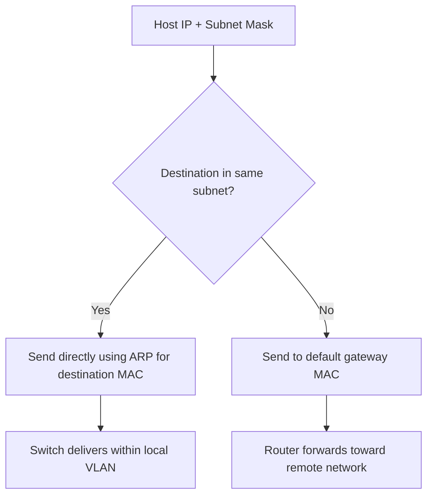

# LESSON 10: IPV4 ADDRESSING FUNDAMENTALS

## TRAINING FOCUS

This lesson is part of the FEMTECT Network Engineering Foundation course. It is written to help students build strong networking fundamentals through clear explanations, real enterprise context, practical troubleshooting logic, and certification-aware technical depth.

## VISUAL DIAGRAM: IPv4 ADDRESS DECISION



This diagram is the foundation for understanding subnet masks, default gateways, ARP, and routing.


## DEFINITION AND TECHNICAL IN-DEPTH KNOWLEDGE

### 10.1 IPv4 Addressing

IPv4 addressing is the system used to identify devices at Layer 3 of the OSI model so that packets can be delivered across local and remote networks. IPv4 means Internet Protocol version 4. It is one of the most important foundations of networking because almost every troubleshooting task eventually asks the same question: does this device have the correct IP address, subnet mask, default gateway, and DNS server?

In Lessons 8 and 9, Ethernet and switching explained local delivery. Ethernet uses MAC addresses, and switches forward frames inside a LAN or VLAN. IPv4 works above that local delivery system. IPv4 gives devices logical addresses so routers can move packets from one network to another.

An IPv4 address is 32 bits long. Humans usually write it in dotted-decimal format, such as `192.168.10.25`. The address is divided into four sections called octets. Each octet represents 8 bits, and each octet can range from 0 to 255.

IPv4 exists because networks need a logical addressing system. MAC addresses identify network interfaces locally, but MAC addresses do not describe which IP network a device belongs to. IPv4 addresses provide structure. They help devices determine whether a destination is local or remote. They help routers decide where packets should go. They help administrators design networks for departments, buildings, branches, data centers, cloud environments, and internet connectivity.

For CCNA and CompTIA Network+, IPv4 addressing is a must-master topic. Students must understand binary, decimal, hexadecimal, IPv4 address structure, network and host portions, public and private addresses, APIPA, and classful addressing history before they can subnet confidently.

### 10.2 Technical and Business Importance of IPv4 Addressing

IPv4 addressing matters because a device can be physically connected to the correct switch and still fail if its IPv4 configuration is wrong. A laptop may have link lights, a valid Ethernet connection, and a learned MAC address on the switch, but it will not reach the correct resources if the IP address is in the wrong subnet, the subnet mask is wrong, the gateway is missing, or the device has assigned itself an APIPA address.

IPv4 addressing also matters because routers use IP addresses to move traffic between networks. A switch forwards frames based on MAC addresses inside one Layer 2 area. A router forwards packets based on destination IP addresses between Layer 3 networks. Without correct IPv4 addressing, routing cannot work properly.

In enterprise support, many common tickets are IPv4-related. A user cannot access a shared folder because the device is on the guest network. A printer cannot be reached because it has a duplicate IP address. A CCTV camera is configured with the wrong gateway. A server loses internet access because its subnet mask is incorrect. A branch office cannot reach headquarters because a route points to the wrong network.

IPv4 addressing is also important for security. Network segmentation, firewall policies, access control lists, VPNs, NAT, DHCP scopes, monitoring tools, and incident investigations all depend on knowing which IP addresses belong to which networks.

## 10.3 NUMBER SYSTEMS USED IN NETWORKING

Networking uses several number systems. The most important for this stage are decimal, binary, and hexadecimal.

Decimal is the number system humans use every day. It is base 10, meaning it uses ten digits: 0 through 9. IPv4 addresses are usually written in decimal because `192.168.10.25` is easier for humans to read than a long binary string.

Binary is base 2. It uses only two digits: 0 and 1. Computers process data in binary. IPv4 addresses are actually binary numbers, even though humans usually write them in dotted-decimal format.

Hexadecimal is base 16. It uses digits 0 through 9 and letters A through F. Hexadecimal appears often in MAC addresses, IPv6 addresses, memory values, packet captures, and troubleshooting tools. Although IPv4 addresses are usually written in decimal, students should understand hexadecimal because networking regularly uses it.

Number System Comparison

| Number System | Base | Symbols Used | Networking Example |
|---|---:|---|---|
| Decimal | 10 | 0-9 | IPv4 octet such as `192` |
| Binary | 2 | 0 and 1 | IPv4 octet such as `11000000` |
| Hexadecimal | 16 | 0-9 and A-F | MAC address section such as `A4` |

## 10.4 BINARY FUNDAMENTALS

Binary is the language of bits. A bit can be either 0 or 1. An IPv4 address contains 32 bits. Those 32 bits are divided into four octets, and each octet contains 8 bits.

Each bit position in an octet has a value. From left to right, the values are:

```text
128  64  32  16   8   4   2   1
```

These values exist because binary uses powers of 2. The rightmost bit is worth 1. Moving left, each position doubles.

Binary Octet Place Values

| Bit Position | 1st | 2nd | 3rd | 4th | 5th | 6th | 7th | 8th |
|---|---:|---:|---:|---:|---:|---:|---:|---:|
| Value | 128 | 64 | 32 | 16 | 8 | 4 | 2 | 1 |

To convert binary to decimal, add the values where the bit is 1.

Example:

```text
Binary:  11000000
Values:  128 64 32 16 8 4 2 1
Add:     128 + 64 = 192
Decimal: 192
```

Another example:

```text
Binary:  00001010
Values:  128 64 32 16 8 4 2 1
Add:     8 + 2 = 10
Decimal: 10
```

This is why the IPv4 address `192.168.10.25` can be represented in binary as:

```text
192      168      10       25
11000000.10101000.00001010.00011001
```

Students do not need to fear binary. Binary conversion becomes manageable when the eight octet values are memorized: `128, 64, 32, 16, 8, 4, 2, 1`.

## 10.5 DECIMAL TO BINARY CONVERSION

To convert decimal to binary, determine which binary place values are needed to build the decimal number. Start from the largest value, 128, and move right.

Example: Convert `172` to binary.

The place values are:

```text
128 64 32 16 8 4 2 1
```

Start with 128. Since 172 is greater than 128, place a 1 under 128 and subtract:

```text
172 - 128 = 44
```

Next is 64. Since 44 is less than 64, place a 0 under 64.

Next is 32. Since 44 is greater than 32, place a 1 under 32 and subtract:

```text
44 - 32 = 12
```

Next is 16. Since 12 is less than 16, place a 0 under 16.

Next is 8. Since 12 is greater than 8, place a 1 under 8 and subtract:

```text
12 - 8 = 4
```

Next is 4. Since 4 equals 4, place a 1 under 4 and subtract:

```text
4 - 4 = 0
```

The remaining positions are 2 and 1. Because nothing remains, both are 0.

Result:

```text
Decimal: 172
Binary:  10101100
```

Decimal to Binary Examples

| Decimal | Binary | Explanation |
|---:|---|---|
| 10 | 00001010 | 8 + 2 |
| 25 | 00011001 | 16 + 8 + 1 |
| 100 | 01100100 | 64 + 32 + 4 |
| 172 | 10101100 | 128 + 32 + 8 + 4 |
| 192 | 11000000 | 128 + 64 |
| 255 | 11111111 | All values added |

## 10.6 HEXADECIMAL FUNDAMENTALS

Hexadecimal is base 16. It is used because it can represent binary more compactly than decimal in many technical contexts. Four binary bits can be represented by one hexadecimal character.

Hexadecimal symbols are:

```text
0 1 2 3 4 5 6 7 8 9 A B C D E F
```

The letters represent decimal values:

| Hex | Decimal |
|---|---:|
| A | 10 |
| B | 11 |
| C | 12 |
| D | 13 |
| E | 14 |
| F | 15 |

Hexadecimal appears in MAC addresses, such as:

```text
00:1A:2B:3C:4D:5E
```

It also appears heavily in IPv6, packet captures, error outputs, and low-level troubleshooting. In IPv4 lessons, hexadecimal is mainly introduced so students are comfortable with the number system before IPv6 and deeper packet analysis.

Binary to Hexadecimal Relationship

| Binary | Hex | Decimal |
|---|---|---:|
| 0000 | 0 | 0 |
| 0001 | 1 | 1 |
| 0010 | 2 | 2 |
| 0011 | 3 | 3 |
| 0100 | 4 | 4 |
| 0101 | 5 | 5 |
| 0110 | 6 | 6 |
| 0111 | 7 | 7 |
| 1000 | 8 | 8 |
| 1001 | 9 | 9 |
| 1010 | A | 10 |
| 1011 | B | 11 |
| 1100 | C | 12 |
| 1101 | D | 13 |
| 1110 | E | 14 |
| 1111 | F | 15 |

## 10.7 IPv4 ADDRESS STRUCTURE

An IPv4 address has 32 bits divided into four octets. Each octet is 8 bits. In dotted-decimal format, the octets are separated by periods.

Example:

```text
192.168.10.25
```

This address has four octets:

| Octet Position | Decimal Value | Binary Value |
|---|---:|---|
| 1st Octet | 192 | 11000000 |
| 2nd Octet | 168 | 10101000 |
| 3rd Octet | 10 | 00001010 |
| 4th Octet | 25 | 00011001 |

Each octet can range from 0 to 255 because 8 binary bits can represent 256 possible values, from 0 through 255.

The full binary form is:

```text
11000000.10101000.00001010.00011001
```

IPv4 addresses are not random labels. They have structure. Part of the address identifies the network. Part of the address identifies the host on that network. The subnet mask tells the device where the network portion ends and where the host portion begins.

## 10.8 NETWORK PORTION AND HOST PORTION

Every usable IPv4 address belongs to an IP network. The address is divided into a network portion and a host portion.

The network portion identifies the network or subnet. Devices in the same IP network share the same network portion. The host portion identifies the specific device inside that network.

For example:

```text
IP Address:   192.168.10.25
Subnet Mask:  255.255.255.0
```

With the mask `255.255.255.0`, the first three octets identify the network, and the last octet identifies the host.

```text
Network portion: 192.168.10
Host portion:    25
```

The network itself is commonly written as:

```text
192.168.10.0/24
```

The `/24` means that the first 24 bits are the network portion. CIDR notation and subnetting will be explained deeply in Lesson 11, but students should begin recognizing that `/24` is another way to describe a subnet mask of `255.255.255.0`.

Why does the network/host split matter? It tells the device whether a destination is local or remote. If the destination is local, the device tries to reach it inside the same LAN or VLAN using ARP and Ethernet. If the destination is remote, the device sends the packet to its default gateway.

Network vs Host Portion Example

| IP Address | Subnet Mask | Network Portion | Host Portion |
|---|---|---|---|
| 192.168.10.25 | 255.255.255.0 | 192.168.10 | 25 |
| 10.1.5.20 | 255.255.0.0 | 10.1 | 5.20 |
| 172.16.30.50 | 255.255.255.0 | 172.16.30 | 50 |

## 10.9 SUBNET MASK BASICS

A subnet mask is a 32-bit value that identifies which part of an IPv4 address is the network portion and which part is the host portion. It is written in dotted-decimal format like an IPv4 address.

Common subnet masks include:

```text
255.0.0.0
255.255.0.0
255.255.255.0
```

In binary, the 1 bits represent the network portion, and the 0 bits represent the host portion.

Example:

```text
Subnet Mask: 255.255.255.0
Binary:      11111111.11111111.11111111.00000000
```

This means the first 24 bits are the network portion, and the last 8 bits are the host portion.

Subnet Mask Examples

| Subnet Mask | CIDR Prefix | Network Bits | Host Bits | Common Description |
|---|---:|---:|---:|---|
| 255.0.0.0 | /8 | 8 | 24 | Very large network |
| 255.255.0.0 | /16 | 16 | 16 | Large network |
| 255.255.255.0 | /24 | 24 | 8 | Common small LAN subnet |

This lesson introduces subnet masks only at a foundation level. Lesson 11 will teach network addresses, broadcast addresses, host ranges, CIDR, fast subnetting, and VLSM in detail.

## 10.10 LOCAL VS REMOTE DESTINATION DECISION

An IPv4 host uses its IP address and subnet mask to decide whether a destination is local or remote.

If the destination is in the same IP network, the host treats it as local. It uses ARP to find the destination MAC address and sends the Ethernet frame directly to that local device.

If the destination is in a different IP network, the host treats it as remote. It uses ARP to find the MAC address of the default gateway and sends the Ethernet frame to the gateway. The router then forwards the IP packet toward the remote network.

Example:

```text
Host IP:      192.168.10.25
Subnet Mask:  255.255.255.0
Gateway:      192.168.10.1
Destination:  192.168.10.50
```

The destination `192.168.10.50` is local because it is in the same `192.168.10.0/24` network.

Now compare:

```text
Host IP:      192.168.10.25
Subnet Mask:  255.255.255.0
Gateway:      192.168.10.1
Destination:  8.8.8.8
```

The destination `8.8.8.8` is remote because it is not in the `192.168.10.0/24` network. The host sends the packet to the default gateway.

This local-vs-remote decision connects IPv4 addressing to earlier lessons. ARP resolves local IPv4 addresses to MAC addresses. Ethernet carries the frame locally. Switches forward the frame inside the VLAN. Routers forward packets between IP networks.

## 10.11 PUBLIC IPv4 ADDRESSES

A public IPv4 address is globally routable on the internet. Public IP addresses must be unique across the internet because internet routers need to know where to send packets.

Public IPv4 addresses are assigned through internet addressing authorities and service providers. In an enterprise, the ISP may provide a public IP address or a block of public IP addresses. These addresses may be used on internet-facing routers, firewalls, NAT devices, VPN gateways, public web servers, email gateways, or cloud resources.

Example public IPv4 addresses include:

```text
8.8.8.8
1.1.1.1
```

Public addressing matters because internet communication requires globally reachable addressing at some point. However, most internal enterprise devices do not use public IPv4 addresses directly. They usually use private IPv4 addresses internally and share one or more public IP addresses through NAT or PAT. NAT and PAT will be covered later in Lesson 18.

Public IP addresses should be protected carefully. A device with a public IP address is more exposed to internet scanning, attacks, and misconfiguration risk than a device hidden behind private addressing and firewall policy.

## 10.12 PRIVATE IPv4 ADDRESSES

Private IPv4 addresses are reserved for internal networks. They are not routed across the public internet. Organizations use private addresses inside LANs, data centers, branch offices, VPNs, labs, and cloud private networks.

The private IPv4 ranges are defined by RFC 1918. Students should memorize them.

Private IPv4 Address Ranges

| Private Range | CIDR Notation | Common Use |
|---|---|---|
| 10.0.0.0 - 10.255.255.255 | 10.0.0.0/8 | Large enterprises, campuses, cloud networks |
| 172.16.0.0 - 172.31.255.255 | 172.16.0.0/12 | Medium/large organizations, VPNs, cloud networks |
| 192.168.0.0 - 192.168.255.255 | 192.168.0.0/16 | Homes, small offices, labs, branch networks |

Private addresses exist because IPv4 address space is limited. If every internal device required a unique public IP address, the internet would have exhausted IPv4 space much faster. Private addressing allows organizations to number internal devices without using public internet address space.

Private addresses cannot normally communicate directly on the public internet. When a private device accesses the internet, a router or firewall usually translates the private address to a public address using NAT or PAT.

Enterprise examples:

| Environment | Example Private Network |
|---|---|
| Corporate staff VLAN | 10.10.20.0/24 |
| Voice VLAN | 10.10.30.0/24 |
| Guest Wi-Fi | 192.168.50.0/24 |
| CCTV network | 172.16.40.0/24 |
| Cloud VPC/VNet | 10.100.0.0/16 |

## 10.13 APIPA

APIPA means Automatic Private IP Addressing. It is a self-assigned IPv4 address range used by Windows and many other systems when DHCP fails.

The APIPA range is:

```text
169.254.0.0/16
```

An APIPA address often looks like:

```text
169.254.25.88
```

APIPA exists so a device can still assign itself an address when it cannot obtain one from DHCP. Devices with APIPA addresses may communicate with other APIPA devices on the same local link, but they usually cannot reach the normal enterprise network, default gateway, internet, or servers.

In troubleshooting, an APIPA address is a strong clue. If a user runs `ipconfig` and sees `169.254.x.x`, the device likely failed to receive a DHCP lease. The technician should check the cable, Wi-Fi connection, switch port, VLAN assignment, DHCP server, DHCP scope, DHCP relay/IP helper, and whether the DHCP address pool is exhausted.

APIPA Troubleshooting Table

| Observation | Likely Meaning | What to Check |
|---|---|---|
| IP address begins with 169.254 | DHCP failed or no manual IP configured | DHCP server, VLAN, cable, Wi-Fi, relay |
| APIPA on one PC only | Local device, cable, port, or adapter issue | NIC, cable, switch port, adapter status |
| APIPA on many PCs in one VLAN | DHCP scope, relay, or VLAN issue | DHCP server, IP helper, scope exhaustion |
| APIPA after moving desk | Wrong wall jack or switch VLAN | Patch panel, switch port, VLAN assignment |

## 10.14 SPECIAL IPv4 ADDRESS TYPES

Some IPv4 addresses have special meanings. Students should recognize them because they appear in troubleshooting, configuration, and exams.

The address `127.0.0.1` is the loopback address. It refers to the local host itself. Testing `ping 127.0.0.1` checks whether the TCP/IP stack is functioning locally.

The network `127.0.0.0/8` is reserved for loopback, but `127.0.0.1` is the most commonly used address.

The address `0.0.0.0` can mean different things depending on context. On a host, it may indicate no address assigned. In routing, `0.0.0.0/0` represents the default route, meaning all destinations not matched by a more specific route.

The address `255.255.255.255` is the limited broadcast address. It is used to send a broadcast on the local network and is not routed.

Special IPv4 Address Examples

| Address | Meaning |
|---|---|
| 127.0.0.1 | Loopback address for local host testing |
| 127.0.0.0/8 | Loopback range |
| 0.0.0.0 | Unspecified address or default route context |
| 0.0.0.0/0 | Default route |
| 255.255.255.255 | Limited broadcast |
| 169.254.0.0/16 | APIPA/link-local self-assigned range |

## 10.15 CLASSFUL IPv4 ADDRESSING

Classful addressing is the older IPv4 addressing system that divided addresses into classes: A, B, C, D, and E. Modern networks use classless addressing with CIDR, but classful addressing still appears in exams, older documentation, and networking discussions.

Classful addressing used the first octet to determine the class and default subnet mask.

IPv4 Address Classes

| Class | First Octet Range | Default Mask | Original Purpose |
|---|---:|---|---|
| Class A | 1-126 | 255.0.0.0 | Very large networks |
| Class B | 128-191 | 255.255.0.0 | Medium/large networks |
| Class C | 192-223 | 255.255.255.0 | Small networks |
| Class D | 224-239 | Not used for normal hosts | Multicast |
| Class E | 240-255 | Reserved | Experimental/reserved |

Class A does not include 127 because 127.0.0.0/8 is reserved for loopback. Class D is used for multicast, not normal host addressing. Class E is reserved and not used for ordinary host assignment.

Classful addressing is mostly historical because it wasted address space. For example, an organization with a Class A network had far more addresses than many organizations needed. Modern networks use CIDR and subnetting to allocate address space more efficiently.

CCNA and Network+ students should understand classful addressing, but they should not design modern networks using only classful thinking. Modern design uses prefixes such as `/24`, `/27`, `/30`, and `/16` based on actual network requirements.

## 10.16 IPv4 CONFIGURATION ON HOSTS

For a host to communicate properly on an IPv4 network, it usually needs four key settings:

1. IPv4 address.
2. Subnet mask.
3. Default gateway.
4. DNS server.

The IPv4 address identifies the device. The subnet mask tells the device which network it belongs to. The default gateway provides access to remote networks. The DNS server translates names such as `www.example.com` into IP addresses.

Example Windows configuration:

```text
IPv4 Address . . . . . . . . . . . : 192.168.10.25
Subnet Mask . . . . . . . . . . . : 255.255.255.0
Default Gateway . . . . . . . . . : 192.168.10.1
DNS Servers . . . . . . . . . . . : 192.168.10.10
```

If the IP address is correct but the gateway is missing, the host may reach local devices but not remote networks or the internet. If DNS is wrong, the host may reach IP addresses directly but fail when using names. If the subnet mask is wrong, the host may incorrectly treat remote devices as local or local devices as remote.

Common IPv4 Misconfiguration Symptoms

| Misconfiguration | Symptom |
|---|---|
| Wrong IP address | Device may be in wrong subnet or conflict with another device |
| Wrong subnet mask | Local/remote decision may fail |
| Missing gateway | Local network works, remote networks fail |
| Wrong gateway | Remote traffic sent to wrong router |
| Wrong DNS server | Ping by IP works, name resolution fails |
| APIPA address | DHCP likely failed |

## 10.17 WINDOWS, LINUX, AND CISCO IOS PRACTICAL COMMANDS

### Windows Commands

```text
ipconfig
ipconfig /all
ping 127.0.0.1
ping <default-gateway>
arp -a
tracert <destination>
```

`ipconfig` shows the IPv4 address, subnet mask, and default gateway. `ipconfig /all` adds more detail, including DNS servers, DHCP status, lease information, and MAC address. If the address begins with `169.254`, DHCP likely failed.

### Linux Commands

```text
ip addr
ip route
ip neigh
ping 127.0.0.1
ping <default-gateway>
traceroute <destination>
```

`ip addr` shows interface addressing. `ip route` shows the default route and local routes. `ip neigh` shows neighbor mappings similar to ARP entries.

### Cisco IOS Commands

```text
show ip interface brief
show interfaces
show running-config interface gigabitEthernet 0/0
ping <destination>
traceroute <destination>
show arp
show ip route
```

`show ip interface brief` is one of the fastest commands for checking interface IP addresses and status on Cisco routers and Layer 3 switches. `show arp` helps connect IPv4 addresses to MAC addresses on local segments. `show ip route` will be covered in more depth later, but students should recognize that routers forward packets using routing tables.

## 10.19 TROUBLESHOOTING IPv4 ADDRESSING

IPv4 troubleshooting should be structured. A technician should not immediately blame the internet or the router. Start from the local host and move outward.

A practical IPv4 troubleshooting flow is:

1. Check the device IP address.
2. Check the subnet mask.
3. Check the default gateway.
4. Check DNS server settings.
5. Look for APIPA.
6. Test loopback with `ping 127.0.0.1`.
7. Test local gateway reachability.
8. Test remote IP reachability.
9. Test DNS name resolution.
10. Check ARP or neighbor entries.

IPv4 Troubleshooting Table

| Symptom | Likely Cause | First Checks |
|---|---|---|
| IP begins with 169.254 | DHCP failure | VLAN, DHCP server, cable, relay |
| Can ping gateway but not website name | DNS issue | DNS server, name resolution |
| Can ping local devices but not internet | Missing/wrong gateway or upstream routing | Gateway, route, firewall |
| Cannot ping gateway | Local IP, mask, VLAN, cable, gateway down | IP settings, switch port, ARP |
| Duplicate IP warning | Two devices using same IP | DHCP reservation, static IP conflict |
| Works on Wi-Fi but not wired | Wired port/VLAN/DHCP issue | Switch port, VLAN, cable |

## 10.20 CYBERSECURITY RELEVANCE

IPv4 addressing is important in cybersecurity because defenders must know what addresses belong to the organization, which subnets contain sensitive devices, and which addresses are allowed through firewalls.

Attackers scan IP ranges to find live hosts and open services. If an organization has poor address documentation, it becomes harder to detect unauthorized devices or unusual traffic. A strange IP address in a sensitive subnet may indicate misconfiguration, rogue equipment, or compromise.

Private addressing and NAT reduce direct public exposure, but they do not replace security controls. Internal networks still need segmentation, monitoring, access control, patching, and incident response.

IPv4 knowledge also supports firewall rules and access control lists. A rule that permits the wrong network may expose too much. A rule that blocks the wrong subnet may break business applications.

## 10.21 CLOUD NETWORKING RELEVANCE

Cloud networks use IPv4 addressing heavily. When an administrator creates a cloud VPC or virtual network, they usually choose an IPv4 CIDR block such as `10.0.0.0/16`. Inside that cloud network, subnets are created for application servers, databases, load balancers, VPN gateways, and management systems.

Cloud addressing must be planned carefully. If the cloud network overlaps with the office network, VPN connectivity may fail or routing may become complicated. For example, if the office already uses `10.0.0.0/16` and the cloud VPC also uses `10.0.0.0/16`, the network may not know whether traffic for `10.0.5.20` belongs locally or in the cloud.

This is why enterprise engineers document private address ranges and avoid overlapping networks when connecting branches, data centers, VPN users, and cloud environments.

## 11. KEY TERMS / GLOSSARY

| Term | Meaning |
|---|---|
| IPv4 | Internet Protocol version 4, a 32-bit Layer 3 addressing system. |
| IP Address | Logical address used to identify a device on an IP network. |
| Octet | One 8-bit section of an IPv4 address. |
| Bit | A binary digit, either 0 or 1. |
| Binary | Base-2 number system using 0 and 1. |
| Decimal | Base-10 number system using 0 through 9. |
| Hexadecimal | Base-16 number system using 0-9 and A-F. |
| Dotted Decimal | Human-readable IPv4 format using four decimal octets separated by periods. |
| Network Portion | Part of an IP address that identifies the network. |
| Host Portion | Part of an IP address that identifies the device inside the network. |
| Subnet Mask | 32-bit value that separates the network portion from the host portion. |
| CIDR | Classless Inter-Domain Routing notation, such as `/24`. |
| Default Gateway | Router address used by a host to reach remote networks. |
| Public IP Address | Globally routable IP address used on the internet. |
| Private IP Address | Internal IP address reserved for non-internet-routed networks. |
| RFC 1918 | Standard defining private IPv4 address ranges. |
| APIPA | Automatic Private IP Addressing range `169.254.0.0/16`. |
| Loopback | Address used to test the local TCP/IP stack, commonly `127.0.0.1`. |
| Limited Broadcast | Address `255.255.255.255`, used for local broadcast. |
| Classful Addressing | Older system that divided IPv4 addresses into classes A, B, C, D, and E. |

## 12. COMPARISON TABLES

### 12.1 MAC Address vs IPv4 Address

| Feature | MAC Address | IPv4 Address |
|---|---|---|
| OSI Layer | Layer 2 | Layer 3 |
| Length | 48 bits | 32 bits |
| Format | Hexadecimal | Dotted decimal |
| Purpose | Local frame delivery | Logical addressing and routing |
| Changes at Router Hop | Yes, Layer 2 header changes | Usually no, unless NAT occurs |
| Used By | Switches, NICs, ARP | Hosts, routers, firewalls |

### 12.2 Public vs Private IPv4 Addresses

| Feature | Public IPv4 | Private IPv4 |
|---|---|---|
| Internet Routable | Yes | No, not directly |
| Uniqueness | Globally unique | Unique only inside organization/design |
| Common Location | ISP edge, firewall outside, public cloud services | LANs, branches, data centers, cloud private networks |
| Security Exposure | Higher if reachable from internet | Lower direct exposure but still needs security |
| Example | 8.8.8.8 | 192.168.10.25 |

### 12.3 IPv4 Host Settings

| Setting | Purpose | Failure Symptom |
|---|---|---|
| IP Address | Identifies the host | Wrong network or duplicate conflict |
| Subnet Mask | Defines local network | Local/remote decision fails |
| Default Gateway | Sends traffic to remote networks | Internet/remote networks fail |
| DNS Server | Resolves names to IP addresses | Names fail but IP tests may work |

### 12.4 Classful Address Summary

| Class | First Octet | Default Mask | Normal Host Use |
|---|---:|---|---|
| A | 1-126 | 255.0.0.0 | Yes |
| B | 128-191 | 255.255.0.0 | Yes |
| C | 192-223 | 255.255.255.0 | Yes |
| D | 224-239 | N/A | Multicast |
| E | 240-255 | N/A | Reserved |

## 13. REAL-WORLD EXAMPLE / ANALOGY

Think of IPv4 addressing like a city address system. The network portion is like the street name or estate name. The host portion is like the house number. If two people are in the same estate, a local messenger can deliver directly inside that estate. If the destination is in another estate, the message must go through a main gate or delivery office.

In networking, the subnet mask tells the device which part of the address identifies the local network. The default gateway is the exit point used when the destination is not local. Ethernet and switching move the message inside the local area, while routing moves it between different IP networks.

## 14. QUICK-RECAP CHEAT SHEET

- IPv4 is a 32-bit Layer 3 addressing system.
- IPv4 addresses are usually written in dotted-decimal format.
- An IPv4 address has four octets.
- Each octet contains 8 bits.
- Each octet ranges from 0 to 255.
- Binary uses 0 and 1.
- Decimal uses 0 through 9.
- Hexadecimal uses 0 through 9 and A through F.
- Binary octet values are `128, 64, 32, 16, 8, 4, 2, 1`.
- The subnet mask separates the network portion from the host portion.
- The network portion identifies the IP network.
- The host portion identifies the device inside the network.
- A default gateway is needed to reach remote networks.
- Public IPv4 addresses are routable on the internet.
- Private IPv4 ranges are `10.0.0.0/8`, `172.16.0.0/12`, and `192.168.0.0/16`.
- APIPA uses `169.254.0.0/16` when DHCP fails.
- `127.0.0.1` is the loopback address.
- `255.255.255.255` is the limited broadcast address.
- Class A default mask is `255.0.0.0`.
- Class B default mask is `255.255.0.0`.
- Class C default mask is `255.255.255.0`.
- Class D is multicast.
- Class E is reserved.

## 7. LESSON ASSESSMENT

This assessment is intentionally focused. Students should answer clearly, use correct networking terminology, and show practical troubleshooting thinking.

### 7.1 Theory Questions

1. Explain the main networking concept covered in this lesson and describe its role in a real enterprise network.
2. Describe two technical problems that can occur when this lesson's concept is poorly designed or incorrectly configured.
3. Explain how a network technician or junior network engineer would verify that this part of the network is working correctly.
4. Describe one security, reliability, or performance concern related to this topic.
5. Explain how this topic connects to CCNA, Network+, IT support, or junior network engineering work.

### 7.2 Multiple-Choice Questions

1. What is the best reason for studying this lesson's topic?
   A. It helps students understand and support real network operation.
   B. It replaces the need for troubleshooting.
   C. It removes the need for IP addressing.
   D. It is only useful for memorizing definitions.

2. When troubleshooting a problem related to this lesson, what should be done first?
   A. Gather evidence and identify the exact scope of the problem.
   B. Replace every network device immediately.
   C. Delete the running configuration without backup.
   D. Assume the Internet service provider is always responsible.

3. Which habit best reflects professional network engineering practice?
   A. Verify changes with commands, tests, and documented results.
   B. Make random changes until something works.
   C. Ignore diagrams and rely only on memory.
   D. Avoid documenting successful fixes.

4. Which item is most useful when proving that a network feature is working?
   A. A successful test result compared with the expected result.
   B. A guess from another user.
   C. A device name with no configuration evidence.
   D. A screenshot unrelated to the problem.

5. What should students connect this lesson to during hands-on practice?
   A. Addressing, device roles, commands, verification, and troubleshooting.
   B. Only typing speed.
   C. Only cable color.
   D. Only memorizing vendor logos.

6. In an enterprise environment, why is documentation important for this topic?
   A. It helps future troubleshooting, audits, handover, and change control.
   B. It makes testing unnecessary.
   C. It disables security risks automatically.
   D. It replaces the need for correct configuration.

7. Which approach gives the strongest learning outcome?
   A. Combining technical explanation with lab practice and verification.
   B. Reading commands without understanding them.
   C. Skipping troubleshooting steps.
   D. Memorizing answers without using the network.

8. If a configuration change causes a new outage, what should the technician use?
   A. A rollback plan and saved baseline information.
   B. A random new subnet.
   C. A different monitor.
   D. A guess without evidence.

9. Which result shows that a student understands the lesson at a practical level?
   A. The student can explain the concept, configure or identify it, test it, and troubleshoot failure.
   B. The student can only repeat the title.
   C. The student avoids using commands.
   D. The student ignores enterprise examples.

10. Why are scenario questions included in this course?
   A. They train students to apply concepts to real network problems.
   B. They remove the need for labs.
   C. They focus only on spelling.
   D. They are unrelated to IT jobs.

### 7.3 Scenario-Based Questions

1. A user or department reports a connectivity problem related to this lesson's topic. Write the first five checks you would perform, the commands or tools you would use, and the evidence you expect to collect.
2. You are asked to explain this topic to a new IT support intern before a hands-on lab. Write a short technical explanation that connects the concept to real devices, real traffic flow, and troubleshooting.

### 7.4 Answer Guide

Theory answers should be marked for technical accuracy, clear explanation, correct terminology, and practical relevance to enterprise networking. Scenario answers should show a logical troubleshooting sequence, evidence gathering, likely causes, verification steps, and a professional final recommendation.

Multiple-choice answers: 1. A; 2. A; 3. A; 4. A; 5. A; 6. A; 7. A; 8. A; 9. A; 10. A
