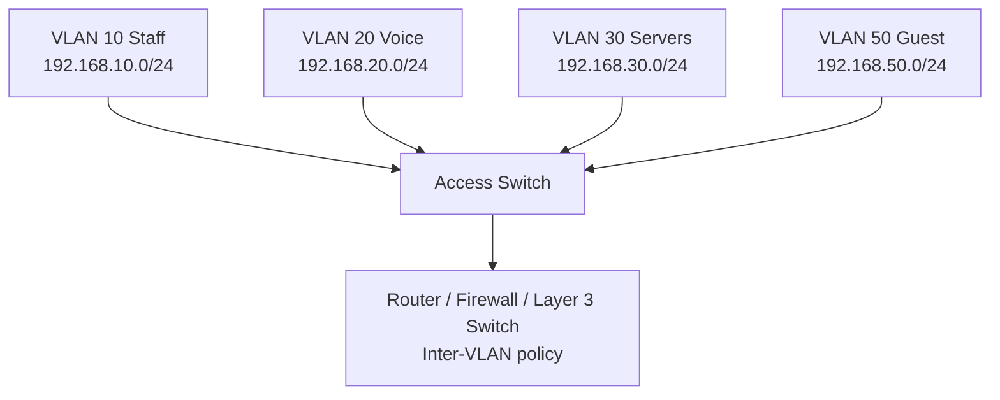

# LESSON 13: VLAN FUNDAMENTALS AND DESIGN

## TRAINING FOCUS

This lesson is part of the FEMTECT Network Engineering Foundation course. It is written to help students build strong networking fundamentals through clear explanations, real enterprise context, practical troubleshooting logic, and certification-aware technical depth.

## VISUAL TOPOLOGY: VLAN SEGMENTATION



This topology shows that VLANs can share one physical switch while remaining separate logical networks.


## DEFINITION AND TECHNICAL IN-DEPTH KNOWLEDGE

### 13.1 VLAN

A VLAN, or Virtual Local Area Network, is a logical Layer 2 network created on a switch. It allows one physical switch infrastructure to be divided into multiple separate broadcast domains. Devices in the same VLAN behave as if they are on the same local network, even if they are connected to different physical switches. Devices in different VLANs are separated at Layer 2 and normally require routing to communicate.

In Lesson 8, Ethernet introduced frames, MAC addresses, and broadcast domains. In Lesson 9, enterprise switching introduced switch ports, MAC address tables, access ports, trunk ports, and Layer 2 forwarding. In Lessons 10 and 11, IPv4 addressing and subnetting explained how IP networks are planned. VLANs bring these ideas together. A VLAN is usually the Layer 2 boundary that matches an IP subnet at Layer 3.

For example, a company may create:

```text
VLAN 10 - Staff
VLAN 20 - Voice
VLAN 30 - Servers
VLAN 40 - CCTV
VLAN 50 - Guest Wi-Fi
```

Each VLAN is a separate broadcast domain. A broadcast sent by a device in VLAN 10 stays inside VLAN 10. It is not automatically forwarded into VLAN 20, VLAN 30, or VLAN 50. This separation improves performance, security, manageability, and troubleshooting.

VLANs exist because modern enterprises need separation without building a completely separate physical network for every department. Instead of buying one physical switch for finance, another for HR, another for guests, and another for IP phones, a switch can logically separate ports into VLANs.

For CCNA and CompTIA Network+, students must understand what VLANs are, why they are used, how VLANs control broadcast domains, how VLANs relate to IP subnets, and why voice VLANs and native VLANs matter in enterprise networks.

### 13.2 Technical Importance: VLANs Matter

VLANs matter because a flat network is difficult to secure, scale, and troubleshoot. A flat network is a network where many devices share the same Layer 2 broadcast domain. In a small home network, this may be acceptable. In an enterprise, it quickly becomes a problem.

If staff PCs, guest devices, IP phones, CCTV cameras, printers, servers, and management interfaces are all in one broadcast domain, broadcasts reach too many devices. A problem in one part of the network can affect everyone. A guest device may sit in the same local network as business systems. Malware may spread more easily. Troubleshooting becomes harder because there is no clean boundary between device groups.

VLANs solve this by creating logical separation. Staff devices can be placed in one VLAN, voice devices in another, guest Wi-Fi in another, and network management interfaces in another. Each VLAN can have its own subnet, DHCP scope, gateway, firewall rules, and monitoring policy.

VLANs also support business operations. A user can move from one desk to another, and the network team can place the new switch port in the correct VLAN. A wireless access point can carry several SSIDs mapped to different VLANs. An IP phone can use a voice VLAN while the PC connected through the phone uses a data VLAN. A factory can separate shop floor machines from back office computers.

In real enterprise work, VLANs are not just an exam topic. They are part of daily network design, ticket resolution, cybersecurity control, wireless deployment, VoIP deployment, and change management.

## 13.3 VLANs and Broadcast Domains

A broadcast domain is the area where Layer 2 broadcast frames are forwarded. In a switched network without VLANs, all ports in the same default VLAN normally belong to the same broadcast domain. When VLANs are created, each VLAN becomes its own broadcast domain.

This is one of the most important VLAN concepts:

```text
One VLAN = One broadcast domain
```

If PC1 in VLAN 10 sends an ARP Request, the switch floods that broadcast only to ports in VLAN 10. Devices in VLAN 20 do not receive it. If a DHCP client in VLAN 30 sends a DHCP Discover message, the broadcast stays within VLAN 30 unless a router or Layer 3 device relays it to a DHCP server.

Broadcast control matters because broadcasts consume bandwidth and processing resources. ARP, DHCP, and some discovery protocols are useful, but uncontrolled broadcast traffic can reduce performance. VLANs keep broadcasts limited to the devices that need to hear them.

Broadcast Control Example

| Device Group | VLAN | Broadcast Scope |
|---|---:|---|
| Staff PCs | 10 | Broadcasts stay inside VLAN 10 |
| IP Phones | 20 | Broadcasts stay inside VLAN 20 |
| CCTV Cameras | 30 | Broadcasts stay inside VLAN 30 |
| Guest Wi-Fi | 40 | Broadcasts stay inside VLAN 40 |

VLANs do not automatically route traffic between groups. If a staff PC in VLAN 10 needs to reach a server in VLAN 30, a router, Layer 3 switch, or firewall must route between those VLANs. Inter-VLAN routing will be covered in Lesson 16.

## 13.4 VLANs and IP Subnets

A VLAN is a Layer 2 concept. An IP subnet is a Layer 3 concept. In enterprise design, they usually work together.

The best beginner rule is:

```text
One VLAN usually maps to one IP subnet.
```

For example:

| VLAN | Name | IPv4 Subnet | Gateway |
|---:|---|---|---|
| 10 | Staff | 192.168.10.0/24 | 192.168.10.1 |
| 20 | Voice | 192.168.20.0/24 | 192.168.20.1 |
| 30 | Servers | 192.168.30.0/24 | 192.168.30.1 |
| 40 | Guest | 192.168.40.0/24 | 192.168.40.1 |

The VLAN controls the Layer 2 broadcast boundary. The IP subnet controls the Layer 3 addressing boundary. The default gateway is the Layer 3 device that routes traffic out of that subnet.

Why does this matter? If a switch port is placed in VLAN 20 but the user receives an IP address from the VLAN 10 subnet, something is wrong. If a device has an IP address in `192.168.30.0/24` but is connected to a port assigned to VLAN 10, it may not reach its gateway. VLAN and subnet design must match.

IPv6 follows the same design idea. A VLAN may have an IPv6 `/64` prefix:

| VLAN | Name | IPv6 Prefix |
|---:|---|---|
| 10 | Staff | 2001:db8:100:10::/64 |
| 20 | Voice | 2001:db8:100:20::/64 |
| 30 | Servers | 2001:db8:100:30::/64 |
| 40 | Guest | 2001:db8:100:40::/64 |

The exact addressing plan depends on the organization, but the principle remains: VLANs separate Layer 2, and subnets separate Layer 3.

## 13.5 VLAN Membership

VLAN membership defines which VLAN a switch port belongs to. The most common method is port-based VLAN assignment. A switch port is configured as an access port and assigned to one VLAN.

Example:

```text
Switch port Fa0/10 -> VLAN 10
Switch port Fa0/11 -> VLAN 20
Switch port Fa0/12 -> VLAN 30
```

If a PC is plugged into `Fa0/10`, it belongs to VLAN 10. If a printer is plugged into `Fa0/12`, it belongs to VLAN 30.

VLAN membership can also be dynamic in some enterprise systems, especially with 802.1X authentication and Network Access Control. In that case, the network may place a user or device into a VLAN based on identity, device type, security posture, or policy. That is more advanced and will be discussed later in security-focused lessons.

For now, students should master static port-based VLAN assignment. It is common, easy to understand, and widely used in small and medium enterprise networks.

VLAN Membership Types

| Membership Type | How It Works | Common Use |
|---|---|---|
| Static Port-Based | Administrator assigns switch port to VLAN | Most basic enterprise access ports |
| Dynamic Policy-Based | System assigns VLAN based on identity or policy | 802.1X/NAC environments |
| Wireless SSID Mapping | SSID maps users into VLAN | Enterprise Wi-Fi segmentation |
| Voice VLAN | Phone uses voice VLAN while PC may use data VLAN | VoIP deployments |

## 13.6 Access VLANs

An access VLAN is the VLAN assigned to an access port. An access port normally carries traffic for one VLAN and connects to an end device such as a PC, printer, camera, or basic access point.

Access VLANs are important because most user connectivity begins at an access port. If a port is assigned to the wrong VLAN, the user may receive the wrong IP address, wrong gateway, wrong DNS server, or wrong security policy. The cable may be good and the switch port may be up, but the user still fails because the VLAN is wrong.

Example access port concept:

```text
Port Fa0/5
Mode: Access
VLAN: 10
Connected device: Staff PC
```

The staff PC belongs to VLAN 10. Its DHCP address should come from the VLAN 10 DHCP scope. Its default gateway should be the VLAN 10 gateway.

Basic Cisco IOS example:

```text
interface fastEthernet 0/5
 switchport mode access
 switchport access vlan 10
```

Lesson 14 will go deeper into VLAN configuration and trunking commands. In this lesson, focus on the design meaning: an access port places an endpoint into one VLAN.

## 13.7 Trunks in VLAN Design

A trunk is a link that carries traffic for multiple VLANs. Trunks are used between switches, between a switch and a router, between a switch and a firewall, between a switch and a hypervisor, or between a switch and a wireless access point that supports multiple SSIDs.

Trunks matter because VLANs often span more than one switch. If VLAN 10 exists on two access switches, the uplink between switches must carry VLAN 10. If VLAN 20 and VLAN 30 also need to cross that link, the link must carry multiple VLANs. A trunk allows this to happen on one physical connection.

Example:

```text
Switch A ---- trunk ---- Switch B
Allowed VLANs: 10, 20, 30, 40
```

Traffic from VLAN 10 remains logically separate from VLAN 20, even though both VLANs cross the same trunk. IEEE 802.1Q tagging is used to identify which VLAN a frame belongs to as it crosses the trunk. Tagging and trunk negotiation will be covered in Lesson 14.

Design warning: do not allow every VLAN on every trunk unless there is a reason. Good design carries only the VLANs required on that link. This reduces unnecessary exposure and helps troubleshooting.

## 13.8 VLAN IDs and VLAN Names

Each VLAN has a VLAN ID. A VLAN ID is a number that identifies the VLAN on switches and trunks.

Common Ethernet VLAN IDs range from 1 to 4094, although some values are reserved depending on platform and standard. In many Cisco environments, VLAN 1 exists by default. Production networks should not rely on VLAN 1 for user traffic or management simply because it is the default.

Administrators should name VLANs clearly. A VLAN named `VLAN0010` is less helpful than `STAFF_DATA`. A VLAN named `GUEST_WIFI` is easier to understand during troubleshooting than an unnamed VLAN 50.

Example VLAN Naming

| VLAN ID | Poor Name | Better Name |
|---:|---|---|
| 10 | VLAN0010 | STAFF_DATA |
| 20 | VLAN0020 | VOICE |
| 30 | VLAN0030 | SERVERS |
| 40 | VLAN0040 | CCTV |
| 50 | VLAN0050 | GUEST_WIFI |
| 99 | VLAN0099 | NETWORK_MGMT |

Good names do not fix bad design, but they reduce confusion during troubleshooting, documentation, and handover.

## 13.9 Default VLAN and VLAN 1

On many Cisco switches, VLAN 1 is the default VLAN. By default, switch ports may belong to VLAN 1 until configured otherwise.

VLAN 1 is important because beginners often leave devices in VLAN 1 without planning. This can create management, security, and troubleshooting problems. A production network should intentionally assign ports to the correct VLANs instead of leaving everything in the default VLAN.

In many environments, VLAN 1 is also associated with default behavior for certain control traffic. Because of this, best practice is usually to avoid using VLAN 1 for normal user data, management, or guest traffic.

Good enterprise design:

- Create named VLANs for real business functions.
- Move user ports out of VLAN 1.
- Shut down unused ports or place them in an unused parking VLAN.
- Use a dedicated management VLAN where appropriate.
- Document VLAN IDs, names, subnets, and gateways.

This lesson introduces the concept. Specific configuration and hardening practices will continue in Lessons 14 and 22.

## 13.10 Voice VLANs

A voice VLAN is a VLAN used for IP phone traffic. It allows voice traffic to be logically separated from normal data traffic.

Voice VLANs exist because IP phones have different requirements from ordinary data devices. Voice traffic is sensitive to delay, jitter, and packet loss. A phone call may become choppy if voice packets are delayed or dropped. A voice VLAN helps identify and separate voice traffic so the network can apply Quality of Service, security policy, and troubleshooting boundaries.

A common office setup uses one switch port for both an IP phone and a PC. The PC connects to the phone, and the phone connects to the switch. The switch port may carry a data VLAN for the PC and a voice VLAN for the phone.

Example:

```text
Switch Port Fa0/15
Data VLAN: 10
Voice VLAN: 20
Connected devices: IP phone and PC behind phone
```

The PC uses VLAN 10. The phone uses VLAN 20. The phone can tag its voice traffic so the switch can recognize it as voice VLAN traffic.

Basic Cisco IOS concept:

```text
interface fastEthernet 0/15
 switchport mode access
 switchport access vlan 10
 switchport voice vlan 20
```

Voice VLAN design should include DHCP options, call manager reachability, QoS, PoE planning, and security. Those deeper voice and QoS topics are beyond this basic VLAN lesson, but students should understand why voice traffic is separated.

Voice VLAN Benefits

| Benefit | Explanation |
|---|---|
| Separation | Voice traffic is separated from ordinary user data |
| QoS Support | Voice packets can be prioritized |
| Troubleshooting | Phone issues can be isolated to voice VLAN |
| Security | Phones can be controlled by separate policy |
| DHCP Design | Phones can receive voice-specific options |

## 13.11 Native VLAN Concept

The native VLAN is a trunking concept. On an IEEE 802.1Q trunk, most VLAN traffic is tagged. The native VLAN is the VLAN whose traffic is sent untagged on that trunk.

Students do not need deep trunk configuration yet, but they must understand the basic idea before Lesson 14. If a trunk receives an untagged frame, the switch places that frame into the native VLAN.

Native VLANs matter because mismatched native VLANs can cause traffic leaks, security risks, and confusing troubleshooting symptoms. If one side of a trunk believes the native VLAN is 99 and the other side believes it is 1, untagged traffic may be placed into the wrong VLAN.

Best practice in many enterprise designs is:

- Do not use VLAN 1 as the native VLAN.
- Use an unused VLAN as the native VLAN where appropriate.
- Make the native VLAN match on both ends of a trunk.
- Do not use the native VLAN for normal user traffic.
- Document trunk native VLAN settings.

Lesson 14 will cover 802.1Q tagging, trunk configuration, trunk negotiation, allowed VLAN lists, and verification commands in more detail.

## 13.12 Enterprise Segmentation Strategy

Enterprise segmentation is the practice of dividing the network into logical zones based on business function, risk, performance needs, and operational management.

VLANs are one of the first tools used for segmentation. A good VLAN design is not random. It should reflect how the organization works and what must be protected.

Common VLAN categories include:

| VLAN Category | Example Devices | Reason for Separation |
|---|---|---|
| Staff Data | PCs, laptops | Normal business access |
| Voice | IP phones | QoS and call control |
| Servers | Application/file servers | Security and policy control |
| Guest | Visitor phones/laptops | Internet-only isolation |
| CCTV | Cameras, NVRs | Bandwidth and security |
| Management | Switches, APs, firewalls, UPS | Administrative control |
| Printers | Shared printers/MFPs | Access control and monitoring |
| IoT/Facilities | Sensors, controllers, smart devices | Risk containment |

Segmentation should consider:

- Who owns the devices.
- What systems they need to access.
- How sensitive the traffic is.
- How many devices are expected.
- Whether the devices need internet access.
- Whether the devices should reach other internal networks.
- Whether the devices need special DHCP options.
- Whether the traffic has performance requirements.

The goal is not to create hundreds of VLANs for no reason. The goal is to create meaningful boundaries that improve security, operations, and troubleshooting.

## 13.13 VLAN Design Principles

Good VLAN design follows practical principles.

First, each VLAN should have a clear purpose. If nobody can explain why a VLAN exists, it may be unnecessary or poorly documented.

Second, each VLAN should usually map to one IP subnet. This keeps addressing, DHCP, routing, and troubleshooting clean.

Third, VLAN IDs and subnet numbers should be consistent when possible. For example, VLAN 10 may use `192.168.10.0/24`, VLAN 20 may use `192.168.20.0/24`, and VLAN 30 may use `192.168.30.0/24`. This is not required, but it improves readability.

Fourth, guest networks should be isolated from internal business networks. Guest users usually need internet access, not access to servers, printers, cameras, or management interfaces.

Fifth, management networks should be protected. Switch management IP addresses, firewall management interfaces, AP management, UPS management, and hypervisor management should not sit in normal user VLANs.

Sixth, avoid carrying unnecessary VLANs across trunks. If VLAN 40 is needed only in one building, do not extend it everywhere without a reason.

Seventh, document the VLAN plan. Documentation should include VLAN ID, name, subnet, gateway, DHCP scope, purpose, allowed access, and responsible owner.

VLAN Design Checklist

| Design Item | Question to Ask |
|---|---|
| Purpose | Why does this VLAN exist? |
| Devices | What devices belong here? |
| Subnet | What IPv4/IPv6 subnet maps to it? |
| Gateway | Where is inter-VLAN routing performed? |
| DHCP | Which DHCP scope serves it? |
| Security | What should this VLAN access or be blocked from? |
| Trunks | Which links must carry this VLAN? |
| Documentation | Is the VLAN recorded in diagrams and tables? |

## 13.14 VLANs, DHCP, and Gateways

Each VLAN commonly has its own DHCP scope and default gateway.

Example:

| VLAN | Name | Subnet | Gateway | DHCP Scope |
|---:|---|---|---|---|
| 10 | Staff | 10.10.10.0/24 | 10.10.10.1 | 10.10.10.50-10.10.10.200 |
| 20 | Voice | 10.10.20.0/24 | 10.10.20.1 | 10.10.20.50-10.10.20.220 |
| 30 | CCTV | 10.10.30.0/24 | 10.10.30.1 | 10.10.30.50-10.10.30.180 |
| 40 | Guest | 10.10.40.0/24 | 10.10.40.1 | 10.10.40.50-10.10.40.250 |

If a user is placed in the wrong VLAN, the user may receive an IP address from the wrong DHCP scope. If DHCP relay is missing for a VLAN, devices may fail to receive addresses and may fall back to APIPA in IPv4.

The default gateway for a VLAN may be on a router interface, router subinterface, firewall interface, or Layer 3 switch SVI. The details of inter-VLAN routing will be covered in Lesson 16, but students should understand the design relationship now:

```text
VLAN -> Subnet -> Gateway -> Routing/Policy
```

## 13.15 VLANs and Wireless SSIDs

Wireless networks often map SSIDs to VLANs. An SSID is the Wi-Fi network name users see. In an enterprise, different SSIDs may represent different security and access levels.

Example:

| SSID | VLAN | Purpose |
|---|---:|---|
| Company-Staff | 10 | Staff laptops and phones |
| Company-Voice | 20 | Wi-Fi calling or voice devices |
| Company-Guest | 40 | Guest internet access only |
| Company-IoT | 60 | Approved IoT devices |

The access point connects to the wired network. If the AP carries multiple SSIDs, the switch port connected to the AP may need to operate as a trunk so it can carry multiple VLANs. The wireless controller or AP maps each SSID to the correct VLAN.

This is why VLAN design affects wireless design. A guest SSID should not place visitors into the staff VLAN. A staff SSID should not accidentally map to guest isolation. Troubleshooting Wi-Fi often includes verifying VLAN mapping.

## 13.16 Case Study: Segmenting Shop Floor, Back Office, and Guest Wi-Fi

Consider a small manufacturing company with one office and one production area.

The company has:

- Back office staff computers.
- Accounting and admin laptops.
- Shop floor production machines.
- CCTV cameras.
- IP phones.
- Guest Wi-Fi for visitors.
- Network devices such as switches and access points.

The original network is flat. Everything is in one subnet:

```text
192.168.1.0/24
```

Problems appear:

- Guest devices can see internal devices.
- CCTV cameras generate traffic in the same broadcast domain as staff PCs.
- Production machines are reachable from normal office devices.
- IP phone troubleshooting is mixed with PC troubleshooting.
- There is no clean management network for switches and APs.
- DHCP changes affect everyone.

A better VLAN design may look like this:

| VLAN | Name | Subnet | Devices | Access Policy |
|---:|---|---|---|---|
| 10 | BACK_OFFICE | 10.50.10.0/24 | Staff PCs, admin laptops | Internal business access |
| 20 | VOICE | 10.50.20.0/24 | IP phones | Call manager, voice services |
| 30 | SHOP_FLOOR | 10.50.30.0/24 | Production machines | Restricted access from approved systems |
| 40 | CCTV | 10.50.40.0/24 | Cameras, NVR | NVR/security workstation only |
| 50 | GUEST_WIFI | 10.50.50.0/24 | Visitor devices | Internet only |
| 99 | NETWORK_MGMT | 10.50.99.0/24 | Switches, APs, firewall mgmt | Admin access only |

This design improves operations. Guest devices are isolated. Shop floor systems can be protected. CCTV is separated. Voice can receive voice-specific treatment. Management interfaces are not exposed to normal users.

The design also improves troubleshooting. If only guest users have a problem, the technician checks VLAN 50, its DHCP scope, its gateway, and its internet policy. If only cameras fail, the technician checks VLAN 40, PoE, camera switch ports, and NVR reachability.

IPv6 can follow the same structure:

| VLAN | Name | IPv6 Prefix |
|---:|---|---|
| 10 | BACK_OFFICE | 2001:db8:50:10::/64 |
| 20 | VOICE | 2001:db8:50:20::/64 |
| 30 | SHOP_FLOOR | 2001:db8:50:30::/64 |
| 40 | CCTV | 2001:db8:50:40::/64 |
| 50 | GUEST_WIFI | 2001:db8:50:50::/64 |
| 99 | NETWORK_MGMT | 2001:db8:50:99::/64 |

The exact prefixes would come from the organization's real allocation, but the design principle remains consistent.

## 13.17 VLAN Troubleshooting

VLAN troubleshooting requires checking both Layer 2 and Layer 3. A device may be physically connected, but if the port is in the wrong VLAN, the IP configuration and traffic path may be wrong.

A practical VLAN troubleshooting sequence is:

1. Confirm the device is connected to the expected switch port.
2. Check the switch port status.
3. Verify the port mode is access or trunk as intended.
4. Verify the access VLAN assigned to the port.
5. Check whether the device receives an IP address from the correct subnet.
6. Confirm the default gateway belongs to that VLAN/subnet.
7. Check whether the VLAN exists on the switch.
8. If traffic crosses switches, verify the VLAN is carried on the trunk.
9. Check DHCP scope or relay configuration.
10. Test gateway reachability.

Useful Cisco IOS verification commands:

```text
show vlan brief
show interfaces status
show interfaces switchport
show running-config interface fastEthernet 0/10
show mac address-table interface fastEthernet 0/10
```

Commands such as `show interfaces trunk` and allowed-VLAN verification will be covered more deeply in Lesson 14.

Common VLAN Problems

| Symptom | Possible VLAN Cause | What to Check |
|---|---|---|
| User gets wrong IP subnet | Port assigned to wrong VLAN | `show vlan brief`, interface config |
| User gets APIPA address | DHCP not available in that VLAN | DHCP scope, relay, VLAN assignment |
| Device can reach local VLAN but not others | Missing inter-VLAN routing or policy block | Gateway, router/firewall, ACL |
| VLAN works on one switch but not another | VLAN not carried on trunk | Trunk allowed VLANs |
| Guest can access internal resources | Guest VLAN policy wrong | Firewall rules, VLAN mapping |
| IP phone works but PC does not | Voice/data VLAN mismatch | Access VLAN and voice VLAN config |

## 13.18 Cybersecurity Relevance

VLANs are not a complete security solution, but they are an important foundation for network security. VLANs create separation at Layer 2. Security policy is then applied using routers, Layer 3 switches, firewalls, ACLs, and identity systems.

A common mistake is believing that VLANs alone are equal to firewall protection. VLANs separate broadcast domains, but traffic between VLANs can still be routed if a Layer 3 device permits it. Real security requires policy at the routing or firewall layer.

VLANs reduce unnecessary exposure. Guest Wi-Fi should not share a VLAN with staff computers. CCTV cameras should not share a VLAN with domain controllers. Network management interfaces should not be reachable from ordinary user VLANs. Voice devices should be separated where possible.

VLAN-related attacks and risks include VLAN hopping, native VLAN misuse, unauthorized trunking, rogue devices, and misconfigured guest networks. Later lessons will discuss trunk security, ACLs, DHCP snooping, Dynamic ARP Inspection, and hardening.

Cybersecurity design principle:

```text
Use VLANs to separate. Use routing and firewall policy to control.
```

## 13.19 Cloud Networking Relevance

Cloud platforms do not always expose VLANs to customers in the same way physical switches do, but the design idea is still important. Cloud networks use virtual networks, subnets, route tables, security groups, network security groups, and firewall policies to create segmentation.

In a data center or private cloud, VLANs may connect physical servers, hypervisors, storage networks, management networks, and tenant networks. A virtualization host may connect to a trunk port carrying multiple VLANs for virtual machines.

In public cloud, a subnet may function as the main segmentation boundary. The engineer still thinks in terms of separating public web tiers, private application tiers, databases, management systems, and VPN connectivity. This is conceptually similar to VLAN/subnet mapping in campus networks.

Example cloud segmentation:

| Segment | Cloud Subnet | Similar Campus Concept |
|---|---|---|
| Public Web | 10.100.10.0/24 | Public-facing DMZ VLAN |
| Private App | 10.100.20.0/24 | Application server VLAN |
| Database | 10.100.30.0/24 | Database VLAN |
| Management | 10.100.99.0/24 | Network/server management VLAN |

Understanding VLANs helps students understand cloud subnets, security zones, hybrid connectivity, and zero-trust segmentation.

## 14. KEY TERMS / GLOSSARY

| Term | Meaning |
|---|---|
| VLAN | Virtual Local Area Network; a logical Layer 2 network on a switch. |
| Broadcast Domain | Area where Layer 2 broadcast frames are forwarded. |
| Segmentation | Dividing a network into logical sections for security, performance, or management. |
| Access VLAN | VLAN assigned to an access port. |
| Access Port | Switch port that normally carries one VLAN for an endpoint. |
| Trunk Port | Switch port that carries multiple VLANs. |
| VLAN ID | Numeric identifier for a VLAN. |
| VLAN Name | Human-readable label assigned to a VLAN. |
| Default VLAN | VLAN assigned to ports by default, often VLAN 1 on Cisco switches. |
| Voice VLAN | VLAN used for IP phone traffic. |
| Native VLAN | VLAN that carries untagged traffic on an 802.1Q trunk. |
| Guest VLAN | VLAN used to isolate visitor or guest devices. |
| Management VLAN | VLAN used for managing network infrastructure devices. |
| VLAN-to-Subnet Mapping | Design practice where each VLAN usually corresponds to one IP subnet. |
| Flat Network | Network where many devices share one large broadcast domain. |
| Parking VLAN | Unused VLAN where unused ports may be placed for safety. |

## 15. COMPARISON TABLES

### 15.1 Flat Network vs VLAN-Segmented Network

| Feature | Flat Network | VLAN-Segmented Network |
|---|---|---|
| Broadcast Scope | Large | Smaller per VLAN |
| Security Boundary | Weak | Stronger foundation for policy |
| Troubleshooting | Harder to isolate | Easier by VLAN/subnet |
| Guest Isolation | Poor unless separately designed | Clear guest VLAN possible |
| Scalability | Limited | Better |
| Enterprise Suitability | Poor for most organizations | Standard design approach |

### 15.2 VLAN vs IP Subnet

| Feature | VLAN | IP Subnet |
|---|---|---|
| OSI Layer | Layer 2 | Layer 3 |
| Main Function | Separates broadcast domains | Separates logical IP networks |
| Device Type | Switches | Routers, Layer 3 switches, hosts |
| Example | VLAN 10 | 192.168.10.0/24 |
| Communication Boundary | Frames | Packets |
| Relationship | Usually maps to one subnet | Usually assigned to one VLAN |

### 15.3 Access Port vs Trunk Port

| Feature | Access Port | Trunk Port |
|---|---|---|
| VLANs Carried | One VLAN, plus optional voice VLAN | Multiple VLANs |
| Common Device | PC, printer, camera, phone | Switch, router, firewall, AP, hypervisor |
| Tagging | Usually untagged for data endpoint | Uses 802.1Q tags |
| Risk | Wrong access VLAN | Missing/extra VLANs, native VLAN mismatch |
| Lesson Depth | Design concept here | Configuration depth in Lesson 14 |

### 15.4 Data VLAN vs Voice VLAN

| Feature | Data VLAN | Voice VLAN |
|---|---|---|
| Main Devices | PCs, printers, laptops | IP phones |
| Traffic Sensitivity | Varies | Delay and jitter sensitive |
| QoS Need | Depends on application | Usually important |
| DHCP Options | Normal host options | May need voice/call manager options |
| Common Port Design | Access VLAN | Voice VLAN plus access VLAN |

### 15.5 VLAN Design Documentation Table

| Field | Example |
|---|---|
| VLAN ID | 50 |
| VLAN Name | GUEST_WIFI |
| IPv4 Subnet | 10.50.50.0/24 |
| IPv6 Prefix | 2001:db8:50:50::/64 |
| Gateway | 10.50.50.1 |
| Purpose | Visitor internet access |
| Access Policy | Internet only |
| DHCP Scope | 10.50.50.50-10.50.50.250 |

## 16. REAL-WORLD EXAMPLE / ANALOGY

Think of a VLAN like dividing one large office building into separate departments with controlled doors. Everyone may be inside the same building, using the same power and physical infrastructure, but finance, guests, engineering, security, and management do not all sit in one open room.

In networking, the physical switch infrastructure is the building. VLANs are the logical departments. Broadcasts stay inside the department. If one department needs to communicate with another, the traffic must pass through a controlled Layer 3 point such as a router, Layer 3 switch, or firewall.

The analogy is useful, but the technical rule is simple: VLANs create separate Layer 2 broadcast domains.

## 18. WINDOWS, LINUX, AND CISCO IOS PRACTICAL COMMANDS

### Windows Commands

```text
ipconfig /all
ping <default-gateway>
arp -a
tracert <destination>
```

Windows does not normally show the switch VLAN directly. The technician uses Windows to verify whether the device received an IP address, subnet mask, gateway, and DNS settings that match the expected VLAN.

### Linux Commands

```text
ip addr
ip route
ip neigh
ping <default-gateway>
```

Linux checks are similar. If a Linux device receives an address from the wrong subnet, the switch port VLAN or DHCP design should be checked.

### Cisco IOS Commands

```text
show vlan brief
show interfaces status
show interfaces switchport
show running-config interface fastEthernet 0/10
show mac address-table interface fastEthernet 0/10
```

These commands help verify whether the port is up, which VLAN it belongs to, whether the VLAN exists, and whether the switch learned the device MAC address on the expected port.

## 19. QUICK-RECAP CHEAT SHEET

- VLAN means Virtual Local Area Network.
- A VLAN is a logical Layer 2 network.
- Each VLAN is a separate broadcast domain.
- VLANs reduce broadcast scope.
- VLANs improve segmentation, troubleshooting, and policy control.
- A VLAN usually maps to one IP subnet.
- Devices in different VLANs need Layer 3 routing to communicate.
- An access port normally carries one VLAN.
- A trunk port carries multiple VLANs.
- 802.1Q tagging identifies VLAN traffic on trunks.
- VLAN 1 is often the default VLAN on Cisco switches.
- Avoid using VLAN 1 for ordinary production user traffic where possible.
- A voice VLAN separates IP phone traffic from data traffic.
- The native VLAN carries untagged traffic on an 802.1Q trunk.
- Native VLAN mismatch can cause confusing and risky behavior.
- Guest Wi-Fi should be isolated from internal networks.
- Management VLANs should be protected.
- Good VLAN design includes VLAN ID, name, subnet, gateway, purpose, and access policy.
- VLANs separate; routers, firewalls, and ACLs control inter-VLAN access.
- Lesson 14 will configure VLANs and trunks in detail.

## 7. LESSON ASSESSMENT

This assessment is intentionally focused. Students should answer clearly, use correct networking terminology, and show practical troubleshooting thinking.

### 7.1 Theory Questions

1. Explain the main networking concept covered in this lesson and describe its role in a real enterprise network.
2. Describe two technical problems that can occur when this lesson's concept is poorly designed or incorrectly configured.
3. Explain how a network technician or junior network engineer would verify that this part of the network is working correctly.
4. Describe one security, reliability, or performance concern related to this topic.
5. Explain how this topic connects to CCNA, Network+, IT support, or junior network engineering work.

### 7.2 Multiple-Choice Questions

1. What is the best reason for studying this lesson's topic?
   A. It helps students understand and support real network operation.
   B. It replaces the need for troubleshooting.
   C. It removes the need for IP addressing.
   D. It is only useful for memorizing definitions.

2. When troubleshooting a problem related to this lesson, what should be done first?
   A. Gather evidence and identify the exact scope of the problem.
   B. Replace every network device immediately.
   C. Delete the running configuration without backup.
   D. Assume the Internet service provider is always responsible.

3. Which habit best reflects professional network engineering practice?
   A. Verify changes with commands, tests, and documented results.
   B. Make random changes until something works.
   C. Ignore diagrams and rely only on memory.
   D. Avoid documenting successful fixes.

4. Which item is most useful when proving that a network feature is working?
   A. A successful test result compared with the expected result.
   B. A guess from another user.
   C. A device name with no configuration evidence.
   D. A screenshot unrelated to the problem.

5. What should students connect this lesson to during hands-on practice?
   A. Addressing, device roles, commands, verification, and troubleshooting.
   B. Only typing speed.
   C. Only cable color.
   D. Only memorizing vendor logos.

6. In an enterprise environment, why is documentation important for this topic?
   A. It helps future troubleshooting, audits, handover, and change control.
   B. It makes testing unnecessary.
   C. It disables security risks automatically.
   D. It replaces the need for correct configuration.

7. Which approach gives the strongest learning outcome?
   A. Combining technical explanation with lab practice and verification.
   B. Reading commands without understanding them.
   C. Skipping troubleshooting steps.
   D. Memorizing answers without using the network.

8. If a configuration change causes a new outage, what should the technician use?
   A. A rollback plan and saved baseline information.
   B. A random new subnet.
   C. A different monitor.
   D. A guess without evidence.

9. Which result shows that a student understands the lesson at a practical level?
   A. The student can explain the concept, configure or identify it, test it, and troubleshoot failure.
   B. The student can only repeat the title.
   C. The student avoids using commands.
   D. The student ignores enterprise examples.

10. Why are scenario questions included in this course?
   A. They train students to apply concepts to real network problems.
   B. They remove the need for labs.
   C. They focus only on spelling.
   D. They are unrelated to IT jobs.

### 7.3 Scenario-Based Questions

1. A user or department reports a connectivity problem related to this lesson's topic. Write the first five checks you would perform, the commands or tools you would use, and the evidence you expect to collect.
2. You are asked to explain this topic to a new IT support intern before a hands-on lab. Write a short technical explanation that connects the concept to real devices, real traffic flow, and troubleshooting.

### 7.4 Answer Guide

Theory answers should be marked for technical accuracy, clear explanation, correct terminology, and practical relevance to enterprise networking. Scenario answers should show a logical troubleshooting sequence, evidence gathering, likely causes, verification steps, and a professional final recommendation.

Multiple-choice answers: 1. A; 2. A; 3. A; 4. A; 5. A; 6. A; 7. A; 8. A; 9. A; 10. A
