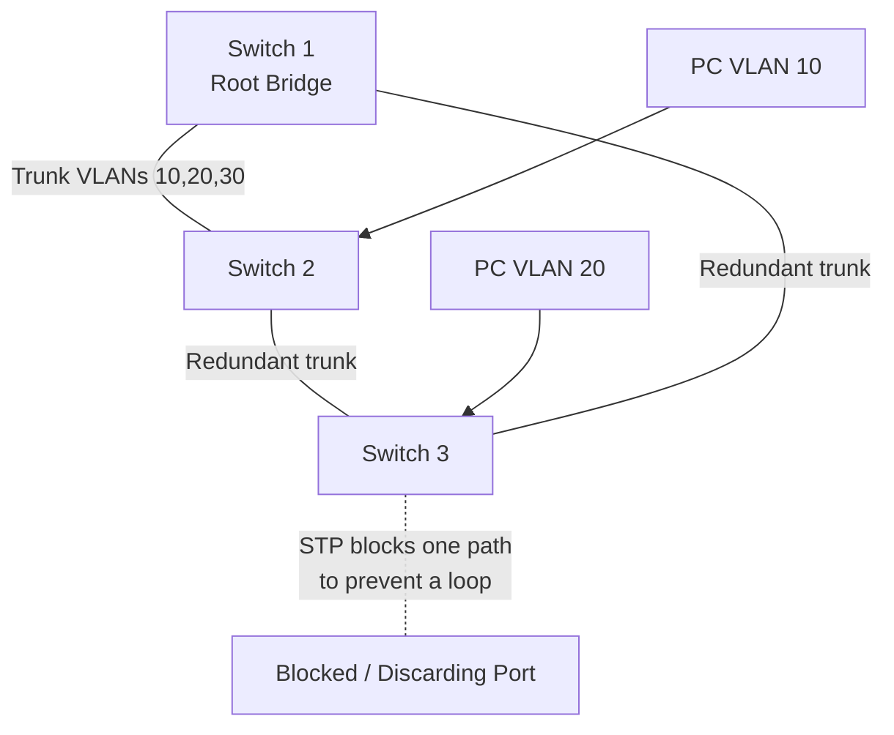

# LESSON 14: VLAN CONFIGURATION, TRUNKING, AND SPANNING TREE

## TRAINING FOCUS

This lesson is part of the FEMTECT Network Engineering Foundation course. It is written to help students build strong networking fundamentals through clear explanations, real enterprise context, practical troubleshooting logic, and certification-aware technical depth.

## VISUAL TOPOLOGY: TRUNKS AND STP LOOP PREVENTION



The diagram shows why trunk redundancy needs STP: the physical triangle gives backup paths, while STP creates a loop-free logical path.

---

## VLAN Configuration and Trunking

## DEFINITION AND TECHNICAL IN-DEPTH KNOWLEDGE

### VLAN Configuration

VLAN configuration is the process of creating VLANs on switches, assigning switch ports to the correct VLANs, and configuring trunk links so multiple VLANs can move between network devices. In Lesson 13, VLANs were introduced as logical Layer 2 networks that create separate broadcast domains. Lesson 14 turns that design knowledge into practical switch configuration and verification.

A VLAN design is only useful when the switch configuration matches it. If the design says staff users belong in VLAN 10, voice devices belong in VLAN 20, and guest wireless belongs in VLAN 50, then the switch ports, trunks, VLAN database, and uplinks must be configured correctly. Otherwise, the network may be physically connected but logically wrong.

VLAN configuration exists because modern enterprise switches do not automatically know the business purpose of each port. A switch must be told which VLANs exist, which access ports belong to which VLAN, which links are trunks, which VLANs are allowed across trunks, and what native VLAN should be used on each trunk.

In real enterprise work, VLAN configuration affects user connectivity, DHCP scope selection, wireless SSID mapping, IP phone behavior, server segmentation, firewall policy, and troubleshooting. A wrong VLAN on one access port may affect one user. A wrong trunk configuration may affect an entire floor, building, wireless network, or server environment.

For CCNA and CompTIA Network+, students must understand access ports, trunk ports, 802.1Q tagging, native VLAN behavior, trunk negotiation, allowed VLAN lists, and verification commands.

### Technical and Business Importance of VLAN Configuration

VLAN configuration matters because VLAN design and switch behavior must agree. A diagram may show a clean design, but the real network follows the running configuration on the switches. If a port is in the wrong VLAN, the device may receive the wrong IP address. If a trunk does not carry a required VLAN, users on another switch may lose access. If the native VLAN is mismatched, untagged traffic may be placed into the wrong VLAN. If dynamic trunking is left uncontrolled, a user-facing port may negotiate a trunk unexpectedly.

VLAN configuration is also important for security. Guest users should not accidentally land in the staff VLAN. Management ports should not be exposed to ordinary users. Trunks should carry only required VLANs. Unused ports should not remain active in a production VLAN. The native VLAN should be chosen intentionally and documented.

In troubleshooting, VLAN configuration is one of the first places a technician checks. If a user reports no network access after moving desks, the cable may be fine, the NIC may be fine, and the switch port may be up. The issue may simply be that the new switch port is assigned to the wrong VLAN.

## 14.3 VLAN Configuration Workflow

A practical VLAN configuration workflow follows a predictable order.

First, create the VLANs and give them meaningful names. Second, assign access ports to the correct VLANs. Third, configure trunk links between switches or network devices. Fourth, define the native VLAN and allowed VLAN list on trunks. Fifth, verify the result using show commands. Sixth, test endpoint connectivity.

Configuration Workflow

| Step | Task | Purpose |
|---:|---|---|
| 1 | Create VLANs | Makes VLAN IDs available on the switch |
| 2 | Name VLANs | Improves readability and documentation |
| 3 | Configure access ports | Places endpoints into correct VLANs |
| 4 | Configure trunks | Carries multiple VLANs between devices |
| 5 | Set allowed VLANs | Limits which VLANs cross trunks |
| 6 | Verify configuration | Confirms switch behavior |
| 7 | Test endpoints | Confirms user/device connectivity |

This workflow prevents random configuration. A professional engineer configures intentionally and verifies after each major step.

## 14.4 Creating VLANs on Cisco Switches

Before a switch port can be assigned to a VLAN, the VLAN should exist in the switch VLAN database. On Cisco IOS, VLANs are created in global configuration mode.

Example:

```text
enable
configure terminal
vlan 10
 name STAFF_DATA
vlan 20
 name VOICE
vlan 30
 name SERVERS
vlan 50
 name GUEST_WIFI
end
```

The VLAN ID is the numeric identifier. The VLAN name is a human-readable label. A VLAN can technically function without a descriptive name, but professional networks should use clear names.

Verification command:

```text
show vlan brief
```

Example output concept:

| VLAN | Name | Status | Ports |
|---:|---|---|---|
| 1 | default | active | Fa0/1, Fa0/2 |
| 10 | STAFF_DATA | active | Fa0/5, Fa0/6 |
| 20 | VOICE | active | Fa0/7 |
| 30 | SERVERS | active | Fa0/10 |
| 50 | GUEST_WIFI | active | Fa0/15 |

If a VLAN does not appear in `show vlan brief`, it may not exist on that switch. If a port is not listed under the expected VLAN, the port may not be assigned correctly or may be operating as a trunk.

## 14.5 Access Ports

An access port is a switch port that normally carries traffic for one VLAN. Access ports are used for end devices such as desktop computers, printers, cameras, and many servers. When an endpoint sends an untagged Ethernet frame into an access port, the switch associates that frame with the access VLAN configured on the port.

Access ports matter because they determine which VLAN an endpoint belongs to. A PC plugged into an access port in VLAN 10 belongs to VLAN 10. If the same PC is moved to a port in VLAN 50, it belongs to VLAN 50 and may receive a guest network IP address.

Basic access port configuration:

```text
configure terminal
interface fastEthernet 0/5
 description Staff PC - Admin Office
 switchport mode access
 switchport access vlan 10
 no shutdown
end
```

The `switchport mode access` command forces the port to operate as an access port. The `switchport access vlan 10` command assigns the port to VLAN 10.

Access Port Configuration Summary

| Command | Purpose |
|---|---|
| `interface fastEthernet 0/5` | Enters interface configuration mode |
| `description Staff PC - Admin Office` | Documents the port purpose |
| `switchport mode access` | Forces access-port mode |
| `switchport access vlan 10` | Assigns the access VLAN |
| `no shutdown` | Enables the port if administratively down |

Verification commands:

```text
show vlan brief
show interfaces fastEthernet 0/5 switchport
show running-config interface fastEthernet 0/5
```

The output should confirm that the port is an access port and that the access VLAN is correct.

## 14.6 Voice VLAN Configuration

A voice VLAN allows an IP phone and a PC to share one physical switch port while separating their traffic logically. The switch port has a data VLAN for the PC and a voice VLAN for the phone.

Example:

```text
interface fastEthernet 0/15
 description IP Phone + Staff PC
 switchport mode access
 switchport access vlan 10
 switchport voice vlan 20
 spanning-tree portfast
```

In this example, the PC uses VLAN 10 and the IP phone uses VLAN 20. The phone may tag voice traffic so the switch identifies it as voice VLAN traffic. The PC traffic remains associated with the access VLAN.

Voice VLANs are important because voice traffic is delay-sensitive. Separating voice traffic helps with Quality of Service, DHCP options, call manager reachability, troubleshooting, and security policy.

Voice Port Design

| Port Component | VLAN | Purpose |
|---|---:|---|
| Access VLAN | 10 | PC/data traffic |
| Voice VLAN | 20 | IP phone traffic |
| Physical Port | Fa0/15 | Shared phone and PC connection |

Students should understand the configuration concept now. Deeper VoIP, QoS, and call manager design are beyond this lesson.

## 14.7 Trunk Ports

A trunk port is a switch port that carries traffic for multiple VLANs. Trunks are used when VLAN traffic must pass between switches or between a switch and another network device such as a router, firewall, wireless access point, or hypervisor.

Without trunks, each VLAN would require a separate physical cable between switches. That would be inefficient and difficult to manage. A trunk allows multiple VLANs to share one physical or logical link while remaining separated by VLAN tags.

Basic trunk configuration:

```text
configure terminal
interface gigabitEthernet 0/1
 description Uplink to SW2
 switchport mode trunk
 switchport trunk native vlan 999
 switchport trunk allowed vlan 10,20,30,50,99
 no shutdown
end
```

This configuration forces the port into trunk mode, sets VLAN 999 as the native VLAN, and allows only VLANs 10, 20, 30, 50, and 99 across the trunk.

Trunk Configuration Summary

| Command | Purpose |
|---|---|
| `switchport mode trunk` | Forces trunk mode |
| `switchport trunk native vlan 999` | Sets the native VLAN |
| `switchport trunk allowed vlan 10,20,30,50,99` | Limits VLANs allowed on trunk |
| `description Uplink to SW2` | Documents trunk purpose |

Verification command:

```text
show interfaces trunk
```

This command shows trunking status, native VLAN, allowed VLANs, and VLANs active on the trunk.

## 14.8 IEEE 802.1Q Tagging

IEEE 802.1Q is the standard used to tag Ethernet frames with VLAN information as they travel across trunk links. When a frame crosses a trunk, the switch must identify which VLAN the frame belongs to. 802.1Q adds a VLAN tag into the Ethernet frame so the receiving switch can place the frame into the correct VLAN.

802.1Q exists because a trunk carries multiple VLANs on one link. Without tagging, the receiving switch would not know whether a frame belongs to VLAN 10, VLAN 20, VLAN 30, or another VLAN.

The 802.1Q tag includes the VLAN ID. This allows traffic from multiple VLANs to share a trunk while staying logically separate.

Simple trunk example:

```text
PC in VLAN 10 -> SW1 -> trunk tag VLAN 10 -> SW2 -> PC in VLAN 10
Phone in VLAN 20 -> SW1 -> trunk tag VLAN 20 -> SW2 -> phone system
```

The trunk does not merge the VLANs. It carries them with identifiers.

802.1Q Tagging Behavior

| Traffic Type | Across Access Port | Across Trunk Port |
|---|---|---|
| Data VLAN endpoint traffic | Usually untagged | Tagged with VLAN ID |
| Voice VLAN traffic | Often tagged by phone | Tagged with VLAN ID |
| Native VLAN traffic | Untagged on trunk | Untagged by default |
| Other VLAN traffic | Not carried on access port | Tagged with VLAN ID |

## 14.9 Native VLAN Behavior

The native VLAN is the VLAN used for untagged traffic on an 802.1Q trunk. Most VLAN traffic is tagged on a trunk. Native VLAN traffic is sent untagged by default.

Native VLAN behavior matters because untagged frames received on a trunk are placed into the native VLAN. If the native VLAN does not match on both ends of the trunk, traffic may be placed into the wrong VLAN.

Example:

```text
SW1 trunk native VLAN: 999
SW2 trunk native VLAN: 1
```

This mismatch is a problem. SW1 expects untagged traffic to belong to VLAN 999. SW2 expects untagged traffic to belong to VLAN 1. The result can be confusing and insecure.

Best practice for many enterprise environments:

- Use a dedicated unused VLAN as the native VLAN.
- Do not use VLAN 1 as the native VLAN where avoidable.
- Ensure the native VLAN matches on both ends of a trunk.
- Do not place normal user devices in the native VLAN.
- Document native VLAN assignments.

Configuration example:

```text
vlan 999
 name NATIVE_UNUSED
interface gigabitEthernet 0/1
 switchport mode trunk
 switchport trunk native vlan 999
```

Verification:

```text
show interfaces trunk
```

## 14.10 Allowed VLAN Lists

An allowed VLAN list controls which VLANs are permitted to cross a trunk. This is an important design and security feature.

By default, some switches may allow many or all VLANs across a trunk. That may be convenient in a lab, but it is not always a good production practice. A trunk should carry the VLANs that are required on that link and no unnecessary VLANs.

Example:

```text
interface gigabitEthernet 0/1
 switchport mode trunk
 switchport trunk allowed vlan 10,20,30,50,99
```

If VLAN 40 is not needed across this uplink, it should not be allowed. This reduces unnecessary broadcast traffic exposure and limits mistakes.

Allowed VLAN list operations:

```text
switchport trunk allowed vlan 10,20,30
switchport trunk allowed vlan add 50
switchport trunk allowed vlan remove 20
switchport trunk allowed vlan except 100
```

Allowed VLAN List Examples

| Command | Meaning |
|---|---|
| `switchport trunk allowed vlan 10,20,30` | Allow only VLANs 10, 20, and 30 |
| `switchport trunk allowed vlan add 50` | Add VLAN 50 to the current list |
| `switchport trunk allowed vlan remove 20` | Remove VLAN 20 from the list |
| `switchport trunk allowed vlan all` | Allow all VLANs |

Be careful with this command. Replacing an allowed VLAN list accidentally can remove active VLANs from a trunk and break connectivity.

## 14.11 Trunk Negotiation and DTP

DTP means Dynamic Trunking Protocol. It is a Cisco protocol that can negotiate trunk formation between switch ports.

DTP exists to make trunk setup easier, but automatic negotiation can create security and operational risks. In production networks, many engineers prefer to manually configure trunk ports and manually configure access ports.

Common trunking modes include:

| Mode | Behavior |
|---|---|
| `access` | Forces port to be an access port |
| `trunk` | Forces port to be a trunk |
| `dynamic desirable` | Actively tries to form a trunk |
| `dynamic auto` | Forms trunk if neighbor actively requests |

A common secure approach is:

```text
interface fastEthernet 0/10
 switchport mode access
 switchport nonegotiate
```

For trunk ports:

```text
interface gigabitEthernet 0/1
 switchport mode trunk
 switchport nonegotiate
```

The `switchport nonegotiate` command disables DTP negotiation on supported platforms. Support and syntax may vary depending on switch model and IOS version.

Security principle:

```text
User-facing ports should not negotiate trunks.
```

If a user-facing port accidentally becomes a trunk, an attacker may attempt VLAN hopping or unauthorized VLAN access.

## 14.12 VLAN Configuration Example: Two-Switch Office

Consider two switches, SW1 and SW2. The office has staff devices in VLAN 10, voice devices in VLAN 20, and guest Wi-Fi in VLAN 50. The switches are connected by a trunk on `Gi0/1`.

Design:

| VLAN | Name | Purpose |
|---:|---|---|
| 10 | STAFF_DATA | Staff PCs |
| 20 | VOICE | IP phones |
| 50 | GUEST_WIFI | Guest wireless |
| 999 | NATIVE_UNUSED | Native VLAN |

SW1 configuration:

```text
enable
configure terminal
vlan 10
 name STAFF_DATA
vlan 20
 name VOICE
vlan 50
 name GUEST_WIFI
vlan 999
 name NATIVE_UNUSED

interface fastEthernet 0/5
 description Staff PC
 switchport mode access
 switchport access vlan 10

interface fastEthernet 0/6
 description IP Phone and PC
 switchport mode access
 switchport access vlan 10
 switchport voice vlan 20

interface gigabitEthernet 0/1
 description Trunk to SW2
 switchport mode trunk
 switchport trunk native vlan 999
 switchport trunk allowed vlan 10,20,50,999
end
```

SW2 should have matching VLANs and a matching trunk configuration on its uplink.

SW2 trunk configuration:

```text
interface gigabitEthernet 0/1
 description Trunk to SW1
 switchport mode trunk
 switchport trunk native vlan 999
 switchport trunk allowed vlan 10,20,50,999
```

The allowed VLAN list and native VLAN should match on both ends. If VLAN 50 is missing on one side, guest Wi-Fi traffic may fail across the trunk.

## 14.13 Verification Commands

Configuration without verification is incomplete. A professional technician proves the result.

Core VLAN and trunk verification commands:

```text
show vlan brief
show interfaces status
show interfaces switchport
show interfaces trunk
show running-config interface <interface-id>
show mac address-table
show mac address-table vlan <vlan-id>
```

Verification Command Table

| Command | What It Shows |
|---|---|
| `show vlan brief` | VLANs and access-port membership |
| `show interfaces status` | Port status, VLAN, speed, duplex, type |
| `show interfaces switchport` | Administrative and operational switchport mode |
| `show interfaces trunk` | Trunk status, native VLAN, allowed VLANs |
| `show running-config interface` | Interface configuration |
| `show mac address-table vlan 10` | MAC addresses learned in VLAN 10 |

What to look for:

- Does the VLAN exist?
- Is the port in the correct VLAN?
- Is the port actually access or trunk?
- Is the trunk operational?
- Is the native VLAN correct?
- Is the VLAN allowed on the trunk?
- Is the switch learning MAC addresses in the expected VLAN?

## 14.14 Troubleshooting VLAN and Trunk Problems

VLAN and trunk troubleshooting should be structured. Do not guess. Check the port, VLAN, trunk, and endpoint configuration.

Common VLAN and trunk problems:

| Symptom | Likely Cause | Verification |
|---|---|---|
| User gets wrong IP subnet | Access port in wrong VLAN | `show vlan brief` |
| User gets APIPA address | DHCP not reachable in VLAN | VLAN assignment, trunk, DHCP relay |
| VLAN works on one switch but not another | VLAN not allowed on trunk | `show interfaces trunk` |
| Native VLAN mismatch warning | Trunk native VLAN differs | `show interfaces trunk`, config |
| IP phone works but PC fails | Access VLAN wrong, voice VLAN correct | `show interfaces switchport` |
| PC works but phone fails | Voice VLAN missing or DHCP option issue | Interface config, voice VLAN |
| MAC learned in wrong VLAN | Port VLAN mismatch | `show mac address-table` |

Troubleshooting sequence:

1. Check the endpoint IP address and subnet.
2. Identify the switch port the endpoint uses.
3. Verify port status.
4. Verify port mode.
5. Verify access VLAN or voice VLAN.
6. Confirm the VLAN exists.
7. If traffic crosses switches, verify trunk status.
8. Confirm allowed VLAN list.
9. Confirm native VLAN match.
10. Check MAC address learning.

Example problem:

```text
PC on SW2 should be in VLAN 10.
PC receives no DHCP address.
VLAN 10 exists on SW2.
Access port is correct.
Trunk to SW1 allows VLANs 20,50,999 only.
```

Root cause:

```text
VLAN 10 is missing from the allowed VLAN list on the trunk.
```

Fix:

```text
interface gigabitEthernet 0/1
 switchport trunk allowed vlan add 10
```

Then verify:

```text
show interfaces trunk
```

## 14.15 Windows, Linux, and Cisco IOS Practical Checks

### Windows Checks

```text
ipconfig /all
ping <default-gateway>
arp -a
tracert <destination>
```

Windows does not normally show the switch VLAN directly. The technician uses Windows to check whether the host received the expected IP subnet, gateway, DNS server, and DHCP lease. If a staff PC receives a guest VLAN address, the switch port or wireless VLAN mapping should be checked.

### Linux Checks

```text
ip addr
ip route
ip neigh
ping <default-gateway>
```

Linux can show VLAN subinterfaces if the host itself is doing VLAN tagging, such as `eth0.10` or `ens33.20`. Most ordinary endpoints do not tag their own VLAN traffic, but servers and virtualization hosts may.

### Cisco IOS Checks

```text
show vlan brief
show interfaces status
show interfaces switchport
show interfaces trunk
show running-config interface fastEthernet 0/10
show running-config interface gigabitEthernet 0/1
show mac address-table
show mac address-table vlan 10
```

Cisco IOS is the primary verification point for VLAN configuration. The switch tells the technician what VLAN the port belongs to, whether the trunk is active, which VLANs are allowed, and whether MAC addresses are being learned.

## 14.17 Cybersecurity Relevance

VLAN configuration affects security directly. A secure design can be weakened by a careless switch configuration. If guest VLAN traffic is allowed across trunks where it is not needed, exposure increases. If a user-facing port negotiates a trunk, an attacker may attempt unauthorized VLAN access. If the native VLAN carries real user traffic, native VLAN misuse becomes more dangerous.

Security-focused VLAN configuration practices include:

- Force user ports to access mode.
- Disable DTP on ports where supported and appropriate.
- Do not use VLAN 1 for normal user traffic.
- Use a dedicated unused native VLAN.
- Restrict allowed VLANs on trunks.
- Shut down unused ports or place them in an unused parking VLAN.
- Document port purpose and VLAN assignment.
- Monitor unexpected MAC addresses and VLAN changes.

VLANs are not firewalls. They separate Layer 2 domains. Actual inter-VLAN security policy must be enforced by routers, Layer 3 switches, firewalls, ACLs, or identity-based controls.

## 14.18 Cloud Networking Relevance

In cloud environments, users may not configure physical switch VLANs directly, but VLAN trunking remains important in data centers, private clouds, colocation environments, and virtualization platforms.

A hypervisor host may connect to a physical switch using a trunk. Virtual machines may belong to different VLAN-backed networks. A firewall appliance may connect to a switch trunk so it can route or filter traffic for multiple VLANs. Wireless controllers and access points may also use trunks to carry multiple SSID VLANs.

Public cloud networking often presents subnets, route tables, and security groups instead of physical VLAN commands. Still, the same design thinking applies: separate traffic by function, carry only what is required, and verify the control points.

## 15. KEY TERMS / GLOSSARY

| Term | Meaning |
|---|---|
| VLAN Configuration | Creating VLANs, assigning ports, and configuring trunks on switches. |
| Access Port | Switch port that normally carries one VLAN for an endpoint. |
| Access VLAN | VLAN assigned to an access port. |
| Voice VLAN | VLAN used for IP phone traffic on a port that may also carry data. |
| Trunk Port | Switch port that carries multiple VLANs. |
| 802.1Q | IEEE standard for VLAN tagging on Ethernet trunks. |
| VLAN Tag | Information added to a frame to identify its VLAN on a trunk. |
| Native VLAN | VLAN that carries untagged traffic on an 802.1Q trunk. |
| Allowed VLAN List | List controlling which VLANs may cross a trunk. |
| DTP | Cisco Dynamic Trunking Protocol used to negotiate trunking. |
| Dynamic Auto | DTP mode that waits for the neighbor to request trunking. |
| Dynamic Desirable | DTP mode that actively tries to form a trunk. |
| Native VLAN Mismatch | Condition where trunk ends use different native VLANs. |
| Tagged Frame | Ethernet frame carrying an 802.1Q VLAN tag. |
| Untagged Frame | Ethernet frame without an 802.1Q VLAN tag. |
| Parking VLAN | Unused VLAN where unused access ports may be placed. |

## 16. COMPARISON TABLES

### 16.1 Access Port vs Trunk Port

| Feature | Access Port | Trunk Port |
|---|---|---|
| VLANs Carried | One VLAN, plus optional voice VLAN | Multiple VLANs |
| Common Use | Endpoint connections | Switch/router/firewall/AP/hypervisor links |
| Tagging | Usually untagged for endpoint data | Uses 802.1Q tags |
| Key Command | `switchport mode access` | `switchport mode trunk` |
| Common Problem | Wrong access VLAN | VLAN missing from allowed list |

### 16.2 Tagged vs Untagged Traffic

| Feature | Tagged Traffic | Untagged Traffic |
|---|---|---|
| VLAN Identifier | Present | Not present |
| Common Location | Trunk links | Access links or native VLAN |
| Standard | 802.1Q | Normal Ethernet frame |
| Switch Interpretation | Uses tag to identify VLAN | Uses access VLAN or native VLAN |

### 16.3 Static Trunking vs Dynamic Trunking

| Feature | Static Trunking | Dynamic Trunking |
|---|---|---|
| Configuration | Manually forced | Negotiated with DTP |
| Predictability | Higher | Lower |
| Security | Preferred in many networks | Risk if uncontrolled |
| Common Command | `switchport mode trunk` | `dynamic auto/desirable` |
| Best Use | Production trunks | Limited labs or controlled environments |

### 16.4 Native VLAN and Allowed VLAN List

| Feature | Native VLAN | Allowed VLAN List |
|---|---|---|
| Purpose | Handles untagged trunk traffic | Controls which VLANs cross trunk |
| Misconfiguration Risk | Native VLAN mismatch | Missing VLAN breaks connectivity |
| Verification | `show interfaces trunk` | `show interfaces trunk` |
| Best Practice | Use dedicated unused VLAN | Allow only needed VLANs |

## 17. REAL-WORLD EXAMPLE / ANALOGY

Think of a trunk as a delivery road shared by several departments. Each package needs a department label so it reaches the correct office at the other end. The 802.1Q tag is the department label. Without the label, the receiving switch would not know which VLAN the frame belongs to.

An access port is like a door into one department. A user entering that door belongs to that department. A trunk is like a service corridor carrying traffic for many departments, with labels keeping everything separated.

## 18. QUICK-RECAP CHEAT SHEET

- Create VLANs before assigning ports to them.
- Use clear VLAN names.
- Access ports normally carry one VLAN.
- `switchport mode access` forces access mode.
- `switchport access vlan <id>` assigns the access VLAN.
- Voice VLANs separate phone traffic from PC data traffic.
- Trunk ports carry multiple VLANs.
- `switchport mode trunk` forces trunk mode.
- 802.1Q tagging identifies VLAN traffic on trunks.
- The native VLAN carries untagged traffic on an 802.1Q trunk.
- Native VLANs should match on both trunk ends.
- Allowed VLAN lists limit which VLANs cross trunks.
- DTP can dynamically negotiate trunks on some Cisco switches.
- User-facing ports should not negotiate trunks.
- `show vlan brief` verifies VLANs and access-port membership.
- `show interfaces trunk` verifies trunks, native VLANs, and allowed VLANs.
- `show interfaces switchport` verifies access/trunk operational mode.
- Missing allowed VLANs can break same-VLAN communication across switches.
- VLANs separate Layer 2 traffic; inter-VLAN routing comes later.

---

## Spanning Tree Protocol

## DEFINITION AND TECHNICAL IN-DEPTH KNOWLEDGE

### Spanning Tree Protocol

Spanning Tree Protocol, or STP, is a Layer 2 loop-prevention protocol used in switched Ethernet networks. Its job is to allow physical redundancy while preventing Layer 2 loops. STP does this by creating a loop-free logical topology and placing selected redundant switch ports into a blocking or discarding state.

In Lessons 13 and 14, VLANs and trunks showed how switches can carry multiple Layer 2 networks across physical links. Redundancy is useful because an enterprise does not want one failed cable or one failed switch to bring down a whole department. However, redundant Layer 2 links can create loops if every path forwards frames at the same time. STP solves this problem.

STP exists because Ethernet frames do not have a built-in hop limit like IP packets. At Layer 3, an IP packet has a TTL or hop limit that eventually expires. At Layer 2, an Ethernet frame can loop indefinitely if the switching topology allows it. Broadcasts, unknown unicasts, and multicasts can multiply quickly and overwhelm the LAN.

In a healthy design, STP allows backup paths to exist physically while keeping the active forwarding topology loop-free. If the active path fails, STP can unblock a backup path so traffic can continue.

For CCNA and CompTIA Network+, students must understand why Layer 2 loops occur, what BPDUs are, how the root bridge is elected, and how STP port roles and states prevent loops.

### Technical and Business Importance of STP

STP matters because a Layer 2 loop can bring down an enterprise network very quickly. One wrongly patched cable, one unmanaged switch connected under a desk, or one misconfigured trunk can create a loop. Once a loop forms, broadcast frames may circulate endlessly. Switch CPU usage may rise. MAC address tables may flap. Users may lose access to DHCP, DNS, servers, internet, phones, and wireless services.

STP also matters because redundancy is necessary. A network with no redundant links is simple but fragile. If one uplink fails, users may be disconnected. A network with redundant links but no loop prevention is dangerous. STP provides the balance: physical redundancy with logical loop prevention.

In real enterprise troubleshooting, STP appears in symptoms such as sudden network slowness, switch logs showing topology changes, MAC addresses moving between ports, unstable trunks, high broadcast traffic, and ports blocking unexpectedly. A technician who understands STP can tell the difference between a normal blocked backup path and a dangerous loop.

## 15.3 Causes of Layer 2 Loops

A Layer 2 loop occurs when there is more than one active switching path between the same Layer 2 devices and frames can circulate endlessly. Loops usually happen when redundant switch links are connected without proper loop prevention.

Example:

```text
SW1 ----- SW2
 |         |
 |         |
 SW3 -----
```

If SW1, SW2, and SW3 are connected in a triangle and all links forward traffic, a broadcast sent by one device may be forwarded around the triangle repeatedly. Each switch floods broadcasts out all ports in the same VLAN except the incoming port. With a loop, those broadcasts can come back again and again.

Layer 2 loops are especially dangerous because switches learn MAC addresses based on the source MAC address of incoming frames. If the same frame loops and arrives on different ports, the switch may keep changing its MAC address table. This is called MAC address table instability or MAC flapping.

Common causes of Layer 2 loops include:

- Redundant switch links without STP.
- A user connecting both ends of a cable into wall ports.
- An unmanaged switch connected with multiple uplinks.
- Misconfigured trunks.
- Incorrectly disabled STP.
- Lab cabling mistakes.
- Bridged wireless or virtualization environments connected incorrectly.

## 15.4 Behavior During a Layer 2 Loop

When a Layer 2 loop forms, several damaging events can happen.

The first problem is a broadcast storm. A broadcast storm occurs when broadcast frames are repeatedly forwarded and multiplied across the network. ARP Requests, DHCP Discover messages, and other broadcast traffic may loop continuously.

The second problem is MAC address flapping. A switch may learn the same MAC address on one port, then another port, then another port again. This causes unstable forwarding because the switch cannot reliably decide where the device is located.

The third problem is duplicate frames. A host may receive the same frame multiple times because it arrives through different looped paths. This can confuse applications and increase unnecessary traffic.

The fourth problem is control-plane stress. Switch CPU and memory may become overloaded by excessive traffic, constant MAC updates, and topology instability. In severe cases, management access to switches may fail.

Layer 2 Loop Symptoms

| Symptom | What It Suggests |
|---|---|
| Network suddenly becomes very slow | Broadcast storm or loop |
| MAC address moves between ports | MAC flapping |
| Switch CPU becomes high | Excessive Layer 2 control/traffic load |
| DHCP fails across many devices | Broadcast/control-plane congestion |
| Users lose access in multiple VLANs | Trunk or loop problem |
| Switch logs show frequent topology changes | STP instability |

## 15.5 STP Design Goal

The goal of STP is not to remove redundant physical links. The goal is to keep redundancy while preventing loops.

STP builds a loop-free logical topology by selecting one switch as the root bridge. Every non-root switch calculates the best path back to the root bridge. Ports that are needed for the loop-free path are placed into forwarding roles. Ports that would create loops are placed into blocking or discarding roles.

The physical topology may have multiple links:

```text
SW1 ----- SW2
 |         |
 |         |
 SW3 -----
```

The logical STP topology may block one link:

```text
SW1 ----- SW2
 |         
 |         
 SW3 ----- SW2 link blocked logically
```

The link still exists physically, but STP prevents it from forwarding normal data frames while it would create a loop. If an active path fails, STP can reconverge and use the backup path.

## 15.6 BPDUs

BPDU means Bridge Protocol Data Unit. BPDUs are special STP messages that switches use to exchange spanning-tree information.

BPDUs allow switches to answer important questions:

- Which switch should become the root bridge?
- What is the best path to the root bridge?
- Which ports should forward?
- Which ports should block or discard?
- Has the topology changed?

Switches send and receive BPDUs on STP-enabled ports. These messages contain information such as bridge ID, root bridge ID, path cost, sender bridge ID, and port ID.

BPDUs are essential because STP is a distributed protocol. There is no separate controller telling every switch what to do. Switches communicate with each other using BPDUs and independently calculate the loop-free topology.

BPDU Information

| BPDU Field | Purpose |
|---|---|
| Root Bridge ID | Identifies the current root bridge |
| Sender Bridge ID | Identifies the switch sending the BPDU |
| Root Path Cost | Cost from sender toward root bridge |
| Port ID | Helps select ports when other values tie |
| Timers | Control STP convergence behavior |

## 15.7 Bridge ID

The Bridge ID, often called BID, identifies a switch in STP. The Bridge ID is used during root bridge election.

The Bridge ID contains:

```text
Bridge Priority + MAC Address
```

In modern Cisco per-VLAN spanning-tree environments, the bridge priority also includes the VLAN ID as part of the extended system ID. Students do not need to calculate that deeply at this stage, but they should recognize that STP can operate per VLAN on Cisco switches.

The default Cisco STP bridge priority is commonly:

```text
32768
```

Lower Bridge ID wins. Because the Bridge ID contains priority first, the switch with the lowest priority becomes the root bridge. If priorities are tied, the lower MAC address wins.

Bridge ID Decision

| Priority | MAC Address | Result |
|---:|---|---|
| 4096 | 00AA.1111.1111 | Better than default priority |
| 32768 | 0001.2222.2222 | Default priority |
| 32768 | 0001.1111.1111 | Wins over same priority with higher MAC |

In professional networks, engineers should not let the root bridge be chosen accidentally by the lowest MAC address. The root bridge should be planned.

## 15.8 Root Bridge Election

The root bridge is the central reference point for STP calculations. All switches calculate their best path toward the root bridge.

Root bridge election follows this rule:

```text
Lowest Bridge ID becomes the root bridge.
```

Because Bridge ID is based on priority and MAC address, the election process is:

1. Lowest bridge priority wins.
2. If priority ties, lowest MAC address wins.

Example:

| Switch | Priority | MAC Address | Root Election Result |
|---|---:|---|---|
| SW1 | 32768 | 00AA.AAAA.AAAA | Loses |
| SW2 | 4096 | 00BB.BBBB.BBBB | Wins because priority is lowest |
| SW3 | 32768 | 0001.CCCC.CCCC | Loses |

SW2 becomes the root bridge because its priority is 4096, which is lower than 32768.

Root bridge placement matters. A root bridge should usually be placed near the center of the Layer 2 design, often on a distribution switch or collapsed core switch. If an access switch accidentally becomes root, traffic paths may become inefficient and troubleshooting becomes confusing.

Basic Cisco IOS command to influence root bridge:

```text
spanning-tree vlan 10 root primary
```

Alternative manual priority command:

```text
spanning-tree vlan 10 priority 4096
```

The exact design depends on the network, but the principle is clear: choose the root bridge intentionally.

## 15.9 STP Path Cost

STP uses path cost to determine the best path to the root bridge. Faster links usually have lower cost. Lower total cost is preferred.

If a switch has multiple possible paths to the root bridge, it chooses the path with the lowest root path cost.

Example:

```text
SW3 has two paths to root SW1.
Path A uses a 1 Gbps link.
Path B uses a 100 Mbps link.
STP prefers the lower-cost 1 Gbps path.
```

Common Cost Concept

| Link Speed | STP Cost Concept |
|---|---|
| Faster link | Lower cost, more preferred |
| Slower link | Higher cost, less preferred |

Different STP standards and platforms may use different exact cost values, especially for modern high-speed links. For beginner CCNA and Network+ understanding, the important idea is that lower cost is preferred and faster links generally have lower cost.

## 15.10 STP Port Roles

STP assigns port roles to determine which ports forward and which ports prevent loops.

The main STP port roles students should understand are:

- Root port.
- Designated port.
- Non-designated or alternate port.

The root port is the best port on a non-root switch toward the root bridge. Every non-root switch has one root port per spanning-tree instance.

A designated port is the best forwarding port on a network segment. Designated ports forward traffic toward and away from that segment.

A non-designated or alternate port is a port that is not currently forwarding because forwarding would create a loop. In classic STP, this port is blocking. In Rapid STP terminology, an alternate port is in a discarding state.

STP Port Roles

| Port Role | Where It Exists | Purpose |
|---|---|---|
| Root Port | Non-root switches | Best path toward root bridge |
| Designated Port | Each segment | Forwarding port for that segment |
| Alternate/Non-Designated Port | Redundant path | Prevents Layer 2 loop |

On the root bridge, all active STP ports are designated ports because the root bridge is the reference point for the topology.

## 15.11 STP Port States

Classic STP uses port states to control whether a port forwards frames or learns MAC addresses.

The classic 802.1D STP port states are:

- Blocking.
- Listening.
- Learning.
- Forwarding.
- Disabled.

Blocking means the port does not forward normal traffic and does not learn MAC addresses. It listens for BPDUs.

Listening means the port is preparing to participate in the topology but still does not learn MAC addresses or forward normal traffic.

Learning means the port learns MAC addresses but does not forward normal traffic yet.

Forwarding means the port forwards normal traffic and learns MAC addresses.

Disabled means the port is administratively shut down or not participating.

Classic STP Port States

| State | Forwards Data? | Learns MACs? | Receives BPDUs? |
|---|---|---|---|
| Blocking | No | No | Yes |
| Listening | No | No | Yes |
| Learning | No | Yes | Yes |
| Forwarding | Yes | Yes | Yes |
| Disabled | No | No | No normal participation |

Rapid Spanning Tree Protocol, or RSTP, simplifies states into discarding, learning, and forwarding. Many modern networks use Rapid PVST+ or other faster STP variants, but understanding classic states helps students understand the logic.

RSTP State Mapping

| Classic STP State | RSTP Equivalent |
|---|---|
| Blocking | Discarding |
| Listening | Discarding |
| Learning | Learning |
| Forwarding | Forwarding |
| Disabled | Discarding/disabled context |

## 15.12 STP Loop Prevention Process

Consider three switches connected in a triangle:

```text
SW1 ----- SW2
 |         |
 |         |
 SW3 -----
```

Step 1: Switches exchange BPDUs.

Each switch sends BPDUs containing its bridge information. At the beginning, each switch may believe it is the root bridge until it hears a better BPDU.

Step 2: Root bridge is elected.

The switch with the lowest Bridge ID becomes the root bridge.

Step 3: Non-root switches choose root ports.

Each non-root switch chooses its best path back to the root bridge.

Step 4: Designated ports are selected on each segment.

Each network segment needs one forwarding designated port.

Step 5: Redundant loop-causing ports are blocked or discarded.

Any port that would create a loop is placed into a non-forwarding state.

Step 6: The logical topology becomes loop-free.

Traffic can forward, but not around a loop. If a forwarding link fails, STP can recalculate and use a backup path.

## 15.13 STP Variants

Several STP variants exist. Students should recognize the names and basic differences.

STP, based on IEEE 802.1D, is the original spanning-tree standard. It prevents loops but converges relatively slowly compared with modern options.

RSTP, based on IEEE 802.1w, is Rapid Spanning Tree Protocol. It improves convergence speed and uses port roles such as root, designated, alternate, and backup.

PVST+ is Cisco's Per-VLAN Spanning Tree Plus. It runs a separate STP instance for each VLAN, allowing different VLANs to have different root bridges and paths.

Rapid PVST+ is Cisco's rapid per-VLAN version based on RSTP behavior.

MST, Multiple Spanning Tree, maps multiple VLANs to fewer spanning-tree instances to reduce overhead in larger environments.

STP Variant Summary

| Variant | Main Idea | Common Relevance |
|---|---|---|
| STP / 802.1D | Original loop prevention | Foundational concept |
| RSTP / 802.1w | Faster convergence | Modern standard behavior |
| PVST+ | One STP instance per VLAN | Cisco environments |
| Rapid PVST+ | Per-VLAN rapid STP | Common Cisco campus use |
| MST | Maps VLANs to fewer instances | Larger scalable designs |

For this course stage, the most important point is not memorizing every timer. The key is understanding how STP prevents Layer 2 loops.

## 15.14 PortFast

PortFast is a Cisco feature used on access ports connected to end devices. It allows an access port to move to forwarding quickly instead of waiting through normal STP listening and learning delays.

PortFast exists because end devices such as PCs, printers, and phones do not normally create Layer 2 loops. A user device expects network access quickly after link comes up. Without PortFast, a device may wait before the port forwards traffic, which can delay DHCP and startup connectivity.

Basic PortFast command:

```text
interface fastEthernet 0/10
 spanning-tree portfast
```

Important warning:

```text
Use PortFast only on ports connected to end devices.
```

Do not enable PortFast on switch-to-switch links. If PortFast is incorrectly enabled on a port connected to another switch, a loop can form before STP has time to protect the network.

## 15.15 BPDU Guard

BPDU Guard is a protection feature often used with PortFast. It disables a PortFast-enabled port if the port receives a BPDU.

BPDU Guard exists because an access port should not normally receive BPDUs. If a BPDU appears on a user-facing PortFast port, it may mean someone connected a switch or bridge device where an endpoint should be.

Basic interface command:

```text
interface fastEthernet 0/10
 spanning-tree bpduguard enable
```

Global default for PortFast ports:

```text
spanning-tree portfast bpduguard default
```

If BPDU Guard triggers, the port may enter an err-disabled state. The administrator should investigate before re-enabling the port.

BPDU Guard is a cybersecurity and stability feature. It helps prevent accidental or unauthorized switches from creating Layer 2 problems at the access layer.

## 15.16 STP Troubleshooting

STP troubleshooting begins by identifying whether the issue is normal loop prevention or an actual fault. A blocked port may be healthy if it is blocking a redundant path. A topology change may be normal after a link failure. However, repeated topology changes, MAC flapping, high broadcast traffic, or unexpected root bridge changes require investigation.

Useful Cisco IOS commands:

```text
show spanning-tree
show spanning-tree vlan 10
show spanning-tree summary
show spanning-tree root
show interfaces status
show interfaces trunk
show mac address-table
show logging
```

What to check:

- Which switch is the root bridge?
- Is the expected switch the root bridge?
- Which ports are root ports?
- Which ports are designated ports?
- Which ports are blocking or discarding?
- Are topology changes frequent?
- Are MAC addresses flapping?
- Are trunks carrying the expected VLANs?
- Did BPDU Guard err-disable a port?

Common STP Troubleshooting Table

| Symptom | Possible Cause | What to Check |
|---|---|---|
| Unexpected blocked port | STP preventing a loop | `show spanning-tree` |
| Wrong switch is root | Priority not configured | Root bridge ID, priority |
| Frequent topology changes | Flapping link or loop | Logs, interfaces, STP summary |
| MAC address flapping | Layer 2 loop | MAC table, logs, cabling |
| Access port err-disabled | BPDU Guard triggered | `show logging`, interface status |
| VLAN affected across trunk | Per-VLAN STP or trunk issue | `show spanning-tree vlan`, `show interfaces trunk` |

## 15.17 Windows, Linux, and Cisco IOS Practical Checks

### Windows Checks

```text
ipconfig /all
ping <default-gateway>
arp -a
tracert <destination>
```

Windows does not show STP directly. A Windows user may report symptoms such as intermittent connectivity, DHCP failure, or sudden network slowness. The technician uses Windows to confirm host impact, then checks the switch for STP and loop symptoms.

### Linux Checks

```text
ip addr
ip route
ip neigh
ping <default-gateway>
```

Linux checks confirm whether the endpoint has an address, gateway, and neighbor entries. If multiple endpoints in the same VLAN fail at once, the problem is more likely a switching, trunk, STP, or DHCP issue than a single host issue.

### Cisco IOS Checks

```text
show spanning-tree
show spanning-tree vlan 10
show spanning-tree summary
show spanning-tree root
show interfaces status
show logging
show mac address-table
```

Cisco IOS is the primary place to verify STP. These commands show root bridge information, port roles, port states, topology changes, and logs.

## 15.19 Cybersecurity Relevance

STP is also a security topic because Layer 2 instability can be caused accidentally or maliciously. An attacker who connects an unauthorized switch could influence STP, create topology changes, or attempt to become the root bridge if protections are weak.

Security-focused STP practices include:

- Configure the intended root bridge.
- Use BPDU Guard on PortFast access ports.
- Use PortFast only on endpoint ports.
- Disable unused ports.
- Avoid unmanaged switches under desks.
- Monitor topology changes.
- Investigate MAC flapping.
- Protect trunk ports physically and administratively.

Features such as Root Guard and Loop Guard also exist in enterprise designs, but they are beyond the basic scope of this lesson. The important principle is that STP should be controlled, monitored, and documented.

## 15.20 Cloud Networking Relevance

Public cloud networks usually hide physical STP from customers. Cloud providers manage the underlying physical and virtual switching fabric. However, STP remains relevant in private clouds, data centers, virtualization clusters, and campus networks that connect to cloud gateways.

In a data center, redundant switches, hypervisor uplinks, storage networks, and firewall pairs may require loop prevention or alternative redundancy designs. Some modern data centers use Layer 3 links, MLAG/vPC, EVPN, or software-defined fabrics to reduce reliance on classic STP. Even then, understanding STP helps engineers understand why Layer 2 loops are dangerous.

For hybrid cloud, a local switching loop can break access to cloud applications before the traffic ever leaves the building. Cloud troubleshooting still begins with the local network.

## 16. KEY TERMS / GLOSSARY

| Term | Meaning |
|---|---|
| STP | Spanning Tree Protocol, a Layer 2 loop-prevention protocol. |
| Layer 2 Loop | Loop where Ethernet frames can circulate endlessly through switches. |
| Broadcast Storm | Excessive broadcast traffic caused by looping or uncontrolled broadcasts. |
| BPDU | Bridge Protocol Data Unit, STP message exchanged between switches. |
| Bridge ID | Identifier used in STP root bridge election. |
| Bridge Priority | Configurable STP value used to influence root election. |
| Root Bridge | Switch selected as the reference point for STP calculations. |
| Root Port | Best port on a non-root switch toward the root bridge. |
| Designated Port | Forwarding port selected for a network segment. |
| Alternate Port | Backup path that does not forward while it would create a loop. |
| Blocking State | Classic STP state where a port does not forward data frames. |
| Forwarding State | State where a port forwards data frames and learns MAC addresses. |
| Topology Change | STP event indicating the Layer 2 topology changed. |
| PortFast | Cisco feature that lets endpoint access ports move to forwarding quickly. |
| BPDU Guard | Feature that disables a protected port if it receives a BPDU. |
| MAC Flapping | Same MAC address repeatedly learned on different ports. |
| RSTP | Rapid Spanning Tree Protocol, faster STP version. |
| PVST+ | Cisco per-VLAN spanning-tree implementation. |
| Rapid PVST+ | Cisco rapid per-VLAN spanning-tree implementation. |

## 17. COMPARISON TABLES

### 17.1 Redundancy Without STP vs Redundancy With STP

| Feature | Without STP | With STP |
|---|---|---|
| Redundant Links | Dangerous | Controlled |
| Loop Prevention | None | Yes |
| Broadcast Storm Risk | High | Reduced |
| Backup Path | Active and loop-prone | Available when needed |
| Enterprise Suitability | Poor | Standard Layer 2 protection |

### 17.2 Root Port vs Designated Port vs Alternate Port

| Port Role | Main Purpose | Forwarding? |
|---|---|---|
| Root Port | Best path to root bridge | Yes |
| Designated Port | Best port for a segment | Yes |
| Alternate Port | Backup loop-prevention path | No, unless topology changes |

### 17.3 Classic STP States

| State | Learns MACs? | Forwards Frames? | Purpose |
|---|---|---|---|
| Blocking | No | No | Prevents loops |
| Listening | No | No | Prepares topology participation |
| Learning | Yes | No | Builds MAC table before forwarding |
| Forwarding | Yes | Yes | Normal data forwarding |
| Disabled | No | No | Administratively or operationally down |

### 17.4 STP Variants

| Variant | Meaning | Main Benefit |
|---|---|---|
| STP | Original 802.1D | Loop prevention |
| RSTP | Rapid STP | Faster convergence |
| PVST+ | Per-VLAN STP | Separate STP per VLAN |
| Rapid PVST+ | Rapid per-VLAN STP | Faster per-VLAN convergence |
| MST | Multiple Spanning Tree | Scalable VLAN-to-instance mapping |

### 17.5 PortFast and BPDU Guard

| Feature | Purpose | Where Used |
|---|---|---|
| PortFast | Moves endpoint port to forwarding quickly | Access ports to end devices |
| BPDU Guard | Shuts protected port if BPDU is received | PortFast access ports |

## 18. REAL-WORLD EXAMPLE / ANALOGY

Think of STP like a traffic controller in a city with multiple roads between the same places. Redundant roads are useful because they provide backup routes. However, if every road is open in every direction without rules, traffic can circle endlessly and cause gridlock.

STP keeps some redundant paths available but logically closed until needed. If the main road fails, STP can open the backup route. The goal is not to remove redundancy; the goal is to control it.

## 19. QUICK-RECAP CHEAT SHEET

- STP prevents Layer 2 loops.
- Ethernet frames do not have a TTL.
- Redundant Layer 2 links can create loops.
- Broadcast storms can occur when broadcasts loop.
- MAC flapping happens when the same MAC is learned on different ports repeatedly.
- BPDUs are STP messages exchanged between switches.
- The root bridge is the reference point for STP.
- Lowest Bridge ID becomes root bridge.
- Bridge ID includes bridge priority and MAC address.
- Lower priority is better.
- If priorities tie, lower MAC address wins.
- Root port is the best port toward the root bridge.
- Designated port forwards for a network segment.
- Alternate or blocking port prevents loops.
- Classic STP states include blocking, listening, learning, forwarding, and disabled.
- RSTP uses discarding, learning, and forwarding.
- PortFast is for endpoint access ports.
- BPDU Guard protects PortFast ports from unexpected BPDUs.
- `show spanning-tree` verifies STP behavior.
- Plan the root bridge intentionally.

## 7. LESSON ASSESSMENT

This assessment is intentionally focused. Students should answer clearly, use correct networking terminology, and show practical troubleshooting thinking.

### 7.1 Theory Questions

1. Explain the main networking concept covered in this lesson and describe its role in a real enterprise network.
2. Describe two technical problems that can occur when this lesson's concept is poorly designed or incorrectly configured.
3. Explain how a network technician or junior network engineer would verify that this part of the network is working correctly.
4. Describe one security, reliability, or performance concern related to this topic.
5. Explain how this topic connects to CCNA, Network+, IT support, or junior network engineering work.

### 7.2 Multiple-Choice Questions

1. What is the best reason for studying this lesson's topic?
   A. It helps students understand and support real network operation.
   B. It replaces the need for troubleshooting.
   C. It removes the need for IP addressing.
   D. It is only useful for memorizing definitions.

2. When troubleshooting a problem related to this lesson, what should be done first?
   A. Gather evidence and identify the exact scope of the problem.
   B. Replace every network device immediately.
   C. Delete the running configuration without backup.
   D. Assume the Internet service provider is always responsible.

3. Which habit best reflects professional network engineering practice?
   A. Verify changes with commands, tests, and documented results.
   B. Make random changes until something works.
   C. Ignore diagrams and rely only on memory.
   D. Avoid documenting successful fixes.

4. Which item is most useful when proving that a network feature is working?
   A. A successful test result compared with the expected result.
   B. A guess from another user.
   C. A device name with no configuration evidence.
   D. A screenshot unrelated to the problem.

5. What should students connect this lesson to during hands-on practice?
   A. Addressing, device roles, commands, verification, and troubleshooting.
   B. Only typing speed.
   C. Only cable color.
   D. Only memorizing vendor logos.

6. In an enterprise environment, why is documentation important for this topic?
   A. It helps future troubleshooting, audits, handover, and change control.
   B. It makes testing unnecessary.
   C. It disables security risks automatically.
   D. It replaces the need for correct configuration.

7. Which approach gives the strongest learning outcome?
   A. Combining technical explanation with lab practice and verification.
   B. Reading commands without understanding them.
   C. Skipping troubleshooting steps.
   D. Memorizing answers without using the network.

8. If a configuration change causes a new outage, what should the technician use?
   A. A rollback plan and saved baseline information.
   B. A random new subnet.
   C. A different monitor.
   D. A guess without evidence.

9. Which result shows that a student understands the lesson at a practical level?
   A. The student can explain the concept, configure or identify it, test it, and troubleshoot failure.
   B. The student can only repeat the title.
   C. The student avoids using commands.
   D. The student ignores enterprise examples.

10. Why are scenario questions included in this course?
   A. They train students to apply concepts to real network problems.
   B. They remove the need for labs.
   C. They focus only on spelling.
   D. They are unrelated to IT jobs.

### 7.3 Scenario-Based Questions

1. A user or department reports a connectivity problem related to this lesson's topic. Write the first five checks you would perform, the commands or tools you would use, and the evidence you expect to collect.
2. You are asked to explain this topic to a new IT support intern before a hands-on lab. Write a short technical explanation that connects the concept to real devices, real traffic flow, and troubleshooting.

### 7.4 Answer Guide

Theory answers should be marked for technical accuracy, clear explanation, correct terminology, and practical relevance to enterprise networking. Scenario answers should show a logical troubleshooting sequence, evidence gathering, likely causes, verification steps, and a professional final recommendation.

Multiple-choice answers: 1. A; 2. A; 3. A; 4. A; 5. A; 6. A; 7. A; 8. A; 9. A; 10. A
