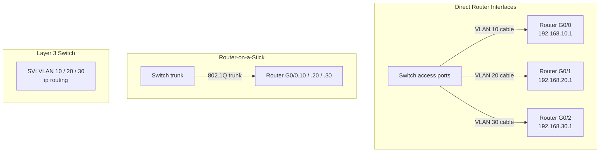

# LESSON 15: INTER-VLAN ROUTING

## TRAINING FOCUS

This lesson is part of the FEMTECT Network Engineering Foundation course. It is written to help students build strong networking fundamentals through clear explanations, real enterprise context, practical troubleshooting logic, and certification-aware technical depth.

## VISUAL TOPOLOGY: THREE WAYS TO ROUTE BETWEEN VLANS



This topology places the beginner physical-interface method beside router-on-a-stick and SVI routing so students can compare the designs visually.


## DEFINITION AND TECHNICAL IN-DEPTH KNOWLEDGE

### 15.1 Inter-VLAN Routing

Inter-VLAN routing is the process of allowing devices in different VLANs to communicate through a Layer 3 device. VLANs separate traffic at Layer 2. Routing connects different Layer 3 networks. Since each VLAN normally maps to a different IP subnet, devices in different VLANs need routing to communicate.

In Lessons 13 and 14, VLANs were explained as separate broadcast domains. A staff PC in VLAN 10 and a server in VLAN 30 are separated at Layer 2. Their Ethernet broadcasts do not cross VLAN boundaries. This is good for segmentation, but it also means communication between the VLANs requires a router, Layer 3 switch, or firewall.

Inter-VLAN routing exists because enterprises need both separation and controlled communication. Guest Wi-Fi should be separated from staff systems, but staff PCs may need to reach servers. IP phones may need to reach call-control systems. CCTV cameras may need to reach an NVR. Management laptops may need to reach switch management IP addresses. VLANs create boundaries; routing and policy decide which boundaries can be crossed.

There are three important ways to understand inter-VLAN routing:

- A router with one physical interface per VLAN.
- Router-on-a-stick.
- Layer 3 switching using Switch Virtual Interfaces.

The first method is the easiest for beginners to visualize because each VLAN gets its own physical cable to the router. Router-on-a-stick improves that design by using one trunk cable and subinterfaces. Layer 3 switching improves it again by allowing a multilayer switch to route between VLANs internally. Students should understand the physical-interface method first because it makes the purpose of a gateway very clear.

### 15.2 Technical and Business Importance of Inter-VLAN Routing

Inter-VLAN routing matters because most real enterprise networks use multiple VLANs. A network with VLANs but no routing between required VLANs is segmented, but isolated. Users may be able to communicate with devices inside their own VLAN, but not with servers, printers, management systems, or internet gateways in other VLANs.

Inter-VLAN routing also matters for security. The goal is not to allow every VLAN to reach every other VLAN freely. The goal is to route where business communication is required and apply policy where traffic should be restricted. In some networks, a Layer 3 switch routes between trusted internal VLANs, while a firewall controls traffic between user VLANs, server VLANs, guest VLANs, and the internet.

In troubleshooting, inter-VLAN routing is a common failure point. A user may have the correct IP address and VLAN assignment but still fail to reach another subnet because the default gateway is wrong, the SVI is down, a router subinterface is missing, a trunk is not carrying the VLAN, routing is disabled, or an access control rule blocks the traffic.

## 15.3 Routing Requirement Between VLANs

A VLAN is a Layer 2 broadcast domain. An IP subnet is a Layer 3 network. In good design, each VLAN usually maps to one IP subnet.

Example:

| VLAN | Name | Subnet | Gateway |
|---:|---|---|---|
| 10 | STAFF | 192.168.10.0/24 | 192.168.10.1 |
| 20 | VOICE | 192.168.20.0/24 | 192.168.20.1 |
| 30 | SERVERS | 192.168.30.0/24 | 192.168.30.1 |
| 50 | GUEST | 192.168.50.0/24 | 192.168.50.1 |

If a staff PC `192.168.10.25/24` wants to reach a server `192.168.30.10/24`, it first checks its subnet mask. The server is not in the local `192.168.10.0/24` network, so the PC sends the packet to its default gateway, `192.168.10.1`.

The default gateway is the Layer 3 interface for that VLAN. It may be a router subinterface, a firewall interface, or a Layer 3 switch SVI. That Layer 3 device then routes the packet toward VLAN 30.

Important rule:

```text
Devices in different VLANs need Layer 3 routing to communicate.
```

VLANs do not route by themselves. Switches operating only at Layer 2 do not move traffic between VLANs.

## 15.4 Default Gateway Per VLAN

Each VLAN/subnet needs a default gateway if devices in that VLAN must reach other networks. The gateway IP address must be in the same subnet as the hosts.

Example:

```text
VLAN 10 subnet: 192.168.10.0/24
Gateway:        192.168.10.1
Host:           192.168.10.25
```

The host can send remote traffic to `192.168.10.1` because the gateway is local to the host's subnet.

Wrong gateway example:

```text
Host:           192.168.10.25/24
Wrong Gateway:  192.168.20.1
```

This is incorrect because `192.168.20.1` is not local to `192.168.10.25/24`. The host may not be able to reach its gateway at Layer 2.

Default Gateway Design Table

| VLAN | Subnet | Correct Gateway | Incorrect Gateway Example |
|---:|---|---|---|
| 10 | 192.168.10.0/24 | 192.168.10.1 | 192.168.20.1 |
| 20 | 192.168.20.0/24 | 192.168.20.1 | 192.168.10.1 |
| 30 | 192.168.30.0/24 | 192.168.30.1 | 192.168.50.1 |

The gateway is usually configured manually on servers and network devices, and delivered through DHCP to client devices.

## 15.5 Inter-VLAN Routing Using One Router Interface Per VLAN

The most basic way to route between VLANs is to give each VLAN its own physical connection to the router. This design is sometimes called the legacy inter-VLAN routing method. It is not the most scalable method, but it is excellent for learning because the cabling directly shows the relationship between a VLAN, an IP subnet, and a router gateway.

Assume a switch has three VLANs:

| VLAN | Name | Subnet | Router Gateway |
|---:|---|---|---|
| 10 | STAFF | 192.168.10.0/24 | 192.168.10.1 |
| 20 | SALES | 192.168.20.0/24 | 192.168.20.1 |
| 30 | SERVERS | 192.168.30.0/24 | 192.168.30.1 |

In the direct-interface method, the switch does not send all VLANs to the router over one trunk. Instead, the switch uses three separate access ports. One access port belongs to VLAN 10, one access port belongs to VLAN 20, and one access port belongs to VLAN 30. Each access port connects by its own Ethernet cable to a different physical router interface.

The physical design looks like this:

```text
Switch Fa0/1  access VLAN 10  ---- cable ---- Router G0/0  192.168.10.1/24
Switch Fa0/2  access VLAN 20  ---- cable ---- Router G0/1  192.168.20.1/24
Switch Fa0/3  access VLAN 30  ---- cable ---- Router G0/2  192.168.30.1/24
```

This means VLAN 10 has a physical path to router interface `G0/0`, VLAN 20 has a physical path to router interface `G0/1`, and VLAN 30 has a physical path to router interface `G0/2`. The router is connected to all three networks at the same time. Because the router has one IP address in each subnet, it can route traffic between those subnets.

For example, a staff PC in VLAN 10 may have this configuration:

```text
IP Address:      192.168.10.25
Subnet Mask:     255.255.255.0
Default Gateway: 192.168.10.1
```

A server in VLAN 30 may have this configuration:

```text
IP Address:      192.168.30.10
Subnet Mask:     255.255.255.0
Default Gateway: 192.168.30.1
```

When the staff PC sends traffic to the server, the PC sees that `192.168.30.10` is not in its own subnet. It sends the frame to its default gateway, `192.168.10.1`. The switch forwards that frame through the VLAN 10 access link to router interface `G0/0`. The router receives the packet, checks the destination IP address, sees that `192.168.30.0/24` is directly connected on `G0/2`, and sends the traffic out the VLAN 30 router interface. The switch then delivers the frame to the server in VLAN 30.

In this design, each router interface is a gateway for exactly one VLAN. There is no 802.1Q trunk between the switch and router, and there are no router subinterfaces. The switch ports connected to the router are normal access ports.

Switch configuration example:

```text
enable
configure terminal
vlan 10
 name STAFF
vlan 20
 name SALES
vlan 30
 name SERVERS
exit

interface fastEthernet0/1
 description Link to Router G0/0 - VLAN 10 Gateway
 switchport mode access
 switchport access vlan 10
 no shutdown
exit

interface fastEthernet0/2
 description Link to Router G0/1 - VLAN 20 Gateway
 switchport mode access
 switchport access vlan 20
 no shutdown
exit

interface fastEthernet0/3
 description Link to Router G0/2 - VLAN 30 Gateway
 switchport mode access
 switchport access vlan 30
 no shutdown
end
show vlan brief
```

Router configuration example:

```text
enable
configure terminal
interface gigabitEthernet0/0
 description Gateway for VLAN 10 STAFF
 ip address 192.168.10.1 255.255.255.0
 no shutdown
exit

interface gigabitEthernet0/1
 description Gateway for VLAN 20 SALES
 ip address 192.168.20.1 255.255.255.0
 no shutdown
exit

interface gigabitEthernet0/2
 description Gateway for VLAN 30 SERVERS
 ip address 192.168.30.1 255.255.255.0
 no shutdown
end
show ip interface brief
show ip route
```

The router will automatically know these three networks because they are directly connected:

```text
192.168.10.0/24
192.168.20.0/24
192.168.30.0/24
```

No static route is needed for the router to route between these directly connected VLAN networks. The hosts only need the correct default gateway. VLAN 10 hosts use `192.168.10.1`, VLAN 20 hosts use `192.168.20.1`, and VLAN 30 hosts use `192.168.30.1`.

This method is simple, but it does not scale well. If a business has 20 VLANs, the router would need 20 physical interfaces and the switch would need 20 access links to the router. That is expensive, wastes ports, creates more cabling, and becomes harder to manage. This limitation is the reason router-on-a-stick became a better option for small networks, and Layer 3 switching became the preferred option in many enterprise LANs.

Direct Physical Interface Method Summary

| Component | Purpose |
|---|---|
| One access switch port per VLAN | Carries traffic for only one VLAN to the router |
| One router physical interface per VLAN | Acts as the default gateway for that VLAN |
| No trunk needed | Each cable carries only one VLAN |
| No subinterfaces needed | Each gateway is configured on a real router interface |
| Main limitation | Poor scalability when many VLANs exist |

## 15.6 Router-on-a-Stick

Router-on-a-stick is an inter-VLAN routing design where one physical router interface connects to a switch trunk and uses subinterfaces to route between multiple VLANs.

The router has one physical link to the switch. That link is configured as an 802.1Q trunk. On the router, each VLAN uses a logical subinterface. Each subinterface has an IP address that acts as the default gateway for that VLAN.

Example topology:

```text
PC VLAN 10 ---- Access Switch ---- trunk ---- Router G0/0
PC VLAN 20 ---- Access Switch ---- trunk ---- Router G0/0
```

Router subinterfaces:

```text
G0/0.10 -> VLAN 10 gateway -> 192.168.10.1/24
G0/0.20 -> VLAN 20 gateway -> 192.168.20.1/24
G0/0.30 -> VLAN 30 gateway -> 192.168.30.1/24
```

Router-on-a-stick is common in labs, small networks, branch offices, and CCNA training because it clearly shows the relationship between trunks, VLAN tags, and Layer 3 gateways.

### Router-on-a-Stick Configuration

Switch trunk toward router:

```text
interface gigabitEthernet 0/1
 description Trunk to Router
 switchport mode trunk
 switchport trunk allowed vlan 10,20,30
```

Router configuration:

```text
interface gigabitEthernet 0/0
 no shutdown

interface gigabitEthernet 0/0.10
 encapsulation dot1Q 10
 ip address 192.168.10.1 255.255.255.0

interface gigabitEthernet 0/0.20
 encapsulation dot1Q 20
 ip address 192.168.20.1 255.255.255.0

interface gigabitEthernet 0/0.30
 encapsulation dot1Q 30
 ip address 192.168.30.1 255.255.255.0
```

The `encapsulation dot1Q <vlan-id>` command tells the router which VLAN tag belongs to that subinterface. The IP address on the subinterface becomes the gateway for that VLAN.

Router-on-a-Stick Summary

| Component | Purpose |
|---|---|
| Switch trunk | Carries multiple VLANs to router |
| Router physical interface | Parent interface for subinterfaces |
| Router subinterface | Gateway for one VLAN |
| `encapsulation dot1Q` | Maps subinterface to VLAN tag |
| Host default gateway | Points to router subinterface IP |

## 15.7 Router-on-a-Stick Packet Journey

Assume PC1 in VLAN 10 wants to reach Server1 in VLAN 30.

PC1:

```text
IP Address: 192.168.10.25/24
Gateway:    192.168.10.1
```

Server1:

```text
IP Address: 192.168.30.10/24
Gateway:    192.168.30.1
```

Step 1: PC1 sees that Server1 is remote because `192.168.30.10` is not in `192.168.10.0/24`.

Step 2: PC1 sends the packet to its default gateway `192.168.10.1`.

Step 3: The switch receives the frame on an access port in VLAN 10.

Step 4: The switch forwards the frame across the trunk to the router, tagged for VLAN 10.

Step 5: The router receives the frame on subinterface `G0/0.10`.

Step 6: The router removes the Layer 2 header, examines the destination IP address, and routes the packet toward VLAN 30.

Step 7: The router sends the packet out subinterface `G0/0.30`, tagged for VLAN 30.

Step 8: The switch receives the tagged frame, places it in VLAN 30, and forwards it to Server1.

This process shows why router-on-a-stick depends on correct VLANs, trunking, dot1Q encapsulation, IP addressing, and default gateways.

## 15.8 Router-on-a-Stick Advantages and Limitations

Router-on-a-stick is simple and useful, especially in small environments and labs. It requires only one router interface and one switch trunk to route multiple VLANs.

However, it can become a bottleneck. All inter-VLAN traffic must cross the same physical router link. If many VLANs send heavy traffic through that one link, performance may suffer. It also depends on the router's interface speed and processing capacity.

Router-on-a-Stick Comparison

| Advantage | Limitation |
|---|---|
| Simple to understand | One trunk can become a bottleneck |
| Useful in small networks | Router interface failure affects all VLANs |
| Good for labs and CCNA practice | Less scalable than Layer 3 switching |
| Requires fewer physical router ports | All inter-VLAN traffic hairpins through router |

In larger enterprise LANs, Layer 3 switching is often preferred for internal inter-VLAN routing.

## 15.9 Switch Virtual Interfaces

A Switch Virtual Interface, or SVI, is a logical Layer 3 interface on a Layer 3 switch. An SVI provides a gateway IP address for a VLAN directly on the switch.

Instead of sending inter-VLAN traffic to an external router, the Layer 3 switch routes between VLANs internally.

Example:

```text
interface vlan 10
 ip address 192.168.10.1 255.255.255.0

interface vlan 20
 ip address 192.168.20.1 255.255.255.0

interface vlan 30
 ip address 192.168.30.1 255.255.255.0
```

Each SVI acts as the default gateway for its VLAN.

SVIs are common in enterprise networks because they are fast and scalable. A Layer 3 switch can route traffic between VLANs at high speed, often using hardware forwarding.

### Layer 3 Switching Requirements

For SVI-based inter-VLAN routing to work:

1. The VLAN must exist.
2. The SVI must have the correct IP address and subnet mask.
3. The SVI must be up/up.
4. At least one active port in the VLAN must usually be up, or the VLAN must be active through a trunk.
5. IP routing must be enabled on the Layer 3 switch.
6. Hosts must use the SVI IP address as their default gateway.

Cisco IOS command to enable routing on a Layer 3 switch:

```text
ip routing
```

SVI configuration example:

```text
configure terminal
ip routing
vlan 10
 name STAFF
vlan 20
 name SERVERS

interface vlan 10
 description Gateway for STAFF VLAN
 ip address 192.168.10.1 255.255.255.0
 no shutdown

interface vlan 20
 description Gateway for SERVERS VLAN
 ip address 192.168.20.1 255.255.255.0
 no shutdown
end
```

## 15.10 Inter-VLAN Routing Design Comparison

The three designs solve the same routing problem in different ways. The direct physical-interface method is the easiest to understand because each VLAN has its own router interface and cable. Router-on-a-stick reduces cabling by using one trunk and router subinterfaces. Layer 3 switching is usually the most scalable option for enterprise campus networks.

| Feature | Direct Router Interfaces | Router-on-a-Stick | Layer 3 Switching with SVIs |
|---|---|---|---|
| Routing Device | External router | External router | Layer 3 switch |
| VLAN Gateway | Router physical interface | Router subinterface | SVI |
| Link to Switch | One access link per VLAN | One 802.1Q trunk to router | Internal switch fabric |
| 802.1Q Required Between Switch and Router | No | Yes | Not for local SVI routing |
| Performance | Limited by router ports and links | Limited by router trunk/interface | Usually faster for LAN routing |
| Common Use | Learning and very small networks | Labs and small branches | Enterprise distribution/collapsed core |
| Scalability | Low | Moderate | High |
| Configuration Focus | Access ports and router physical interfaces | Subinterfaces and dot1Q | SVIs and `ip routing` |

For CCNA, students should be comfortable with both designs. In real enterprise networks, Layer 3 switching is very common for internal VLAN routing, while firewalls may route or filter traffic between security zones.

## 15.11 Inter-VLAN Routing and Firewalls

Not all inter-VLAN routing should happen freely on a Layer 3 switch. Some VLANs require security policy between them. In those cases, a firewall may route between VLANs or sit between major security zones.

Example:

| Source VLAN | Destination VLAN | Policy |
|---|---|---|
| Staff | Servers | Allow required business ports |
| Guest | Internal LAN | Deny |
| CCTV | NVR | Allow only camera/NVR traffic |
| Management | Network Devices | Allow admin protocols |
| Voice | Call Manager | Allow voice control/media |

A Layer 3 switch may route trusted internal VLANs, while a firewall controls guest, server, DMZ, internet, and sensitive traffic. The design depends on business risk and performance needs.

Security principle:

```text
Routing enables communication. Policy controls communication.
```

## 15.12 IPv6 Inter-VLAN Routing

IPv6 also needs inter-VLAN routing. Each VLAN may have an IPv6 `/64` prefix and a gateway address on a router subinterface or SVI.

Example SVI:

```text
interface vlan 10
 ipv6 address 2001:db8:100:10::1/64
```

Hosts in VLAN 10 may use SLAAC, DHCPv6, or manual configuration. The router or Layer 3 switch sends Router Advertisements, and hosts learn default gateway information through IPv6 neighbor discovery behavior.

IPv6 routing must be enabled on Cisco devices:

```text
ipv6 unicast-routing
```

At this course level, the core idea is simple: VLAN segmentation applies to IPv6 too, and a Layer 3 device is required to route between IPv6 prefixes.

## 15.13 Inter-VLAN Routing Troubleshooting

Inter-VLAN troubleshooting should be systematic. Because inter-VLAN routing depends on both Layer 2 and Layer 3, the technician must check VLANs, trunks, IP addressing, gateways, and routing.

Troubleshooting sequence:

1. Confirm the source host IP address, subnet mask, and default gateway.
2. Confirm the destination host IP address and subnet.
3. Verify the source switch port VLAN.
4. Verify the destination switch port VLAN.
5. Confirm the VLANs exist on the switches.
6. If trunks are involved, confirm the VLANs are allowed on trunks.
7. Confirm the default gateway interface exists.
8. Confirm the router subinterface or SVI is up.
9. Confirm IP routing is enabled where needed.
10. Check ACLs or firewall policy.
11. Test gateway reachability from each VLAN.
12. Test end-to-end connectivity.

Common Inter-VLAN Routing Problems

| Symptom | Likely Cause | What to Check |
|---|---|---|
| Host cannot ping gateway | Wrong VLAN, wrong gateway, SVI down | VLAN, gateway IP, SVI status |
| Same-VLAN works, different-VLAN fails | Missing routing or gateway issue | Router/SVI, `ip routing` |
| One VLAN cannot cross trunk | VLAN missing from allowed list | `show interfaces trunk` |
| Router-on-a-stick VLAN fails | Missing dot1Q subinterface | Router subinterface config |
| SVI is down/down | VLAN inactive or no active ports | VLAN existence, active port/trunk |
| Guest reaches internal network | Policy missing or wrong | Firewall/ACL rules |
| IPv6 works locally but not across VLANs | IPv6 routing or RA issue | `ipv6 unicast-routing`, SVI IPv6 |

## 15.14 Verification Commands

### Cisco IOS Direct Physical Interface Checks

On the switch, verify that the router-facing ports are access ports in the correct VLANs:

```text
show vlan brief
show interfaces status
show running-config interface fastEthernet0/1
show running-config interface fastEthernet0/2
show running-config interface fastEthernet0/3
```

On the router, verify that each physical interface is up and has the correct gateway IP address:

```text
show ip interface brief
show ip route connected
ping 192.168.10.25
ping 192.168.30.10
```
### Cisco IOS Router-on-a-Stick Commands

```text
show ip interface brief
show running-config interface gigabitEthernet 0/0.10
show interfaces trunk
show ip route connected
show arp
ping <destination>
traceroute <destination>
```

On the switch, use:

```text
show vlan brief
show interfaces trunk
show interfaces switchport
show mac address-table vlan 10
```

### Cisco IOS Layer 3 Switch Commands

```text
show ip interface brief
show running-config interface vlan 10
show vlan brief
show ip route connected
show interfaces trunk
show mac address-table vlan 10
ping <destination>
traceroute <destination>
```

For IPv6:

```text
show ipv6 interface brief
show ipv6 route
show ipv6 neighbors
ping ipv6 <destination>
```

## 15.15 Windows, Linux, and Cisco IOS Practical Checks

### Windows Checks

```text
ipconfig /all
ping <default-gateway>
ping <remote-vlan-host>
arp -a
tracert <remote-vlan-host>
```

Windows helps confirm whether the device has the correct IP address, subnet mask, gateway, and DNS settings. If the host cannot ping its own default gateway, fix local VLAN/gateway issues before testing remote VLANs.

### Linux Checks

```text
ip addr
ip route
ip neigh
ping <default-gateway>
ping <remote-vlan-host>
traceroute <remote-vlan-host>
```

Linux shows the prefix length and default route clearly. If `ip route` has no default route, the host may communicate locally but fail to reach other VLANs.

### Cisco IOS Checks

```text
show vlan brief
show interfaces trunk
show ip interface brief
show ip route
show arp
show running-config interface <interface-id>
```

Cisco IOS verifies the switch and routing side of the path. Use these commands to prove whether the issue is VLAN membership, trunking, gateway configuration, routing, or policy.

## 15.16 Cybersecurity Relevance

Inter-VLAN routing is a security control point. Once routing exists, VLAN boundaries can be crossed. This is useful for business communication, but dangerous if unrestricted.

A poor design may allow guest users to reach internal servers, CCTV cameras, printers, or management interfaces. A better design routes traffic through a firewall or applies ACLs so only approved communication is allowed.

Examples:

| Traffic | Recommended Policy |
|---|---|
| Guest to internal LAN | Deny |
| Staff to file server | Allow required ports |
| CCTV to NVR | Allow only camera/NVR traffic |
| User VLAN to switch management | Deny |
| Admin VLAN to network devices | Allow SSH/HTTPS/SNMP as required |

Inter-VLAN routing should be paired with least privilege. Do not route everything everywhere simply because it is technically possible.

## 15.17 Cloud Networking Relevance

Cloud networks use the same principle: subnets are separated, and routing connects them. In a public cloud, a route table may decide whether a subnet can reach another subnet, an internet gateway, a NAT gateway, a firewall, or a VPN.

In private cloud and virtualization environments, VLANs may still exist underneath virtual networks. A hypervisor may trunk multiple VLANs to virtual switches. A virtual firewall may route between VLAN-backed port groups.

Understanding inter-VLAN routing helps students understand cloud route tables, subnet gateways, network security groups, firewall appliances, and hybrid VPN routing.

## 15.18 KEY TERMS / GLOSSARY

| Term | Meaning |
|---|---|
| Inter-VLAN Routing | Routing traffic between different VLANs/subnets. |
| Legacy Inter-VLAN Routing | Inter-VLAN routing design using one physical router interface per VLAN. |
| Router-on-a-Stick | Inter-VLAN routing design using router subinterfaces over one trunk. |
| Subinterface | Logical interface created under a physical router interface. |
| `encapsulation dot1Q` | Cisco command that maps a router subinterface to a VLAN tag. |
| SVI | Switch Virtual Interface; logical Layer 3 VLAN interface on a switch. |
| Layer 3 Switch | Switch that can route between IP networks as well as switch frames. |
| Default Gateway | Local Layer 3 address hosts use to reach remote networks. |
| `ip routing` | Cisco command enabling IPv4 routing on a Layer 3 switch. |
| Connected Route | Route automatically created when an interface with an IP address is up. |
| Gateway VLAN | VLAN whose SVI or router subinterface acts as host gateway. |
| Policy Control | Rules that permit or deny traffic between VLANs or networks. |

## 15.19 COMPARISON TABLES

### 15.19.1 Direct Router Interfaces vs Router-on-a-Stick vs Layer 3 Switching

| Feature | Direct Router Interfaces | Router-on-a-Stick | Layer 3 Switching |
|---|---|---|---|
| Gateway Type | Router physical interface | Router subinterface | SVI |
| Link Type | One access cable per VLAN | One trunk to router | Internal switch routing |
| Key Command | `ip address` on router interface | `encapsulation dot1Q` | `interface vlan`, `ip routing` |
| Performance | Low to moderate | Moderate | High |
| Common Use | Learning and very small networks | Labs, small sites | Enterprise campus/distribution |

### 15.19.2 Layer 2 VLAN vs Layer 3 Gateway

| Feature | VLAN | Gateway/SVI/Subinterface |
|---|---|---|
| OSI Layer | Layer 2 | Layer 3 |
| Purpose | Separates broadcast domain | Routes to other networks |
| Example | VLAN 10 | 192.168.10.1 |
| Device Function | Switching | Routing |
| Failure Symptom | Wrong subnet/DHCP | Cannot reach remote VLANs |

### 15.19.3 Common Inter-VLAN Faults

| Fault | Result |
|---|---|
| Wrong access VLAN | Host may get wrong IP subnet |
| Missing trunk VLAN | VLAN fails across switches |
| Wrong router access link | Direct-interface VLAN cannot reach its physical gateway |
| Missing router subinterface | Router-on-a-stick VLAN cannot route |
| SVI down | Hosts cannot reach gateway |
| `ip routing` disabled | Layer 3 switch does not route |
| ACL/firewall block | Routing exists but traffic denied |

## 15.20 REAL-WORLD EXAMPLE / ANALOGY

Think of VLANs as separate departments in a building. Each department has its own internal room space. Inter-VLAN routing is the controlled hallway or security desk that allows approved movement between departments.

Without the hallway, departments are isolated. With an uncontrolled hallway, everyone can go everywhere. A good network uses routing for required movement and policy to control who is allowed through.

## 15.21 QUICK-RECAP CHEAT SHEET

- VLANs separate Layer 2 broadcast domains.
- Devices in different VLANs usually belong to different IP subnets.
- Different VLANs need Layer 3 routing to communicate.
- Each VLAN/subnet needs a default gateway.
- The simplest inter-VLAN routing design uses one router physical interface and one switch access link per VLAN.
- With three VLANs, VLAN 10, VLAN 20, and VLAN 30 can each use a separate cable from an access switch port to a different router interface.
- Router-on-a-stick uses one router physical interface with subinterfaces.
- Router-on-a-stick requires a trunk between switch and router.
- `encapsulation dot1Q <vlan-id>` maps a subinterface to a VLAN.
- An SVI is a Layer 3 interface for a VLAN on a Layer 3 switch.
- SVIs commonly act as default gateways.
- Layer 3 switches need `ip routing` for IPv4 routing.
- IPv6 inter-VLAN routing needs `ipv6 unicast-routing`.
- Same-VLAN communication can work even when inter-VLAN routing is broken.
- Missing allowed VLANs on trunks can break inter-VLAN paths.
- Wrong default gateway breaks remote network access.
- Firewalls and ACLs should control inter-VLAN traffic where security matters.

## 7. LESSON ASSESSMENT

This assessment is intentionally focused. Students should answer clearly, use correct networking terminology, and show practical troubleshooting thinking.

### 7.1 Theory Questions

1. Explain inter-VLAN routing and describe why devices in different VLANs need a Layer 3 gateway.
2. Explain the direct physical-interface method using three VLANs, three switch access links, and three router interfaces.
3. Compare the direct physical-interface method, router-on-a-stick, and Layer 3 switch SVI routing.
4. Describe one security, reliability, or performance concern related to this topic.
5. Explain how this topic connects to CCNA, Network+, IT support, or junior network engineering work.

### 7.2 Multiple-Choice Questions

1. What is the best reason for studying this lesson's topic?
   A. It helps students understand and support real network operation.
   B. It replaces the need for troubleshooting.
   C. It removes the need for IP addressing.
   D. It is only useful for memorizing definitions.

2. When troubleshooting a problem related to this lesson, what should be done first?
   A. Gather evidence and identify the exact scope of the problem.
   B. Replace every network device immediately.
   C. Delete the running configuration without backup.
   D. Assume the Internet service provider is always responsible.

3. Which habit best reflects professional network engineering practice?
   A. Verify changes with commands, tests, and documented results.
   B. Make random changes until something works.
   C. Ignore diagrams and rely only on memory.
   D. Avoid documenting successful fixes.

4. Which item is most useful when proving that a network feature is working?
   A. A successful test result compared with the expected result.
   B. A guess from another user.
   C. A device name with no configuration evidence.
   D. A screenshot unrelated to the problem.

5. What should students connect this lesson to during hands-on practice?
   A. Addressing, device roles, commands, verification, and troubleshooting.
   B. Only typing speed.
   C. Only cable color.
   D. Only memorizing vendor logos.

6. In an enterprise environment, why is documentation important for this topic?
   A. It helps future troubleshooting, audits, handover, and change control.
   B. It makes testing unnecessary.
   C. It disables security risks automatically.
   D. It replaces the need for correct configuration.

7. Which approach gives the strongest learning outcome?
   A. Combining technical explanation with lab practice and verification.
   B. Reading commands without understanding them.
   C. Skipping troubleshooting steps.
   D. Memorizing answers without using the network.

8. If a configuration change causes a new outage, what should the technician use?
   A. A rollback plan and saved baseline information.
   B. A random new subnet.
   C. A different monitor.
   D. A guess without evidence.

9. Which result shows that a student understands the lesson at a practical level?
   A. The student can explain the concept, configure or identify it, test it, and troubleshoot failure.
   B. The student can only repeat the title.
   C. The student avoids using commands.
   D. The student ignores enterprise examples.

10. Why are scenario questions included in this course?
   A. They train students to apply concepts to real network problems.
   B. They remove the need for labs.
   C. They focus only on spelling.
   D. They are unrelated to IT jobs.

### 7.3 Scenario-Based Questions

1. A company creates VLAN 10, VLAN 20, and VLAN 30 on a switch and connects three separate switch access ports to three router interfaces. Explain the addressing, gateway configuration, and traffic flow when a VLAN 10 PC reaches a VLAN 30 server.
2. You are asked to explain this topic to a new IT support intern before a hands-on lab. Write a short technical explanation that connects the concept to real devices, real traffic flow, and troubleshooting.

### 7.4 Answer Guide

Theory answers should be marked for technical accuracy, clear explanation, correct terminology, and practical relevance to enterprise networking. Scenario answers should show a logical troubleshooting sequence, evidence gathering, likely causes, verification steps, and a professional final recommendation.

Multiple-choice answers: 1. A; 2. A; 3. A; 4. A; 5. A; 6. A; 7. A; 8. A; 9. A; 10. A
