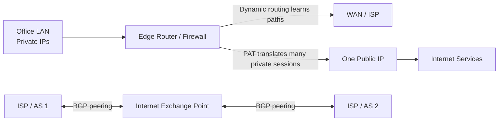

# LESSON 17: DYNAMIC ROUTING AND NAT/PAT

## TRAINING FOCUS

This lesson is part of the FEMTECT Network Engineering Foundation course. It is written to help students build strong networking fundamentals through clear explanations, real enterprise context, practical troubleshooting logic, and certification-aware technical depth.

## VISUAL DIAGRAM: ROUTING AND NAT/PAT AT THE EDGE



The visual separates internal routing from NAT/PAT translation and shows how provider networks exchange routes at a high level.


## DEFINITION AND TECHNICAL IN-DEPTH KNOWLEDGE

### 18.1 Dynamic Routing and NAT/PAT

Dynamic routing is the process where routers automatically exchange routing information and learn network paths from one another using routing protocols. NAT, or Network Address Translation, is the process of translating one IP address into another as traffic passes through a router or firewall. PAT, or Port Address Translation, is a form of NAT that allows many internal devices to share one public IP address by using different port numbers.

In Lesson 16, static routes, default routes, longest-prefix match, administrative distance, and floating static routes were explained. Static routing is manually configured. It is useful, but it does not scale well when many routers and many networks are involved. Dynamic routing solves this by allowing routers to learn, update, and remove routes automatically.

NAT and PAT solve a different but related problem. Many organizations use private IPv4 addresses internally, such as `192.168.10.0/24`, `10.10.0.0/16`, or `172.16.0.0/12`. These private addresses are not directly routed on the public internet. NAT allows private internal devices to communicate with public networks by translating private addresses to public addresses.

Dynamic routing answers this question:

```text
How do routers learn where networks are?
```

NAT and PAT answer this question:

```text
How do private internal devices communicate through public IP addressing?
```

For CCNA and CompTIA Network+, students must understand the purpose of dynamic routing, the difference between RIP, OSPF, and BGP at a practical level, and the difference between static NAT, dynamic NAT, and PAT.

### 18.2 Technical Importance: Dynamic Routing and NAT/PAT Matter

Dynamic routing matters because enterprise networks change. Links fail, new branches are added, cloud networks are connected, backup WAN links come online, and routing paths must adjust. If every route is manually configured everywhere, the network becomes difficult to maintain and easy to break.

Dynamic routing also improves resilience. If one path fails and another path exists, a routing protocol can remove the failed route and choose another path. Static routes can provide backup with floating static routes, but dynamic routing is more scalable when many networks and routers are involved.

NAT and PAT matter because IPv4 address space is limited and most organizations use private IPv4 internally. A whole office may have 200 devices but only one public IPv4 address from the ISP. PAT allows all those devices to access the internet through that one public address.

In real enterprise networks, routing and NAT often meet at the edge. Internal routers and Layer 3 switches move traffic between internal networks. A firewall or edge router may use NAT/PAT to translate internal private addresses when traffic goes to the internet. Dynamic routing may also exchange routes between branches, data centers, cloud environments, and ISPs.

## 18.3 Static Routing vs Dynamic Routing

Static routing is manually configured by an administrator. Dynamic routing is learned through routing protocols.

Static routing is predictable and simple in small networks. Dynamic routing is more scalable and adaptive in larger networks.

Static vs Dynamic Routing

| Feature | Static Routing | Dynamic Routing |
|---|---|---|
| Route Creation | Manual | Learned automatically |
| Scalability | Low to medium | Medium to high |
| Reaction to Failure | Manual unless floating/tracking is used | Automatic convergence |
| Administrative Effort | Higher as network grows | Lower after proper design |
| Predictability | Very predictable | Depends on protocol and metrics |
| Best Use | Small/stub networks, default routes | Larger networks, redundant paths |

Dynamic routing does not mean "no planning." Routing protocols must still be designed, secured, summarized, filtered, monitored, and documented.

## 18.4 Routing Protocol Fundamentals

A routing protocol is a set of rules routers use to share network reachability information. Routing protocols allow routers to advertise networks, learn routes, calculate best paths, and react to topology changes.

A routing protocol is not the same as a routed protocol. IP is the routed protocol because IP packets are forwarded. OSPF, RIP, EIGRP, IS-IS, and BGP are routing protocols because they help routers learn paths.

Routing Protocol Functions

| Function | Explanation |
|---|---|
| Discover Networks | Learn what networks exist |
| Exchange Routes | Share reachability information |
| Choose Best Path | Use protocol rules and metrics |
| Detect Failures | Notice when paths disappear |
| Converge | Update routing tables after change |

Convergence is the process where routers update their routing information after a change and agree on the new best paths. Fast and stable convergence is important in enterprise networks.

## 18.5 RIP Brief Overview

RIP means Routing Information Protocol. It is one of the oldest dynamic routing protocols. RIP uses hop count as its metric. A hop is one router crossed on the way to a destination.

RIP is simple, but it has limitations. It supports a maximum hop count of 15. A route with 16 hops is considered unreachable. RIP also converges slowly compared with modern protocols.

RIP exists mostly as a learning tool today. It helps beginners understand dynamic route advertisement, but it is rarely the best choice for modern enterprise networks.

RIP Summary

| Feature | RIP |
|---|---|
| Metric | Hop count |
| Maximum Usable Hop Count | 15 |
| Protocol Type | Distance vector |
| Scalability | Low |
| Modern Enterprise Use | Rare |
| Learning Value | Good for basics |

For CCNA and Network+, remember that RIP is simple and hop-count based, but OSPF is much more common in enterprise internal routing.

## 18.6 OSPF Overview

OSPF means Open Shortest Path First. It is a link-state dynamic routing protocol commonly used inside enterprise networks. OSPF is an interior gateway protocol, or IGP, meaning it is used within an organization or autonomous system.

OSPF routers exchange information about links and build a topology database. Each router uses the Shortest Path First algorithm to calculate the best path. OSPF commonly uses cost as its metric, and cost is usually based on interface bandwidth.

OSPF matters because it scales better than RIP, converges faster, supports hierarchical design using areas, and is widely used in enterprise networks.

Basic OSPF concepts:

- OSPF routers form neighbor relationships.
- OSPF exchanges link-state information.
- OSPF uses areas to organize routing.
- Area 0 is the backbone area.
- OSPF selects routes based on lowest cost.

Example Cisco IOS OSPF configuration:

```text
router ospf 1
 network 192.168.10.0 0.0.0.255 area 0
 network 10.0.0.0 0.0.0.3 area 0
```

This lesson introduces OSPF at a practical overview level. Deeper OSPF neighbor states, LSAs, DR/BDR, and multi-area design are beyond this lesson's scope.

## 18.7 BGP Overview

BGP means Border Gateway Protocol. It is the routing protocol used to exchange routes between autonomous systems on the internet. An autonomous system, or AS, is a network or group of networks under one administrative control with a shared routing policy.

BGP is an exterior gateway protocol, or EGP. It is used between organizations, ISPs, cloud providers, content networks, and large enterprises. BGP is policy-based and highly scalable.

BGP does not choose paths only by simple bandwidth. It uses attributes such as AS path, local preference, MED, origin, and next hop. BGP is designed for internet-scale routing and policy control.

Enterprise students should understand BGP at a high level:

- ISPs use BGP to exchange internet routes.
- Large organizations may use BGP with multiple ISPs.
- Cloud providers may use BGP over VPN or dedicated connectivity.
- Internet exchange points allow many networks to peer and exchange routes.

BGP is powerful, but misconfiguration can have large impact. A wrong BGP advertisement can affect reachability far beyond one LAN.

## 18.8 OSPF vs BGP

OSPF and BGP are both routing protocols, but they solve different problems.

| Feature | OSPF | BGP |
|---|---|---|
| Protocol Type | Interior Gateway Protocol | Exterior Gateway Protocol |
| Common Use | Inside enterprise networks | Between organizations/ISPs |
| Path Selection | Cost-based | Policy and attributes |
| Scale | Enterprise/internal | Internet-scale |
| Convergence Goal | Fast internal convergence | Stable policy-based routing |
| Example Use | Campus routing, data center internal routing | ISP peering, cloud edge, multi-homing |

Simple rule:

```text
OSPF is commonly used inside networks. BGP is used between networks.
```

This is a simplification, but it is a useful beginner mental model.

## 18.9 Nigerian ISP Peering Through IXPN

IXPN, the Internet Exchange Point of Nigeria, is a real-world example of how networks exchange traffic locally. An Internet Exchange Point is a shared interconnection platform where ISPs, mobile operators, content providers, cloud providers, educational networks, and other networks can peer.

According to IXPN's official website, IXPN enables direct peering between networks, helps keep Nigerian internet traffic local, reduces latency, reduces transit costs, improves resilience, and supports network sovereignty. The site also describes IXPN as having 130+ connected networks, 170 connected ports, 13 POPs, and 2.5 Tbps peak traffic at the time this lesson was prepared.

Why does this matter? Without local peering, traffic between two Nigerian networks might leave Nigeria, travel through international transit providers, and return to Nigeria. That increases latency, cost, and dependency on international links. With local peering at IXPN, two connected networks can exchange local traffic inside Nigeria.

Example:

```text
User on ISP A in Lagos wants content hosted on Network B in Nigeria.
Without local peering: ISP A -> international transit -> foreign exchange/transit -> Network B
With IXPN peering: ISP A -> IXPN -> Network B
```

At the routing level, BGP is commonly used for peering between independent networks. Each network advertises the prefixes it is allowed to announce. Other peers learn those routes and can send traffic directly through the exchange fabric.

IXPN Context Table

| Concept | Practical Meaning |
|---|---|
| IXP | Shared platform where networks interconnect |
| Peering | Direct exchange of traffic between networks |
| Local Traffic | Nigerian-to-Nigerian traffic stays local where possible |
| Lower Latency | Shorter path improves performance |
| Reduced Transit Cost | Less dependency on paid international transit |
| Resilience | Local traffic can continue even if some upstream paths fail |

Source note: the IXPN details above were verified from the official IXPN website at `https://ixpn.ng/` during lesson preparation.

## 18.10 NAT Fundamentals

NAT means Network Address Translation. NAT changes IP address information as traffic passes through a router, firewall, or NAT device.

NAT is most commonly used to translate private IPv4 addresses into public IPv4 addresses for internet access. Private IPv4 addresses, such as `192.168.1.25`, cannot be routed directly on the public internet. A NAT device translates that private address to a public address before sending the packet out to the internet.

Example:

```text
Inside private IP: 192.168.10.25
Translated public IP: 203.0.113.10
```

NAT exists mainly because IPv4 public addresses are limited. It also hides internal addressing from the public internet, but NAT should not be treated as a complete security solution. Firewalls and policy are still required.

## 18.11 NAT Terminology

Cisco NAT uses several important terms.

| Term | Meaning |
|---|---|
| Inside Local | Private IP address of an internal host before translation |
| Inside Global | Public IP address representing the internal host after translation |
| Outside Local | Address of external host as seen internally |
| Outside Global | Real public address of external host |

Most beginner NAT troubleshooting focuses on inside local and inside global.

Example:

```text
Inside Local:  192.168.10.25
Inside Global: 203.0.113.10
```

The internal PC uses `192.168.10.25`. The internet sees `203.0.113.10`.

## 18.12 Static NAT

Static NAT maps one private IP address to one public IP address permanently.

Example:

```text
192.168.10.10 <-> 203.0.113.10
```

Static NAT is useful when an internal server must be reachable from outside using a consistent public address. For example, a company may publish an internal web server, VPN server, mail gateway, or remote access appliance.

Cisco IOS static NAT example:

```text
ip nat inside source static 192.168.10.10 203.0.113.10
```

The inside and outside interfaces must also be marked:

```text
interface gigabitEthernet 0/0
 description Inside LAN
 ip nat inside

interface gigabitEthernet 0/1
 description Internet
 ip nat outside
```

Static NAT Summary

| Feature | Static NAT |
|---|---|
| Mapping Type | One-to-one |
| Direction | Often inbound and outbound |
| Public IP Requirement | One public IP per internal mapped host |
| Common Use | Publishing internal server |
| Scalability | Limited by public IP availability |

## 18.13 Dynamic NAT

Dynamic NAT maps private inside addresses to a pool of public addresses. The mapping is created dynamically when internal hosts initiate traffic.

Example:

```text
Internal pool: 192.168.10.0/24
Public NAT pool: 203.0.113.10 - 203.0.113.20
```

If a user initiates internet traffic, the NAT device assigns an available public address from the pool. When the session ends and the translation expires, the address can be reused by another host.

Cisco IOS dynamic NAT example:

```text
access-list 1 permit 192.168.10.0 0.0.0.255
ip nat pool PUBLIC_POOL 203.0.113.10 203.0.113.20 netmask 255.255.255.0
ip nat inside source list 1 pool PUBLIC_POOL
```

Dynamic NAT requires enough public addresses for simultaneous translated hosts. If the pool is exhausted, new translations may fail.

## 18.14 PAT / NAT Overload

PAT means Port Address Translation. It is also called NAT overload. PAT allows many private inside devices to share one public IP address by using different TCP or UDP port numbers.

PAT is the most common form of NAT for office internet access.

Example:

| Inside Host | Source Port | Public Translation |
|---|---:|---|
| 192.168.10.25 | 49152 | 203.0.113.5:30001 |
| 192.168.10.26 | 49153 | 203.0.113.5:30002 |
| 192.168.10.27 | 49154 | 203.0.113.5:30003 |

All three internal hosts share the same public IP address `203.0.113.5`, but the NAT device tracks sessions using port numbers.

Cisco IOS PAT example using the outside interface public IP:

```text
access-list 1 permit 192.168.10.0 0.0.0.255
interface gigabitEthernet 0/0
 ip nat inside
interface gigabitEthernet 0/1
 ip nat outside
ip nat inside source list 1 interface gigabitEthernet 0/1 overload
```

The keyword `overload` enables PAT.

PAT Summary

| Feature | PAT / NAT Overload |
|---|---|
| Mapping Type | Many-to-one |
| Uses Ports | Yes |
| Public IP Efficiency | Very high |
| Common Use | Whole office internet access |
| Limitation | Inbound connections need extra configuration |

## 18.15 Static NAT vs Dynamic NAT vs PAT

| Feature | Static NAT | Dynamic NAT | PAT / NAT Overload |
|---|---|---|---|
| Mapping | One-to-one fixed | Many private to pool, one-to-one per active translation | Many private to one/few public IPs using ports |
| Public IP Need | High | Medium | Low |
| Common Use | Public access to internal server | Outbound access with public pool | Office internet access |
| Port Translation | Not required | Not required | Required |
| Scalability | Low | Medium | High |

For most small offices, PAT is the practical answer because the ISP may provide only one public IPv4 address.

## 18.16 Getting a Whole Office Online on One Public IP

Imagine a small office with 50 devices:

```text
Inside network: 192.168.10.0/24
Router LAN IP:  192.168.10.1
Public IP:      203.0.113.5
ISP next hop:   203.0.113.1
```

The office wants all internal users to access the internet using one public IP address. PAT solves this.

Configuration concept:

```text
interface gigabitEthernet 0/0
 description LAN
 ip address 192.168.10.1 255.255.255.0
 ip nat inside

interface gigabitEthernet 0/1
 description ISP
 ip address 203.0.113.5 255.255.255.252
 ip nat outside

access-list 1 permit 192.168.10.0 0.0.0.255
ip nat inside source list 1 interface gigabitEthernet 0/1 overload
ip route 0.0.0.0 0.0.0.0 203.0.113.1
```

What this does:

1. Marks the LAN interface as NAT inside.
2. Marks the ISP interface as NAT outside.
3. Matches internal users with ACL 1.
4. Translates those users to the public IP on `G0/1`.
5. Uses overload so many users can share the same public IP.
6. Uses a default route to send internet traffic to the ISP.

This is one of the most common real-world edge configurations in small offices.

## 18.17 NAT Verification and Troubleshooting

NAT troubleshooting requires checking both routing and translation. NAT cannot fix broken routing. The router must know where to send traffic before NAT can help.

Useful Cisco IOS commands:

```text
show ip nat translations
show ip nat statistics
show access-lists
show ip route
show ip interface brief
clear ip nat translation *
```

Troubleshooting sequence:

1. Confirm inside host has correct IP, mask, gateway, and DNS.
2. Confirm the router can reach the ISP next hop.
3. Confirm a default route exists.
4. Confirm inside and outside NAT interfaces are correctly marked.
5. Confirm ACL matches inside source addresses.
6. Generate traffic from an inside host.
7. Check NAT translations.
8. Check firewall/ISP policy if translations exist but traffic fails.

Common NAT Problems

| Symptom | Possible Cause | What to Check |
|---|---|---|
| No internet from inside hosts | Missing default route | `show ip route` |
| No NAT translations | Wrong ACL or NAT inside/outside missing | `show ip nat translations`, config |
| Some users work, others fail | ACL excludes part of subnet | `show access-lists` |
| Public server unreachable | Static NAT or firewall missing | NAT config, ACL/firewall |
| NAT pool exhausted | Dynamic NAT pool too small | `show ip nat statistics` |
| DNS names fail but IP works | DNS issue, not NAT | DNS configuration |

## 18.18 Windows, Linux, and Cisco IOS Practical Commands

### Windows Commands

```text
ipconfig /all
ping <default-gateway>
ping 8.8.8.8
tracert 8.8.8.8
nslookup example.com
```

Windows helps confirm whether the client has proper addressing, gateway, DNS, and internet reachability. If ping by IP works but names fail, DNS is the likely issue.

### Linux Commands

```text
ip addr
ip route
ping <default-gateway>
ping 8.8.8.8
traceroute 8.8.8.8
dig example.com
```

Linux checks are useful for confirming the local default route and testing whether internet access fails at routing, NAT, or DNS.

### Cisco IOS Commands

```text
show ip route
show ip protocols
show ip nat translations
show ip nat statistics
show access-lists
show ip interface brief
ping <destination>
traceroute <destination>
```

For dynamic routing, `show ip protocols` shows routing protocol information. For NAT, `show ip nat translations` and `show ip nat statistics` are key commands.

## 18.20 Cybersecurity Relevance

Dynamic routing and NAT both affect security.

Dynamic routing must be protected because false or unauthorized route advertisements can redirect traffic, blackhole traffic, or expose networks. Routing protocol authentication, route filtering, prefix filtering, and proper neighbor control are important in enterprise and ISP environments.

NAT hides internal private addressing, but NAT is not a firewall by itself. PAT allows inside users to start outbound sessions, but inbound access to internal systems should be controlled by firewall rules and explicit NAT/publishing policies.

Security concerns include:

- Rogue routing advertisements.
- Route leaks.
- Incorrect default routes.
- NAT rules exposing internal servers.
- Overly broad ACLs matching too many internal networks.
- Lack of logging for translated sessions.

Security principle:

```text
Routing determines reachability. NAT changes addresses. Firewalls enforce policy.
```

## 18.21 Cloud Networking Relevance

Cloud networks use dynamic routing and NAT concepts heavily. VPN gateways may use BGP to exchange routes between on-premises networks and cloud virtual networks. Cloud route tables decide where traffic goes. NAT gateways allow private cloud instances to reach the internet without exposing each instance directly.

Example cloud NAT design:

| Cloud Component | Purpose |
|---|---|
| Private subnet | Hosts internal application servers |
| NAT gateway | Allows outbound internet access |
| Route table | Sends `0.0.0.0/0` from private subnet to NAT gateway |
| Internet gateway | Provides public internet path |
| BGP VPN | Exchanges routes with office network |

The same concepts from this lesson apply in cloud: route learning, default routes, next hops, NAT translation, and security policy.

## 19. KEY TERMS / GLOSSARY

| Term | Meaning |
|---|---|
| Dynamic Routing | Automatic route learning through routing protocols. |
| Routing Protocol | Protocol routers use to exchange routing information. |
| Convergence | Process where routers update routes after a topology change. |
| RIP | Routing Information Protocol, hop-count-based dynamic routing protocol. |
| OSPF | Open Shortest Path First, link-state IGP commonly used in enterprises. |
| BGP | Border Gateway Protocol, path-vector EGP used between autonomous systems. |
| IGP | Interior Gateway Protocol, used inside one organization or AS. |
| EGP | Exterior Gateway Protocol, used between autonomous systems. |
| Autonomous System | Network under one administrative routing policy. |
| Peering | Direct route/traffic exchange between networks. |
| IXP | Internet Exchange Point where networks interconnect. |
| NAT | Network Address Translation. |
| PAT | Port Address Translation, many-to-one NAT using ports. |
| NAT Overload | Cisco term for PAT. |
| Static NAT | Permanent one-to-one NAT mapping. |
| Dynamic NAT | Dynamic mapping from private addresses to public pool. |
| Inside Local | Internal private address before translation. |
| Inside Global | Public address representing an internal host after translation. |

## 20. COMPARISON TABLES

### 20.1 RIP vs OSPF vs BGP

| Feature | RIP | OSPF | BGP |
|---|---|---|---|
| Type | Distance vector | Link-state IGP | Path-vector EGP |
| Metric/Decision | Hop count | Cost | Policy attributes |
| Common Use | Learning/small legacy networks | Enterprise internal routing | ISP/internet/cloud edge |
| Scalability | Low | Medium/high | Very high |
| Modern Relevance | Limited | High | Very high |

### 20.2 Static NAT vs Dynamic NAT vs PAT

| Feature | Static NAT | Dynamic NAT | PAT |
|---|---|---|---|
| Mapping | One-to-one fixed | Pool-based dynamic | Many-to-one using ports |
| Public IP Efficiency | Low | Medium | High |
| Common Use | Published server | Outbound access with pool | Office internet access |
| Port Translation | No | No | Yes |

### 20.3 Dynamic Routing vs Static Routing

| Feature | Static Routing | Dynamic Routing |
|---|---|---|
| Configuration | Manual | Protocol-based |
| Failure Response | Manual or floating route | Automatic convergence |
| Scale | Smaller networks | Larger networks |
| Control | Very explicit | Policy/protocol controlled |
| Complexity | Low initially | Higher design knowledge |

### 20.4 NAT Troubleshooting Commands

| Command | Purpose |
|---|---|
| `show ip nat translations` | Shows active NAT entries |
| `show ip nat statistics` | Shows NAT counters and pool usage |
| `show access-lists` | Confirms NAT ACL matches |
| `show ip route` | Confirms routing/default route |
| `show ip interface brief` | Confirms interface status |

## 21. REAL-WORLD EXAMPLE / ANALOGY

Dynamic routing is like a group of delivery offices sharing road updates with each other. If a road closes, the offices update their maps and choose another route. Static routing is like writing directions manually and changing them by hand whenever roads change.

PAT is like an office building with many employees using one public reception phone number. The receptionist tracks which internal extension started each conversation. Outsiders see one main number, but the receptionist knows which internal person belongs to each call.

## 22. QUICK-RECAP CHEAT SHEET

- Dynamic routing lets routers learn routes automatically.
- Static routing is manual.
- RIP uses hop count and is mostly legacy/learning focused.
- OSPF is a link-state IGP commonly used inside enterprises.
- BGP is an EGP used between autonomous systems.
- IXPs allow networks to peer and exchange local traffic.
- IXPN helps Nigerian networks keep local traffic local through peering.
- NAT translates IP addresses.
- PAT translates many private addresses to one public address using ports.
- Static NAT is one-to-one fixed mapping.
- Dynamic NAT uses a pool of public addresses.
- PAT is also called NAT overload.
- `ip nat inside` marks the inside interface.
- `ip nat outside` marks the outside interface.
- `overload` enables PAT on Cisco IOS.
- `show ip nat translations` verifies active NAT translations.
- NAT requires working routing.
- NAT is not a replacement for firewall policy.

## 7. LESSON ASSESSMENT

This assessment is intentionally focused. Students should answer clearly, use correct networking terminology, and show practical troubleshooting thinking.

### 7.1 Theory Questions

1. Explain the main networking concept covered in this lesson and describe its role in a real enterprise network.
2. Describe two technical problems that can occur when this lesson's concept is poorly designed or incorrectly configured.
3. Explain how a network technician or junior network engineer would verify that this part of the network is working correctly.
4. Describe one security, reliability, or performance concern related to this topic.
5. Explain how this topic connects to CCNA, Network+, IT support, or junior network engineering work.

### 7.2 Multiple-Choice Questions

1. What is the best reason for studying this lesson's topic?
   A. It helps students understand and support real network operation.
   B. It replaces the need for troubleshooting.
   C. It removes the need for IP addressing.
   D. It is only useful for memorizing definitions.

2. When troubleshooting a problem related to this lesson, what should be done first?
   A. Gather evidence and identify the exact scope of the problem.
   B. Replace every network device immediately.
   C. Delete the running configuration without backup.
   D. Assume the Internet service provider is always responsible.

3. Which habit best reflects professional network engineering practice?
   A. Verify changes with commands, tests, and documented results.
   B. Make random changes until something works.
   C. Ignore diagrams and rely only on memory.
   D. Avoid documenting successful fixes.

4. Which item is most useful when proving that a network feature is working?
   A. A successful test result compared with the expected result.
   B. A guess from another user.
   C. A device name with no configuration evidence.
   D. A screenshot unrelated to the problem.

5. What should students connect this lesson to during hands-on practice?
   A. Addressing, device roles, commands, verification, and troubleshooting.
   B. Only typing speed.
   C. Only cable color.
   D. Only memorizing vendor logos.

6. In an enterprise environment, why is documentation important for this topic?
   A. It helps future troubleshooting, audits, handover, and change control.
   B. It makes testing unnecessary.
   C. It disables security risks automatically.
   D. It replaces the need for correct configuration.

7. Which approach gives the strongest learning outcome?
   A. Combining technical explanation with lab practice and verification.
   B. Reading commands without understanding them.
   C. Skipping troubleshooting steps.
   D. Memorizing answers without using the network.

8. If a configuration change causes a new outage, what should the technician use?
   A. A rollback plan and saved baseline information.
   B. A random new subnet.
   C. A different monitor.
   D. A guess without evidence.

9. Which result shows that a student understands the lesson at a practical level?
   A. The student can explain the concept, configure or identify it, test it, and troubleshoot failure.
   B. The student can only repeat the title.
   C. The student avoids using commands.
   D. The student ignores enterprise examples.

10. Why are scenario questions included in this course?
   A. They train students to apply concepts to real network problems.
   B. They remove the need for labs.
   C. They focus only on spelling.
   D. They are unrelated to IT jobs.

### 7.3 Scenario-Based Questions

1. A user or department reports a connectivity problem related to this lesson's topic. Write the first five checks you would perform, the commands or tools you would use, and the evidence you expect to collect.
2. You are asked to explain this topic to a new IT support intern before a hands-on lab. Write a short technical explanation that connects the concept to real devices, real traffic flow, and troubleshooting.

### 7.4 Answer Guide

Theory answers should be marked for technical accuracy, clear explanation, correct terminology, and practical relevance to enterprise networking. Scenario answers should show a logical troubleshooting sequence, evidence gathering, likely causes, verification steps, and a professional final recommendation.

Multiple-choice answers: 1. A; 2. A; 3. A; 4. A; 5. A; 6. A; 7. A; 8. A; 9. A; 10. A
