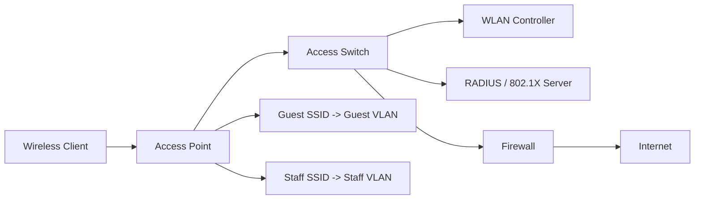

# LESSON 19: WIRELESS NETWORKING, DEPLOYMENT, AND SECURITY

## TRAINING FOCUS

This lesson is part of the FEMTECT Network Engineering Foundation course. It is written to help students build strong networking fundamentals through clear explanations, real enterprise context, practical troubleshooting logic, and certification-aware technical depth.

## VISUAL TOPOLOGY: SECURE ENTERPRISE WI-FI



This topology connects RF access, SSIDs, VLAN mapping, authentication, and security policy in one enterprise wireless view.

---

## Wireless Fundamentals and Deployment

## DEFINITION AND TECHNICAL IN-DEPTH KNOWLEDGE

### Wireless Networking

Wireless networking is the use of radio frequency signals to connect devices to a network without a physical Ethernet cable. In a wired Ethernet network, the signal travels through copper or fiber. In a wireless LAN, the signal travels through the air between a wireless client and a wireless access point.

Wireless LAN is commonly written as WLAN. A WLAN still belongs to the larger network. It still uses IP addressing, VLANs, DHCP, DNS, routing, NAT, firewalls, authentication, monitoring, and troubleshooting. The main difference is the access medium. Instead of plugging into a switchport with a cable, the user connects through a radio signal.

Wireless answers this question:

```text
How can devices connect to the LAN without a physical Ethernet cable?
```

A wireless network is not separate from normal networking. It is an extension of the wired LAN. The access point acts like a bridge between wireless clients and the wired network. Behind the access point, the traffic still reaches switches, routers, DHCP servers, DNS servers, firewalls, internet links, cloud services, and enterprise applications.

### Technical and Business Importance of Wireless Networking

Wireless matters because modern users expect mobility. Laptops, smartphones, tablets, barcode scanners, point-of-sale terminals, wireless printers, warehouse devices, CCTV cameras, IoT sensors, guest devices, and medical devices often need network access without being tied to a desk.

In an enterprise, wireless is no longer a convenience feature. It is a production network. If Wi-Fi fails in a school, teachers may not access online lessons. If Wi-Fi fails in a hospital, mobile workstations may not reach clinical systems. If Wi-Fi fails in a hotel, guests complain immediately. If Wi-Fi fails in a warehouse, scanners and inventory systems may stop working.

Wireless also matters because it introduces problems that do not exist in the same way on wired Ethernet. A cable either links up or it does not. Wireless depends on signal strength, noise, interference, walls, distance, client capability, channel planning, power levels, roaming behavior, authentication, and radio design.

For CCNA and CompTIA Network+, students must understand that wireless troubleshooting is not only about checking whether the SSID is visible. A professional troubleshooter checks radio conditions, authentication, VLAN mapping, DHCP, DNS, routing, NAT, firewall policy, and user device behavior.

### Operation and Process: Wireless Fits Into the Network Path

A wireless client follows a full communication path before it can use applications.

Wireless Client Connectivity Path

| Stage | What Happens | Related Earlier Lesson |
|---|---|---|
| 1 | Client discovers SSID | Wireless fundamentals |
| 2 | Client associates to AP | Wireless fundamentals |
| 3 | Client authenticates | Wireless security |
| 4 | AP maps client to VLAN | VLAN design |
| 5 | Client receives IP settings | DHCP |
| 6 | Client resolves names | DNS |
| 7 | Client sends remote traffic to gateway | Routing |
| 8 | Firewall/NAT handles internet access | NAT/PAT and security |

This sequence is important. A user may say, "Wi-Fi is connected but internet is not working." That statement may mean the radio association succeeded, but DHCP failed. It may also mean DHCP worked, but DNS failed. It may also mean DNS worked, but the firewall or NAT policy is blocking internet traffic.

Wireless troubleshooting must therefore move from radio to network services.

## 20.4 RF Basics

RF means radio frequency. Wireless networks use radio waves to carry data through the air. A radio wave is electromagnetic energy that travels from a transmitter to a receiver.

In Wi-Fi, the access point and the client both transmit and receive radio signals. The AP is not only "sending internet." The client also sends frames back to the AP. Good wireless communication requires both directions to work.

Important RF ideas:

| Concept | Meaning |
|---|---|
| Frequency | The band where the radio signal operates |
| Channel | A smaller range inside a frequency band |
| Signal Strength | How strong the received wireless signal is |
| Noise | Unwanted RF energy that interferes with communication |
| SNR | Signal-to-noise ratio, the difference between useful signal and noise |
| Interference | Another signal or device disrupting communication |
| Attenuation | Signal weakening as it travels through distance or materials |
| Absorption | Signal energy being absorbed by walls, metal, glass, water, or people |
| Reflection | Signal bouncing off surfaces |
| Multipath | Signal reaching receiver through multiple reflected paths |

Wireless performance is not only about AP speed. A powerful AP cannot fully solve a weak client radio. Many laptops and phones transmit at lower power than an AP. If the AP is too far away, the client may hear the AP, but the AP may not hear the client clearly.

### 20.4.1 Signal Strength

Signal strength is commonly measured in dBm. Wireless signal values are usually negative numbers. A value closer to zero is stronger.

Example Signal Strength Guide

| Signal Strength | General Meaning |
|---|---|
| -30 dBm | Excellent, very close to AP |
| -50 dBm | Very good |
| -67 dBm | Common design target for voice/video |
| -70 dBm | Usable for normal data in many networks |
| -80 dBm | Weak and unreliable |
| -90 dBm | Very poor |

These values are practical guidelines, not absolute guarantees. Application type, noise, client capability, channel width, and environment all matter.

### 20.4.2 Noise and SNR

Noise is unwanted RF energy. SNR means signal-to-noise ratio. It compares the useful wireless signal to the background noise.

If signal strength is -65 dBm and noise is -90 dBm, the SNR is about 25 dB. That is usually much better than a signal of -65 dBm with noise at -72 dBm, because the useful signal is only slightly above the noise.

SNR Example

| Signal | Noise | Approximate SNR | Meaning |
|---|---|---|---|
| -60 dBm | -90 dBm | 30 dB | Good |
| -67 dBm | -90 dBm | 23 dB | Usually usable |
| -70 dBm | -80 dBm | 10 dB | Poor |
| -75 dBm | -78 dBm | 3 dB | Very poor |

Wireless troubleshooting should therefore consider both signal and noise. Strong signal with high noise can still perform badly.

## 20.5 Wi-Fi Frequency Bands: 2.4 GHz, 5 GHz, and 6 GHz

Wi-Fi commonly uses the 2.4 GHz, 5 GHz, and 6 GHz bands. Each band has different behavior.

Frequency Band Comparison

| Band | Main Strength | Main Limitation | Common Use |
|---|---|---|---|
| 2.4 GHz | Longer range, better wall penetration | Crowded, fewer non-overlapping channels, more interference | IoT, older devices, basic coverage |
| 5 GHz | More channels, better capacity than 2.4 GHz | Shorter range than 2.4 GHz | Enterprise laptops, phones, normal business Wi-Fi |
| 6 GHz | More spectrum and cleaner channels where allowed | Shorter range, newer client support needed, country rules vary | High-density, high-performance modern WLAN |

### 20.5.1 2.4 GHz Band

The 2.4 GHz band travels farther and penetrates walls better than higher bands, but it is often crowded. Bluetooth, microwave ovens, older cordless devices, wireless cameras, neighboring Wi-Fi networks, and many IoT devices can contribute to congestion.

The 2.4 GHz band has very limited clean channel capacity. In many deployments, channels 1, 6, and 11 are used because they do not overlap in the common 20 MHz channel plan. Using overlapping channels causes adjacent-channel interference, which can make the network slower and less reliable.

2.4 GHz is useful for coverage and compatibility, but it should not be treated as the main high-performance band in a modern enterprise if 5 GHz or 6 GHz are available.

### 20.5.2 5 GHz Band

The 5 GHz band provides more channels and usually less interference than 2.4 GHz. It is commonly used for enterprise laptops, smartphones, tablets, and general office Wi-Fi.

5 GHz does not travel as far as 2.4 GHz and does not penetrate walls as well. This is not always a disadvantage. Shorter range can allow better frequency reuse because APs interfere less with distant APs when the design is done properly.

5 GHz is usually the practical workhorse band for many enterprise WLANs.

### 20.5.3 6 GHz Band

The 6 GHz band provides additional spectrum for newer Wi-Fi generations such as Wi-Fi 6E and Wi-Fi 7, depending on country regulations and device support. It can provide cleaner spectrum and wider channels for high-throughput applications.

The limitation is that both the AP and client must support 6 GHz, and regulatory availability depends on the country. 6 GHz also has shorter range and weaker wall penetration than 2.4 GHz.

In a modern enterprise, 6 GHz is useful for high-density areas, newer devices, low-latency applications, and reducing load from crowded 2.4 GHz and 5 GHz bands.

## 20.6 Channels and Channel Width

A Wi-Fi band is divided into channels. A channel is a smaller range of frequencies that an AP uses to transmit.

Channel planning matters because nearby APs should not all use the same or overlapping channels. If they do, they must share airtime or interfere with each other.

Channel width controls how much spectrum one channel uses. Common channel widths include 20 MHz, 40 MHz, 80 MHz, 160 MHz, and in Wi-Fi 7, 320 MHz support in 6 GHz environments where available.

Channel Width Tradeoff

| Channel Width | Advantage | Disadvantage |
|---|---|---|
| 20 MHz | More channels, better reuse, more stable in dense networks | Lower peak throughput |
| 40 MHz | More throughput than 20 MHz | Uses more spectrum |
| 80 MHz | Higher throughput | Fewer clean channels, more interference risk |
| 160 MHz | Very high throughput | Hard to use cleanly in many enterprise areas |
| 320 MHz | Wi-Fi 7 high-throughput capability in 6 GHz | Requires compatible APs/clients and clean spectrum |

In enterprise design, wider is not always better. A school, hotel, office, or hospital with many APs may perform better with narrower channels because APs can reuse channels more effectively.

## 20.7 Channel Planning and Overlap

Channel planning is the process of choosing channels so APs can provide coverage without causing unnecessary interference.

There are two major problems:

1. Co-channel interference
2. Adjacent-channel interference

Co-channel interference happens when nearby APs use the same channel. Wi-Fi can coordinate shared channel use, but all devices on that channel must share airtime. This reduces capacity.

Adjacent-channel interference happens when nearby APs use overlapping channels. This is often worse because devices may not coordinate properly and instead corrupt each other's transmissions.

2.4 GHz Channel Planning

| Recommended 2.4 GHz Practice | Reason |
|---|---|
| Use 20 MHz channels | Preserves limited channel space |
| Commonly use channels 1, 6, and 11 | Avoids overlap in many regulatory domains |
| Avoid 40 MHz in most enterprises | Consumes too much 2.4 GHz spectrum |
| Reduce 2.4 GHz power if needed | Prevents excessive cell overlap |
| Disable 2.4 GHz on some APs if design allows | Reduces congestion in dense areas |

5 GHz and 6 GHz offer more channel options, but channel planning still matters. Automatic radio resource management can help, but administrators must still validate results.

## 20.8 Wi-Fi Standards: 802.11 a/b/g/n/ac/ax/be

IEEE 802.11 is the family of wireless LAN standards. The letters identify amendments and generations of Wi-Fi technology.

Wi-Fi Standards Summary

| Standard | Common Name | Main Bands | Practical Notes |
|---|---|---|---|
| 802.11a | Wi-Fi 2-era naming, not commonly branded today | 5 GHz | Older standard, up to 54 Mbps theoretical |
| 802.11b | Wi-Fi 1-era naming, not commonly branded today | 2.4 GHz | Older, slow, can reduce performance if supported |
| 802.11g | Wi-Fi 3-era naming, not commonly branded today | 2.4 GHz | Older, up to 54 Mbps theoretical |
| 802.11n | Wi-Fi 4 | 2.4 GHz and 5 GHz | Introduced MIMO, common legacy support |
| 802.11ac | Wi-Fi 5 | 5 GHz | Wider channels, higher throughput, common in enterprises |
| 802.11ax | Wi-Fi 6 / Wi-Fi 6E | 2.4 GHz, 5 GHz, 6 GHz for 6E | Better efficiency, OFDMA, high-density improvements |
| 802.11be | Wi-Fi 7 | 2.4 GHz, 5 GHz, 6 GHz | Multi-link operation, wider channels, very high throughput features |

Theoretical speed values are not the same as real user throughput. Wireless speed depends on signal, noise, distance, channel width, number of spatial streams, client capability, AP capability, interference, encryption, application behavior, and wired uplink capacity.

### 20.8.1 Wi-Fi 4, Wi-Fi 5, Wi-Fi 6, Wi-Fi 6E, and Wi-Fi 7

Wi-Fi generation names make standards easier to discuss.

Wi-Fi Generation Comparison

| Generation | IEEE Standard | Key Idea |
|---|---|---|
| Wi-Fi 4 | 802.11n | MIMO and improved throughput |
| Wi-Fi 5 | 802.11ac | Better 5 GHz performance and wider channels |
| Wi-Fi 6 | 802.11ax | Efficiency and high-density improvements |
| Wi-Fi 6E | 802.11ax in 6 GHz | Extends Wi-Fi 6 into 6 GHz where allowed |
| Wi-Fi 7 | 802.11be | Extremely high throughput, MLO, wider channels |

For CCNA and Network+, students should not only memorize names. They should understand the trend: newer standards improve efficiency, capacity, and client experience, but real performance still depends on design.

## 20.9 SSID, BSSID, and ESSID

An SSID is the wireless network name users see, such as `FEMTECT-STAFF`, `FEMTECT-GUEST`, or `WAREHOUSE-SCANNERS`.

A BSSID is the MAC address of a radio interface advertising a WLAN. If three APs advertise the same SSID, each AP radio still has its own BSSID.

An ESSID is an extended service set name. In practical use, many administrators use SSID to refer to the network name across multiple APs.

SSID Concepts

| Term | Meaning |
|---|---|
| SSID | Wireless network name |
| BSSID | MAC address of a specific AP radio/WLAN instance |
| ESS | Multiple APs providing the same WLAN across an area |
| Hidden SSID | SSID not advertised in beacon name field, but not true security |

Hiding an SSID is not strong security. Wireless frames can still reveal network information. Proper security comes from strong authentication and encryption, not hiding the name.

## 20.10 Wireless Association and Authentication

A wireless client must associate before it can send normal network traffic through an AP. Association is the process of joining a wireless network at Layer 2.

Basic Wireless Join Process

| Step | Explanation |
|---|---|
| 1 | Client scans for available SSIDs |
| 2 | Client selects an SSID |
| 3 | Client and AP negotiate capabilities |
| 4 | Client authenticates using the WLAN security method |
| 5 | Client associates to the AP |
| 6 | Client is placed into the mapped VLAN or policy |
| 7 | Client obtains IP configuration through DHCP |
| 8 | Client begins normal network communication |

Authentication may be simple, such as a pre-shared key in a small office, or enterprise-grade, such as 802.1X authentication using a RADIUS server. Security is included later in this same wireless lesson, after deployment fundamentals.

## 20.11 Access Points

An access point is a network device that provides wireless access to the wired LAN. It has radio interfaces for wireless clients and a wired Ethernet uplink to the switching infrastructure.

The AP does not replace switching, routing, DHCP, DNS, or firewalls. It provides the wireless access layer.

Access Point Functions

| Function | Explanation |
|---|---|
| Advertise SSIDs | Makes WLANs available to clients |
| Bridge wireless to wired | Moves client traffic into the LAN |
| Enforce WLAN security | Applies authentication/encryption settings |
| Map SSIDs to VLANs | Places users into the correct network segment |
| Manage radio settings | Uses channels, power, and band steering |
| Support roaming | Allows clients to move between AP coverage cells |

Most enterprise APs are powered using PoE. This allows a single Ethernet cable to provide both data and power from a PoE switch.

## 20.12 Autonomous APs vs Lightweight APs

Autonomous APs are individually configured and managed. Each AP stores its own configuration. This can work in a small office or lab, but it becomes difficult when many APs are deployed.

Lightweight APs are centrally managed by a wireless LAN controller or cloud controller. The APs focus on radio service, while the controller provides centralized configuration, monitoring, firmware management, WLAN policy, and roaming support.

Autonomous vs Lightweight APs

| Feature | Autonomous AP | Lightweight AP |
|---|---|---|
| Management | Individually configured | Centrally managed |
| Best Fit | Small sites, simple networks, labs | Enterprise WLANs |
| Scaling | Difficult as AP count grows | Easier for many APs |
| Policy Consistency | Manual consistency needed | Central policy |
| Roaming Support | Limited or less centralized | Better enterprise roaming support |
| Troubleshooting | AP-by-AP | Central visibility |

In real enterprises, lightweight or cloud-managed APs are common because wireless networks need consistent SSID settings, security, VLAN mapping, channel planning, and monitoring across many APs.

## 20.13 Wireless LAN Controllers

A wireless LAN controller, or WLC, centrally manages lightweight APs. Depending on the design, the WLC may manage control traffic only, or it may also tunnel user traffic.

WLC Functions

| Function | Explanation |
|---|---|
| AP Registration | Lightweight APs join the controller |
| WLAN Configuration | SSIDs, security, VLAN mapping, QoS |
| RF Management | Channel and power control |
| Roaming Support | Helps clients move between APs |
| Monitoring | Client, AP, and radio visibility |
| Firmware Management | Updates AP software |
| Security Integration | RADIUS, guest portals, access policy |

Some modern WLAN systems use cloud management instead of an on-premises controller. The same design principles still apply: SSID, VLAN, security, RF, DHCP, DNS, routing, and policy must all align.

## 20.14 SSID Design

SSID design is the process of deciding how many wireless networks to advertise, what they are used for, and how they map to VLANs and security policies.

A common mistake is creating too many SSIDs. Each SSID adds management overhead and consumes airtime because beacon and management frames must be transmitted. In enterprise design, fewer well-planned SSIDs are usually better than many casual SSIDs.

Example SSID Design

| SSID | Users | VLAN | Authentication | Access Policy |
|---|---|---|---|---|
| FEMTECT-STAFF | Employees | VLAN 10 | WPA2/WPA3 Enterprise | Internal apps, internet |
| FEMTECT-GUEST | Visitors | VLAN 30 | Captive portal or guest PSK | Internet only |
| FEMTECT-VOICE | Wi-Fi phones | VLAN 20 | Enterprise/PSK depending design | Voice services |
| FEMTECT-IOT | Cameras, sensors, devices | VLAN 60 | Device-specific policy | Limited internal access |

SSID design should follow segmentation design from the VLAN lessons. A guest SSID should not drop users into the staff VLAN. An IoT SSID should not provide unrestricted access to servers. A staff SSID should use stronger authentication than a guest SSID.

## 20.15 Guest Networks

A guest network provides internet access for visitors while protecting internal resources. Guest Wi-Fi is common in offices, schools, churches, hotels, restaurants, hospitals, training centers, and event venues.

Guest Wi-Fi should be separated from internal networks using VLANs, firewall rules, captive portals, client isolation, rate limits, and DNS/security filtering where appropriate.

Guest Wi-Fi Design Principles

| Principle | Why It Matters |
|---|---|
| Separate guest VLAN | Prevents guests from sharing staff subnet |
| Internet-only firewall policy | Protects internal servers and devices |
| Client isolation | Prevents guests from attacking each other |
| Bandwidth limits | Protects business-critical traffic |
| Clear DNS policy | Supports filtering and logging |
| Captive portal where needed | Provides terms, branding, or access control |
| Lease time planning | Handles high turnover of guest devices |

Guest networks should be treated as untrusted networks.

## 20.16 SSID-to-VLAN Mapping

An SSID often maps to a VLAN. This connects wireless design to Layer 2 segmentation.

For example:

```text
FEMTECT-STAFF -> VLAN 10 -> 192.168.10.0/24
FEMTECT-GUEST -> VLAN 30 -> 192.168.30.0/24
FEMTECT-IOT   -> VLAN 60 -> 192.168.60.0/24
```

The AP uplink port is commonly configured as a trunk so it can carry multiple VLANs. The AP tags client traffic according to the SSID/VLAN mapping.

SSID-to-VLAN Mapping

| SSID | VLAN | Subnet | Gateway | DHCP Scope | DNS |
|---|---|---|---|---|---|
| FEMTECT-STAFF | 10 | 192.168.10.0/24 | 192.168.10.1 | Staff scope | Internal DNS |
| FEMTECT-GUEST | 30 | 192.168.30.0/24 | 192.168.30.1 | Guest scope | Public/filtered DNS |
| FEMTECT-IOT | 60 | 192.168.60.0/24 | 192.168.60.1 | IoT scope/reservations | Internal/filtered DNS |

This is why earlier lessons matter. If VLANs, trunks, DHCP scopes, DNS options, routing, NAT, or firewall policy are wrong, Wi-Fi clients may associate successfully but still fail to use the network.

## 20.17 Roaming

Roaming is the process where a wireless client moves from one AP to another while staying on the same WLAN. The client usually decides when to roam. The infrastructure can encourage roaming, but the client makes many of the final decisions.

Good roaming matters for mobile users, Wi-Fi calling, voice handsets, scanners, warehouse devices, hospitals, and campuses.

Roaming Problems

| Symptom | Possible Cause |
|---|---|
| Device sticks to far AP | Client roaming behavior, AP power too high |
| Voice call drops while walking | Poor overlap, slow authentication, weak signal |
| Scanner disconnects in warehouse aisle | Coverage hole or interference |
| User reconnects but loses IP | VLAN mismatch between APs |
| Roaming works in one area but not another | RF design inconsistency |

Enterprise roaming may use features such as 802.11k, 802.11v, and 802.11r, depending on client and infrastructure support. Students should understand the purpose: helping clients discover, choose, and transition between APs more efficiently.

## 20.18 Site Survey Concepts

A wireless site survey is the process of measuring and planning wireless coverage, capacity, interference, and AP placement.

Wireless should not be designed only by guessing where APs look nice on the ceiling. Walls, concrete, metal, glass, elevators, generators, shelves, machinery, people, neighboring networks, and building layout all affect Wi-Fi.

Types of Wireless Survey

| Survey Type | Purpose |
|---|---|
| Predictive Survey | Uses floor plans and software to estimate AP placement before installation |
| Passive Survey | Measures existing RF signals without actively connecting |
| Active Survey | Connects to the WLAN and tests performance |
| Spectrum Analysis | Detects RF energy and non-Wi-Fi interference |
| Post-Deployment Survey | Validates actual coverage after installation |

A professional deployment often combines predictive planning with real-world validation.

## 20.19 Capacity Planning

Coverage means the signal reaches an area. Capacity means the network can support the number of users, devices, and applications in that area.

A single AP may cover a large open hall, but it may not support hundreds of active users well. A classroom, conference room, hotel lobby, church auditorium, lecture hall, or event center may require multiple APs because of capacity, not just coverage.

Capacity Planning Factors

| Factor | Why It Matters |
|---|---|
| Number of users | More users share airtime |
| Number of devices per user | Phones, laptops, tablets increase load |
| Application type | Video and voice need more stable performance |
| Airtime use | Slow clients consume more airtime |
| Channel reuse | Determines how APs share spectrum |
| Wired uplink | AP performance can be limited by switch uplink |
| PoE budget | APs may need PoE+, PoE++, or reduced features |

Wireless design should ask what users will do, not only whether the signal reaches them.

## 20.20 AP Placement and Power

AP placement affects coverage, roaming, interference, and performance.

APs should usually be placed where users are, not only where cabling is convenient. Ceiling-mounted APs often provide better coverage than APs hidden in cabinets, above metal ceilings, behind walls, or beside electrical noise sources.

AP Placement Guidelines

| Guideline | Reason |
|---|---|
| Place APs near user areas | Supports usable signal |
| Avoid hiding APs behind metal or concrete | Reduces attenuation |
| Avoid placing APs too close together at high power | Prevents excessive overlap |
| Use proper mounting orientation | Antenna pattern matters |
| Plan for cable and PoE | AP must connect reliably |
| Validate after installation | Real buildings differ from drawings |

Higher transmit power is not always better. If APs transmit too loudly, clients may remain connected to a far AP instead of roaming to a closer AP. This creates sticky client problems and poor performance.

## 20.21 Local Realities in Wireless Deployment

Real deployments must consider local conditions. In many environments, especially where power and cabling are inconsistent, wireless performance can fail for reasons that are not purely RF.

Local Deployment Considerations

| Reality | Design Response |
|---|---|
| Unstable power | Use UPS, inverter, or proper PoE switching |
| Thick walls/concrete | Perform survey and add APs where needed |
| Metal roofs/shelves | Expect reflection and attenuation |
| Generator noise/electrical issues | Protect switches and APs with stable power |
| Mixed old/new devices | Keep compatibility without letting old clients hurt performance |
| ISP instability | Separate Wi-Fi issue from internet issue |
| Outdoor coverage needs | Use proper outdoor-rated APs and grounding |
| High guest turnover | Use correct DHCP lease time and guest isolation |

In Nigerian offices, schools, training centers, shops, and warehouses, power stability and building materials can strongly affect wireless reliability. A good wireless design includes power protection and physical installation quality, not only AP model selection.

## 20.22 Windows Wireless Verification

Windows clients can show useful wireless information.

Useful Windows Wireless Commands

| Command | Purpose |
|---|---|
| `netsh wlan show interfaces` | Shows SSID, BSSID, radio type, channel, signal, receive/transmit rate |
| `netsh wlan show profiles` | Lists saved wireless profiles |
| `ipconfig /all` | Shows IP, DHCP, DNS, gateway, adapter details |
| `ping gateway` | Tests local connectivity after association |
| `nslookup name` | Tests DNS resolution |
| `tracert destination` | Tests routed path |

Example troubleshooting flow on Windows:

```text
netsh wlan show interfaces
ipconfig /all
ping default-gateway
nslookup www.example.com
tracert 8.8.8.8
```

This sequence checks wireless association, IP configuration, gateway reachability, DNS, and path.

## 20.23 Linux Wireless Verification

Linux commands vary by distribution, but the troubleshooting logic is the same.

Useful Linux Wireless Commands

| Command | Purpose |
|---|---|
| `iw dev` | Shows wireless interfaces |
| `iw dev wlan0 link` | Shows current wireless link information |
| `nmcli dev wifi list` | Lists visible Wi-Fi networks on NetworkManager systems |
| `nmcli connection show` | Shows configured connections |
| `ip addr` | Shows IP addresses |
| `ip route` | Shows default gateway and routes |
| `resolvectl status` | Shows DNS resolver details |
| `dig name` | Tests DNS resolution |

Linux verification should confirm both the wireless link and normal IP connectivity.

## 20.24 Cisco Wireless and Switching Verification

In Cisco-based networks, wireless troubleshooting often requires checking the AP, switchport, VLAN trunking, PoE, WLC, and client state.

Useful Cisco Switching Checks for APs

| Command | Purpose |
|---|---|
| `show interfaces status` | Confirms AP port status and speed |
| `show power inline` | Verifies PoE delivery |
| `show interfaces trunk` | Confirms VLANs allowed to AP |
| `show vlan brief` | Confirms VLAN exists |
| `show mac address-table interface` | Verifies learned MACs |
| `show cdp neighbors` | Identifies connected Cisco APs where supported |
| `show lldp neighbors` | Identifies connected APs using LLDP |

Wireless controller commands vary by platform. In general, administrators verify AP join status, client association, WLAN/SSID configuration, VLAN mapping, authentication logs, RF health, and client DHCP behavior.

## 20.25 Troubleshooting Wireless Problems

Wireless troubleshooting must separate radio problems from network service problems.

Wireless Troubleshooting Table

| Symptom | Likely Area | Example Checks |
|---|---|---|
| SSID not visible | AP/radio/SSID broadcast | AP online, WLAN enabled, radio enabled |
| Cannot connect to SSID | Authentication/security | Password, 802.1X, RADIUS, client support |
| Connected but no IP | DHCP/VLAN/relay | VLAN mapping, DHCP scope, helper address |
| Has IP but no internet | Gateway/routing/NAT/firewall | Default gateway, route, NAT, policy |
| Internet works but internal names fail | DNS | DNS server option, internal zone |
| Slow Wi-Fi | RF/capacity/interference | Signal, SNR, channel, airtime, clients |
| Drops while moving | Roaming/coverage | AP overlap, power, roaming support |
| Only old devices fail | Compatibility/security | Supported standards and encryption |

Do not troubleshoot wireless only from the AP. Always test from the client perspective too.

## 20.27 Cybersecurity Relevance

Wireless extends the network beyond physical walls. An attacker does not need to plug into a switchport if wireless security is weak. A person near the building may see SSIDs and attempt attacks.

Wireless security topics include encryption, authentication, rogue APs, evil twin APs, weak pre-shared keys, guest isolation, management frame protection, RADIUS authentication, and monitoring.

Wireless Security Risks

| Risk | Explanation |
|---|---|
| Weak PSK | Attackers may guess or capture handshake for offline cracking |
| Shared guest password | Password spreads beyond intended users |
| Rogue AP | Unauthorized AP connected to network |
| Evil twin | Fake AP impersonates legitimate SSID |
| No client isolation | Guests can attack other guests |
| Wrong VLAN mapping | Guest or IoT users reach internal systems |
| Open management interface | AP/controller exposed to attackers |

The security portion of this lesson goes deeper into WPA2, WPA3, enterprise 802.1X, and broader network security. For now, students should remember that wireless deployment must be designed with segmentation and authentication from the beginning.

## 20.28 Cloud Networking Relevance

Wireless itself is local radio access, but many modern WLAN systems are cloud-managed. Cloud-managed wireless platforms allow administrators to configure SSIDs, view clients, monitor AP health, push firmware, and apply policy from a web portal.

Cloud-managed does not mean the wireless traffic always goes through the cloud. In many systems, the management plane is cloud-based while user traffic remains local. Students must distinguish management traffic from user data traffic.

Cloud Wireless Concepts

| Concept | Explanation |
|---|---|
| Cloud-managed AP | AP receives configuration and monitoring through cloud dashboard |
| Local switching | Client traffic exits locally into VLANs |
| Centralized policy | SSID/security settings managed centrally |
| Remote monitoring | Admin can view AP/client health from anywhere |
| Dependency planning | Internet outage may affect management visibility |
| Hybrid DNS/RADIUS | Cloud-managed WLAN may still use local enterprise services |

Cloud-managed WLANs are common in branch offices, schools, retail stores, and distributed organizations.

## 21. KEY TERMS / GLOSSARY

| Term | Definition |
|---|---|
| WLAN | Wireless Local Area Network. |
| RF | Radio frequency, electromagnetic signal used for wireless communication. |
| Frequency | The radio band used for transmission, such as 2.4 GHz, 5 GHz, or 6 GHz. |
| Channel | A smaller frequency range inside a Wi-Fi band. |
| Channel Width | Amount of spectrum used by a Wi-Fi channel. |
| Signal Strength | Power level of received wireless signal, often measured in dBm. |
| Noise | Unwanted RF energy that disrupts communication. |
| SNR | Signal-to-noise ratio. |
| Interference | Disruption caused by other RF signals or devices. |
| Attenuation | Signal weakening over distance or through materials. |
| SSID | Wireless network name. |
| BSSID | MAC address of a specific AP radio/WLAN instance. |
| AP | Access point, a device that provides wireless access to the wired LAN. |
| WLC | Wireless LAN controller. |
| Autonomous AP | AP that is individually configured and managed. |
| Lightweight AP | AP centrally managed by a controller or cloud platform. |
| Roaming | Moving between APs while staying connected to the WLAN. |
| Site Survey | Wireless planning and measurement process. |
| Co-channel Interference | Nearby devices sharing the same channel and airtime. |
| Adjacent-channel Interference | Interference from overlapping channels. |
| Guest Network | Separated WLAN for visitors. |
| Captive Portal | Web-based guest access or terms page. |
| Client Isolation | Feature that prevents wireless clients from communicating directly with each other. |
| Band Steering | Encouraging capable clients to use a preferred band, often 5 GHz or 6 GHz. |

## 22. COMPARISON TABLES

### 22.1 2.4 GHz vs 5 GHz vs 6 GHz

| Feature | 2.4 GHz | 5 GHz | 6 GHz |
|---|---|---|---|
| Range | Best | Medium | Shorter |
| Wall Penetration | Best | Medium | Lowest |
| Channel Capacity | Low | Higher | Highest where available |
| Interference | Often high | Usually lower | Usually cleaner |
| Device Support | Very broad | Broad | Newer devices |
| Best Use | Compatibility/IoT | Enterprise general use | High capacity/new devices |

### 22.2 Autonomous AP vs Lightweight AP

| Feature | Autonomous AP | Lightweight AP |
|---|---|---|
| Configuration | Per AP | Centralized |
| Scaling | Limited | Strong |
| Best Environment | Small office/lab | Enterprise |
| Troubleshooting | Device by device | Central dashboard/controller |
| Policy Consistency | Manual | Central template/policy |

### 22.3 Coverage vs Capacity

| Feature | Coverage | Capacity |
|---|---|---|
| Main Question | Does signal reach the area? | Can the network support the users/apps? |
| Solved By | AP placement and signal design | AP density, channel reuse, airtime planning |
| Common Mistake | Assuming signal bars prove quality | Ignoring number of active devices |
| Example | One AP covers a hall | Three APs needed for 300 users |

### 22.4 Co-channel vs Adjacent-channel Interference

| Feature | Co-channel Interference | Adjacent-channel Interference |
|---|---|---|
| Meaning | Same channel nearby | Overlapping channels nearby |
| Behavior | Devices share airtime | Devices may corrupt transmissions |
| Common Fix | Better channel reuse and power control | Use non-overlapping channels |
| 2.4 GHz Example | Two APs on channel 6 | APs on channels 4 and 6 |

### 22.5 Wireless Troubleshooting Domains

| Domain | What to Check |
|---|---|
| RF | Signal, noise, SNR, interference, channel |
| Association | SSID visibility, AP availability, client support |
| Authentication | PSK, 802.1X, RADIUS, certificates |
| VLAN | SSID mapping, trunk, allowed VLANs |
| DHCP | Scope, relay, lease, APIPA |
| DNS | Resolver, records, name resolution |
| Routing/NAT | Gateway, routes, firewall, internet path |

## 23. REAL-WORLD EXAMPLE / ANALOGY

Think of wireless coverage like speaking in a crowded hall. If the speaker is close and the room is quiet, communication is easy. If the speaker is far away, many people are talking, and walls block the sound, communication becomes difficult.

An AP is like the speaker and listener for the wireless network, but communication is two-way. The client must also be heard clearly. This is why simply increasing AP power is not always the answer. The AP may shout loudly, but a phone or laptop may still whisper back weakly.

Professional wireless design is about clear two-way communication, enough capacity for the people in the room, and proper connection to the rest of the network.

## 24. QUICK-RECAP CHEAT SHEET

- WLAN means wireless local area network.
- Wi-Fi uses RF signals instead of copper or fiber to reach clients.
- Wireless still depends on VLANs, DHCP, DNS, routing, NAT, and security.
- 2.4 GHz has better range but more congestion.
- 5 GHz provides better enterprise capacity than 2.4 GHz.
- 6 GHz provides newer, cleaner spectrum where supported and allowed.
- Channel planning prevents unnecessary interference.
- 2.4 GHz commonly uses non-overlapping channels 1, 6, and 11.
- Wider channels increase peak speed but reduce channel reuse.
- SSID is the wireless network name.
- BSSID is the MAC address of a specific AP radio/WLAN instance.
- APs bridge wireless clients to the wired LAN.
- Autonomous APs are individually managed.
- Lightweight APs are centrally managed by WLC or cloud platform.
- WLCs centralize WLAN configuration, AP management, RF control, and monitoring.
- SSIDs should map to correct VLANs and security policies.
- Guest Wi-Fi should be isolated from internal networks.
- Roaming allows clients to move between APs.
- Site surveys validate coverage, capacity, and interference.
- Wi-Fi troubleshooting must separate RF, authentication, VLAN, DHCP, DNS, routing, NAT, and firewall issues.

---

## Wireless and Network Security Foundations

## DEFINITION AND TECHNICAL IN-DEPTH KNOWLEDGE

### Network Security

Network security is the combination of technologies, policies, processes, and human actions used to protect network devices, services, communications, systems, and data from unauthorized access, misuse, alteration, disruption, or destruction.

Network security is not one device and it is not one product. A firewall is part of network security, but a firewall alone cannot protect an organization. Wireless encryption is part of security, but encryption alone cannot stop a user from entering credentials into a phishing website. Antivirus is useful, but it cannot replace patching, backups, segmentation, authentication, monitoring, or user awareness.

Security answers four basic questions:

```text
What must be protected?
What threats could affect it?
Which controls reduce the risk?
How will the organization detect, respond to, and recover from an incident?
```

In previous lessons, students built the technical foundation: switches, routers, VLANs, routing, NAT, DHCP, DNS, access points, controllers, SSIDs, and guest networks. This lesson explains how security protects those systems and the information that travels through them.

### Technical and Business Importance of Network Security

Organizations depend on networks for communication, payments, customer records, identity services, cloud applications, email, voice, databases, CCTV, file sharing, remote work, and business operations. A security incident can therefore become a business incident.

Examples include:

| Environment | Security Impact |
|---|---|
| Bank | Stolen credentials, fraudulent transactions, service outage |
| Hospital | Loss of access to clinical systems or patient data exposure |
| School | Student records exposed or online learning disrupted |
| Factory | Production network interrupted or industrial devices manipulated |
| Retail shop | Payment systems compromised or customer data stolen |
| Government office | Sensitive information exposed or services disrupted |
| Small business | Ransomware, financial loss, and prolonged downtime |

Security matters because attackers do not only target large companies. Smaller organizations may have weaker controls, less monitoring, and fewer recovery resources. A compromised email account, exposed Remote Desktop service, weak Wi-Fi password, unpatched server, or stolen administrator credential can create serious damage.

### Operation and Process: Security Risk Is Created

Risk exists when a threat can exploit a vulnerability and cause an impact.

```text
Risk = likelihood of exploitation combined with potential impact
```

A threat is anything capable of causing harm. A vulnerability is a weakness that can be exploited. An exploit is a method or code used to take advantage of a vulnerability. A control is a safeguard used to reduce risk.

Security Risk Terms

| Term | Meaning | Example |
|---|---|---|
| Asset | Something valuable that must be protected | Server, data, router, user account |
| Threat | Something capable of causing harm | Attacker, malware, fire, insider misuse |
| Vulnerability | Weakness that can be exploited | Unpatched software, weak password |
| Exploit | Method used to abuse a vulnerability | Malicious code targeting a software flaw |
| Risk | Possibility and impact of harm | Customer database may be stolen |
| Control | Safeguard that reduces risk | MFA, firewall, backup, segmentation |

Security does not usually eliminate all risk. It reduces risk to an acceptable level while supporting business operations.

## 21.4 The CIA Triad

The CIA triad is a foundational security model built around confidentiality, integrity, and availability.

```text
Confidentiality
Integrity
Availability
```

These three objectives help administrators understand what a security control protects and what an attack damages.

### 21.4.1 Confidentiality

Confidentiality means information is accessible only to authorized people, systems, or processes.

Confidentiality protects data from unauthorized disclosure. Examples include employee records, passwords, customer information, financial data, medical records, private emails, encryption keys, and business plans.

Controls that support confidentiality include:

| Control | How It Supports Confidentiality |
|---|---|
| Encryption | Makes intercepted data unreadable without the key |
| Authentication | Verifies identity |
| Authorization | Limits what authenticated identities may access |
| VLANs and firewalls | Restrict network reachability |
| Access control lists | Permit or deny specific traffic |
| Physical security | Prevents unauthorized access to equipment |
| Data classification | Identifies how sensitive data must be handled |

A confidentiality failure occurs when information is exposed to someone who should not see it.

### 21.4.2 Integrity

Integrity means information and systems remain accurate, complete, and unaltered except by authorized actions.

Integrity protects against unauthorized modification. A payroll record changed from one salary to another is an integrity problem. A router configuration secretly changed to redirect traffic is an integrity problem. Malware modifying system files is an integrity problem.

Controls that support integrity include:

| Control | How It Supports Integrity |
|---|---|
| Hashing | Detects whether data has changed |
| Digital signatures | Verifies origin and detects alteration |
| File integrity monitoring | Alerts when protected files change |
| Change management | Controls and documents authorized changes |
| Role-based access | Limits who can modify systems |
| Backups and versioning | Restore trusted copies |
| Logging | Records who changed what and when |

An integrity failure may be difficult to notice because the system can remain available while producing false or manipulated information.

### 21.4.3 Availability

Availability means authorized users can access systems and data when needed.

Availability protects business continuity. A website taken offline by a DDoS attack, a switch powered off by unstable electricity, a server encrypted by ransomware, or a WAN link cut by construction all affect availability.

Controls that support availability include:

| Control | How It Supports Availability |
|---|---|
| Redundancy | Provides alternate devices or paths |
| UPS and backup power | Keeps equipment running during power problems |
| Backups | Supports recovery after data loss or ransomware |
| Load balancing | Distributes service demand |
| DDoS protection | Absorbs or filters attack traffic |
| Monitoring | Detects faults and attacks quickly |
| Patch management | Reduces exploitable outages |
| Disaster recovery planning | Restores services after major incidents |

Security decisions must balance all three parts of the CIA triad. Encrypting data strongly supports confidentiality, but losing the only encryption key destroys availability.

## 21.5 Security Control Categories

Security controls can be grouped by implementation type and by purpose.

Control Types

| Type | Meaning | Examples |
|---|---|---|
| Administrative | Policies and management processes | Security policy, training, risk assessment |
| Technical | Hardware or software controls | Firewall, MFA, encryption, EDR |
| Physical | Controls protecting buildings and equipment | Locks, guards, CCTV, access badges |

Control Functions

| Function | Purpose | Example |
|---|---|---|
| Preventive | Stops an incident | Firewall rule, MFA, locked server room |
| Detective | Identifies an incident | IDS, SIEM alert, CCTV |
| Corrective | Fixes or limits damage | Malware removal, patch deployment |
| Deterrent | Discourages attacks or misuse | Warning banner, visible cameras |
| Compensating | Alternative when preferred control is unavailable | Extra monitoring for legacy system |
| Recovery | Restores operations | Backups, disaster recovery site |

A strong security program uses several control categories. Technical controls without policy, training, physical security, or recovery planning leave major gaps.

## 21.6 Defense-in-Depth

Defense-in-depth is the use of multiple layers of security controls so that one failed control does not expose the entire organization.

For example, consider a malicious email attachment:

1. Email filtering may block it.
2. User awareness may prevent the user from opening it.
3. Endpoint protection may detect it.
4. Application control may stop it from running.
5. Least privilege may limit its permissions.
6. Network segmentation may limit its movement.
7. IDS/IPS and logging may detect suspicious traffic.
8. Backups may support recovery.

Defense-in-Depth Layers

| Layer | Example Controls |
|---|---|
| Physical | Locked rooms, CCTV, access badges, environmental controls |
| Perimeter | Firewalls, VPN gateways, DDoS protection |
| Network | VLANs, ACLs, segmentation, IDS/IPS, NAC |
| Identity | MFA, AAA, least privilege, password policy |
| Endpoint | Patching, anti-malware, EDR, host firewall |
| Application | Secure configuration, input validation, WAF |
| Data | Encryption, backups, access controls, classification |
| Monitoring | Syslog, SIEM, alerts, audit logs |
| People and Process | Training, incident response, change management |

Defense-in-depth does not mean adding products without design. Every layer should have a clear purpose, owner, configuration standard, and monitoring plan.

## 21.7 Zero Trust and Least Privilege

Zero Trust is a security approach based on continuously verifying access rather than automatically trusting a user or device because it is inside the network.

The central idea is:

```text
Never trust automatically; verify explicitly and limit access.
```

Least privilege means users, devices, applications, and administrators receive only the permissions required to perform their tasks.

Examples:

| Poor Practice | Better Practice |
|---|---|
| Every staff member is a local administrator | Standard accounts with approved elevation |
| Guest Wi-Fi can reach internal servers | Guest VLAN receives internet-only policy |
| One shared administrator account | Named administrator accounts with MFA |
| IoT devices can reach every subnet | IoT VLAN permitted only to required services |
| All switchports are active | Unused ports disabled and placed in parking VLAN |

Zero Trust does not remove the need for VLANs, firewalls, identity systems, or monitoring. It uses these controls more deliberately.

## 21.8 Wireless Security Evolution

Wireless traffic travels through the air, so it requires strong authentication and encryption. Early wireless security methods were weak and should not be used.

Wireless Security Evolution

| Technology | Status | Main Security Method | Practical Position |
|---|---|---|---|
| Open Wi-Fi | No traditional password encryption | None or enhanced open where supported | Unsafe for sensitive traffic without additional protection |
| WEP | Obsolete | RC4 with weak design | Must not be used |
| WPA | Legacy | TKIP | Must not be used for modern deployments |
| WPA2 | Widely supported | AES-CCMP preferred | Still common when securely configured |
| WPA3 | Newer security generation | SAE for Personal, stronger Enterprise options | Preferred where clients support it |

WEP and original WPA/TKIP are obsolete because their protections are no longer adequate. Modern enterprise deployments should use WPA2 with AES-CCMP or WPA3, depending on device support and organizational requirements.

## 21.9 WPA2

WPA2 means Wi-Fi Protected Access 2. It became the long-standing standard for securing Wi-Fi and is closely associated with IEEE 802.11i.

WPA2 commonly uses AES-based CCMP encryption. It can operate in Personal mode or Enterprise mode.

WPA2 Modes

| Mode | Authentication | Typical Use |
|---|---|---|
| WPA2-Personal | Pre-shared key | Home, small office, simple device networks |
| WPA2-Enterprise | 802.1X/EAP with RADIUS | Business, school, government, enterprise |

WPA2-Personal is easy to deploy, but every user commonly knows the same shared key. If an employee leaves or the key is exposed, the organization may need to change the key on every device.

WPA2-Enterprise provides individual authentication. Users or devices can be identified separately, access can be revoked centrally, and authentication events can be logged.

## 21.10 WPA3

WPA3 means Wi-Fi Protected Access 3. It improves wireless security while retaining Personal and Enterprise deployment models.

WPA3-Personal replaces the traditional pre-shared key exchange with Simultaneous Authentication of Equals, or SAE. SAE improves resistance to offline password-guessing attacks and provides stronger protection for the authentication exchange.

WPA3 also requires Protected Management Frames in WPA3 deployments. Protected Management Frames help defend important wireless management traffic from forgery and certain disconnection attacks.

WPA3 Features

| Feature | Security Benefit |
|---|---|
| SAE in Personal mode | Stronger password-authenticated key exchange |
| Protected Management Frames | Protects selected management traffic |
| Stronger Enterprise option | Supports higher-security enterprise environments |
| Enhanced Open/OWE ecosystem support | Can encrypt traffic on supported open networks |

WPA3 requires compatible clients and infrastructure. During migration, organizations may use transition modes that support both WPA2 and WPA3. Transition modes improve compatibility but may not provide the full security benefit of WPA3-only operation.

## 21.11 WPA2 vs WPA3

WPA2 and WPA3 both protect wireless communication, but WPA3 improves key establishment and management-frame protection.

WPA2 vs WPA3

| Feature | WPA2 | WPA3 |
|---|---|---|
| Personal Authentication | Pre-shared key | SAE |
| Offline Password Guessing Resistance | Depends heavily on password strength | Improved through SAE |
| Protected Management Frames | Optional in many WPA2 deployments | Required |
| Legacy Client Support | Very broad | Requires newer support |
| Enterprise Use | 802.1X/EAP | 802.1X/EAP with stronger options |
| Recommended Direction | Secure legacy/compatible deployment | Preferred modern deployment |

WPA3 does not make weak operational practices acceptable. Administrators still need strong passwords where passwords are used, secure certificates, correct RADIUS validation, patched devices, monitoring, segmentation, and careful transition planning.

## 21.12 Personal vs Enterprise Wireless Authentication

Personal mode uses a shared password or passphrase. Enterprise mode authenticates individual users or devices using 802.1X and an authentication server.

Personal vs Enterprise

| Feature | Personal Mode | Enterprise Mode |
|---|---|---|
| Credentials | Shared passphrase | Individual user/device credentials |
| Authentication Server | Not required | Usually RADIUS |
| User Accountability | Limited | Stronger individual logging |
| Revocation | Change shared key or remove device | Disable one account/certificate |
| Scalability | Small environments | Medium and large organizations |
| Common Risk | Key sharing | Certificate or identity misconfiguration |

Personal mode may be appropriate for small offices, guest networks, or device groups that cannot use 802.1X. Enterprise mode is preferred for staff networks where identity, accountability, and centralized access control matter.

## 21.13 IEEE 802.1X Authentication

IEEE 802.1X is a framework for port-based network access control. It can protect wired switchports and wireless networks.

802.1X has three main roles:

| Role | Meaning | Wireless Example |
|---|---|---|
| Supplicant | Device requesting access | Laptop or smartphone |
| Authenticator | Network device controlling access | Access point or WLC |
| Authentication Server | Server validating credentials | RADIUS server |

The supplicant provides identity information. The authenticator passes authentication messages between the supplicant and authentication server. The RADIUS server validates the identity and returns an access decision.

The authenticator does not normally verify the user's password itself. It controls network access based on the RADIUS result.

## 21.14 EAP and RADIUS

EAP means Extensible Authentication Protocol. EAP provides a framework for different authentication methods. RADIUS means Remote Authentication Dial-In User Service. It transports authentication, authorization, and accounting information between network devices and an identity service.

Common EAP Methods

| EAP Method | Credentials | Practical Notes |
|---|---|---|
| EAP-TLS | Client and server certificates | Strong security; requires certificate infrastructure |
| PEAP | Server certificate plus protected user credentials | Common in Windows environments |
| EAP-TTLS | Protected tunnel with inner authentication | Supported in many enterprise environments |

EAP-TLS is often considered a strong enterprise method because it uses certificates for both client and server authentication. Its operational challenge is certificate enrollment, renewal, revocation, and device management.

RADIUS commonly uses UDP ports 1812 for authentication and 1813 for accounting, although older deployments may use UDP 1645 and 1646.

## 21.15 Enterprise 802.1X Authentication Process

A simplified enterprise wireless authentication process is:

| Step | Action |
|---|---|
| 1 | Client selects the enterprise SSID |
| 2 | AP/WLC permits authentication traffic but blocks normal access |
| 3 | Client and RADIUS server exchange EAP messages through AP/WLC |
| 4 | Client validates the server certificate where applicable |
| 5 | RADIUS validates user/device credentials or certificate |
| 6 | RADIUS returns accept or reject |
| 7 | Controller applies VLAN, ACL, or role policy |
| 8 | Client receives DHCP configuration and normal access |

Certificate validation is critical. If users ignore certificate warnings or clients are configured to trust any authentication server, an attacker may create a fake enterprise SSID and attempt to steal credentials.

## 21.16 RADIUS Policy and Dynamic Access

RADIUS can return more than an allow or deny decision. It can return attributes that place users into specific VLANs or apply roles and access policies.

Example:

| Identity | RADIUS Result | Access |
|---|---|---|
| Employee | VLAN 10 | Internal applications and internet |
| Contractor | VLAN 50 | Limited project systems |
| Guest sponsor account | VLAN 30 | Internet only |
| Managed IoT device | VLAN 60 | Required services only |
| Unknown/noncompliant device | Quarantine VLAN | Remediation services only |

This combines identity with network segmentation. It is stronger than placing everyone who knows one shared password into the same VLAN.

## 21.17 Common Wireless Attacks

Wireless attacks target radio availability, authentication, user trust, and network access.

Wireless Attack Types

| Attack | What Happens | Security Impact |
|---|---|---|
| Evil Twin | Fake AP copies a trusted SSID | Credential theft or traffic interception |
| Rogue AP | Unauthorized AP is connected or deployed | Bypasses policy and creates access path |
| Deauthentication Attack | Forged management frames disconnect clients | Availability disruption |
| Weak PSK Attack | Attacker guesses or cracks shared password | Unauthorized WLAN access |
| Wi-Fi Eavesdropping | Attacker captures unprotected traffic | Confidentiality loss |
| WPS Attack | Weak WPS design/PIN is abused | Network key exposure |
| Jamming | RF interference blocks communication | Availability loss |

Protected Management Frames can reduce some forged management-frame attacks, but no single wireless feature stops every attack.

## 21.18 Denial-of-Service and Distributed Denial-of-Service

A denial-of-service attack attempts to make a service unavailable. A distributed denial-of-service attack uses many systems or sources to generate the attack.

DoS and DDoS may target:

| Target | Example |
|---|---|
| Internet link | Flood consumes available bandwidth |
| Firewall | Connection table or CPU exhausted |
| Web server | Application requests overwhelm service |
| DNS server | Query flood prevents name resolution |
| Wireless network | Jamming or authentication floods |
| User account | Repeated logins trigger lockout |

DoS may come from one source. DDoS commonly uses a botnet of compromised devices. Defenses can include rate limiting, upstream ISP filtering, content delivery networks, DDoS mitigation services, redundant links, application controls, and monitoring.

## 21.19 Man-in-the-Middle Attacks

A man-in-the-middle, or MITM, attack occurs when an attacker secretly places themselves between communicating parties to observe, alter, or redirect traffic.

MITM techniques may involve:

- Evil twin wireless access points.
- ARP spoofing on a LAN.
- DNS spoofing or poisoning.
- Rogue DHCP giving an attacker-controlled gateway.
- SSL stripping or certificate deception.
- Compromised routers, proxies, or VPN endpoints.

MITM attacks threaten confidentiality and integrity. Encryption with correct certificate validation is a major defense. Network segmentation, DHCP snooping, Dynamic ARP Inspection, secure DNS, VPNs, monitoring, and user awareness also reduce risk.

## 21.20 Spoofing Attacks

Spoofing means pretending to be a trusted device, user, service, or address.

Common Spoofing Types

| Type | Description |
|---|---|
| IP Spoofing | Forging source IP information |
| MAC Spoofing | Changing or impersonating a MAC address |
| ARP Spoofing | Sending false ARP information |
| DNS Spoofing | Providing false name-resolution answers |
| Email Spoofing | Forging sender identity |
| Caller ID Spoofing | Displaying a false phone number |
| Website Spoofing | Creating a fake site that resembles a trusted service |

Spoofing is often part of another attack. For example, email spoofing supports phishing, ARP spoofing supports MITM, and an evil twin AP spoofs a trusted SSID.

## 21.21 Social Engineering

Social engineering manipulates people into revealing information, performing an unsafe action, or bypassing security controls.

Attackers exploit trust, fear, urgency, authority, curiosity, or helpfulness.

Social Engineering Types

| Type | Description | Example |
|---|---|---|
| Phishing | Fraudulent message sent to many targets | Fake password reset email |
| Spear Phishing | Targeted phishing | Email designed for finance manager |
| Whaling | Targeting senior leaders | Fake legal request to CEO |
| Vishing | Voice-based social engineering | Fake bank support call |
| Smishing | SMS-based social engineering | Fake delivery link |
| Pretexting | Invented scenario used to gain trust | Attacker claims to be IT support |
| Baiting | Enticing victim with something attractive | Infected USB labeled "Payroll" |
| Tailgating | Following an authorized person into secure area | Entering server room without badge |

Technical controls help, but users must be trained to verify unusual requests. A password reset request, payment instruction, MFA prompt, or emergency access request should be verified using a trusted channel.

## 21.22 Password Attacks

Password attacks attempt to discover, steal, or reuse credentials.

Password Attack Types

| Attack | Explanation |
|---|---|
| Brute Force | Tries many possible passwords |
| Dictionary Attack | Tries likely words and common passwords |
| Password Spraying | Tries a few common passwords against many accounts |
| Credential Stuffing | Reuses stolen username/password pairs |
| Keylogging | Records keystrokes |
| Phishing | Tricks users into entering credentials |
| Offline Cracking | Attacker guesses against captured password data |

Defenses include MFA, long unique passwords, password managers, account lockout/rate limits, breached-password detection, phishing-resistant authentication, secure password storage, and monitoring.

## 21.23 Malware

Malware means malicious software. It is software designed to damage systems, steal data, spy on users, disrupt operations, gain unauthorized access, or support further attacks.

Malware can arrive through phishing, malicious websites, pirated software, infected USB drives, exposed services, software vulnerabilities, supply-chain compromise, or stolen credentials.

Malware Categories

| Category | Main Behavior |
|---|---|
| Virus | Attaches to files and spreads when executed |
| Worm | Self-propagates across systems or networks |
| Trojan | Pretends to be legitimate software |
| Ransomware | Encrypts or steals data and demands payment |
| Spyware | Secretly monitors activity and steals information |
| Adware | Displays unwanted advertising, sometimes with tracking |
| Rootkit | Hides malicious activity and maintains privileged access |
| Keylogger | Captures keystrokes |
| Bot/Botnet Agent | Makes device part of remotely controlled network |
| Backdoor | Creates hidden unauthorized access |
| Logic Bomb | Activates when a condition is met |
| Fileless Malware | Uses trusted system tools and memory to reduce file artifacts |

### 21.23.1 Virus vs Worm

A virus usually needs a host file and user action to spread. A worm can spread automatically across networks by exploiting vulnerabilities or weak services.

Virus vs Worm

| Feature | Virus | Worm |
|---|---|---|
| Requires Host File | Usually | No |
| User Action | Often required | May spread automatically |
| Network Impact | Depends on execution | Can spread rapidly |
| Main Defense | Endpoint protection, safe behavior | Patching, segmentation, endpoint/network controls |

### 21.23.2 Trojan

A Trojan appears useful or legitimate but performs malicious actions. A fake software installer, cracked application, or fraudulent attachment may install a remote-access Trojan.

The name comes from the idea of hiding danger inside something that appears safe.

### 21.23.3 Ransomware

Ransomware encrypts data or systems and demands payment. Modern ransomware operations may also steal data before encryption and threaten to publish it.

Ransomware affects confidentiality, integrity, and availability:

| CIA Objective | Ransomware Impact |
|---|---|
| Confidentiality | Data may be stolen |
| Integrity | Files and configurations may be altered |
| Availability | Systems and data become inaccessible |

Ransomware defenses include patching, MFA, restricting exposed services, email security, endpoint detection, segmentation, least privilege, tested offline or immutable backups, logging, and incident response planning.

### 21.23.4 Spyware and Keyloggers

Spyware secretly collects information such as browsing activity, credentials, screenshots, or documents. Keyloggers specifically record keyboard input.

These threats primarily affect confidentiality but can also support account takeover and further compromise.

### 21.23.5 Rootkits and Backdoors

A rootkit attempts to hide malicious activity or maintain privileged access. A backdoor creates an unauthorized method of entering a system while bypassing normal authentication.

Rootkits can be difficult to detect because they may manipulate what the operating system reports. Strong endpoint detection, secure boot, integrity checking, and rebuilding from trusted media may be necessary.

### 21.23.6 Botnets

A botnet is a group of compromised devices controlled by an attacker. Botnets may send spam, perform DDoS attacks, steal data, distribute malware, or conduct credential attacks.

IoT devices with default passwords and unpatched firmware are frequent botnet targets. IoT segmentation and restricted outbound access reduce the potential impact.

## 21.24 Indicators of Compromise

An indicator of compromise, or IOC, is evidence that a device, account, or network may have been compromised.

Common IOCs

| Indicator | Possible Meaning |
|---|---|
| Unusual outbound traffic | Malware communication or data exfiltration |
| Repeated failed logins | Password attack |
| Login from unusual location | Stolen account |
| New unknown administrator account | Persistence |
| Disabled security tools | Attacker evasion |
| Unexpected DNS queries | Malware command-and-control |
| Files renamed or encrypted | Ransomware |
| High CPU/network use | Cryptomining, botnet, DoS, or malfunction |
| Unknown AP/SSID | Rogue or evil twin wireless activity |
| Configuration changed without ticket | Unauthorized change |

One indicator is not always proof of compromise. Administrators correlate logs, timestamps, user activity, network flows, endpoint alerts, and configuration history.

## 21.25 Security Monitoring and Logging

Security controls must generate useful evidence. Logs support detection, troubleshooting, incident response, compliance, and accountability.

Important Log Sources

| Source | Security Value |
|---|---|
| Firewall | Allowed/denied traffic, NAT, VPN events |
| WLC/AP | Client association, authentication, rogue AP alerts |
| RADIUS | Authentication success/failure and identity |
| Switch | Port state, MAC changes, security violations |
| Router | Routing changes, ACL events, management access |
| DNS | Queried domains and suspicious patterns |
| DHCP | Device address assignments |
| Windows/Linux | Login, process, service, and system events |
| EDR/Antivirus | Malware and behavior alerts |
| Cloud Platform | Identity, API, configuration, and workload events |

Time synchronization is essential. If devices have different times, incident timelines become difficult to reconstruct. NTP supports accurate log correlation.

## 21.26 Basic Incident Response

Incident response is the organized process used to prepare for, detect, contain, remove, and recover from security incidents.

Incident Response Lifecycle

| Phase | Main Activities |
|---|---|
| Preparation | Policies, tools, contacts, backups, training |
| Detection and Analysis | Confirm alert, collect evidence, determine scope |
| Containment | Isolate affected systems and limit spread |
| Eradication | Remove malware, close vulnerabilities, reset credentials |
| Recovery | Restore systems, monitor, return to service |
| Lessons Learned | Document cause, response, gaps, and improvements |

Do not immediately erase a compromised device without considering evidence and business impact. In a real organization, follow the incident response procedure and escalation path.

For an infected endpoint, containment may include disabling the switchport, moving the device to a quarantine VLAN, disconnecting Wi-Fi, revoking credentials, or blocking malicious destinations.

## 21.27 Windows Security Verification

Windows provides tools for checking wireless security, firewall state, endpoint protection, active connections, and event logs.

Useful Windows Security Commands

| Command | Purpose |
|---|---|
| `netsh wlan show interfaces` | Shows current SSID, BSSID, authentication, and cipher |
| `netsh wlan show profiles` | Lists saved wireless profiles |
| `Get-NetFirewallProfile` | Shows Windows Firewall profile state |
| `Get-MpComputerStatus` | Shows Microsoft Defender status |
| `netstat -ano` | Shows network connections and process IDs |
| `Get-NetTCPConnection` | Shows TCP connection details |
| `whoami /all` | Shows user identity, groups, and privileges |
| `wevtutil qe Security /c:10 /rd:true /f:text` | Reads recent Security log events |

Commands should be interpreted carefully. A listening port is not automatically malicious, and a high process ID does not indicate compromise. The technician must identify the owning process, expected service, remote endpoint, user context, and business purpose.

## 21.28 Linux Security Verification

Linux provides commands for reviewing identities, services, ports, logs, and firewall rules.

Useful Linux Security Commands

| Command | Purpose |
|---|---|
| `id` | Shows current user and group membership |
| `who` | Shows logged-in users |
| `ss -tulpen` | Shows listening TCP/UDP sockets and processes |
| `ps aux` | Shows running processes |
| `journalctl` | Reviews system and service logs |
| `last` | Shows login history |
| `ip addr` and `ip route` | Verifies network configuration |
| `nft list ruleset` | Shows nftables firewall rules |
| `ufw status` | Shows UFW status where used |

Security review should follow organizational authorization. Scanning, packet capture, password testing, or account access must only be performed with permission.

## 21.29 Cisco and Wireless Security Verification

Cisco IOS and wireless platforms provide commands for reviewing access, port state, security events, and authentication.

Useful Cisco Security Checks

| Command | Purpose |
|---|---|
| `show access-lists` | Reviews ACL entries and counters |
| `show port-security` | Reviews port-security status |
| `show port-security interface` | Reviews security on one switchport |
| `show authentication sessions` | Reviews 802.1X/MAB sessions where supported |
| `show logging` | Reviews device logs |
| `show users` | Shows management sessions |
| `show running-config | include username` | Reviews configured local usernames |
| `show ip interface brief` | Finds unexpected active interfaces |
| `show interfaces status` | Reviews switchport state |
| `show mac address-table` | Reviews learned MAC addresses |

On a WLC or cloud wireless platform, administrators should verify SSID security mode, RADIUS reachability, authentication failures, client identity, assigned VLAN, rogue AP alerts, and management-frame protection.

## 21.30 Enterprise Security Case Study

A company has four network groups:

| Group | Network | Security Requirement |
|---|---|---|
| Staff | VLAN 10 and staff SSID | WPA3/WPA2-Enterprise, RADIUS, internal access |
| Guests | VLAN 30 and guest SSID | Internet only, client isolation |
| IoT/CCTV | VLAN 60 | Restricted services, no broad internal access |
| Servers | VLAN 40 | Limited inbound access, monitoring, backups |

An attacker creates an evil twin named `FEMTECT-STAFF` near the office. A user connects and enters enterprise credentials without checking the server certificate. The attacker captures information that may help compromise the account.

Defense-in-depth can reduce the impact:

1. Managed wireless profiles validate the correct RADIUS certificate.
2. MFA protects sensitive applications.
3. RADIUS logs reveal unusual authentication.
4. WLC detects an unauthorized SSID or rogue AP.
5. Network segmentation limits access.
6. SIEM correlates account and wireless events.
7. The user reports the suspicious certificate prompt.
8. Incident response resets credentials and investigates affected systems.

The case demonstrates that wireless encryption, identity, endpoint configuration, monitoring, segmentation, and user awareness must work together.

## 21.32 Cybersecurity Career Relevance

Networking knowledge is essential in cybersecurity. Security analysts must understand normal traffic before identifying abnormal traffic. They must know VLANs, routing, DNS, DHCP, NAT, ports, protocols, wireless authentication, and packet journeys.

Career connections:

| Role | Networking/Security Responsibility |
|---|---|
| IT Support | Secure endpoints, accounts, Wi-Fi, and user access |
| Network Engineer | Configure segmentation, firewalls, AAA, VPN, and monitoring |
| SOC Analyst | Investigate alerts, logs, IPs, domains, and traffic |
| Security Engineer | Design controls and harden systems |
| Incident Responder | Contain devices, analyze evidence, restore services |
| Cloud Security Engineer | Protect cloud identities, networks, workloads, and logs |

Students should practice explaining security incidents in networking terms: source, destination, protocol, port, identity, VLAN, route, policy, timestamp, and expected behavior.

## 21.33 Cloud Security Relevance

Cloud security uses the same foundational objectives: confidentiality, integrity, and availability. The controls may be implemented through cloud identity systems, security groups, network ACLs, private subnets, encryption services, logging, and managed security tools.

Cloud Security Examples

| Control | Cloud Example |
|---|---|
| Identity | IAM roles and MFA |
| Segmentation | Virtual networks, subnets, security groups |
| Encryption | Data encryption at rest and in transit |
| Monitoring | Cloud audit logs and flow logs |
| Availability | Multiple zones, backups, load balancing |
| Least Privilege | Narrow IAM permissions |
| Incident Response | Isolate workload, revoke keys, preserve snapshots |

Cloud security follows a shared responsibility model. The provider secures parts of the cloud infrastructure, while the customer remains responsible for areas such as identities, data, configurations, applications, and access policies, depending on the service model.

## 22. KEY TERMS / GLOSSARY

| Term | Definition |
|---|---|
| Network Security | Protection of network systems, services, communications, and data. |
| Asset | Valuable system, data, service, device, or identity. |
| Threat | Something capable of causing harm. |
| Vulnerability | Weakness that can be exploited. |
| Exploit | Method or code used to abuse a vulnerability. |
| Risk | Likelihood and impact of harm. |
| Control | Safeguard used to reduce risk. |
| CIA Triad | Confidentiality, integrity, and availability. |
| Confidentiality | Preventing unauthorized disclosure. |
| Integrity | Protecting accuracy and preventing unauthorized modification. |
| Availability | Keeping services accessible to authorized users. |
| Defense-in-Depth | Multiple overlapping security layers. |
| Least Privilege | Giving only the access required. |
| Zero Trust | Explicitly verifying access rather than trusting location alone. |
| WPA2 | Widely used Wi-Fi security generation supporting Personal and Enterprise modes. |
| WPA3 | Newer Wi-Fi security generation using SAE in Personal mode and stronger protections. |
| SAE | Simultaneous Authentication of Equals. |
| PMF | Protected Management Frames. |
| 802.1X | Port-based network access control framework. |
| Supplicant | Client requesting 802.1X access. |
| Authenticator | Network device controlling 802.1X access. |
| RADIUS | Protocol/service used for centralized authentication, authorization, and accounting. |
| EAP | Framework supporting multiple authentication methods. |
| Evil Twin | Fake AP impersonating a trusted wireless network. |
| Rogue AP | Unauthorized access point. |
| DoS | Denial-of-service attack. |
| DDoS | Distributed denial-of-service attack. |
| MITM | Man-in-the-middle attack. |
| Spoofing | Impersonating a trusted identity, address, or service. |
| Social Engineering | Manipulating people to bypass security. |
| Phishing | Fraudulent message designed to steal information or cause unsafe action. |
| Malware | Malicious software. |
| Ransomware | Malware that encrypts or steals data and demands payment. |
| Trojan | Malware disguised as legitimate software. |
| Worm | Self-propagating malware. |
| Virus | Malware that attaches to files and spreads when executed. |
| Spyware | Malware that secretly collects information. |
| Rootkit | Malware designed to hide activity or maintain privileged access. |
| Botnet | Group of compromised devices controlled by an attacker. |
| IOC | Indicator of compromise. |
| Incident Response | Organized process for handling security incidents. |

## 23. COMPARISON TABLES

### 23.1 Confidentiality vs Integrity vs Availability

| Objective | Protects Against | Example Control |
|---|---|---|
| Confidentiality | Unauthorized disclosure | Encryption |
| Integrity | Unauthorized modification | Hashing/digital signatures |
| Availability | Service disruption | Redundancy/backups |

### 23.2 WPA2 vs WPA3

| Feature | WPA2 | WPA3 |
|---|---|---|
| Personal Method | PSK | SAE |
| Management Frame Protection | Often optional | Required |
| Legacy Compatibility | Broad | Newer devices required |
| Enterprise Support | 802.1X/EAP | 802.1X/EAP with stronger options |
| Deployment Direction | Secure compatibility option | Preferred modern option |

### 23.3 Personal vs Enterprise Wi-Fi

| Feature | Personal | Enterprise |
|---|---|---|
| Identity | Shared password | Individual user/device |
| Server | None required | RADIUS |
| Revocation | Change shared key | Disable one identity |
| Accountability | Limited | Stronger |
| Best Fit | Home/small office/simple devices | Enterprise staff networks |

### 23.4 DoS vs DDoS

| Feature | DoS | DDoS |
|---|---|---|
| Sources | Usually one or few | Many distributed sources |
| Scale | Limited to large | Often large |
| Common Infrastructure | One attacking host | Botnet |
| Defense | Filtering, rate limiting | Upstream/cloud mitigation and filtering |

### 23.5 Virus vs Worm vs Trojan

| Feature | Virus | Worm | Trojan |
|---|---|---|---|
| Main Form | Attaches to file | Standalone self-spreading code | Disguised malicious program |
| User Action | Often | Not always | Usually installation/execution |
| Self-Propagation | Limited | Yes | Not its defining feature |
| Common Defense | Endpoint security | Patching and segmentation | Trusted software and endpoint security |

### 23.6 Preventive vs Detective vs Corrective Controls

| Control Function | Purpose | Example |
|---|---|---|
| Preventive | Stop incident | MFA |
| Detective | Find incident | IDS/SIEM alert |
| Corrective | Remove cause or damage | Patch and malware removal |
| Recovery | Restore operations | Backup restoration |

## 24. REAL-WORLD EXAMPLE / ANALOGY

Think of an enterprise network like a secured office building.

The fence and gate represent perimeter controls. The reception desk represents authentication. Access badges represent authorization. Locked rooms represent segmentation. CCTV represents monitoring. Fire alarms represent detection. Backup generators represent availability. Emergency procedures represent incident response.

No serious building relies on one lock at the front door. In the same way, no serious network should rely on one firewall or one password. Security works through multiple coordinated layers.

## 25. QUICK-RECAP CHEAT SHEET

- Network security protects devices, services, communications, identities, and data.
- Risk exists when a threat can exploit a vulnerability and cause impact.
- CIA means confidentiality, integrity, and availability.
- Defense-in-depth uses multiple security layers.
- Least privilege gives only required access.
- WPA2 commonly uses AES-CCMP and supports Personal and Enterprise modes.
- WPA3-Personal uses SAE.
- WPA3 requires Protected Management Frames.
- Personal Wi-Fi commonly uses a shared passphrase.
- Enterprise Wi-Fi uses 802.1X/EAP and RADIUS.
- 802.1X roles are supplicant, authenticator, and authentication server.
- EAP-TLS uses client and server certificates.
- RADIUS commonly uses UDP 1812 and 1813.
- Evil twins imitate trusted SSIDs.
- Rogue APs are unauthorized access points.
- DoS attacks availability; DDoS uses distributed sources.
- MITM attacks place an attacker between communicating parties.
- Spoofing impersonates trusted identities or addresses.
- Social engineering manipulates people.
- Malware categories include viruses, worms, Trojans, ransomware, spyware, rootkits, and bots.
- Logs, NTP, monitoring, segmentation, MFA, patching, backups, and training support defense-in-depth.
- Incident response includes preparation, detection, containment, eradication, recovery, and lessons learned.

## 7. LESSON ASSESSMENT

This assessment is intentionally focused. Students should answer clearly, use correct networking terminology, and show practical troubleshooting thinking.

### 7.1 Theory Questions

1. Explain the main networking concept covered in this lesson and describe its role in a real enterprise network.
2. Describe two technical problems that can occur when this lesson's concept is poorly designed or incorrectly configured.
3. Explain how a network technician or junior network engineer would verify that this part of the network is working correctly.
4. Describe one security, reliability, or performance concern related to this topic.
5. Explain how this topic connects to CCNA, Network+, IT support, or junior network engineering work.

### 7.2 Multiple-Choice Questions

1. What is the best reason for studying this lesson's topic?
   A. It helps students understand and support real network operation.
   B. It replaces the need for troubleshooting.
   C. It removes the need for IP addressing.
   D. It is only useful for memorizing definitions.

2. When troubleshooting a problem related to this lesson, what should be done first?
   A. Gather evidence and identify the exact scope of the problem.
   B. Replace every network device immediately.
   C. Delete the running configuration without backup.
   D. Assume the Internet service provider is always responsible.

3. Which habit best reflects professional network engineering practice?
   A. Verify changes with commands, tests, and documented results.
   B. Make random changes until something works.
   C. Ignore diagrams and rely only on memory.
   D. Avoid documenting successful fixes.

4. Which item is most useful when proving that a network feature is working?
   A. A successful test result compared with the expected result.
   B. A guess from another user.
   C. A device name with no configuration evidence.
   D. A screenshot unrelated to the problem.

5. What should students connect this lesson to during hands-on practice?
   A. Addressing, device roles, commands, verification, and troubleshooting.
   B. Only typing speed.
   C. Only cable color.
   D. Only memorizing vendor logos.

6. In an enterprise environment, why is documentation important for this topic?
   A. It helps future troubleshooting, audits, handover, and change control.
   B. It makes testing unnecessary.
   C. It disables security risks automatically.
   D. It replaces the need for correct configuration.

7. Which approach gives the strongest learning outcome?
   A. Combining technical explanation with lab practice and verification.
   B. Reading commands without understanding them.
   C. Skipping troubleshooting steps.
   D. Memorizing answers without using the network.

8. If a configuration change causes a new outage, what should the technician use?
   A. A rollback plan and saved baseline information.
   B. A random new subnet.
   C. A different monitor.
   D. A guess without evidence.

9. Which result shows that a student understands the lesson at a practical level?
   A. The student can explain the concept, configure or identify it, test it, and troubleshoot failure.
   B. The student can only repeat the title.
   C. The student avoids using commands.
   D. The student ignores enterprise examples.

10. Why are scenario questions included in this course?
   A. They train students to apply concepts to real network problems.
   B. They remove the need for labs.
   C. They focus only on spelling.
   D. They are unrelated to IT jobs.

### 7.3 Scenario-Based Questions

1. A user or department reports a connectivity problem related to this lesson's topic. Write the first five checks you would perform, the commands or tools you would use, and the evidence you expect to collect.
2. You are asked to explain this topic to a new IT support intern before a hands-on lab. Write a short technical explanation that connects the concept to real devices, real traffic flow, and troubleshooting.

### 7.4 Answer Guide

Theory answers should be marked for technical accuracy, clear explanation, correct terminology, and practical relevance to enterprise networking. Scenario answers should show a logical troubleshooting sequence, evidence gathering, likely causes, verification steps, and a professional final recommendation.

Multiple-choice answers: 1. A; 2. A; 3. A; 4. A; 5. A; 6. A; 7. A; 8. A; 9. A; 10. A
